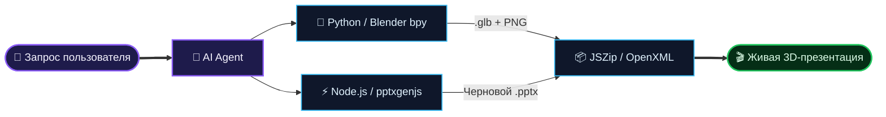
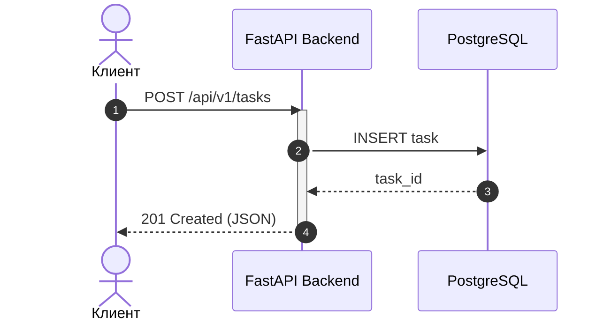
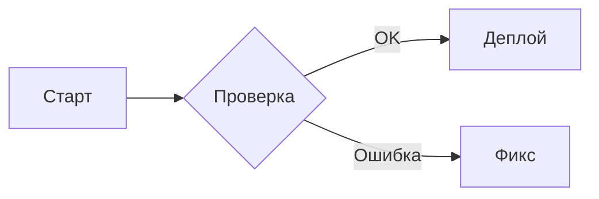
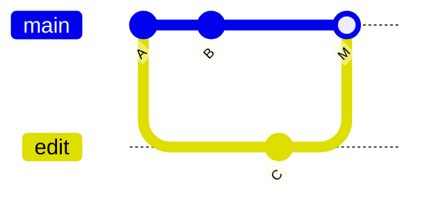

<picture>
  <source media="(max-width: 600px)" srcset="assets/banner-compact.svg">
  <source media="(prefers-color-scheme: dark)" srcset="assets/banner-dark.svg">
  <source media="(prefers-color-scheme: light)" srcset="assets/banner-light.svg">
  
</picture>

# Витрина шаблонов

Выбери обложку и скопируй Markdown из открывшегося шаблона.

<p align="center">
  <a href="templates/PROJECT-README-TEMPLATE.md"></a>
  <a href="templates/PROFILE-README-TEMPLATE.md"></a>
</p>

[Кинолаборатория](#кинолаборатория) · [Оглавление](#оглавление) · [Код витрины](#5-витрина-из-двух-обложек) · [Змейка для профиля](templates/profile-snake-workflow.yml)

## Кинолаборатория

На плёнке — короткая история двух веток. Проследи линии назад от кадра `M`: какие два коммита стали его родителями?

<p align="center">
  
</p>

<details>
<summary><b>Монтажный лист</b> · проверить ответ и забрать киноленту</summary>

Родители `M` — **`B` и `C`**. Коммит `A` есть в истории обеих веток, но он их общий предок, а не родитель `M`.

Скопируй [киноленту](assets/commit-reel.svg) в папку `assets/` своего репозитория и вставь строку ниже. Это иллюстрация, а не статистика репозитория: она проигрывается один раз, а при включённом уменьшении движения сразу показывает всю схему.

```markdown

```

Хочешь изобразить свои ветки? Вот [та же история на Mermaid](#граф-коммитов): вместо координат SVG редактируются имена веток и коммитов.

</details>

<details>
<summary><b>Проявочная</b> · сравнить «Ризограф» и «Фосфор»</summary>

Один хребет, два оттиска. У «Ризографа» видны точки типографского растра и чуть смещённая краска. У «Фосфора» те же вершины проступают на сетке экрана.

<p align="center">
  
  
</p>

| Оттиск | Фон `--paper` | Контур `--ink` | Акцент `--spot` |
|---|---|---|---|
| [Ризограф](assets/relief-riso.svg) | `#FFF1D9` | `#292948` | `#EF6747` |
| [Фосфор](assets/relief-phosphor.svg) | `#102622` | `#ADF2CB` | `#FFD182` |

Чтобы превратить пару в одну заставку, скопируй оба SVG в `assets/` и вставь этот блок. На светлой теме появится бумажный оттиск, на тёмной — экранный. Цвета меняются в `:root` каждого SVG.

```html
<picture>
  <source media="(prefers-color-scheme: dark)" srcset="assets/relief-phosphor.svg">
  <source media="(prefers-color-scheme: light)" srcset="assets/relief-riso.svg">
  
</picture>
```

</details>

## Оглавление

Нужен один элемент, а не целый шаблон? Выбери раздел ниже: рядом с примерами есть код для копирования.

1. [Бейджи и шилды (`Shields.io` + `Simple Icons`)](#1-бейджи-и-шилды-shieldsio--simple-icons)
2. [Квадратные иконки стека одной строкой (`Skill Icons`)](#2-квадратные-иконки-стека-одной-строкой-skill-icons)
3. [Живые SVG-анимации: печатная машинка, волны и свои баннеры](#3-живые-svg-анимации-печатная-машинка-волны-и-свои-баннеры)
4. [Цветные инфо-блоки GitHub Alerts](#4-цветные-инфо-блоки-github-alerts)
5. [Интерактивные векторные схемы `Mermaid`](#5-интерактивные-векторные-схемы-mermaid)
6. [Продвинутая вёрстка портфолио (сплит, темы `<picture>`, видео, `<kbd>`)](#6-продвинутая-вёрстка-портфолио-сплит-темы-picture-видео-kbd)
7. [Секретный репозиторий профиля (`overbaffe1/overbaffe1`) + змейка коммитов](#7-секретный-репозиторий-профиля-overbaffe1overbaffe1--змейка-коммитов)


## 1. Бейджи и шилды (`Shields.io` + `Simple Icons`)

Цветные кнопки-плашки рисует на лету бесплатный сервис **[Shields.io](https://shields.io/)** в векторном формате `SVG` (скачивать файлы в репо не нужно), а логотипы брендов берутся из каталога **[Simple Icons](https://simpleicons.org/)** (более 3000 иконок).

### Формула статичного бейджа за 10 секунд

```text
https://img.shields.io/badge/<ЛЕВЫЙ_ТЕКСТ>-<ПРАВЫЙ_ТЕКСТ>-<HEX_ЦВЕТ>?style=flat-square&logo=<ИКОНКА>&logoColor=white
```

* **Двухчастный бейдж:** -EA7600?style=flat-square&logo=blender&logoColor=white)
  ```markdown
  -EA7600?style=flat-square&logo=blender&logoColor=white)
  ```
* **Одночастная цветная плашка (без серой левой части):** 
  ```markdown
  
  ```

### Таблица спецсимволов и параметров URL

| Символ в тексте | Замена в ссылке | Пример | Параметр `?` | За что отвечает |
|---|---|---|---|---|
| Пробел ` ` | `_` или `%20` | `AI%20Agent` → `AI Agent` | `style=` | `flat`, `flat-square`, `for-the-badge`, `plastic`, `social` |
| Дефис `-` | `--` | `UTF--8` → `UTF-8` | `logo=` | Slug иконки с [simpleicons.org](https://simpleicons.org/) (`python`, `docker`) |
| Подчёркивание `_` | `__` | `my__var` → `my_var` | `logoColor=` | Цвет иконки (`white`, `black`, `FFD43B`) |
| Плюс `+` | `%2B` | `C%2B%2B` → `C++` | `labelColor=` | Цвет левой части (`1E293B`, `000000`) |
| Процент `%` | `%25` | `100%25` → `100%` | `color=` | Переопределение цвета правой части |

### Все 5 стилей лицом к лицу

| Стиль | Живой рендер | Где смотрится лучше всего |
|---|---|---|
| `flat` |  | Универсальная классика по умолчанию |
| `flat-square` |  | Строгие инженерные проекты и компактные шапки |
| `for-the-badge` |  | Крупные акцентные кнопки навигации («Демо», «Доки», «Скачать») |
| `plastic` |  | Глянцевый объёмный стиль |
| `social` |  | Нативные счётчики звёзд и форков |

### Кликабельные кнопки-ссылки

Чтобы плашка работала как настоящая кнопка, оберни картинку в Markdown-ссылку `[](адрес)`:

[](https://github.com/overbaffe1/MyWorkAiBrain)
[](templates/PROJECT-README-TEMPLATE.md)

```markdown
[](https://github.com/overbaffe1/MyWorkAiBrain)
```

### Витрина готовых бейджей технологий (Copy & Paste)

| Превью | Готовый Markdown-код |
|---|---|
|  | `` |
|  | `` |
|  | `` |
|  | `` |
|  | `` |
|  | `` |
|  | `` |
|  | `` |
|  | `` |
|  | `` |
|  | `` |
|  | `` |
|  | `` |
|  | `` |
|  | `` |

### Динамические бейджи GitHub API и GitHub Actions

Строка показателей для этого репозитория:


| Метрика | Живой пример | Шаблон |
|---|---|---|
| Последний коммит |  | `https://img.shields.io/github/last-commit/<USER>/<REPO>?style=flat-square` |
| Размер репо |  | `https://img.shields.io/github/repo-size/<USER>/<REPO>?style=flat-square` |
| Главный язык |  | `https://img.shields.io/github/languages/top/<USER>/<REPO>?style=flat-square` |
| Звёзды |  | `https://img.shields.io/github/stars/<USER>/<REPO>?style=flat-square` |
| Статус GitHub Actions | `build \| passing` | `https://img.shields.io/github/actions/workflow/status/<USER>/<REPO>/ci.yml?style=flat-square&logo=githubactions&logoColor=white` |


## 2. Квадратные иконки стека одной строкой (`Skill Icons`)

Сервис **[skillicons.dev](https://skillicons.dev/)** собирает квадратные иконки приложений в единую плитку по списку через запятую (`&theme=dark` или `light`, `&perline=8`):

**Python / AI / 3D:**


```markdown

```

**Fullstack Web & DevOps:**


```markdown

```


## 3. Живые SVG-анимации: печатная машинка, волны и свои баннеры

GitHub режет JavaScript, но **полностью разрешает SMIL `<animate>` / `<animateTransform>` внутри `.svg`-картинок**.

### А) Самопечатающийся текст — [Readme Typing SVG](https://readme-typing-svg.demolab.com/demo/)


```markdown

```

### Б) Плывущая градиентная волна — [Capsule Render](https://github.com/kyechan99/capsule-render)


```markdown

```

### В) Профи-уровень: собственные локальные `.svg` в папке `assets/`

Внешние сервисы иногда уходят в офлайн, а **локальный `.svg` внутри самого репозитория** грузится мгновенно, никогда не падает и позволяет верстать любую анимацию (посмотри исходники [`assets/banner-dark.svg`](assets/banner-dark.svg) и [`assets/banner-light.svg`](assets/banner-light.svg) в этом репо!).

> [!WARNING]
> **Важная тонкость SVG в браузерах:** если двигаешь группу `<g transform="translate(860, 50)">`, не вешай на этот же `<g>` CSS `@keyframes { transform: translateY(...) }` — CSS перетрёт координаты `860, 50` в `0, 0`. Вкладывай внутрь дочерний `<g>` с нативным `<animateTransform attributeName="transform" type="translate" .../>`.


## 4. Цветные инфо-блоки GitHub Alerts

Нативная замена обычным серым цитатам `>` — 5 системных плашек с иконками и цветной рамкой:

> [!NOTE]
> **Заметка (`[!NOTE]`):** Полезный контекст или справочная деталь, на которую стоит обратить внимание.

> [!TIP]
> **Совет (`[!TIP]`):** Лайфхак, ускоряющий работу — например, запуск в быстром режиме `FAST=1`.

> [!IMPORTANT]
> **Важно (`[!IMPORTANT]`):** Ключевое требование, без которого проект не запустится как задумано.

> [!WARNING]
> **Внимание (`[!WARNING]`):** Потенциальный подводный камень или ограничение совместимости.

> [!CAUTION]
> **Опасно (`[!CAUTION]`):** Действие может удалить данные или сломать сборку.

```markdown
> [!TIP]
> Текст зелёного блока с лампочкой.
```


## 5. Интерактивные векторные схемы `Mermaid`

Блок кода с языком `mermaid` превращается на GitHub в масштабируемую векторную диаграмму без единого графического файла:

### Архитектурный пайплайн с кастомными цветами



### Sequence-диаграмма взаимодействия сервисов



````markdown

````

### Граф коммитов

Та же склейка, что в [кинолаборатории](#кинолаборатория), но без рисунка: `branch` создаёт ветку, `checkout` переключает текущую, а `merge` сливает указанную ветку в текущую.



<details>
<summary>Скопировать Markdown для своей истории</summary>

````markdown

````

</details>


## 6. Продвинутая вёрстка портфолио (сплит, темы `<picture>`, видео, `<kbd>`)

### 1) Автоматическая смена баннера под тёмную и светлую тему GitHub (`<picture>`)

Браузер берёт первый подходящий `<source>`. В шапке этой страницы на экранах до 600 пикселей показывается [короткая обложка](assets/banner-compact.svg) с крупным названием. На широких экранах остаётся полный баннер под цвет темы:

```html
<picture>
  <source media="(max-width: 600px)" srcset="assets/banner-compact.svg">
  <source media="(prefers-color-scheme: dark)" srcset="assets/banner-dark.svg">
  <source media="(prefers-color-scheme: light)" srcset="assets/banner-light.svg">
  
</picture>
```

### 2) Сплит-вёрстка: текст слева + живая гифка справа

```html


### Главные возможности
* Пункт описания слева от анимации
* Второй пункт описания
* Третий пункт описания

<br clear="right"/>
```

### 3) Спойлеры `<details>` и физические клавиши `<kbd>`

Сочетания вроде <kbd>Ctrl</kbd> + <kbd>Shift</kbd> + <kbd>P</kbd> или <kbd>⌘ Cmd</kbd> + <kbd>K</kbd> пишутся через тег `<kbd>Ctrl</kbd>`, а большие скриншоты и логи удобно прятать под кат:

<details>
<summary><b>Нажми, чтобы развернуть пример спойлера</b></summary>
<br>
Сюда отлично прячутся длинные таблицы, переменные окружения <code>.env</code> или большие контакт-листы слайдов, чтобы не перегружать первый экран.
</details>

```html
<details>
<summary><b>Заголовок спойлера</b></summary>
<br>
Скрытый контент или большая картинка.
</details>
```

### 4) Настоящий `.mp4`-видеоплеер без утяжеления git-репозитория

Открой редактирование `README.md` прямо в веб-интерфейсе GitHub и **перетащи файл `.mp4` или `.mov` мышкой в текстовое поле**. GitHub загрузит ролик на свой внутренний CDN (`github.com/user-attachments/assets/...`) и вставит нативный видеоплеер со звуком и перемоткой, а сам репозиторий останется лёгким!

### 5) Витрина из двух обложек

В [витрине в начале страницы](#витрина-шаблонов) каждая обложка — обычная ссылка с локальным SVG внутри. Скопируй [«Чертёж»](assets/cover-project.svg) и [«Созвездие»](assets/cover-profile.svg) в папку `assets/` рядом со своим `README.md`. В `href` подставь пути к своим страницам:

```html
<p align="center">
  <a href="templates/PROJECT-README-TEMPLATE.md"></a>
  <a href="templates/PROFILE-README-TEMPLATE.md"></a>
</p>
```

Не склеивай теги `</a>` и `<a>`: пробел или перенос строки между ними позволяет обложкам встать друг под другом на узком экране. Чтобы перекрасить карточку, поменяй `--paper` (фон) и `--accent` (акцент) в её SVG. Рядом в `@media (prefers-color-scheme: dark)` лежит тёмная палитра. Если включено уменьшение движения, обе иллюстрации сразу показываются в финальном виде.


## 7. Секретный репозиторий профиля (`overbaffe1/overbaffe1`) + змейка коммитов

Если создать публичный репозиторий с именем **один в один как твой логин** (`overbaffe1/overbaffe1`), его `README.md` станет витриной прямо на главной странице твоего профиля **[github.com/overbaffe1](https://github.com/overbaffe1)**.

Что заготовлено в папке [`templates/`](templates/):
1. **[`templates/PROFILE-README-TEMPLATE.md`](templates/PROFILE-README-TEMPLATE.md)** — полностью собранный шаблон главной страницы профиля (волна, печатающийся подзаголовок, кнопки соцсетей, плитка стека, витрина лучших репозиториев и адаптивный блок со змейкой).
2. **[`templates/profile-snake-workflow.yml`](templates/profile-snake-workflow.yml)** — готовый воркфлоу GitHub Actions (`Platane/snk`), который раз в сутки сам рисует анимацию змейки, поедающей твои зелёные квадратики коммитов, сразу в двух версиях (для светлой и тёмной темы GitHub) в отдельную ветку `output`!
3. **[`templates/PROJECT-README-TEMPLATE.md`](templates/PROJECT-README-TEMPLATE.md)** — универсальный каркас вау-ридмика для любого нового проекта в портфолио.

---

## Полезные конструкторы в закладки

* **[shields.io](https://shields.io/)** — генератор любых статичных и динамических бейджей.
* **[simpleicons.org](https://simpleicons.org/)** — 3000+ логотипов брендов и их фирменные HEX-цвета.
* **[skillicons.dev](https://skillicons.dev/)** — плитки квадратных иконок стека.
* **[readme-typing-svg.demolab.com/demo](https://readme-typing-svg.demolab.com/demo/)** — визуальный редактор печатающегося SVG-текста.
* **[mermaid.live](https://mermaid.live/)** — песочница с предпросмотром диаграмм `Mermaid`.
* **[ileriayo/markdown-badges](https://github.com/Ileriayo/markdown-badges)** — огромная коллекция готовых бейджей.

[↑ К витрине шаблонов](#витрина-шаблонов)
