<p align="center"><a href="assets/night-shift/fold.gif"></a><a href="assets/night-shift/weeks-tape.svg">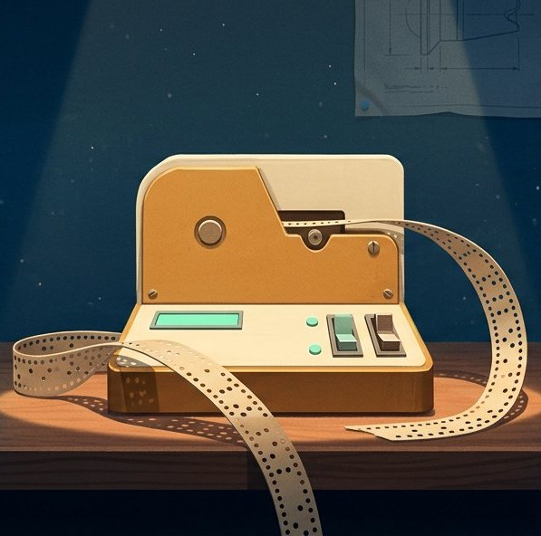</a><a href="assets/night-shift/moth-projector.svg"></a></p>

<p align="center">
  <em>Три кадра — <a href="assets/night-shift/bench-master.jpg">одна панорама</a>.</em><br>
  <picture></picture>
</p>

## Зеркальный конёк

<p align="center"><a href="assets/catoptric/sheet-a4.pdf"><picture>
  <source media="(max-width: 540px)" srcset="assets/catoptric/mirror.png">
  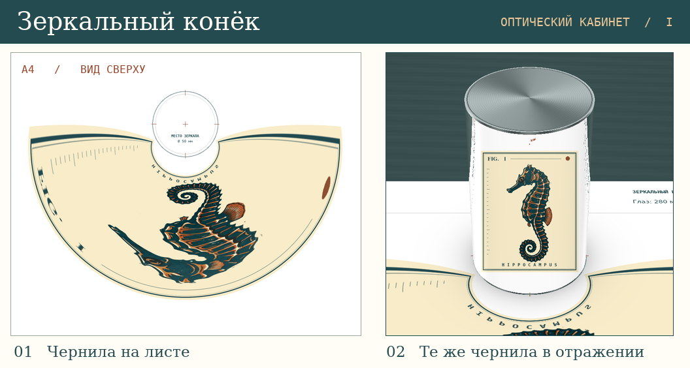
</picture></a></p>

На листе медная отметка вытянута в овал. В цилиндрическом зеркале она становится круглой, хвост сворачивается спиралью, а надпись **HIPPOCAMPUS** снова читается слева направо. Это зеркальная анаморфоза: вид в зеркале рассчитан по готовому отпечатку, а не по картинке конька.

[Лист A4 для печати (PDF)](assets/catoptric/sheet-a4.pdf?raw=true) · [оба вида рядом (PNG)](assets/catoptric/proof.png) · [проследить луч без настоящего зеркала (ZIP)](assets/catoptric/bench.zip?raw=true).

На столе: печатай в масштабе **100 %** и поставь на круг гладкий зеркальный цилиндр **Ø 50 мм** высотой от 80 мм. Глаз — со стороны стрелки, в 28 см от оси по столу и в 24 см над листом. Без печати: распакуй ZIP, открой `mirror.html` и коснись глаза конька — второй прицел найдёт его на бумаге.

## Одна форма, три тени

<p align="center"><a href="assets/shadow-type/git.stl"><picture>
  <source media="(prefers-reduced-motion: reduce)" srcset="assets/shadow-type/proof.png">
  
</picture></a></p>

Спереди видна **G**. Четверть оборота — и на её месте **I**. Сверху читается **T**. Меняется только ракурс: во всех трёх случаях это те же 114 кубиков.

[Повернуть фигуру самому (STL)](assets/shadow-type/git.stl) · [три проекции без движения (PNG)](assets/shadow-type/proof.png).

## Медуза, записанная звуком

<p align="center"><a href="assets/aurelia/swim.gif"><picture>
  <source media="(prefers-reduced-motion: reduce)" srcset="assets/aurelia/trace.png">
  
</picture></a></p>

В `aurelia.wav` нет ни одного видеокадра. Высота оранжевой дорожки в отмеченной точке задаёт **X**, высота сиреневой в тот же момент — **Y**. За 800 таких пар луч обводит медузу целиком. Этот GIF построен из готового WAV.

[Забрать стерео-WAV (4 секунды)](assets/aurelia/aurelia.wav?raw=true) · [карманный осциллограф (ZIP)](assets/aurelia/scope.zip?raw=true) · [кадр без движения (PNG)](assets/aurelia/trace.png).

Распакуй ZIP, открой `aurelia.html` и переключи **«Стерео» → «Моно»**. Медуза сложится в диагональ: на обе оси теперь идёт одно и то же значение. Это видно даже на паузе; сеть и звук не нужны.

## Сумеречный лист

<p align="center"><a href="assets/twilight/proof.png"></a></p>

Кто смотрит на тебя с листа? На белой странице — **лисица**, на тёмной — **сипуха**. Посмотри на зрачки: у обоих они на одной высоте. Это один прозрачный PNG, а не две картинки, которые README подбирает по теме.

<details open>
<summary>Подложить оба фона рядом, не меняя тему</summary>

<a href="assets/twilight/proof.png"></a>

Если просмотрщик обозначает прозрачность серой «шахматкой», на ней могут проступить оба рисунка.

</details>

[Забрать прозрачный лист](assets/twilight/glass.png?raw=true) · [световой стол с ползунком (ZIP)](assets/twilight/table.zip?raw=true). Распакуй архив и открой `table.html`: границу белой бумаги можно провести прямо между глазами.

## Шрифт-кладовщик

<p align="center"><a href="assets/typecase/delivery.gif"><picture>
  <source media="(prefers-reduced-motion: reduce)" srcset="assets/typecase/proof.png">
  
</picture></a></p>

`0866` — ящик застрял у правой стены. Сотри последнюю шестёрку: получится `086`, и ящик отойдёт на клетку назад. **Это одно текстовое поле.** В шрифте *Typecase Dock* каждому положению робота и ящика соответствует свой знак. Кадры GIF отпечатаны этим шрифтом; сыграть можно в офлайн-пробнике.

[Сыграть без установки шрифта (ZIP)](assets/typecase/typecase.zip?raw=true) · [забрать сам TTF](assets/typecase/dock.ttf?raw=true) · [два оттиска до и после Backspace](assets/typecase/proof.png).

Распакуй ZIP и открой `dock.html`. Доведи ящик с крестом до ромба: **8** ↑, **4** ←, **2** ↓, **6** →. Поставь галочку «Снять шрифт» — вместо комнаты увидишь свой маршрут цифрами.

## Бумажный кристалл

**Кристалл в 3D:** [студия «Грань» — текстуры и движение](https://rawcdn.githack.com/overbaffe1/gitEdit/7b8b2cb05c77223867c772de0d411330f1eddc9f/docs/index.html) · [синий просмотрщик GitHub — отдельный STL](assets/crystal.stl).

<p align="center"><a href="assets/night-shift/fold.gif"><picture>
  <source media="(prefers-reduced-motion: reduce)" srcset="assets/night-shift/fold-still.png">
  
</picture></a></p>

**01 / Форма.** У кристалла разрезали пять рёбер. Остальные семь работают как сгибы: зелёные грани расходятся веером, абрикосовые ложатся вдоль края. Проследи за штрихами на любой грани — бумага поворачивается, но не растягивается.

<details open>
<summary><b>Разложить выкройку на столе</b></summary>

<a href="assets/night-shift/crystal-net.svg"></a>

Это раскрой именно этой модели. Режь по сплошным линиям, сгибай по пунктиру; **A** соединяется с **A**, **B** с **B** и так далее. Внизу листа — линейка 30 мм для проверки масштаба при печати.

</details>

<a href="assets/night-shift/weeks-tape.svg"></a>

### Покрути кристалл

<p><a href="https://rawcdn.githack.com/overbaffe1/gitEdit/7b8b2cb05c77223867c772de0d411330f1eddc9f/docs/index.html"><picture>
  <source media="(prefers-reduced-motion: reduce)" srcset="docs/poster.jpg">
  
</picture></a></p>

**Малахитовая капсула.** Прожилки нанесены на те же восемь граней бумажного кристалла. За один оборот можно увидеть и камень снаружи, и гравировку на обратной стороне створок. Здесь идёт восьмисекундная кинопетля — раскрывать картинки не нужно.

**[Открыть 3D-студию «Грань» →](https://rawcdn.githack.com/overbaffe1/gitEdit/7b8b2cb05c77223867c772de0d411330f1eddc9f/docs/index.html)** · **[Включить парусник из MyWorkAiBrain →](https://rawcdn.githack.com/overbaffe1/gitEdit/7b8b2cb05c77223867c772de0d411330f1eddc9f/docs/index.html?scene=ship)**

Без текстур и клипа: **[открыть тот же кристалл в синем просмотрщике GitHub (STL)](assets/crystal.stl)**.

При первом открытии студии CDN может попросить подтвердить переход к странице `gitEdit`. В студии можно потянуть модель мышью или пальцем, остановить клип и передвинуть ползунок времени. У парусника проигрывается его собственная анимация парусов, волн и чайки. Можно открыть свой GLB или STL; для STL — добавить рисунок на поверхность. [Та же студия для работы без сети (ZIP)](https://github.com/overbaffe1/gitEdit/raw/refs/heads/main/assets/crystal-view.zip): распакуй и открой `crystal.html`. Паруснику при первом открытии нужен интернет или скачанный `ship.glb`.

### Кейс проекта

**Один кристалл, два прохода.** Слева — рёбра на чертёжной сетке, справа — те же грани под цветным светом. Граница сама проходит по рисунку. Верхушка не смещается: положение камеры в обоих кадрах одинаковое.

<p><a href="assets/crystal-wipe.gif"><picture>
  <source media="(prefers-reduced-motion: reduce)" srcset="assets/crystal-wipe.png">
  
</picture></a></p>

<details open>
<summary>Положить оба кадра рядом и рассмотреть без движения</summary>

<a href="assets/crystal-wire.png">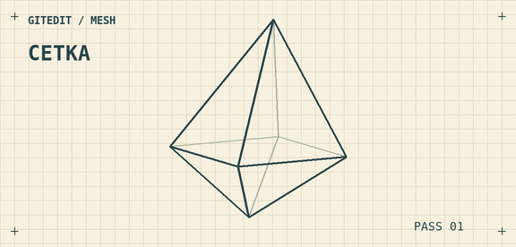</a> <a href="assets/crystal-light.png">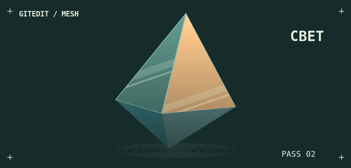</a>

</details>

**Оттиск для терминала.** Тот же вид умещается в 20 столбцов текста. Светлые и тёмные знаки заменяют краску; этот кристалл останется виден даже без загрузки картинок.

<pre>
           ▒
          ▒▓▓
         ▒▒▓▓▓
        ▒▒▒▓▓▓
       ▒▒▒▓▓▓▓▓
     ▒▒▒▒▒▓▓▓▓▓▓
    ▒▒▒▒▒▒▓▓▓▓▓▓▓
   ▒▒▒▒▒▒▓▓▓▓▓▓▓▓
  ▒▒▒▒▒▒▒▓▓▓▓▓▓▓▓▓
 ▒▒▒▒▒▒▒▒▓▓▓▓▓▓▓▓▓▓
░▒▒▒▒▒▒▒▓▓▓▓▓▓▓▓▓▓▓▓
  ░░░░▒▒▓▓▓▓▓▓░░░░░
   ░░░░░░░░░░░░░░
     ░░░░░░░░░░
       ░░░░░
        ░░
</pre>

## Перфолента

<p align="center"><a href="assets/night-shift/weeks-tape.svg"><picture>
  <source media="(max-width: 600px)" srcset="assets/night-shift/weeks-tape-compact.svg">
  
</picture></a></p>

**02 / Данные.** У каждой недели свой столбец. Тёмный круг — пробитое отверстие: сложи веса напротив таких кругов. Ряд маленьких точек нужен для подачи ленты и в сумму не входит.

Это **398 коммитов LazyGit** за 6 января — 27 апреля 2025 года, не активность автора профиля. Издалека две выделенные недели почти одинаковы. **Чем № 15 отличается от № 07?**

<details open>
<summary><b>Положить колонки рядом и прочитать код</b></summary>

<a href="assets/night-shift/weeks-key.svg">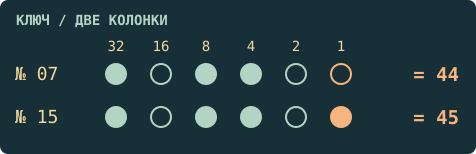</a>

**Одним отверстием в дорожке 1.** 17–23 февраля — 44 коммита, 14–20 апреля — 45. Те же шестнадцать недель превратились в [календарь](assets/snake-weeks.gif) и [квартал](assets/weekly-skyline.stl).

</details>

<a href="assets/night-shift/moth-projector.svg"></a>

### Приёмы из других README

#### Город вкладов

<p><a href="assets/contribution-city.gif"><picture>
  <source media="(prefers-reduced-motion: reduce)" srcset="assets/contribution-city.png">
  
</picture></a></p>

Башни растут прямо здесь. Первый кадр показывает **весь город**, а движение повторяется, так что его не пропустишь при прокрутке. В режиме уменьшенного движения останется тот же ночной вид. Это календарь из демонстрации **yoshi389111** за 2021–2022 годы, не статистика этого профиля. Это иллюстрация, а не вращаемая сцена. Для вращения есть [отдельный STL квартала](assets/weekly-skyline.stl).

#### Змейка на календаре

<p><a href="assets/snake-weeks.gif"><picture>
  <source media="(prefers-reduced-motion: reduce)" srcset="assets/snake-weeks.png">
  
</picture></a></p>

Один столбец — неделя, верхняя клетка — понедельник. Змейка гасит клетки по пути; чем светлее нетронутая клетка, тем больше в тот день было коммитов. Это наш рисунок по истории **LazyGit**: 398 коммитов за 16 недель, с 6 января по 27 апреля 2025 года. Ни бот, ни вход в аккаунт для просмотра не нужны.

#### Квартал в 3D

Каждый дом — одна неделя из календаря LazyGit, единица высоты — один коммит. На рисунке тот же квартал, что и в STL. Найди самый высокий дом и сравни его с соседями.

<p><a href="assets/weekly-skyline.stl">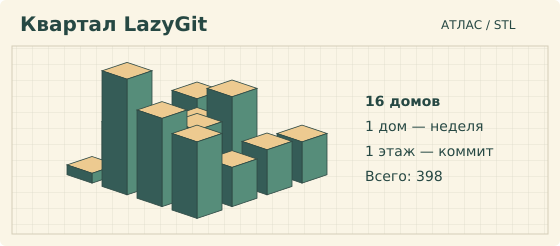</a></p>

[Повернуть квартал на GitHub (STL)](assets/weekly-skyline.stl) · [открыть рисунок (SVG)](assets/weekly-skyline.svg)

<details open>
<summary>Какая неделя оказалась самой высокой?</summary>

**7–13 апреля: 59 коммитов.** Следующая неделя дала 45. В анимации клетки показывают отдельные дни, а в квартале хорошо видна сумма за неделю.

</details>

## Театр теней

<p align="center"><a href="assets/night-shift/moth-projector.svg"><picture>
  <source media="(max-width: 600px) and (prefers-reduced-motion: no-preference)" srcset="assets/night-shift/moth-projector-compact.svg">
  <source media="(max-width: 600px)" srcset="assets/night-shift/moth-still-compact.svg">
  <source media="(prefers-reduced-motion: no-preference)" srcset="assets/night-shift/moth-projector.svg">
  
</picture></a></p>

**03 / Движение.** В первом окне мотылёк машет крыльями, хотя рисунок под решёткой неподвижен. Сдвинулась решётка — в просвет попали полоски следующей позы. Во втором окне для сравнения та же фаза целиком.

Одна позиция держится 1,4 секунды. Здесь решётка перемещается сама, не за курсором; при уменьшении движения остаётся неподвижная пара окон.

<details open>
<summary><b>Снять решётку и достать четыре кадра</b></summary>

**Так выглядит бумага без решётки.** На ней уже напечатаны все четыре положения крыльев вперемешку.

<a href="assets/night-shift/moth-paper.svg"></a>

**А это исходные позы.** Первую и третью легко различить даже без движения. Один миллиметр сдвига на печатном экземпляре меняет позу; четыре возвращают первую.

<a href="assets/night-shift/moth-poses.svg"></a>

</details>

<a href="assets/night-shift/bench-master.jpg"></a>

### Кинолаборатория

На плёнке — история двух веток. Какие коммиты стали родителями кадра `M`?

<a href="assets/commit-reel.svg"></a>

<details open>
<summary>Свериться с монтажным листом</summary>

**B и C.** Коммит A — их общий предок, а не родитель M.

</details>

#### Граф коммитов

Та же история в готовой диаграмме Mermaid. Сравни две линии с кинолентой выше.

<p><a href="assets/mermaid/commits.png">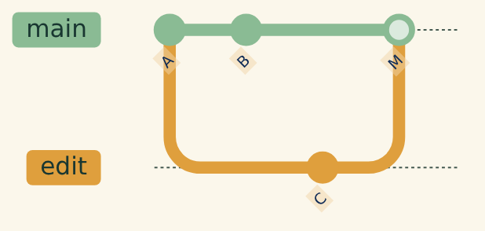</a></p>

#### Терминал в README

<p><a href="assets/facet-count.gif"><picture>
  <source media="(prefers-reduced-motion: reduce)" srcset="assets/facet-count.png">
  
</picture></a></p>

Команда ищет в STL строки `facet normal` и получает восемь граней. Это повторяющаяся запись терминала, не приглашение выполнить команду в браузере.

#### Партитура пауз

Три GIF на одной шкале. Справа — длительность одного цикла и ссылка на саму запись.

<pre>
 0    2    4    6  <b>t, с</b>  <b>ЛЕНТА</b>
╭┬────┬────┬────┬╮
│····▁▃▇▆▃▁      │ 3,71  <a href="/assets/facet-count.gif">Набор</a>
│··▂▅▅▅▅▂··▁▅▅▅▅▃│ 6,23  <a href="/assets/night-shift/fold.gif">Сгиб</a>
│██████████      │ 4,00  <a href="/assets/aurelia/swim.gif">Медуза</a>
╰────────────────╯
</pre>

Одна клетка — **0,4 с**. Высота — сколько кадров закончилось за это время: `·` — ни одного, `▁`…`█` — от 1 до 8. Пробел — за концом петли.

Первые **2 с** терминал держит на экране ответ «8». У кристалла пауза есть и в середине: развёртка лежит плоско **1,45 с**. У медузы полоска ровная — все 80 кадров длятся по **50 мс**.

[Забрать разметку партитуры](templates/blocks/cue-sheet.md?plain=1) · [построить по своим GIF](atlas/native.md).

#### Видео с перемоткой

Нажми ▶ в `commit_and_push.mp4`: это демонстрация коммита и отправки изменений из LazyGit. Здесь есть пауза и полоса перемотки; ролик не обязан стартовать сам.

https://github.com/user-attachments/assets/031799d1-740d-4cda-90cf-689513fa9860

#### Что осталось за кадром · D2

<a href="assets/staging.svg"></a>

На первом переходе выбранное содержимое попадает в индекс, на втором — в историю. Это готовый рисунок D2, а не ещё один нативный просмотрщик.

#### Шахматный этюд

Ход белых, мат в один. Белые: король g6 и ладья a7. Чёрные: король h8.

<a href="assets/mate-in-one.svg"></a>

<details open>
<summary>Проверить свой ход</summary>

**Лa8#**. Ладья даёт шах по восьмой горизонтали и отрезает g8. Белый король держит g7 и h7.

</details>

#### Проявочная

Один хребет, два оттиска. У «Ризографа» краска смещена относительно точечного растра. У «Фосфора» те же вершины светятся на сетке экрана.

<p align="center">
  <a href="assets/relief-riso.svg"></a>
  <a href="assets/relief-phosphor.svg"></a>
</p>

#### Картотека красок

<p align="center">
  <a href="assets/inkbook/press.svg"></a>
  <a href="assets/inkbook/blueprint.svg"></a>
  <a href="assets/inkbook/orbit.svg"></a>
</p>

На каждой карточке рисунок пересекает границу двух тем. Число в углу — контраст **текста с фоном**. Краски в каждой ячейке идут в порядке **фон · текст · акцент**.

| Светлая проба | Тёмная проба |
| :--- | :--- |
| **Ризограф**<br>`#FFF1D9` `#292948` `#EF6747` | **Фосфор**<br>`#102622` `#ADF2CB` `#FFD182` |
| **Чертёж**<br>`#F6F3FF` `#261D3C` `#61419A` | **Чертёж**<br>`#211B32` `#FAF5FF` `#D5BAFF` |
| **Созвездие**<br>`#EEF8F3` `#153B30` `#18654E` | **Созвездие**<br>`#142C27` `#F0FCF6` `#A0E8C9` |

У «Ризографа» тёмные буквы на кремовом дают **12,52:1**, а коралл на той же бумаге — только **2,81:1**. Поэтому кораллом напечатан диск, не мелкая подпись.

[Палитру для GIMP (.gpl)](assets/inkbook/inkbook.gpl?raw=true) можно импортировать целиком: в ней 18 подписанных красок. Для сайта есть [CSS-переменные для светлой и тёмной темы](assets/inkbook/inkbook.css) и [пример подключения](atlas/samples/inkbook/).

#### Печатный лист

<a href="atlas/samples/field-sheet.pdf"></a>

Это содержимое одностраничного PDF в виде PNG. Та же картинка размером 1280 × 640 подходит для карточки ссылки на репозиторий.

<p align="center">
  <picture></picture>
</p>

## Что умеет README на GitHub

### Оглавление

Выбери экспонат, чтобы открыть его файл.

- **Форма:** [конёк для цилиндрического зеркала](assets/catoptric/sheet-a4.pdf) · [литера G/I/T](assets/shadow-type/git.stl) · [два оттиска одного PNG](assets/twilight/proof.png) · [выкройка кристалла](assets/night-shift/crystal-net.svg) · [кинопетля капсулы](assets/crystal-theatre.gif) · [сетка и свет](assets/crystal-wipe.gif) · [обложка «Север»](assets/polar-cover.svg).
- **Данные:** [перфолента](assets/night-shift/weeks-tape.svg) · [город вкладов](assets/contribution-city.gif) · [отпечаток репозитория](assets/repo-fingerprint.svg) · [маршрут](assets/survey.geojson) · [соседние листы](assets/sheets.topojson) · [размеры файлов](assets/mermaid/file-sizes.png).
- **Движение:** [медуза из стереозаписи](assets/aurelia/swim.gif) · [театр теней](assets/night-shift/moth-projector.svg) · [кинолента](assets/commit-reel.svg) · [терминал](assets/facet-count.gif) · [видео с перемоткой](https://github.com/user-attachments/assets/031799d1-740d-4cda-90cf-689513fa9860).
- **Игры:** [наборный склад (ZIP)](assets/typecase/typecase.zip?raw=true) · [шахматный этюд](assets/mate-in-one.svg).
- **Своё портфолио:** [шаблон проекта](templates/PROJECT-README-TEMPLATE.md) · [шаблон профиля](templates/PROFILE-README-TEMPLATE.md) · [палитры](atlas/samples/palettes.csv).

## Мастерская оформления

### Живой фон: где проходит край

<p><a href="assets/polar-cover.svg"><picture>
  <source media="(max-width: 600px) and (prefers-reduced-motion: no-preference)" srcset="assets/polar-cover-compact.svg">
  <source media="(max-width: 600px)" srcset="assets/polar-cover-compact-still.svg">
  <source media="(prefers-reduced-motion: no-preference)" srcset="assets/polar-cover.svg">
  
</picture></a></p>

На обложке **«Север»** посмотри на ближний берег: он сдвигается заметнее дальнего хребта. Световая завеса плывёт чуть вверх, а луна и заголовок стоят на месте. Открывать картинку не нужно. На узком экране луна остаётся в кадре, при системном уменьшении движения браузер выбирает неподвижную обложку.

Это **фон внутри картинки**, а не подложка под Markdown. За обычные заголовки и списки GitHub свой фон поставить не даёт. Для сравнения — тот же пейзаж на отдельной HTML-странице:

<details open>
<summary>Посмотреть, как выглядит фон за настоящим текстом сайта</summary>

<p><a href="assets/polar-page.png"><picture>
  <source media="(max-width: 600px)" srcset="assets/polar-page-compact.png">
  
</picture></a></p>

Здесь показан **снимок**. На самой странице текст можно выделить, прокрутить до оттисков и остановить фон, не останавливая прокрутку. Для просмотра выставки покидать README не нужно.

</details>

### Два оттиска одного кольца

<p align="center">
  <a href="assets/ring-pen.svg"></a>
  <a href="assets/ring-screen.svg"></a>
</p>

Геометрия и камера одни и те же. **Перо** показывает изгиб линией; **растр** собирает свет из ячеек 4 × 4. Прищурься: отверстие видно на обеих карточках, хотя во второй нет ни одного обводящего штриха.

### Марки вместо меню

<p align="center">
  <a href="assets/crystal.stl"></a>
  <a href="assets/weekly-skyline.stl"></a>
  <a href="assets/commit-reel.svg"></a>
</p>

Марки открывают три файла: кристалл и квартал в формате STL и киноленту в SVG. Имя проекта задаёт число лепестков, поворот и краску. У «Кристалла» по окружности медленно идёт надпись, сама розетка и подпись не вращаются.

### Форзац из одной плитки

<a href="assets/tile-frieze.svg">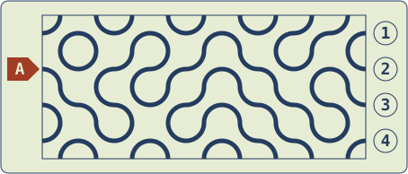</a>

Квадрат с двумя дугами можно оставить как есть или повернуть на четверть оборота. Получился узор для разделителя глав. **К какому номеру ведёт линия от А?**

<details open>
<summary>Проявить дорожку</summary>

<a href="assets/tile-route.svg"></a>

**А → 3.** Дорожка проходит 30 дуг. Плитки не поменялись: поверх тех же линий напечатан пунктир.

</details>

## Витрина шаблонов

Выбери обложку. «Чертёж» ведёт к сравнению сетки и света, «Созвездие» — к печатной подписи профиля.

<p align="center">
  <a href="assets/crystal-wipe.gif"></a>
  <a href="assets/portfolio-signature.svg"></a>
</p>

### Карточка профиля

<a href="assets/portfolio-signature.svg"></a>

Верхняя строка задаёт тему мастерской. Ниже — не список навыков, а пример работы с данными: вот что лежит внутри одного проекта.

### Отпечаток репозитория

<p><a href="assets/repo-fingerprint.svg"><picture>
  <source media="(max-width: 600px)" srcset="assets/repo-fingerprint-compact.svg">
  
</picture></a></p>

Один круг — один файл. Площадь соответствует числу байтов, цвет и внешний контур — каталогу первого уровня. Это снимок `gitEdit` на [коммите `11ea344`](https://github.com/overbaffe1/gitEdit/tree/11ea34407408f20f95becf35607f6f0e3b1c6394), **до** добавления этой карты, а не постоянно обновляемый счётчик. Площади посчитаны по размерам Git-блобов до сжатия.

<details open>
<summary>Что за самый большой круг с надписью SVG?</summary>

Это [рисунок «File → Index → Commit»](assets/staging.svg). В этом срезе он занимает 77 397 байт. У соседнего GIF с записью терминала — 61 627 байт. Так по отпечатку можно найти тяжёлую иллюстрацию, не просматривая каталоги.

</details>

### Карманное портфолио

Вместо списка навыков — по одному числу на работу. Нажми число на поле: откроется не главная репозитория, а именно тот кадр, расчёт или фрагмент кода, из которого оно взялось.

<table>
<thead>
<tr><th colspan="2" align="left"><sub>ЛИЧНЫЙ ТИРАЖ · № 01 · overbaffe1</sub><br>Три числа</th></tr>
</thead>
<tbody>
<tr>
<th scope="row" align="center"><a href="https://github.com/overbaffe1/OMLP/blob/1a4aa4a40c62e6b5e06d3d1db4aa0c4e16094e7e/docs/figures/detection.png" title="Термоснимок и маска"><strong>44</strong><br><sub>пикселя</sub></a></th>
<td><sub>02–03 · OMLP</sub><br><strong>След на тепловом кадре</strong><br>В маске кадра VIIRS огнём помечены 44 пикселя. Цветное наложение показывает попадания, пропуски и ложные тревоги детектора.<br><a href="https://github.com/overbaffe1/OMLP/blob/1a4aa4a40c62e6b5e06d3d1db4aa0c4e16094e7e/tools/make_figures.py#L45-L81">Как собран кадр</a></td>
</tr>
<tr>
<th scope="row" align="center"><a href="https://github.com/overbaffe1/CosmoH/blob/6cd3197af0412c22b782d90dbefde266cffdddad/solutions/fuel-contour/docs/evidence/response-grid.csv" title="Таблица расчёта"><strong>35</strong><br><sub>сценариев</sub></a></th>
<td><sub>04–05 · CosmoH</sub><br><strong>Цена опоздания</strong><br>При полном срыве поставки заказ в день сбоя закрывает дефицит. Если отложить заказ на 90 дней, не хватит 14,73 т.<br><a href="https://github.com/overbaffe1/CosmoH/blob/6cd3197af0412c22b782d90dbefde266cffdddad/solutions/fuel-contour/docs/evidence/response-grid.svg">Матрица сценариев</a></td>
</tr>
<tr>
<th scope="row" align="center"><a href="https://github.com/overbaffe1/MyWorkAiBrain/blob/3cbd01a7c9b6fa174be3dc6f96419df6f2db1db2/presentations/cantillon/models/make_models.py#L445-L463" title="Сборка струн арфы"><strong>13</strong><br><sub>струн</sub></a></th>
<td><sub>06–07 · MyWorkAiBrain</sub><br><strong>Глиссандо на слайде</strong><br>У каждой струны арфы своя кость. Колебание идёт по струнам и обратно. В PowerPoint движется сама модель, не видео.<br><a href="https://github.com/overbaffe1/MyWorkAiBrain/blob/3cbd01a7c9b6fa174be3dc6f96419df6f2db1db2/exports/cantillon-3d-presentation.pptx?raw=true">Презентация (.pptx)</a></td>
</tr>
</tbody>
</table>

Номера рядом с названиями проектов — страницы карманной книги. Вот разворот **04–05** из готового печатного листа:

<a href="assets/pocket-folio/issue-a4.pdf">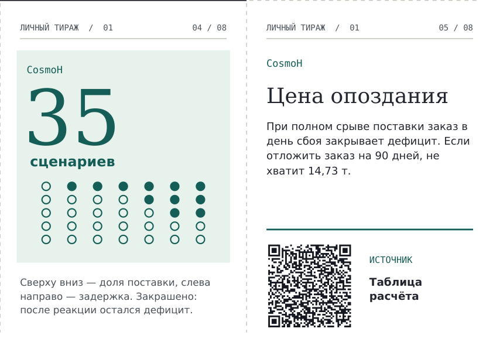</a>

[Скопировать блок в профиль](templates/blocks/pocket-folio.md?plain=1) · [лист A4 для печати (PDF)](assets/pocket-folio/issue-a4.pdf?raw=true) · [как сложить книжку или выпустить свою](atlas/samples/pocket_folio/). Один лист, один разрез, восемь страниц. На бумаге к источникам ведут QR-коды.

### Витрина визуальных находок — полистай и забирай

Хочешь что-то необычное, анимированное и сразу красивое? Все эти SVG живут прямо в репозитории — без внешних серверов, печатаются и уважают `prefers-reduced-motion`.

<p align="center"><a href="assets/neon-pill.svg">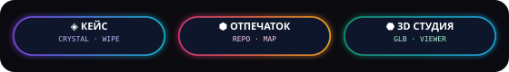</a></p>

**Неоновые пилюли** — круглые кнопки с градиентом и мягким свечением. Три ссылки в одном файле. Меняешь текст, цвет и `href` — получаешь свои. [Исходник SVG](assets/neon-pill.svg) · как и у [марок проекта](assets/seal-crystal.svg), только ярче.

<p align="center"><a href="assets/orbit-stack.svg">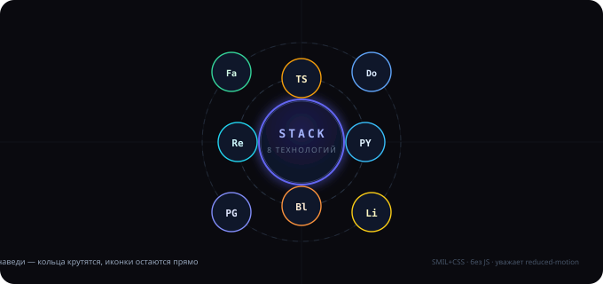</a></p>

**Орбита стека** — 8 технологий на двух вращающихся кольцах. Иконки остаются прямо, пока орбиты крутятся. Чистый SVG+CSS, без JS и внешних картинок. [Файл](assets/orbit-stack.svg) · пересобрать: `python3 atlas/samples/orbit-stack.py` · альтернатива плоской стене [skillicons](https://skillicons.dev).

<p align="center"><a href="assets/glass-panel.svg"></a></p>

**Стеклянная панель** — модный glassmorphism: размытые пятна + полупрозрачное стекло. Меняешь заголовок и бейджи — готова шапка или карточка секции. [Файл](assets/glass-panel.svg) · пересобрать: `python3 atlas/samples/glass-panel.py`.

<p align="center"><a href="assets/pixel-night.svg"></a></p>

**Пиксельная ночь** — ретро-пиксель-арт: город из блоков, призрак парит и моргает, окна и звёзды мерцают. Каждый пиксель — прямоугольник, анимация — чистый SMIL, без веб-шрифтов. [Файл](assets/pixel-night.svg) · пересобрать: `python3 atlas/samples/pixel-night.py` · идея из [pixel-profile](https://github.com/sknoyon324234234234/pixel-profile), рисунок свой.

<p align="center"><a href="assets/hologram-card.svg"></a></p>

**Голографическая карточка** — проектор с вращающимся глобусом-паутинкой, две орбиты и бегущий сканирующий луч. Справа — имя и теги с мягким свечением. Всё — один SVG, без внешних картинок. [Файл](assets/hologram-card.svg) · пересобрать: `python3 atlas/samples/hologram-card.py`.

<p align="center"><a href="assets/equalizer.svg"></a></p>

**Эквалайзер** — 8 столбиков с десинхронизированной анимацией, как у DJ-календаря. Каждый свой `dur` и `delay`, чистый CSS, без JS, уважает `prefers-reduced-motion`. [Файл](assets/equalizer.svg) · пересобрать: `python3 atlas/samples/equalizer.py` · идея из [eq-visualizer](https://github.com/bryanhamiltondev/eq-visualizer).

<p align="center"><a href="assets/terminal-block.svg"></a></p>

**Терминал-блок** — окно zsh с набором команд: `whoami → cat stack.txt → ls projects`. Каждая строка появляется с задержкой, финальный курсор моргает. Чистый SMIL (`<animate>` на opacity), без внешних шрифтов. [Файл](assets/terminal-block.svg) · пересобрать: `python3 atlas/samples/terminal-block.py` · вдохновлён [terminal-typing-svg](https://github.com/VaidikV/terminal-typing-svg) и [terminal-readme](https://github.com/Grawty/terminal-readme), рисунок свой.

<p align="center"><a href="assets/liquid-blob.svg"></a></p>

**Жидкая капля** — один путь морфит между 4 состояниями по `d` (SMIL), два глаза-спутника тоже танцуют. Маслянистый градиент + моргание. [Файл](assets/liquid-blob.svg) · пересобрать: `python3 atlas/samples/liquid-blob.py` · техника из [bloub](https://github.com/blackscythe123/bloub) и [SVG-Morph](https://github.com/JulianCallejas/SVG-Morph), формы свои.

<p align="center"><a href="assets/wave-divider.svg"></a></p>

**Волнистый разделитель** — волна с бегущим `stroke-dash` и кометой (`animateMotion` по пути). Ставишь между секциями вместо `<hr>`. [Файл](assets/wave-divider.svg) · `python3 atlas/samples/wave-divider.py` · 908 байт.

<p align="center"><a href="assets/radar-skills.svg">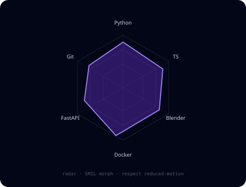</a></p>

**Радар скиллов** — 6 осей, заливка морфит по `points` за 4с. Меняешь точки — меняешь стек. [Файл](assets/radar-skills.svg) · `python3 atlas/samples/radar-skills.py`

<p align="center"><a href="assets/timeline-journey.svg"></a></p>

**Таймлайн пути** — линия 2.8с (`stroke-dashoffset`), точки всплывают по очереди. [Файл](assets/timeline-journey.svg) · `python3 atlas/samples/timeline-journey.py`

<p align="center"><a href="assets/marquee-icons.svg">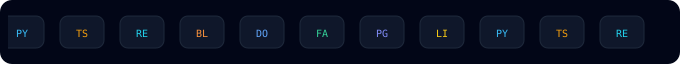</a></p>

**Бегущая строка** — 8 пилюль едут влево 8с, бесшовный луп (`translate -240`). Чистый SVG. [Файл](assets/marquee-icons.svg) · `python3 atlas/samples/marquee-icons.py` · идея из [icon-marquee](https://github.com/topics/icon-marquee)

<p align="center"><a href="assets/ascii-portrait.svg"></a></p>

**ASCII-портрет** — монохромный портрет из `⣿⣤⣿` + neofetch-карточка рядом, печатаются построчно. [Файл](assets/ascii-portrait.svg) · `python3 atlas/samples/ascii-portrait.py` · идея из [ASCII Portrait guide](https://www.avivashishta.com/blog/build-animated-github-profile-readme)

<p align="center"><a href="assets/heatmap-wave.svg"></a></p>

**Heatmap-волна** — 53 недели, клетки `10×10 rx=2`, диагональный reveal 0.3с каждая. [Файл](assets/heatmap-wave.svg) · `python3 atlas/samples/heatmap-wave.py` · цвета как у GitHub (Less→More)

<p align="center"><a href="assets/spotify-card.svg"></a></p>

**Now Playing** — карточка трека с 4 столбиками-эквалайзером (0.7-0.9с). Инлайн-обложка как в [spotify-readme-card](https://github.com/GautamVhavle/spotify-readme-card), но без бэкенда. [Файл](assets/spotify-card.svg) · `python3 atlas/samples/spotify-card.py`

<p align="center"><a href="assets/waka-bar.svg">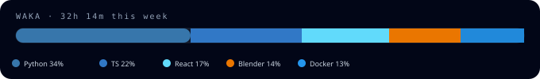</a></p>

**Waka-полоска** — 5 языков stacked bar, 32h 14m. [Файл](assets/waka-bar.svg) · `python3 atlas/samples/waka-bar.py`

<p align="center"><a href="assets/trophy-shelf.svg">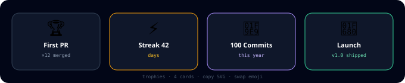</a></p>

**Полка трофеев** — 4 карточки: First PR, Streak 42, 100 Commits, Launch. Меняешь эмодзи/текст. [Файл](assets/trophy-shelf.svg) · `python3 atlas/samples/trophy-shelf.py` · как [github-profile-trophy](https://github.com/ryo-ma/github-profile-trophy)

<p align="center"><a href="assets/neofetch-card.svg">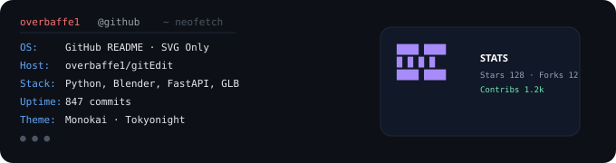</a></p>

**Neofetch-карточка** — `OS/Host/Stack/Uptime` слева, ASCII-арт + STATS справа. [Файл](assets/neofetch-card.svg) · `python3 atlas/samples/neofetch-card.py`

<p align="center"><a href="assets/commit-pulse.svg">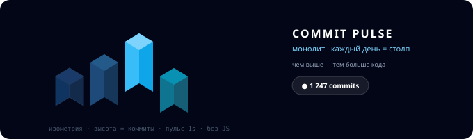</a></p>

**Commit Pulse** — изометрический монолит: каждый день = столп, высота = коммиты, пульс 1-1.2с. [Файл](assets/commit-pulse.svg) · `python3 atlas/samples/commit-pulse.py` · идея из [CommitPulse](https://commitpulse.vercel.app/) + [github-city](https://github.com/Zain1024/github-city)

<p align="center"><a href="assets/neon-stadium.svg"></a></p>

**Neon Stadium** — календарь как 3D-стадион, неоновая петля бежит по контуру (`stroke-dashoffset` 1с). [Файл](assets/neon-stadium.svg) · `python3 atlas/samples/neon-stadium.py` · идея [Neon Arena](https://github.com/SandeepKomal/neon-arena)

<p align="center"><a href="assets/contrib-galaxy.svg">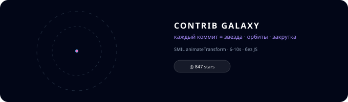</a></p>

**Contribution Galaxy** — каждый коммит = звезда на орбите, закрутка 6-10с. [Файл](assets/contrib-galaxy.svg) · `python3 atlas/samples/contrib-galaxy.py` · альтернатива плоскому heatmap

<p align="center"><a href="assets/drago-card.svg"></a></p>

**Drago** — дракон-питомец `🐉` парит (1.4с), орбита 12с, полоса опыта пульсирует. [Файл](assets/drago-card.svg) · `python3 atlas/samples/drago-card.py` · идея [Drago](https://github.com/topics/drago)

<p align="center"><a href="assets/typing-banner.svg"></a></p>

**Печатающий баннер** — градиент `7c3aed→06b6d4` + курсор `blink 0.8с`, без внешних API. [Файл](assets/typing-banner.svg) · `python3 atlas/samples/typing-banner.py` · как [readme-typing-svg](https://github.com/DenverCoder1/readme-typing-svg), но селф-хостед

> Синий 3D-просмотрщик уже есть — это [кристалл в STL](assets/crystal.stl). Открой его в GitHub, он крутится прямо на странице без твоего кода. Новые штуки выше — такая же идея: открыл файл и смотри, без установок. Хочешь анимированную шапку извне — бери [волну+печаталку](templates/ANIMATED-HEADER-TEMPLATE.md).

### Склад одной строкой

Нужна волна, печаталка или стена скиллов за 30 секунд? В [складе](atlas/sklad.md) — 8 готовых строк: шапка-волна, печатающий текст, скиллы, бейджи, статистика, змейка, город и трофеи. Копируешь строку, меняешь `USER`. Без сборки. Если нужна печать без внешних картинок — бери [блоки без картинок](templates/blocks/).

## Две карты

### Маршрут по точкам · GeoJSON

Две метки обозначают концы ломаной, между ними ещё два отсчёта. Координаты учебные.

<p><a href="assets/survey.geojson">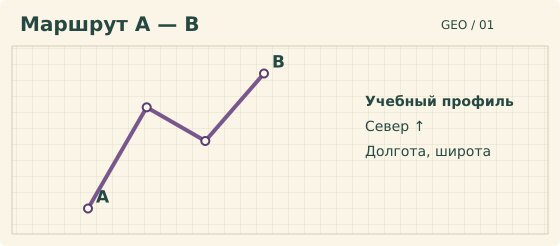</a></p>

[Приблизить маршрут в отдельном GeoJSON](assets/survey.geojson) · [рисунок маршрута](assets/survey.svg)

### Два листа с общей границей · TopoJSON

На рисунке пунктиром отмечен стык участков. В TopoJSON общая дуга записана один раз: западный лист проходит её в одну сторону, восточный — в обратную.

<p><a href="assets/sheets.topojson"></a></p>

[Рассмотреть участки в отдельном TopoJSON](assets/sheets.topojson) · [рисунок границы](assets/sheets.svg)

## Графики из данных

### Что весит больше: модель или её обложка?

STL кристалла занимает **1,2 КиБ**. У печатного листа три версии: SVG — **2,8 КиБ**, PDF — **41,6 КиБ**, PNG — **53,8 КиБ**. Это размеры файлов выставки.

<p><a href="assets/mermaid/file-sizes.png">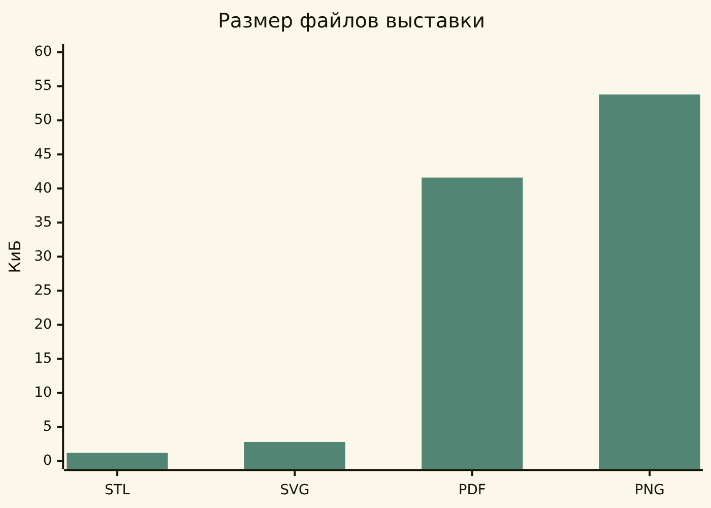</a></p>

### Куда ушли эскизы? · Диаграмма Санкея

Из 12 эскизов четыре ушли в архив, восемь — на цветопробу. Из них пять отправили в печать, три — на экран. Теперь число задаёт толщину потока, а не высоту столбца.

<p><a href="assets/mermaid/sketch-flow.png">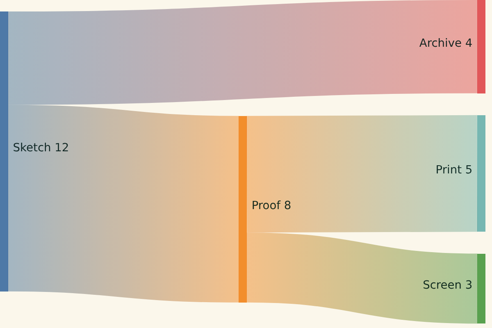</a></p>

## Схемы Mermaid

Схемы уже отрисованы: каждая открывается как отдельный PNG. Движок Mermaid при чтении страницы не запускается.

**Цветопроба.** Проследи путь от эскиза до тиража. Какое решение возвращает работу на предыдущий этап?

<p><a href="assets/mermaid/edition.png"></a></p>

**Доли.** Из десяти частей макета шесть отведены бумаге, три — чернилам, одна — акценту.

<p><a href="assets/mermaid/ink-share.png"></a></p>

**Сроки.** Эскиз, цветопроба и печать занимают разное время; каждая работа начинается после предыдущей.

<p><a href="assets/mermaid/schedule.png"></a></p>

**Архитектура.** Для презентации два пути — подготовка 3D и сборка слайдов — сходятся в одном файле.

<p><a href="assets/mermaid/presentation.png">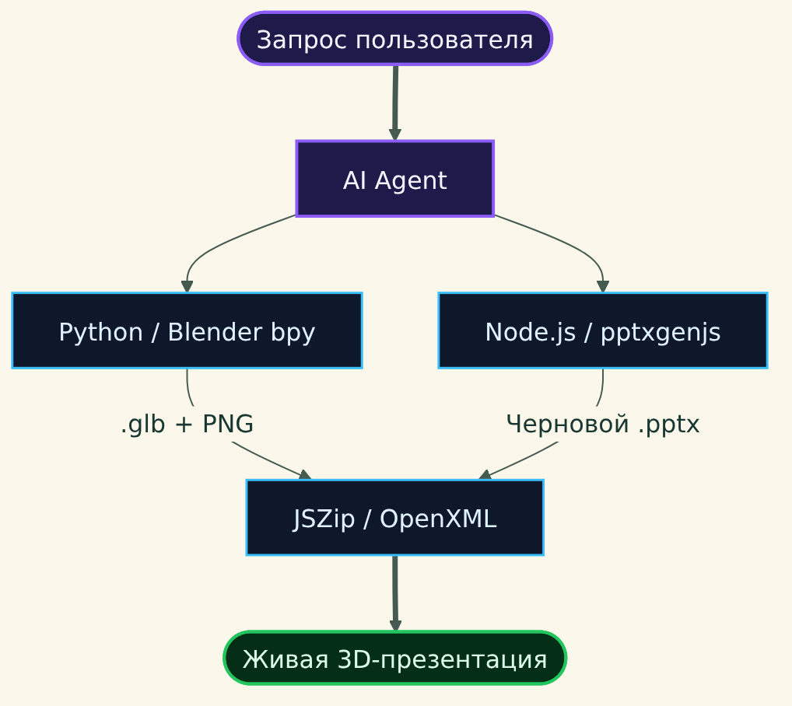</a></p>

**Диалог сервисов.** Здесь важны не размеры и не доли, а порядок запроса, записи и ответа.

<p><a href="assets/mermaid/task-sequence.png"></a></p>

## Палитра Markdown

### Бейджи и иконки

Пять стилей одной плашки: плоская, квадратная, крупная, объёмная и социальная. Ниже две кнопки открывают файлы работ.

    

[](assets/crystal-wipe.gif) [](assets/repo-fingerprint.svg)

**Примеры технологических меток**, не перечень зависимостей gitEdit:

              

**Живые счётчики gitEdit** — последнее обновление, размер и звёзды. Этот ряд, плашки и плитки стека загружаются с внешних сервисов; для просмотра города и кейсов эти сервисы не нужны.


**Python / 3D:**


**Fullstack / DevOps:**


### Пять видов оповещений

> [!NOTE]
> **Заметка (`[!NOTE]`):** Полезный контекст или справочная деталь, на которую стоит обратить внимание.

> [!TIP]
> **Совет (`[!TIP]`):** Лайфхак, ускоряющий работу — например, запуск в быстром режиме `FAST=1`.

> [!IMPORTANT]
> **Важно (`[!IMPORTANT]`):** Ключевое требование, без которого проект не запустится как задумано.

> [!WARNING]
> **Внимание (`[!WARNING]`):** Потенциальный подводный камень или ограничение совместимости.

> [!CAUTION]
> **Опасно (`[!CAUTION]`):** Действие может удалить данные или сломать сборку.

### Вёрстка и текст

<a href="assets/relief-riso.svg"></a>

Подпись обтекает оттиск. При узком экране рисунок занимает чуть больше трети строки, а не вытесняет текст целиком.

<br clear="right">

<ruby>色見本<rp> (</rp><rt>いろみほん</rt><rp>)</rp></ruby> — «образец цвета»: чтение набрано над иероглифами. Нижний и верхний индексы тоже остаются текстом: H<sub>2</sub>O и м<sup>2</sup>.

Для кристалла с $V=6$ вершинами, $E=12$ рёбрами и $F=8$ гранями формула Эйлера выглядит так:

```math
V - E + F = 6 - 12 + 8 = 2
```

```diff
- Показать только название проекта.
+ Показать работу, а название оставить в подписи.
```

- [x] Кейс понятен по неподвижному кадру.
- [ ] Подставить собственную работу при копировании.

<details open>
<summary>Проверить раскрытие с клавиатуры</summary>

На заголовок можно перейти клавишей <kbd>Tab</kbd>, раскрыть или закрыть его — <kbd>Enter</kbd> или <kbd>Пробел</kbd>. Галочки выше — состояние документа, а не голосование.

</details>

## Где заканчивается README

В README кристалл движется в записанной кинопетле. Свой JavaScript и WebGL GitHub сюда не встраивает: свободное вращение и управление клипами работают в студии по ссылке. Чтобы повернуть STL или приблизить карту, открой файл экспоната. В README остаются их рисунки; у видео по-прежнему есть кнопка Play. У GIF нет ручной перемотки, а у нашего сравнения нет перетаскиваемой ручки. Переключатель автозапуска GIF в GitHub и системное уменьшение движения — разные настройки. Если система просит меньше движения, «Север» останется неподвижным. Поиск по CSV и просмотр самого PDF работают в просмотрщиках файлов; для своего JavaScript или игры с сохранением ходов нужен другой интерфейс.

---

## Исходники README

[Весь Markdown одним файлом (Raw)](https://github.com/overbaffe1/gitEdit/raw/refs/heads/main/README.md) · [Код с номерами строк](https://github.com/overbaffe1/gitEdit/blob/main/README.md?plain=1) · [Скачать README со всеми картинками (ZIP)](https://github.com/overbaffe1/gitEdit/archive/refs/heads/main.zip)

### Собрать триптих из трёх кадров

**[Шаблон с триптихом](templates/EXHIBITION-README-TEMPLATE.md)** начинается с трёх соседних JPG. Ниже — три работы и их файлы. Возьми каталог `assets/night-shift/` из ZIP выше. У шаблона в `templates/` ссылки начинаются с `../assets/`; когда кладёшь его в корень своего репозитория, замени этот префикс на `assets/`.

| Что переносить в своё портфолио | Мастера и материалы | Разобранный пример |
|---|---|---|
| **Три кадра встык.** У фрагментов общая высота и одна линия стола: даже на узком экране они читаются как одна иллюстрация. | [Цельная иллюстрация](assets/night-shift/bench-master.jpg) · [нарезка и билеты](atlas/samples/night_shift/bench.py). Иллюстрация мастерской сгенерирована для gitEdit; это воображаемый интерьер, не фотография приборов. | В портфолио-комнате **pixel** [1](https://github.com/ayush6447/pixel) предмет открывает панель веб-приложения. Здесь не нужны карта кликов, JavaScript или кликабельные элементы внутри SVG. |
| **Объект → инструкция.** Для объёмной работы покажи способ сборки, а не только красивый ракурс. | [STL](assets/crystal.stl) · [кинопетля](assets/night-shift/fold.gif) · [два неподвижных положения](assets/night-shift/fold-still.png) · [выкройка А4](assets/night-shift/crystal-net.svg) · [разворачивание по рёбрам](atlas/samples/night_shift/crystal.py). Для печати открой скачанный SVG, выбери альбомный A4 и 100 %, проверь линейку. | **Papercraft lab** [3](https://github.com/sderosiaux/papercraft-lab) показывает переход от меша к бумаге, парные номера и клапаны. Здесь своя развёртка восьми граней, без Blender. |
| **Данные → материальный носитель.** Вместо счётчика дай читателю расшифровать одну разницу. | [112 дней CSV](atlas/samples/snake-weeks.csv) · [лента](assets/night-shift/weeks-tape.svg) · [раскладка для телефона](assets/night-shift/weeks-tape-compact.svg) · [ключ](assets/night-shift/weeks-key.svg) · [набор ленты](atlas/samples/night_shift/tape.py). | Снимки настоящей ленты и объяснение отверстий подачи — **ICL CES** [2](https://iclces.uk/articles/reading_punched_paper_tape.html). Наши шесть весов — собственный код для чисел 0–63, не историческая лента ASCII. |
| **Движение → оптическая игрушка.** Из четырёх силуэтов собери один полосатый отпечаток. | [Проектор](assets/night-shift/moth-projector.svg) · [стоп-кадр](assets/night-shift/moth-still.svg) · [четыре позы](assets/night-shift/moth-poses.svg) · [бумага](assets/night-shift/moth-paper.svg) и [решётка](assets/night-shift/moth-grille.svg) · [генератор](atlas/samples/night_shift/projector.py). Печатай пару **120 × 72 мм** в одном масштабе: рисунок на бумаге, решётку на прозрачной плёнке. | Для прямых полос — [animbar](https://github.com/jtojnar/animbar); у **FabObscura** [4](https://github.com/tichaesque/FabObscura) есть и криволинейные барьеры. Рисунок мотылька и разбиение на фазы здесь свои. |

<details open>
<summary>Пересобрать экспонаты и подставить свои работы</summary>

Из корня, Python 3. Для нарезки панорамы нужен Pillow ≥ 10; для подписей в GIF со сгибами — ещё и шрифты DejaVu Sans/Mono. Лента и проектор собираются одной стандартной библиотекой. Скрипты не обращаются к сети.

```sh
python3 atlas/samples/night_shift/bench.py
python3 atlas/samples/night_shift/crystal.py
python3 atlas/samples/night_shift/tape.py
python3 atlas/samples/night_shift/projector.py
```

Для такой склейки возьми три фото одинаковых пропорций. Выставь горизонт на одной высоте, а теги `</a><a>` поставь подряд **без пробела**. У каждого изображения в шаблоне ширина `33%`: три кадра умещаются в строку и на телефоне. Для варианта без ссылок достаточно одной строки:

```html
<p align="center"></p>
```

</details>

### Забрать оформление

- **[Шаблон проекта](templates/PROJECT-README-TEMPLATE.md)** и **[шаблон профиля](templates/PROFILE-README-TEMPLATE.md)**. README публичного репозитория `логин/логин` появляется в профиле. Сами обложки: [«Чертёж»](assets/cover-project.svg) и [«Созвездие»](assets/cover-profile.svg).
- **Предыдущая шапка:** [узкая](assets/banner-compact.svg), [светлая](assets/banner-light.svg), [тёмная](assets/banner-dark.svg), [полоса-разделитель](assets/divider.svg). **Подпись с волной и печатью:** [самодостаточный SVG](assets/portfolio-signature.svg).
- **[Заготовка workflow для личной змейки](templates/profile-snake-workflow.yml)** рассчитана на Platane/snk и отдельную ветку с картинками. Это шаблон, а не включённая автоматизация; для просмотра выставки Actions не нужны.

<details open>
<summary>Скопировать мини-портфолио целиком</summary>

Положи изображения из архива в `assets/` рядом со своим README. Обложки здесь открывают файлы работ из `assets/`. Замени подписи и работы на свои.

```markdown
# Мастерская

[Кейс](assets/crystal-wipe.gif) · [Профиль](assets/repo-fingerprint.svg)

<p>
  <a href="assets/crystal-wipe.gif"></a>
  <a href="assets/repo-fingerprint.svg"></a>
</p>

## Кейс

<picture>
  <source media="(prefers-reduced-motion: reduce)" srcset="assets/crystal-wipe.png">
  
</picture>

Одинаковая камера, две обработки. Что изменилось и как это проверить?

## Профиль


```

</details>

### Повторить мастерскую оформления

| Приём | Забрать и изменить | Откуда идея |
|---|---|---|
| Пейзаж за названием | «Север»: [широкая](assets/polar-cover.svg) и [узкая](assets/polar-cover-compact.svg) композиции; [широкий](assets/polar-cover-still.svg) и [узкий](assets/polar-cover-compact-still.svg) неподвижные оттиски. В [генераторе](atlas/samples/polar-press.py) поменяй короткое `NAME`, подпись `STRAP` и две палитры. | [Haikei](https://haikei.app/) раскладывает фон на волны и пики; здесь свой берег и завеса из кривых. Двигаются группы SVG, а не текст README. |
| Фон за текстом страницы | [Сайт одним HTML-файлом](atlas/north.html) + [фоновый слой без надписи](assets/polar-plate.svg) + оба кольца из строки ниже. Снимки для README: [960 × 600](assets/polar-page.png) и [360 × 640](assets/polar-page-compact.png). | У [Vanta](https://github.com/tengbao/vanta) фон прикрепляется к элементу сайта с помощью JS. Нашему примеру хватает CSS: слой закреплён за текстом, галочка ставит на паузу только его движение. |
| Линия и точка | [Перо](assets/ring-pen.svg) · [растр](assets/ring-screen.svg) · [генератор кольца](atlas/samples/print-ring.py). Из одной проекции берутся видимые линии поверхности и освещённость для пороговой матрицы Байера. | [Перьевой этюд Stéphane Tombeur в canvas-sketch](https://github.com/mattdesl/canvas-sketch/blob/master/examples/pen-plotter-circle-segments.js) и [виды дизеринга](https://github.com/makew0rld/dither). Оба наших оттиска — SVG без растровой подложки. |
| Серия марок | [Кристалл](assets/seal-crystal.svg) · [квартал](assets/seal-skyline.svg) · [кинолента](assets/seal-reel.svg). [Генератор](atlas/samples/maker-seals.py) берёт байты SHA-256 имени; одинаковое имя даёт ту же форму и палитру. Это не уникальный идентификатор. | [Jdenticon](https://jdenticon.com/) строит знаки из значения. У нас своя формула розетки, а [textPath](https://developer.mozilla.org/en-US/docs/Web/SVG/Reference/Element/textPath) укладывает буквы по кольцу. |
| Модульный форзац | [Узор](assets/tile-frieze.svg) · [проявленная дорожка](assets/tile-route.svg) · [четыре строки набора и трассировка](atlas/samples/tile-frieze.py). Цифра выбирает ориентацию плитки, не цвет. | [Truchet Tiles](https://github.com/evoluteur/truchet-tiles) показывает, как из поворотов одного квадрата получаются петли. В README вместо редактора — наш набор и второй оттиск внутри `<details>`. |

<details open>
<summary>Вставить обложку, напечатать свою марку или открыть фон на весь экран</summary>

Скопируй четыре файла `polar-cover*.svg` в `assets/` рядом с README. У каждого размера есть завершённый неподвижный вариант; если условия `<source>` не поддерживаются, останется обычный ``. Краски дня и ночи заданы **внутри** SVG.

```html
<picture>
  <source media="(max-width: 600px) and (prefers-reduced-motion: no-preference)" srcset="assets/polar-cover-compact.svg">
  <source media="(max-width: 600px)" srcset="assets/polar-cover-compact-still.svg">
  <source media="(prefers-reduced-motion: no-preference)" srcset="assets/polar-cover.svg">
  
</picture>
```

Все векторные листы этой мастерской собираются из корня репозитория на Python 3, без дополнительных пакетов, шрифтов для загрузки, токенов и Actions:

```sh
python3 atlas/samples/polar-press.py
python3 atlas/samples/print-ring.py
python3 atlas/samples/maker-seals.py
python3 atlas/samples/tile-frieze.py
# Своя марка: ключ рисунка, файл и надпись. Без --orbit буквы стоят на месте.
python3 atlas/samples/maker-seals.py my-project my-mark.svg --label 'Мой проект' --orbit
```

**Чтобы получить фон под обычным текстом**, распакуй ZIP репозитория и открой `atlas/north.html` в браузере. Сборка или сервер не нужны. Это отдельная страница: ссылка на `.html` в списке файлов GitHub показывает **исходник**, а не действующий сайт. Для публикации подойдёт [GitHub Pages](https://docs.github.com/en/pages/getting-started-with-github-pages/what-is-github-pages); бюро «Север» осталось офлайн-примером, а отдельная страница отведена студии «Грань».

**Почему не `<style>` в README?** В [описании обработки GitHub Markup](https://github.com/github/markup#github-markup) есть отдельный этап очистки HTML. При проверке через GitHub `/markdown` блок `<style>` стал текстом, а у обычного `<div>` исчезли `class` и `style`. `<picture>` и условия `media` у `<source>` сохранились. Поэтому пейзаж с надписью экспортирован как картинка, а не как попытка оформить `body` страницы GitHub.

</details>

### Откуда взялись экспонаты

| Экспонат | Готовый файл и воспроизводимый исходник |
|---|---|
| Зеркальный конёк | [Опыт FeichenFD с цилиндрическим зеркалом](https://github.com/FeichenFD/cylindricalmirror/blob/e64bd8cf896f9e0e85fdb997b331ab9c9aae168e/README.md) · [как рассчитан наш лист и где поставить зеркало](atlas/samples/catoptric/README.md). |
| Одна форма, три тени | [Кинопетля](assets/shadow-type/git.gif) · [неподвижный лист](assets/shadow-type/proof.png) · [та же сетка в STL](assets/shadow-type/git.stl). Идея трёх проекций — [модель букв в OpenSCAD у ondras/3](https://github.com/ondras/3/blob/3749f6a674fc7fdc233ff7aea082af28939f5c2b/geb.scad). Наш [генератор](atlas/samples/shadow_type.py) оставляет в сетке 7 × 7 × 7 только ячейки, разрешённые всеми тремя силуэтами. Кадры и STL построены по одним граням. Пересборка: `python3 atlas/samples/shadow_type.py` (Python 3.10+, Pillow и шрифты DejaVu). |
| Аурелия | [Стереозапись](assets/aurelia/aurelia.wav) · [контур и его два канала](assets/aurelia/trace.png). Приём — [осциллографический синтез у James Ball](https://github.com/jameshball/osci-render/blob/25f5938e5983af8803b5b090176bde1b7e35180e/README.md); [ещё один пример и разбор](atlas/inspiration.md). Наш [синтезатор](atlas/samples/aurelia/xy_signal.py) записывает только PCM. [Сборка GIF, PNG и осциллографа](atlas/samples/aurelia/render.py): `python3 atlas/samples/aurelia/render.py` (Python 3.10+, Pillow ≥ 10 и шрифты DejaVu). |
| Сумеречный лист | [Прозрачный PNG](assets/twilight/glass.png) · [проба на двух фонах](assets/twilight/proof.png). Приём в действии — [демо HideImageMaker](https://github.com/wuyr/HideImageMaker/blob/9fc2d095f4c7bd1119f1be35c4080cfe03472553/preview.gif); наши [печатные формы и разбор](atlas/inspiration.md). [Пересборка](atlas/samples/twilight/print.py): `python3 atlas/samples/twilight/print.py` (Python 3.10+, Pillow и шрифты DejaVu). |
| Наборный склад | [Как набрана игра Fontemon](https://github.com/mmulet/code-relay/blob/3a6b651445aac3b8dc6fad64b4234b6950828dbe/markdown/HowIDidIt.md) · [сборка нашего шрифта из плана комнаты](atlas/samples/typecase/README.md). |
| Город вкладов | [GIF](assets/contribution-city.gif) · [полный неподвижный кадр](assets/contribution-city.png) · [скрипт экспорта](atlas/samples/render-city.py). Кадры сняты с [оригинального SVG yoshi389111](https://github.com/yoshi389111/github-profile-3d-contrib/blob/e235d118909be71eb7edb05482a3de4e76156df3/docs/demo/profile-night-view.svg) (© SATO, Yoshiyuki, [MIT](assets/licenses/contribution-city-MIT.txt)). В оригинале `dur="3s"`, `repeatCount="1"`: при открытии файла с начала виден ещё один проход. Здесь первый кадр уже заполнен, затем идёт обратный ход и повтор роста. |
| Змейка | [GIF](assets/snake-weeks.gif) · [PNG](assets/snake-weeks.png) · [данные за 112 дней](atlas/samples/snake-weeks.csv) · [наш отрисовщик](atlas/samples/render-calendar.py). Идея календаря — [Platane/snk](https://github.com/Platane/snk). Это собственный маршрут по **коммитам репозитория**, не копия рисунка Platane и не календарь вкладов пользователя. Даты коммитера в UTC посчитаны по [Commits API LazyGit, страницы по 100 записей](https://api.github.com/repos/jesseduffield/lazygit/commits?sha=bb64e3ccb6524368945ba0dfd3134b4189644eed&since=2025-01-06T00:00:00Z&until=2025-04-27T23:59:59Z&per_page=100). |
| Квартал в 3D | [STL 16 недель](assets/weekly-skyline.stl) · [генератор на чистом Python](atlas/samples/weekly-skyline.py). Читает тот же CSV, печатает два треугольника на каждую сторону дома. `python3 atlas/samples/weekly-skyline.py` обновляет STL и [статичный вид](assets/weekly-skyline.svg), не переписывая README. |
| Грань · кинетический кабинет | [Кинопетля](assets/crystal-theatre.gif) · [стоп-кадр](docs/poster.jpg) · [текстурированная капсула GLB](docs/malachite.glb). [Как изготовить модель, собрать просмотрщик, записать клип и вставить его в другой README](studio/README.md). Сетка граней взята из [crystal.stl](assets/crystal.stl); UV, карты материала и анимация добавлены при сборке GLB. Обычный STL хранит геометрию, а не текстуры и клипы. [Исходный парусник](https://github.com/overbaffe1/MyWorkAiBrain/blob/4131aaf20ce8aa92066aaab203ee7a465cad6d91/presentations/cantillon/models/glb/ship.glb) загружается из MyWorkAiBrain только по выбору; это GLB со скелетом, не его одноцветный STL-слепок. |
| Сетка ↔ свет | [GIF](assets/crystal-wipe.gif) · [кадр сравнения](assets/crystal-wipe.png) · [сетка](assets/crystal-wire.png) · [свет](assets/crystal-light.png) · [отрисовщик по настоящему STL](atlas/samples/render-passes.py). Ползунок для сайта и GIF-переход для документа — два подхода у [Knight Lab](https://juxtapose.knightlab.com/) ([JuxtaposeJS](https://github.com/NUKnightLab/juxtapose)). Здесь свой GIF, без встроенного JS. |
| Оттиск символами | Тот же `render-passes.py --stamp` печатает проекцию гранями разной плотности. Ещё один подход к графике в терминале — [Chafa](https://github.com/hpjansson/chafa); наш оттиск рассчитан из вершин, а не взят из чужого скриншота. |
| Отпечаток репозитория | [Широкий SVG](assets/repo-fingerprint.svg) · [мобильный SVG](assets/repo-fingerprint-compact.svg) · [скрипт по `git ls-tree`](atlas/samples/repo-fingerprint.mjs). Идея упаковки файлов в круги — [эксперимент GitHub Next](https://githubnext.com/projects/repo-visualization/) и [реальный README с repo-visualizer](https://github.com/githubocto/repo-visualizer-demo). У нас статичный экспорт D3, не iframe и не запущенный Action. |
| Видео, терминал, рисунок | Вложение взято из [README LazyGit](https://github.com/jesseduffield/lazygit#readme). Наши [терминальная запись `.cast`](atlas/samples/facet-count.cast), [GIF](assets/facet-count.gif) и [PNG](assets/facet-count.png); похожие инструменты — [asciinema/agg](https://github.com/asciinema/agg) и [VHS](https://github.com/charmbracelet/vhs). Для схемы рядом — [файл D2](atlas/samples/staging.d2) и [экспорт SVG](assets/staging.svg). |
| Кинолента, печать, шахматы | [Граф веток](assets/commit-reel.svg), [ризограф](assets/relief-riso.svg), [фосфор](assets/relief-phosphor.svg), [палитры CSV](atlas/samples/palettes.csv), [мастер печатного листа](atlas/samples/atlas-plate.svg), [PNG](atlas/samples/social-preview.png), [PDF](atlas/samples/field-sheet.pdf), [наш этюд](assets/mate-in-one.svg). У [Tim Burgan](https://github.com/timburgan/timburgan#tims-community-chess-tournament) ход делают через Issues; здесь это задача с открываемым ответом. |

<details open>
<summary>Повторить экспорт: геометрия, календарь и карта файлов</summary>

Из корня репозитория, с Python 3, Pillow и шрифтами DejaVu Sans:

```sh
python atlas/samples/render-passes.py
python atlas/samples/render-passes.py --stamp
python atlas/samples/render-calendar.py
```

Для отпечатка нужен Node.js и `d3-hierarchy@3`. Передай нужный коммит вместо `11ea344`: скрипт обновит обе раскладки и напечатает общий размер. Для чужого SVG города отдельно нужны Playwright и Chromium; скрипт экспорта принимает файл ровно той версии, на которую ведёт ссылка в таблице.

```sh
npm install --no-save --package-lock=false d3-hierarchy@3
node atlas/samples/repo-fingerprint.mjs 11ea344
```

</details>

### Рецепты GitHub Markdown

<details>
<summary>3D, карты, формулы и Mermaid</summary>

- **STL:** вставь полный **текст** [crystal.stl](assets/crystal.stl) между строками ` ```stl ` и ` ``` `. Имя файла или двоичный STL в блоке не сработают. [Блокнот](atlas/samples/crystal.ipynb) проверяет вершины, рёбра и грани. Для объёмного календаря вместо картинки есть генератор STL [gh-skyline](https://github.com/github/gh-skyline).
- **Карты:** точно так же вложи [данные маршрута](assets/survey.geojson) в `geojson`, [данные двух листов](assets/sheets.topojson) — в `topojson`. В координатах сначала долгота. [Документация встроенных просмотрщиков](https://docs.github.com/en/get-started/writing-on-github/working-with-advanced-formatting/creating-diagrams).
- **Как сделаны картинки на витрине:** [скрипт экспорта схем](atlas/samples/render-diagrams.sh) использует Mermaid CLI 11.12.0 (`mmdc` в `PATH`), Chromium и [палитру](atlas/samples/diagram-style.json). Результат — PNG в `assets/mermaid/`. Источники: [коммиты](atlas/samples/commits.mmd), [размеры](atlas/samples/file-sizes.mmd), [потоки](atlas/samples/sketch-flow.mmd), [цветопроба](atlas/samples/edition.mmd), [доли](atlas/samples/ink-share.mmd), [сроки](atlas/samples/schedule.mmd), [презентация](atlas/samples/presentation.mmd), [диалог](atlas/samples/task-sequence.mmd). Данные карт и копии файлов для отдельных просмотрщиков обновляет [экспорт листов](atlas/samples/file_plates.py); модели и данные в `atlas/samples/` по-прежнему доступны по старым адресам.
- **Mermaid в своём Markdown:** возьми [схему состояний](atlas/samples/edition.mmd) или короткий пример ниже. Для графиков есть [XY](https://mermaid.js.org/syntax/xyChart.html) и [Sankey](https://mermaid.js.org/syntax/sankey.html); версия движка на GitHub может отличаться от [редактора](https://mermaid.live/).

````markdown
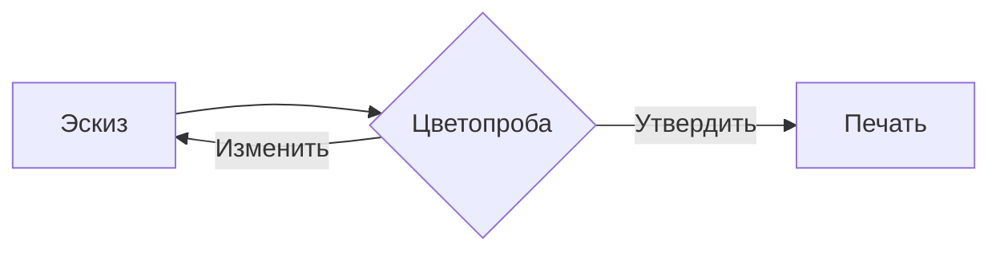

В строке: $F=8$. Отдельная формула:

```math
V-E+F = 6-12+8 = 2
```
````

</details>

<details>
<summary>Тема, размер экрана, уменьшение движения и видео</summary>

Браузер использует первый подходящий `<source>`. Для GIF сверху нужен статичный кадр, для карты файлов — вертикальная компоновка на телефоне, для двух оттисков — выбор по теме. Вот готовый блок города:

```html
<picture>
  <source media="(prefers-reduced-motion: reduce)" srcset="assets/contribution-city.png">
  
</picture>
```

```html
<picture>
  <source media="(max-width: 600px)" srcset="assets/repo-fingerprint-compact.svg">
  
</picture>

<picture>
  <source media="(prefers-color-scheme: dark)" srcset="assets/relief-phosphor.svg">
  
</picture>
```

На GitHub автозапуск GIF зависит и от **Settings → Accessibility → Motion → Autoplay animated images** ([справка GitHub](https://docs.github.com/en/account-and-profile/how-tos/account-settings/managing-accessibility-settings#managing-motion)). README не должен переопределять выбор читателя. Для **видеоплеера** перетащи MP4 в поле редактора GitHub и оставь выданный URL вложения отдельным абзацем. `` — синтаксис изображения, не плеера.

Подпись и волну можно нарисовать локально, как в карточке профиля, или получить из [Typing SVG](https://readme-typing-svg.demolab.com/demo/) и [Capsule Render](https://github.com/kyechan99/capsule-render):

```markdown


```

</details>

<details>
<summary>Бейджи, динамические счётчики и плитка стека</summary>

[Shields.io](https://shields.io/) рисует плашки, [Simple Icons](https://simpleicons.org/) даёт названия логотипов, [Skill Icons](https://github.com/tandpfun/skill-icons) собирает плитку. Стили: `flat`, `flat-square`, `for-the-badge`, `plastic`, `social`. В тексте бейджа пробел кодируется как `%20`, дефис — `--`, подчёркивание — `__`, плюс — `%2B`, процент — `%25`. `color` меняет правую часть плашки, `labelColor` — левую.

```markdown


[](assets/crystal-wipe.gif)


```

Для статуса реально существующего workflow: `https://img.shields.io/github/actions/workflow/status/<USER>/<REPO>/ci.yml`. Плашка со словом *passing* сама ничего не проверяет. Ещё заготовки: [Markdown Badges](https://github.com/Ileriayo/markdown-badges).

**Технологические метки — строки для копирования:**

```markdown


```

</details>

<details>
<summary>Колонки, загадка, клавиши, цветное оповещение и сноска</summary>

```html

<p>Подпись обтекает рисунок слева.</p>
<br clear="right">

<details>
<summary>Проверить ответ</summary>
<p>Лa8#. Для раскрытия с клавиатуры — <kbd>Enter</kbd>.</p>
</details>
```

```markdown
> [!TIP]
> Оставь неподвижный кадр тем, кто предпочитает читать без анимации.

- [x] Результат виден на странице.[^demo]

[^demo]: Уточнение или источник данных.
```

Для остальных цветов используй `NOTE`, `IMPORTANT`, `WARNING` или `CAUTION`. Для подписи над иероглифами — `<ruby>色見本<rt>いろみほん</rt></ruby>`, для индексов — `<sub>` и `<sup>`.

</details>

**Ещё примеры и первоисточники:** [атлас форматов](atlas/README.md) · [карты и STL](atlas/relief.md) · [набор текста и диаграммы](atlas/native.md) · [приёмы из других проектов](atlas/inspiration.md) · [что оформляется вне README](atlas/surfaces.md). Идея навигации обложками встречается, например, у [Ray Tracing in One Weekend](https://github.com/RayTracing/raytracing.github.io#readme).
