# Ночная смена

**Выбери прибор:** разверни бумажный кристалл, прочти перфоленту или загляни за решётку проектора. Всё открывается прямо здесь.

<p align="center"><a href="#бумажный-кристалл"></a><a href="#перфолента"></a><a href="#театр-теней"></a></p>

[01 · Кристалл](#бумажный-кристалл)　 [02 · Перфолента](#перфолента)　 [03 · Театр теней](#театр-теней)

**Ещё на выставке:** [3D-модель](#покрути-кристалл) · [город вкладов](#город-вкладов) · [обложка «Север»](#мастерская-оформления) · [оглавление](#оглавление).

## Бумажный кристалл

<p><a href="#покрути-кристалл"><picture>
  <source media="(prefers-reduced-motion: reduce)" srcset="assets/night-shift/fold-still.png">
  
</picture></a></p>

**01 / Форма.** У кристалла разрезали пять рёбер. Остальные семь работают как сгибы: зелёные грани расходятся веером, абрикосовые ложатся вдоль края. Проследи за штрихами на любой грани — бумага поворачивается, но не растягивается.

<details>
<summary><b>Разложить выкройку на столе</b></summary>


Это раскрой именно этой модели. Режь по сплошным линиям, сгибай по пунктиру; **A** соединяется с **A**, **B** с **B** и так далее. Внизу листа — линейка 30 мм для проверки масштаба при печати.

</details>

<a href="#перфолента"></a>

### Покрути кристалл

Потяни за вершину, приблизь модель колёсиком и переключи поверхность на каркас.

<!-- These fences are the viewers themselves. Keep each payload identical to its geometry file in atlas/samples/. -->
```stl
solid field_crystal
  facet normal 0.5906538 0.7269586 0.3502274
    outer loop
      vertex 3 -1 36
      vertex 16 0 12
      vertex 0 13 12
    endloop
  endfacet
  facet normal 0.4731097 0.5822889 -0.6611405
    outer loop
      vertex -2 1 0
      vertex 0 13 12
      vertex 16 0 12
    endloop
  endfacet
  facet normal -0.5568154 0.6853112 0.4693668
    outer loop
      vertex 3 -1 36
      vertex 0 13 12
      vertex -16 0 12
    endloop
  endfacet
  facet normal -0.5236315 0.6444695 -0.5571976
    outer loop
      vertex -2 1 0
      vertex -16 0 12
      vertex 0 13 12
    endloop
  endfacet
  facet normal -0.5713854 -0.7032436 0.4230450
    outer loop
      vertex 3 -1 36
      vertex -16 0 12
      vertex 0 -13 12
    endloop
  endfacet
  facet normal -0.4923218 -0.6059346 -0.6248700
    outer loop
      vertex -2 1 0
      vertex 0 -13 12
      vertex -16 0 12
    endloop
  endfacet
  facet normal 0.6024457 -0.7414717 0.2954301
    outer loop
      vertex 3 -1 36
      vertex 0 -13 12
      vertex 16 0 12
    endloop
  endfacet
  facet normal 0.4435471 -0.5459041 -0.7108127
    outer loop
      vertex -2 1 0
      vertex 16 0 12
      vertex 0 -13 12
    endloop
  endfacet
endsolid field_crystal
```

Паспорт модели: $V=6$ вершин, $E=12$ рёбер, $F=8$ граней. Четыре треугольника сверху и четыре снизу: эту же сетку дальше увидишь в цвете.

```math
V - E + F = 6 - 12 + 8 = 2
```

### Кейс проекта

**Один кристалл, два прохода.** Слева — рёбра на чертёжной сетке, справа — те же грани под цветным светом. Граница сама проходит по рисунку. Верхушка не смещается: положение камеры в обоих кадрах одинаковое.

<picture>
  <source media="(prefers-reduced-motion: reduce)" srcset="assets/crystal-wipe.png">
  
</picture>

<details>
<summary>Положить оба кадра рядом и рассмотреть без движения</summary>

 

</details>

**Оттиск для терминала.** Тот же вид умещается в 20 столбцов текста. Светлые и тёмные знаки заменяют краску; этот кристалл останется виден даже без загрузки картинок.

<pre>
           ▒
          ▒▓▓
         ▒▒▓▓▓
        ▒▒▒▓▓▓
       ▒▒▒▓▓▓▓▓
     ▒▒▒▒▒▓▓▓▓▓▓
    ▒▒▒▒▒▒▓▓▓▓▓▓▓
   ▒▒▒▒▒▒▓▓▓▓▓▓▓▓
  ▒▒▒▒▒▒▒▓▓▓▓▓▓▓▓▓
 ▒▒▒▒▒▒▒▒▓▓▓▓▓▓▓▓▓▓
░▒▒▒▒▒▒▒▓▓▓▓▓▓▓▓▓▓▓▓
  ░░░░▒▒▓▓▓▓▓▓░░░░░
   ░░░░░░░░░░░░░░
     ░░░░░░░░░░
       ░░░░░
        ░░
</pre>

## Перфолента

<picture>
  <source media="(max-width: 600px)" srcset="assets/night-shift/weeks-tape-compact.svg">
  
</picture>

**02 / Данные.** У каждой недели свой столбец. Тёмный круг — пробитое отверстие: сложи веса напротив таких кругов. Ряд маленьких точек нужен для подачи ленты и в сумму не входит.

Это **398 коммитов LazyGit** за 6 января — 27 апреля 2025 года, не активность автора профиля. Издалека две выделенные недели почти одинаковы. **Чем № 15 отличается от № 07?**

<details>
<summary><b>Положить колонки рядом и прочитать код</b></summary>


**Одним отверстием в дорожке 1.** 17–23 февраля — 44 коммита, 14–20 апреля — 45. Те же шестнадцать недель ниже превращаются в [календарь](#змейка-на-календаре) и [квартал](#квартал-в-3d).

</details>

<a href="#театр-теней">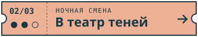</a>

### Приёмы из других README

#### Город вкладов

<picture>
  <source media="(prefers-reduced-motion: reduce)" srcset="assets/contribution-city.png">
  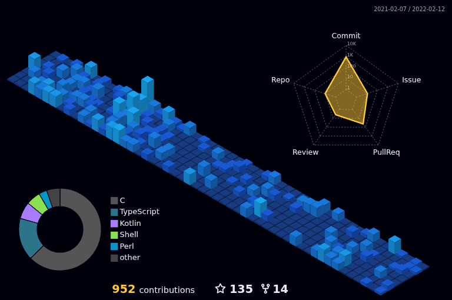
</picture>

Башни растут прямо здесь. Первый кадр показывает **весь город**, а движение повторяется, так что его не пропустишь при прокрутке. В режиме уменьшенного движения останется тот же ночной вид. Это календарь из демонстрации **yoshi389111** за 2021–2022 годы, не статистика этого профиля. Это иллюстрация, а не вращаемая сцена. Для вращения есть [3D-квартал чуть ниже](#квартал-в-3d).

#### Змейка на календаре

<picture>
  <source media="(prefers-reduced-motion: reduce)" srcset="assets/snake-weeks.png">
  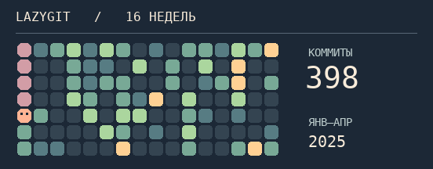
</picture>

Один столбец — неделя, верхняя клетка — понедельник. Змейка гасит клетки по пути; чем светлее нетронутая клетка, тем больше в тот день было коммитов. Это наш рисунок по истории **LazyGit**: 398 коммитов за 16 недель, с 6 января по 27 апреля 2025 года. Ни бот, ни вход в аккаунт для просмотра не нужны.

#### Квартал в 3D

Теперь потяни мышью за **настоящие башни**. Это другая модель: каждый дом — одна неделя из календаря LazyGit выше, единица высоты — один коммит. У всех 16 домов одинаковое основание. Найди самый высокий и посмотри на соседей с уровня улицы.

<!-- weekly-skyline:begin -->

```stl
solid weekly_skyline
  facet normal 0 0 -1
    outer loop
      vertex 0 0 0
      vertex 0 10 0
      vertex 10 10 0
    endloop
  endfacet
  facet normal 0 0 -1
    outer loop
      vertex 0 0 0
      vertex 10 10 0
      vertex 10 0 0
    endloop
  endfacet
  facet normal 0 0 1
    outer loop
      vertex 0 0 25
      vertex 10 0 25
      vertex 10 10 25
    endloop
  endfacet
  facet normal 0 0 1
    outer loop
      vertex 0 0 25
      vertex 10 10 25
      vertex 0 10 25
    endloop
  endfacet
  facet normal 0 -1 0
    outer loop
      vertex 0 0 0
      vertex 10 0 0
      vertex 10 0 25
    endloop
  endfacet
  facet normal 0 -1 0
    outer loop
      vertex 0 0 0
      vertex 10 0 25
      vertex 0 0 25
    endloop
  endfacet
  facet normal 1 0 0
    outer loop
      vertex 10 0 0
      vertex 10 10 0
      vertex 10 10 25
    endloop
  endfacet
  facet normal 1 0 0
    outer loop
      vertex 10 0 0
      vertex 10 10 25
      vertex 10 0 25
    endloop
  endfacet
  facet normal 0 1 0
    outer loop
      vertex 10 10 0
      vertex 0 10 0
      vertex 0 10 25
    endloop
  endfacet
  facet normal 0 1 0
    outer loop
      vertex 10 10 0
      vertex 0 10 25
      vertex 10 10 25
    endloop
  endfacet
  facet normal -1 0 0
    outer loop
      vertex 0 10 0
      vertex 0 0 0
      vertex 0 0 25
    endloop
  endfacet
  facet normal -1 0 0
    outer loop
      vertex 0 10 0
      vertex 0 0 25
      vertex 0 10 25
    endloop
  endfacet
  facet normal 0 0 -1
    outer loop
      vertex 14 0 0
      vertex 14 10 0
      vertex 24 10 0
    endloop
  endfacet
  facet normal 0 0 -1
    outer loop
      vertex 14 0 0
      vertex 24 10 0
      vertex 24 0 0
    endloop
  endfacet
  facet normal 0 0 1
    outer loop
      vertex 14 0 7
      vertex 24 0 7
      vertex 24 10 7
    endloop
  endfacet
  facet normal 0 0 1
    outer loop
      vertex 14 0 7
      vertex 24 10 7
      vertex 14 10 7
    endloop
  endfacet
  facet normal 0 -1 0
    outer loop
      vertex 14 0 0
      vertex 24 0 0
      vertex 24 0 7
    endloop
  endfacet
  facet normal 0 -1 0
    outer loop
      vertex 14 0 0
      vertex 24 0 7
      vertex 14 0 7
    endloop
  endfacet
  facet normal 1 0 0
    outer loop
      vertex 24 0 0
      vertex 24 10 0
      vertex 24 10 7
    endloop
  endfacet
  facet normal 1 0 0
    outer loop
      vertex 24 0 0
      vertex 24 10 7
      vertex 24 0 7
    endloop
  endfacet
  facet normal 0 1 0
    outer loop
      vertex 24 10 0
      vertex 14 10 0
      vertex 14 10 7
    endloop
  endfacet
  facet normal 0 1 0
    outer loop
      vertex 24 10 0
      vertex 14 10 7
      vertex 24 10 7
    endloop
  endfacet
  facet normal -1 0 0
    outer loop
      vertex 14 10 0
      vertex 14 0 0
      vertex 14 0 7
    endloop
  endfacet
  facet normal -1 0 0
    outer loop
      vertex 14 10 0
      vertex 14 0 7
      vertex 14 10 7
    endloop
  endfacet
  facet normal 0 0 -1
    outer loop
      vertex 28 0 0
      vertex 28 10 0
      vertex 38 10 0
    endloop
  endfacet
  facet normal 0 0 -1
    outer loop
      vertex 28 0 0
      vertex 38 10 0
      vertex 38 0 0
    endloop
  endfacet
  facet normal 0 0 1
    outer loop
      vertex 28 0 5
      vertex 38 0 5
      vertex 38 10 5
    endloop
  endfacet
  facet normal 0 0 1
    outer loop
      vertex 28 0 5
      vertex 38 10 5
      vertex 28 10 5
    endloop
  endfacet
  facet normal 0 -1 0
    outer loop
      vertex 28 0 0
      vertex 38 0 0
      vertex 38 0 5
    endloop
  endfacet
  facet normal 0 -1 0
    outer loop
      vertex 28 0 0
      vertex 38 0 5
      vertex 28 0 5
    endloop
  endfacet
  facet normal 1 0 0
    outer loop
      vertex 38 0 0
      vertex 38 10 0
      vertex 38 10 5
    endloop
  endfacet
  facet normal 1 0 0
    outer loop
      vertex 38 0 0
      vertex 38 10 5
      vertex 38 0 5
    endloop
  endfacet
  facet normal 0 1 0
    outer loop
      vertex 38 10 0
      vertex 28 10 0
      vertex 28 10 5
    endloop
  endfacet
  facet normal 0 1 0
    outer loop
      vertex 38 10 0
      vertex 28 10 5
      vertex 38 10 5
    endloop
  endfacet
  facet normal -1 0 0
    outer loop
      vertex 28 10 0
      vertex 28 0 0
      vertex 28 0 5
    endloop
  endfacet
  facet normal -1 0 0
    outer loop
      vertex 28 10 0
      vertex 28 0 5
      vertex 28 10 5
    endloop
  endfacet
  facet normal 0 0 -1
    outer loop
      vertex 42 0 0
      vertex 42 10 0
      vertex 52 10 0
    endloop
  endfacet
  facet normal 0 0 -1
    outer loop
      vertex 42 0 0
      vertex 52 10 0
      vertex 52 0 0
    endloop
  endfacet
  facet normal 0 0 1
    outer loop
      vertex 42 0 21
      vertex 52 0 21
      vertex 52 10 21
    endloop
  endfacet
  facet normal 0 0 1
    outer loop
      vertex 42 0 21
      vertex 52 10 21
      vertex 42 10 21
    endloop
  endfacet
  facet normal 0 -1 0
    outer loop
      vertex 42 0 0
      vertex 52 0 0
      vertex 52 0 21
    endloop
  endfacet
  facet normal 0 -1 0
    outer loop
      vertex 42 0 0
      vertex 52 0 21
      vertex 42 0 21
    endloop
  endfacet
  facet normal 1 0 0
    outer loop
      vertex 52 0 0
      vertex 52 10 0
      vertex 52 10 21
    endloop
  endfacet
  facet normal 1 0 0
    outer loop
      vertex 52 0 0
      vertex 52 10 21
      vertex 52 0 21
    endloop
  endfacet
  facet normal 0 1 0
    outer loop
      vertex 52 10 0
      vertex 42 10 0
      vertex 42 10 21
    endloop
  endfacet
  facet normal 0 1 0
    outer loop
      vertex 52 10 0
      vertex 42 10 21
      vertex 52 10 21
    endloop
  endfacet
  facet normal -1 0 0
    outer loop
      vertex 42 10 0
      vertex 42 0 0
      vertex 42 0 21
    endloop
  endfacet
  facet normal -1 0 0
    outer loop
      vertex 42 10 0
      vertex 42 0 21
      vertex 42 10 21
    endloop
  endfacet
  facet normal 0 0 -1
    outer loop
      vertex 0 14 0
      vertex 0 24 0
      vertex 10 24 0
    endloop
  endfacet
  facet normal 0 0 -1
    outer loop
      vertex 0 14 0
      vertex 10 24 0
      vertex 10 14 0
    endloop
  endfacet
  facet normal 0 0 1
    outer loop
      vertex 0 14 19
      vertex 10 14 19
      vertex 10 24 19
    endloop
  endfacet
  facet normal 0 0 1
    outer loop
      vertex 0 14 19
      vertex 10 24 19
      vertex 0 24 19
    endloop
  endfacet
  facet normal 0 -1 0
    outer loop
      vertex 0 14 0
      vertex 10 14 0
      vertex 10 14 19
    endloop
  endfacet
  facet normal 0 -1 0
    outer loop
      vertex 0 14 0
      vertex 10 14 19
      vertex 0 14 19
    endloop
  endfacet
  facet normal 1 0 0
    outer loop
      vertex 10 14 0
      vertex 10 24 0
      vertex 10 24 19
    endloop
  endfacet
  facet normal 1 0 0
    outer loop
      vertex 10 14 0
      vertex 10 24 19
      vertex 10 14 19
    endloop
  endfacet
  facet normal 0 1 0
    outer loop
      vertex 10 24 0
      vertex 0 24 0
      vertex 0 24 19
    endloop
  endfacet
  facet normal 0 1 0
    outer loop
      vertex 10 24 0
      vertex 0 24 19
      vertex 10 24 19
    endloop
  endfacet
  facet normal -1 0 0
    outer loop
      vertex 0 24 0
      vertex 0 14 0
      vertex 0 14 19
    endloop
  endfacet
  facet normal -1 0 0
    outer loop
      vertex 0 24 0
      vertex 0 14 19
      vertex 0 24 19
    endloop
  endfacet
  facet normal 0 0 -1
    outer loop
      vertex 14 14 0
      vertex 14 24 0
      vertex 24 24 0
    endloop
  endfacet
  facet normal 0 0 -1
    outer loop
      vertex 14 14 0
      vertex 24 24 0
      vertex 24 14 0
    endloop
  endfacet
  facet normal 0 0 1
    outer loop
      vertex 14 14 24
      vertex 24 14 24
      vertex 24 24 24
    endloop
  endfacet
  facet normal 0 0 1
    outer loop
      vertex 14 14 24
      vertex 24 24 24
      vertex 14 24 24
    endloop
  endfacet
  facet normal 0 -1 0
    outer loop
      vertex 14 14 0
      vertex 24 14 0
      vertex 24 14 24
    endloop
  endfacet
  facet normal 0 -1 0
    outer loop
      vertex 14 14 0
      vertex 24 14 24
      vertex 14 14 24
    endloop
  endfacet
  facet normal 1 0 0
    outer loop
      vertex 24 14 0
      vertex 24 24 0
      vertex 24 24 24
    endloop
  endfacet
  facet normal 1 0 0
    outer loop
      vertex 24 14 0
      vertex 24 24 24
      vertex 24 14 24
    endloop
  endfacet
  facet normal 0 1 0
    outer loop
      vertex 24 24 0
      vertex 14 24 0
      vertex 14 24 24
    endloop
  endfacet
  facet normal 0 1 0
    outer loop
      vertex 24 24 0
      vertex 14 24 24
      vertex 24 24 24
    endloop
  endfacet
  facet normal -1 0 0
    outer loop
      vertex 14 24 0
      vertex 14 14 0
      vertex 14 14 24
    endloop
  endfacet
  facet normal -1 0 0
    outer loop
      vertex 14 24 0
      vertex 14 14 24
      vertex 14 24 24
    endloop
  endfacet
  facet normal 0 0 -1
    outer loop
      vertex 28 14 0
      vertex 28 24 0
      vertex 38 24 0
    endloop
  endfacet
  facet normal 0 0 -1
    outer loop
      vertex 28 14 0
      vertex 38 24 0
      vertex 38 14 0
    endloop
  endfacet
  facet normal 0 0 1
    outer loop
      vertex 28 14 44
      vertex 38 14 44
      vertex 38 24 44
    endloop
  endfacet
  facet normal 0 0 1
    outer loop
      vertex 28 14 44
      vertex 38 24 44
      vertex 28 24 44
    endloop
  endfacet
  facet normal 0 -1 0
    outer loop
      vertex 28 14 0
      vertex 38 14 0
      vertex 38 14 44
    endloop
  endfacet
  facet normal 0 -1 0
    outer loop
      vertex 28 14 0
      vertex 38 14 44
      vertex 28 14 44
    endloop
  endfacet
  facet normal 1 0 0
    outer loop
      vertex 38 14 0
      vertex 38 24 0
      vertex 38 24 44
    endloop
  endfacet
  facet normal 1 0 0
    outer loop
      vertex 38 14 0
      vertex 38 24 44
      vertex 38 14 44
    endloop
  endfacet
  facet normal 0 1 0
    outer loop
      vertex 38 24 0
      vertex 28 24 0
      vertex 28 24 44
    endloop
  endfacet
  facet normal 0 1 0
    outer loop
      vertex 38 24 0
      vertex 28 24 44
      vertex 38 24 44
    endloop
  endfacet
  facet normal -1 0 0
    outer loop
      vertex 28 24 0
      vertex 28 14 0
      vertex 28 14 44
    endloop
  endfacet
  facet normal -1 0 0
    outer loop
      vertex 28 24 0
      vertex 28 14 44
      vertex 28 24 44
    endloop
  endfacet
  facet normal 0 0 -1
    outer loop
      vertex 42 14 0
      vertex 42 24 0
      vertex 52 24 0
    endloop
  endfacet
  facet normal 0 0 -1
    outer loop
      vertex 42 14 0
      vertex 52 24 0
      vertex 52 14 0
    endloop
  endfacet
  facet normal 0 0 1
    outer loop
      vertex 42 14 23
      vertex 52 14 23
      vertex 52 24 23
    endloop
  endfacet
  facet normal 0 0 1
    outer loop
      vertex 42 14 23
      vertex 52 24 23
      vertex 42 24 23
    endloop
  endfacet
  facet normal 0 -1 0
    outer loop
      vertex 42 14 0
      vertex 52 14 0
      vertex 52 14 23
    endloop
  endfacet
  facet normal 0 -1 0
    outer loop
      vertex 42 14 0
      vertex 52 14 23
      vertex 42 14 23
    endloop
  endfacet
  facet normal 1 0 0
    outer loop
      vertex 52 14 0
      vertex 52 24 0
      vertex 52 24 23
    endloop
  endfacet
  facet normal 1 0 0
    outer loop
      vertex 52 14 0
      vertex 52 24 23
      vertex 52 14 23
    endloop
  endfacet
  facet normal 0 1 0
    outer loop
      vertex 52 24 0
      vertex 42 24 0
      vertex 42 24 23
    endloop
  endfacet
  facet normal 0 1 0
    outer loop
      vertex 52 24 0
      vertex 42 24 23
      vertex 52 24 23
    endloop
  endfacet
  facet normal -1 0 0
    outer loop
      vertex 42 24 0
      vertex 42 14 0
      vertex 42 14 23
    endloop
  endfacet
  facet normal -1 0 0
    outer loop
      vertex 42 24 0
      vertex 42 14 23
      vertex 42 24 23
    endloop
  endfacet
  facet normal 0 0 -1
    outer loop
      vertex 0 28 0
      vertex 0 38 0
      vertex 10 38 0
    endloop
  endfacet
  facet normal 0 0 -1
    outer loop
      vertex 0 28 0
      vertex 10 38 0
      vertex 10 28 0
    endloop
  endfacet
  facet normal 0 0 1
    outer loop
      vertex 0 28 21
      vertex 10 28 21
      vertex 10 38 21
    endloop
  endfacet
  facet normal 0 0 1
    outer loop
      vertex 0 28 21
      vertex 10 38 21
      vertex 0 38 21
    endloop
  endfacet
  facet normal 0 -1 0
    outer loop
      vertex 0 28 0
      vertex 10 28 0
      vertex 10 28 21
    endloop
  endfacet
  facet normal 0 -1 0
    outer loop
      vertex 0 28 0
      vertex 10 28 21
      vertex 0 28 21
    endloop
  endfacet
  facet normal 1 0 0
    outer loop
      vertex 10 28 0
      vertex 10 38 0
      vertex 10 38 21
    endloop
  endfacet
  facet normal 1 0 0
    outer loop
      vertex 10 28 0
      vertex 10 38 21
      vertex 10 28 21
    endloop
  endfacet
  facet normal 0 1 0
    outer loop
      vertex 10 38 0
      vertex 0 38 0
      vertex 0 38 21
    endloop
  endfacet
  facet normal 0 1 0
    outer loop
      vertex 10 38 0
      vertex 0 38 21
      vertex 10 38 21
    endloop
  endfacet
  facet normal -1 0 0
    outer loop
      vertex 0 38 0
      vertex 0 28 0
      vertex 0 28 21
    endloop
  endfacet
  facet normal -1 0 0
    outer loop
      vertex 0 38 0
      vertex 0 28 21
      vertex 0 38 21
    endloop
  endfacet
  facet normal 0 0 -1
    outer loop
      vertex 14 28 0
      vertex 14 38 0
      vertex 24 38 0
    endloop
  endfacet
  facet normal 0 0 -1
    outer loop
      vertex 14 28 0
      vertex 24 38 0
      vertex 24 28 0
    endloop
  endfacet
  facet normal 0 0 1
    outer loop
      vertex 14 28 8
      vertex 24 28 8
      vertex 24 38 8
    endloop
  endfacet
  facet normal 0 0 1
    outer loop
      vertex 14 28 8
      vertex 24 38 8
      vertex 14 38 8
    endloop
  endfacet
  facet normal 0 -1 0
    outer loop
      vertex 14 28 0
      vertex 24 28 0
      vertex 24 28 8
    endloop
  endfacet
  facet normal 0 -1 0
    outer loop
      vertex 14 28 0
      vertex 24 28 8
      vertex 14 28 8
    endloop
  endfacet
  facet normal 1 0 0
    outer loop
      vertex 24 28 0
      vertex 24 38 0
      vertex 24 38 8
    endloop
  endfacet
  facet normal 1 0 0
    outer loop
      vertex 24 28 0
      vertex 24 38 8
      vertex 24 28 8
    endloop
  endfacet
  facet normal 0 1 0
    outer loop
      vertex 24 38 0
      vertex 14 38 0
      vertex 14 38 8
    endloop
  endfacet
  facet normal 0 1 0
    outer loop
      vertex 24 38 0
      vertex 14 38 8
      vertex 24 38 8
    endloop
  endfacet
  facet normal -1 0 0
    outer loop
      vertex 14 38 0
      vertex 14 28 0
      vertex 14 28 8
    endloop
  endfacet
  facet normal -1 0 0
    outer loop
      vertex 14 38 0
      vertex 14 28 8
      vertex 14 38 8
    endloop
  endfacet
  facet normal 0 0 -1
    outer loop
      vertex 28 28 0
      vertex 28 38 0
      vertex 38 38 0
    endloop
  endfacet
  facet normal 0 0 -1
    outer loop
      vertex 28 28 0
      vertex 38 38 0
      vertex 38 28 0
    endloop
  endfacet
  facet normal 0 0 1
    outer loop
      vertex 28 28 33
      vertex 38 28 33
      vertex 38 38 33
    endloop
  endfacet
  facet normal 0 0 1
    outer loop
      vertex 28 28 33
      vertex 38 38 33
      vertex 28 38 33
    endloop
  endfacet
  facet normal 0 -1 0
    outer loop
      vertex 28 28 0
      vertex 38 28 0
      vertex 38 28 33
    endloop
  endfacet
  facet normal 0 -1 0
    outer loop
      vertex 28 28 0
      vertex 38 28 33
      vertex 28 28 33
    endloop
  endfacet
  facet normal 1 0 0
    outer loop
      vertex 38 28 0
      vertex 38 38 0
      vertex 38 38 33
    endloop
  endfacet
  facet normal 1 0 0
    outer loop
      vertex 38 28 0
      vertex 38 38 33
      vertex 38 28 33
    endloop
  endfacet
  facet normal 0 1 0
    outer loop
      vertex 38 38 0
      vertex 28 38 0
      vertex 28 38 33
    endloop
  endfacet
  facet normal 0 1 0
    outer loop
      vertex 38 38 0
      vertex 28 38 33
      vertex 38 38 33
    endloop
  endfacet
  facet normal -1 0 0
    outer loop
      vertex 28 38 0
      vertex 28 28 0
      vertex 28 28 33
    endloop
  endfacet
  facet normal -1 0 0
    outer loop
      vertex 28 38 0
      vertex 28 28 33
      vertex 28 38 33
    endloop
  endfacet
  facet normal 0 0 -1
    outer loop
      vertex 42 28 0
      vertex 42 38 0
      vertex 52 38 0
    endloop
  endfacet
  facet normal 0 0 -1
    outer loop
      vertex 42 28 0
      vertex 52 38 0
      vertex 52 28 0
    endloop
  endfacet
  facet normal 0 0 1
    outer loop
      vertex 42 28 20
      vertex 52 28 20
      vertex 52 38 20
    endloop
  endfacet
  facet normal 0 0 1
    outer loop
      vertex 42 28 20
      vertex 52 38 20
      vertex 42 38 20
    endloop
  endfacet
  facet normal 0 -1 0
    outer loop
      vertex 42 28 0
      vertex 52 28 0
      vertex 52 28 20
    endloop
  endfacet
  facet normal 0 -1 0
    outer loop
      vertex 42 28 0
      vertex 52 28 20
      vertex 42 28 20
    endloop
  endfacet
  facet normal 1 0 0
    outer loop
      vertex 52 28 0
      vertex 52 38 0
      vertex 52 38 20
    endloop
  endfacet
  facet normal 1 0 0
    outer loop
      vertex 52 28 0
      vertex 52 38 20
      vertex 52 28 20
    endloop
  endfacet
  facet normal 0 1 0
    outer loop
      vertex 52 38 0
      vertex 42 38 0
      vertex 42 38 20
    endloop
  endfacet
  facet normal 0 1 0
    outer loop
      vertex 52 38 0
      vertex 42 38 20
      vertex 52 38 20
    endloop
  endfacet
  facet normal -1 0 0
    outer loop
      vertex 42 38 0
      vertex 42 28 0
      vertex 42 28 20
    endloop
  endfacet
  facet normal -1 0 0
    outer loop
      vertex 42 38 0
      vertex 42 28 20
      vertex 42 38 20
    endloop
  endfacet
  facet normal 0 0 -1
    outer loop
      vertex 0 42 0
      vertex 0 52 0
      vertex 10 52 0
    endloop
  endfacet
  facet normal 0 0 -1
    outer loop
      vertex 0 42 0
      vertex 10 52 0
      vertex 10 42 0
    endloop
  endfacet
  facet normal 0 0 1
    outer loop
      vertex 0 42 5
      vertex 10 42 5
      vertex 10 52 5
    endloop
  endfacet
  facet normal 0 0 1
    outer loop
      vertex 0 42 5
      vertex 10 52 5
      vertex 0 52 5
    endloop
  endfacet
  facet normal 0 -1 0
    outer loop
      vertex 0 42 0
      vertex 10 42 0
      vertex 10 42 5
    endloop
  endfacet
  facet normal 0 -1 0
    outer loop
      vertex 0 42 0
      vertex 10 42 5
      vertex 0 42 5
    endloop
  endfacet
  facet normal 1 0 0
    outer loop
      vertex 10 42 0
      vertex 10 52 0
      vertex 10 52 5
    endloop
  endfacet
  facet normal 1 0 0
    outer loop
      vertex 10 42 0
      vertex 10 52 5
      vertex 10 42 5
    endloop
  endfacet
  facet normal 0 1 0
    outer loop
      vertex 10 52 0
      vertex 0 52 0
      vertex 0 52 5
    endloop
  endfacet
  facet normal 0 1 0
    outer loop
      vertex 10 52 0
      vertex 0 52 5
      vertex 10 52 5
    endloop
  endfacet
  facet normal -1 0 0
    outer loop
      vertex 0 52 0
      vertex 0 42 0
      vertex 0 42 5
    endloop
  endfacet
  facet normal -1 0 0
    outer loop
      vertex 0 52 0
      vertex 0 42 5
      vertex 0 52 5
    endloop
  endfacet
  facet normal 0 0 -1
    outer loop
      vertex 14 42 0
      vertex 14 52 0
      vertex 24 52 0
    endloop
  endfacet
  facet normal 0 0 -1
    outer loop
      vertex 14 42 0
      vertex 24 52 0
      vertex 24 42 0
    endloop
  endfacet
  facet normal 0 0 1
    outer loop
      vertex 14 42 59
      vertex 24 42 59
      vertex 24 52 59
    endloop
  endfacet
  facet normal 0 0 1
    outer loop
      vertex 14 42 59
      vertex 24 52 59
      vertex 14 52 59
    endloop
  endfacet
  facet normal 0 -1 0
    outer loop
      vertex 14 42 0
      vertex 24 42 0
      vertex 24 42 59
    endloop
  endfacet
  facet normal 0 -1 0
    outer loop
      vertex 14 42 0
      vertex 24 42 59
      vertex 14 42 59
    endloop
  endfacet
  facet normal 1 0 0
    outer loop
      vertex 24 42 0
      vertex 24 52 0
      vertex 24 52 59
    endloop
  endfacet
  facet normal 1 0 0
    outer loop
      vertex 24 42 0
      vertex 24 52 59
      vertex 24 42 59
    endloop
  endfacet
  facet normal 0 1 0
    outer loop
      vertex 24 52 0
      vertex 14 52 0
      vertex 14 52 59
    endloop
  endfacet
  facet normal 0 1 0
    outer loop
      vertex 24 52 0
      vertex 14 52 59
      vertex 24 52 59
    endloop
  endfacet
  facet normal -1 0 0
    outer loop
      vertex 14 52 0
      vertex 14 42 0
      vertex 14 42 59
    endloop
  endfacet
  facet normal -1 0 0
    outer loop
      vertex 14 52 0
      vertex 14 42 59
      vertex 14 52 59
    endloop
  endfacet
  facet normal 0 0 -1
    outer loop
      vertex 28 42 0
      vertex 28 52 0
      vertex 38 52 0
    endloop
  endfacet
  facet normal 0 0 -1
    outer loop
      vertex 28 42 0
      vertex 38 52 0
      vertex 38 42 0
    endloop
  endfacet
  facet normal 0 0 1
    outer loop
      vertex 28 42 45
      vertex 38 42 45
      vertex 38 52 45
    endloop
  endfacet
  facet normal 0 0 1
    outer loop
      vertex 28 42 45
      vertex 38 52 45
      vertex 28 52 45
    endloop
  endfacet
  facet normal 0 -1 0
    outer loop
      vertex 28 42 0
      vertex 38 42 0
      vertex 38 42 45
    endloop
  endfacet
  facet normal 0 -1 0
    outer loop
      vertex 28 42 0
      vertex 38 42 45
      vertex 28 42 45
    endloop
  endfacet
  facet normal 1 0 0
    outer loop
      vertex 38 42 0
      vertex 38 52 0
      vertex 38 52 45
    endloop
  endfacet
  facet normal 1 0 0
    outer loop
      vertex 38 42 0
      vertex 38 52 45
      vertex 38 42 45
    endloop
  endfacet
  facet normal 0 1 0
    outer loop
      vertex 38 52 0
      vertex 28 52 0
      vertex 28 52 45
    endloop
  endfacet
  facet normal 0 1 0
    outer loop
      vertex 38 52 0
      vertex 28 52 45
      vertex 38 52 45
    endloop
  endfacet
  facet normal -1 0 0
    outer loop
      vertex 28 52 0
      vertex 28 42 0
      vertex 28 42 45
    endloop
  endfacet
  facet normal -1 0 0
    outer loop
      vertex 28 52 0
      vertex 28 42 45
      vertex 28 52 45
    endloop
  endfacet
  facet normal 0 0 -1
    outer loop
      vertex 42 42 0
      vertex 42 52 0
      vertex 52 52 0
    endloop
  endfacet
  facet normal 0 0 -1
    outer loop
      vertex 42 42 0
      vertex 52 52 0
      vertex 52 42 0
    endloop
  endfacet
  facet normal 0 0 1
    outer loop
      vertex 42 42 39
      vertex 52 42 39
      vertex 52 52 39
    endloop
  endfacet
  facet normal 0 0 1
    outer loop
      vertex 42 42 39
      vertex 52 52 39
      vertex 42 52 39
    endloop
  endfacet
  facet normal 0 -1 0
    outer loop
      vertex 42 42 0
      vertex 52 42 0
      vertex 52 42 39
    endloop
  endfacet
  facet normal 0 -1 0
    outer loop
      vertex 42 42 0
      vertex 52 42 39
      vertex 42 42 39
    endloop
  endfacet
  facet normal 1 0 0
    outer loop
      vertex 52 42 0
      vertex 52 52 0
      vertex 52 52 39
    endloop
  endfacet
  facet normal 1 0 0
    outer loop
      vertex 52 42 0
      vertex 52 52 39
      vertex 52 42 39
    endloop
  endfacet
  facet normal 0 1 0
    outer loop
      vertex 52 52 0
      vertex 42 52 0
      vertex 42 52 39
    endloop
  endfacet
  facet normal 0 1 0
    outer loop
      vertex 52 52 0
      vertex 42 52 39
      vertex 52 52 39
    endloop
  endfacet
  facet normal -1 0 0
    outer loop
      vertex 42 52 0
      vertex 42 42 0
      vertex 42 42 39
    endloop
  endfacet
  facet normal -1 0 0
    outer loop
      vertex 42 52 0
      vertex 42 42 39
      vertex 42 52 39
    endloop
  endfacet
endsolid weekly_skyline
```

<!-- weekly-skyline:end -->

<details>
<summary>Какая неделя оказалась самой высокой?</summary>

**7–13 апреля: 59 коммитов.** Следующая неделя дала 45. В анимации клетки показывают отдельные дни, а в квартале хорошо видна сумма за неделю.

</details>

## Театр теней

<picture>
  <source media="(max-width: 600px) and (prefers-reduced-motion: no-preference)" srcset="assets/night-shift/moth-projector-compact.svg">
  <source media="(max-width: 600px)" srcset="assets/night-shift/moth-still-compact.svg">
  <source media="(prefers-reduced-motion: no-preference)" srcset="assets/night-shift/moth-projector.svg">
  
</picture>

**03 / Движение.** В первом окне мотылёк машет крыльями, хотя рисунок под решёткой неподвижен. Сдвинулась решётка — в просвет попали полоски следующей позы. Во втором окне для сравнения та же фаза целиком.

Одна позиция держится 1,4 секунды. Здесь решётка перемещается сама, не за курсором; при уменьшении движения остаётся неподвижная пара окон.

<details>
<summary><b>Снять решётку и достать четыре кадра</b></summary>

**Так выглядит бумага без решётки.** На ней уже напечатаны все четыре положения крыльев вперемешку.

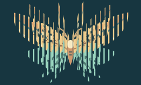

**А это исходные позы.** Первую и третью легко различить даже без движения. Один миллиметр сдвига на печатном экземпляре меняет позу; четыре возвращают первую.


</details>

<a href="#ночная-смена"></a>

### Кинолаборатория

На плёнке — история двух веток. Какие коммиты стали родителями кадра `M`?


<details>
<summary>Свериться с монтажным листом</summary>

**B и C.** Коммит A — их общий предок, а не родитель M.

</details>

#### Граф коммитов

Та же история в нативной диаграмме GitHub. Сравни две линии с кинолентой выше.

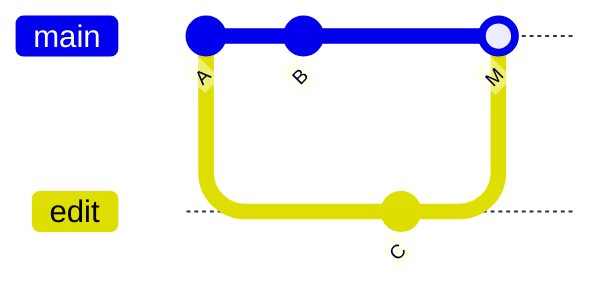

#### Терминал в README

<picture>
  <source media="(prefers-reduced-motion: reduce)" srcset="assets/facet-count.png">
  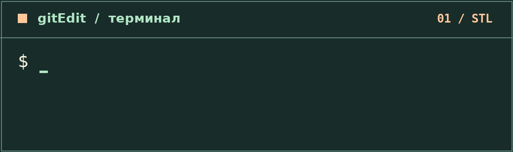
</picture>

Команда ищет в STL строки `facet normal` и получает восемь граней. Это повторяющаяся запись терминала, не приглашение выполнить команду в браузере.

#### Видео с перемоткой

Нажми ▶ в `commit_and_push.mp4`: это демонстрация коммита и отправки изменений из LazyGit. Здесь есть пауза и полоса перемотки; ролик не обязан стартовать сам.

https://github.com/user-attachments/assets/031799d1-740d-4cda-90cf-689513fa9860

#### Что осталось за кадром · D2


На первом переходе выбранное содержимое попадает в индекс, на втором — в историю. Это готовый рисунок D2, а не ещё один нативный просмотрщик.

#### Шахматный этюд

Ход белых, мат в один. Белые: король g6 и ладья a7. Чёрные: король h8.


<details>
<summary>Проверить свой ход</summary>

**Лa8#**. Ладья даёт шах по восьмой горизонтали и отрезает g8. Белый король держит g7 и h7.

</details>

#### Проявочная

Один хребет, два оттиска. У «Ризографа» краска смещена относительно точечного растра. У «Фосфора» те же вершины светятся на сетке экрана.

<p align="center">
  
  
</p>

| Палитра | Тема | Фон | Текст | Акцент |
|---|---|---|---|---|
| Ризограф | светлая | `#FFF1D9` | `#292948` | `#EF6747` |
| Фосфор | тёмная | `#102622` | `#ADF2CB` | `#FFD182` |
| Чертёж | светлая | `#F6F3FF` | `#261D3C` | `#61419A` |
| Чертёж | тёмная | `#211B32` | `#FAF5FF` | `#D5BAFF` |
| Созвездие | светлая | `#EEF8F3` | `#153B30` | `#18654E` |
| Созвездие | тёмная | `#142C27` | `#F0FCF6` | `#A0E8C9` |

#### Печатный лист


Это содержимое одностраничного PDF в виде PNG. Та же картинка размером 1280 × 640 подходит для карточки ссылки на репозиторий.

## Что умеет README на GitHub

### Оглавление

- **Форма:** [бумажный раскрой](#бумажный-кристалл) · [вращаемая модель](#покрути-кристалл) · [кейс: сетка и свет](#кейс-проекта) · [обложка «Север» и печатные оттиски](#мастерская-оформления).
- **Данные:** [перфолента](#перфолента) · [город вкладов](#город-вкладов) · [отпечаток репозитория](#отпечаток-репозитория) · [две карты](#две-карты) · [графики](#графики-из-данных).
- **Движение:** [театр теней](#театр-теней) · [кинолента и граф веток](#кинолаборатория) · [терминал](#терминал-в-readme) · [видео с перемоткой](#видео-с-перемоткой).
- **Своё портфолио:** [витрина шаблонов](#витрина-шаблонов) · [палитра Markdown](#палитра-markdown) · [исходники и готовые блоки](#исходники-readme).

## Мастерская оформления

### Живой фон: где проходит край

<picture>
  <source media="(max-width: 600px) and (prefers-reduced-motion: no-preference)" srcset="assets/polar-cover-compact.svg">
  <source media="(max-width: 600px)" srcset="assets/polar-cover-compact-still.svg">
  <source media="(prefers-reduced-motion: no-preference)" srcset="assets/polar-cover.svg">
  
</picture>

На обложке **«Север»** посмотри на ближний берег: он сдвигается заметнее дальнего хребта. Световая завеса плывёт чуть вверх, а луна и заголовок стоят на месте. Открывать картинку не нужно. На узком экране луна остаётся в кадре, при системном уменьшении движения браузер выбирает неподвижную обложку.

Это **фон внутри картинки**, а не подложка под Markdown. За обычные заголовки и списки GitHub свой фон поставить не даёт. Для сравнения — тот же пейзаж на отдельной HTML-странице:

<details>
<summary>Посмотреть, как выглядит фон за настоящим текстом сайта</summary>

<picture>
  <source media="(max-width: 600px)" srcset="assets/polar-page-compact.png">
  
</picture>

Здесь показан **снимок**. На самой странице текст можно выделить, прокрутить до оттисков и остановить фон, не останавливая прокрутку. Для просмотра выставки покидать README не нужно.

</details>

### Два оттиска одного кольца

<p align="center">
  
  
</p>

Геометрия и камера одни и те же. **Перо** показывает изгиб линией; **растр** собирает свет из ячеек 4 × 4. Прищурься: отверстие видно на обеих карточках, хотя во второй нет ни одного обводящего штриха.

### Марки вместо меню

<p align="center">
  <a href="#покрути-кристалл">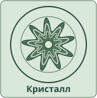</a>
  <a href="#квартал-в-3d">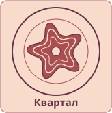</a>
  <a href="#кинолаборатория">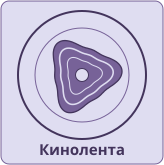</a>
</p>

Выбери марку: каждая ведёт к своей работе **на этой странице**. Имя проекта задаёт число лепестков, поворот и краску. У «Кристалла» по окружности медленно идёт надпись, сама розетка и подпись не вращаются.

### Форзац из одной плитки


Квадрат с двумя дугами можно оставить как есть или повернуть на четверть оборота. Получился узор для разделителя глав. **К какому номеру ведёт линия от А?**

<details>
<summary>Проявить дорожку</summary>

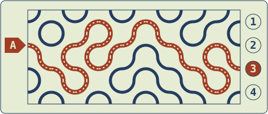

**А → 3.** Дорожка проходит 30 дуг. Плитки не поменялись: поверх тех же линий напечатан пунктир.

</details>

## Витрина шаблонов

Выбери обложку. «Чертёж» ведёт к разбору одной работы, «Созвездие» — к карточке профиля. Обе открывают раздел **на этой странице**.

<p align="center">
  <a href="#кейс-проекта"></a>
  <a href="#карточка-профиля"></a>
</p>

### Карточка профиля


Верхняя строка задаёт тему мастерской. Ниже — не список навыков, а пример работы с данными: вот что лежит внутри одного проекта.

### Отпечаток репозитория

<picture>
  <source media="(max-width: 600px)" srcset="assets/repo-fingerprint-compact.svg">
  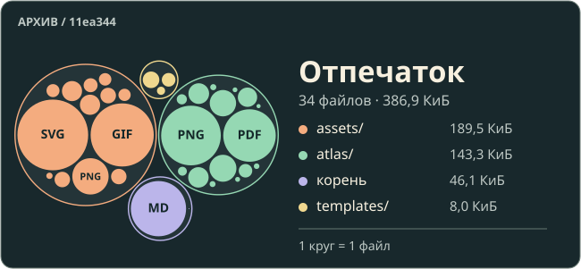
</picture>

Один круг — один файл. Площадь соответствует числу байтов, цвет и внешний контур — каталогу первого уровня. Это снимок `gitEdit` на коммите `11ea344`, **до** добавления этой карты, а не постоянно обновляемый счётчик.[^snapshot]

<details>
<summary>Что за самый большой круг с надписью SVG?</summary>

Это рисунок «File → Index → Commit» из [разбора под видео](#что-осталось-за-кадром--d2). В этом срезе он занимает 77 397 байт. У соседнего GIF с записью терминала — 61 627 байт. Так по отпечатку можно найти тяжёлую иллюстрацию, не просматривая каталоги.

</details>

## Две карты

### Маршрут по точкам · GeoJSON

Приблизь ломаную между A и B. Два маркера обозначают её концы, между ними ещё два отсчёта. Координаты учебные.

```geojson
{
  "type": "FeatureCollection",
  "features": [
    {"type": "Feature", "properties": {"title": "Условная точка A"}, "geometry": {"type": "Point", "coordinates": [-19.10, 64.20]}},
    {"type": "Feature", "properties": {"title": "Условная точка B"}, "geometry": {"type": "Point", "coordinates": [-18.86, 64.28]}},
    {"type": "Feature", "properties": {"title": "Учебный профиль A–B", "stroke": "#7156a0"}, "geometry": {"type": "LineString", "coordinates": [[-19.10, 64.20], [-19.02, 64.26], [-18.94, 64.24], [-18.86, 64.28]]}}
  ]
}
```

### Два листа с общей границей · TopoJSON

Найди стык двух участков. Для соседей он записан всего один раз: западный лист проходит границу в одну сторону, восточный — в обратную.

```topojson
{
  "type": "Topology",
  "objects": {
    "sheets": {"type": "GeometryCollection", "geometries": [
      {"type": "Polygon", "properties": {"title": "Западный лист", "fill": "#9469bd"}, "arcs": [[0, 1]]},
      {"type": "Polygon", "properties": {"title": "Восточный лист", "fill": "#38806e"}, "arcs": [[-1, 2]]}
    ]}
  },
  "arcs": [
    [[-19.0, 64.18], [-19.0, 64.30]],
    [[-19.0, 64.30], [-19.14, 64.30], [-19.14, 64.18], [-19.0, 64.18]],
    [[-19.0, 64.18], [-18.82, 64.18], [-18.82, 64.30], [-19.0, 64.30]]
  ]
}
```

## Графики из данных

### Что весит больше: модель или её обложка?

STL кристалла занимает **1,2 КиБ**. У печатного листа три версии: SVG — **2,8 КиБ**, PDF — **41,6 КиБ**, PNG — **53,8 КиБ**. Это размеры файлов выставки.

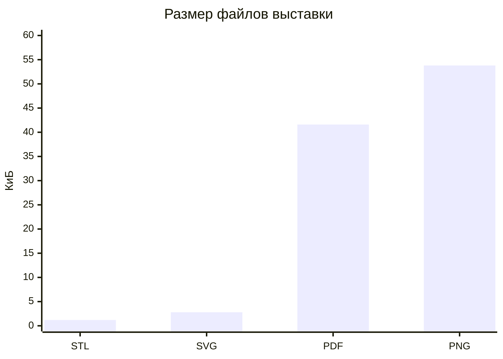

### Куда ушли эскизы? · Диаграмма Санкея

Из 12 эскизов четыре ушли в архив, восемь — на цветопробу. Из них пять отправили в печать, три — на экран. Теперь число задаёт толщину потока, а не высоту столбца.

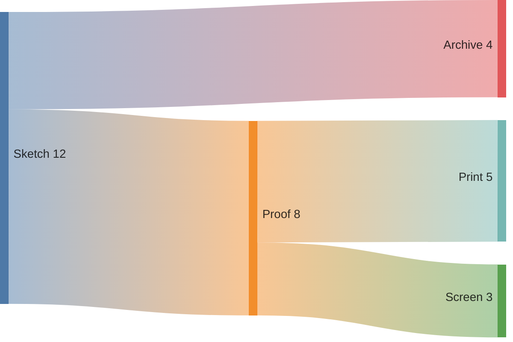

## Схемы Mermaid

**Цветопроба.** Проследи путь от эскиза до тиража. Какое решение возвращает работу на предыдущий этап?

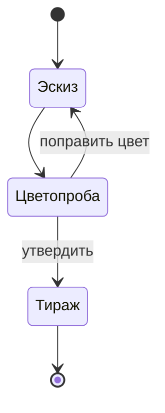

**Доли.** Из десяти частей макета шесть отведены бумаге, три — чернилам, одна — акценту.

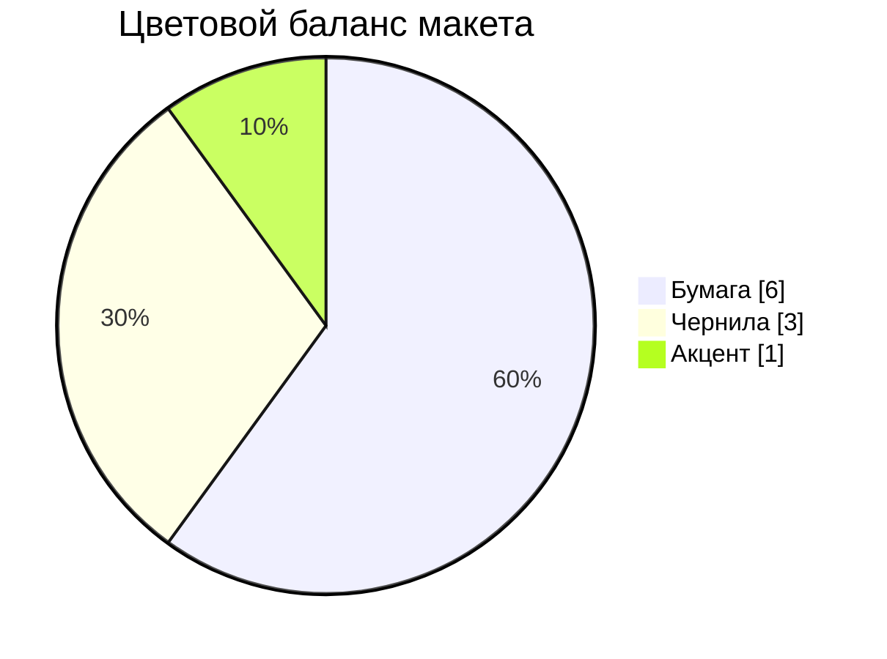

**Сроки.** Эскиз, цветопроба и печать занимают разное время; каждая работа начинается после предыдущей.

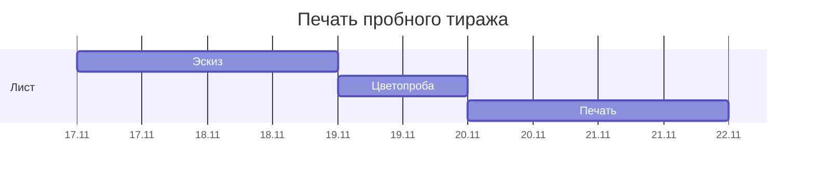

**Архитектура.** Для презентации два пути — подготовка 3D и сборка слайдов — сходятся в одном файле.


**Диалог сервисов.** Здесь важны не размеры и не доли, а порядок запроса, записи и ответа.

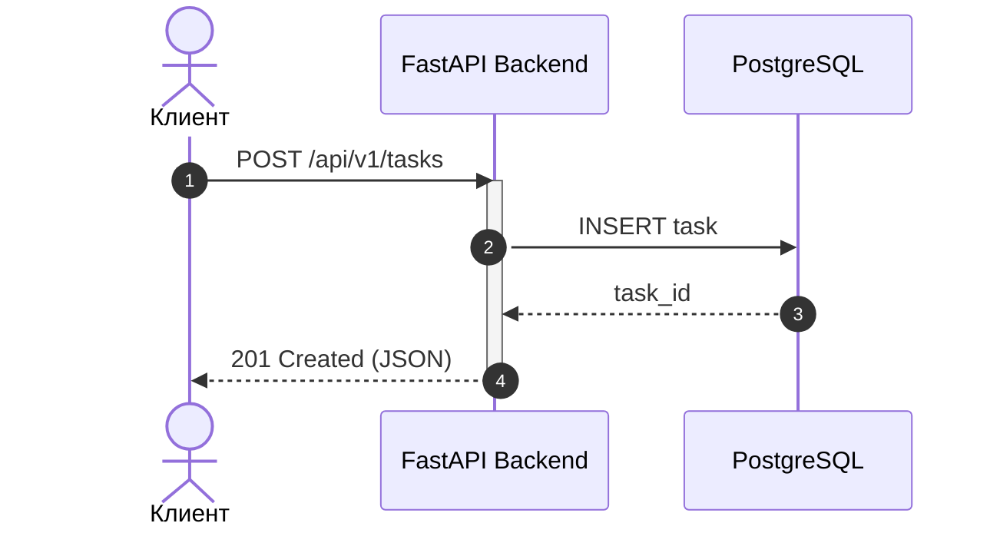

## Палитра Markdown

### Бейджи и иконки

Пять стилей одной плашки: плоская, квадратная, крупная, объёмная и социальная. Ниже две кнопки ведут не в файлы, а к работам этой выставки.

    

[](#кейс-проекта) [](#отпечаток-репозитория)

**Примеры технологических меток**, не перечень зависимостей gitEdit:

              

**Живые счётчики gitEdit** — последнее обновление, размер и звёзды. Этот ряд, плашки и плитки стека загружаются с внешних сервисов; для просмотра города и кейсов эти сервисы не нужны.


**Python / 3D:**


**Fullstack / DevOps:**


### Пять видов оповещений

> [!NOTE]
> **Заметка (`[!NOTE]`):** Полезный контекст или справочная деталь, на которую стоит обратить внимание.

> [!TIP]
> **Совет (`[!TIP]`):** Лайфхак, ускоряющий работу — например, запуск в быстром режиме `FAST=1`.

> [!IMPORTANT]
> **Важно (`[!IMPORTANT]`):** Ключевое требование, без которого проект не запустится как задумано.

> [!WARNING]
> **Внимание (`[!WARNING]`):** Потенциальный подводный камень или ограничение совместимости.

> [!CAUTION]
> **Опасно (`[!CAUTION]`):** Действие может удалить данные или сломать сборку.

### Вёрстка и текст


Подпись обтекает оттиск. При узком экране рисунок занимает чуть больше трети строки, а не вытесняет текст целиком.

<br clear="right">

<ruby>色見本<rp> (</rp><rt>いろみほん</rt><rp>)</rp></ruby> — «образец цвета»: чтение набрано над иероглифами. Нижний и верхний индексы тоже остаются текстом: H<sub>2</sub>O и м<sup>2</sup>.

```diff
- Показать только название проекта.
+ Показать работу, а название оставить в подписи.
```

- [x] Кейс понятен по неподвижному кадру.
- [ ] Подставить собственную работу при копировании.

<details>
<summary>Проверить раскрытие с клавиатуры</summary>

На заголовок можно перейти клавишей <kbd>Tab</kbd>, раскрыть или закрыть его — <kbd>Enter</kbd> или <kbd>Пробел</kbd>. Галочки выше — состояние документа, а не голосование.

</details>

## Где заканчивается README

Кристалл и квартал можно повернуть, карты приблизить, у видео нажать Play. У GIF нет ручной перемотки, а у нашего сравнения нет перетаскиваемой ручки. Переключатель автозапуска GIF в GitHub и системное уменьшение движения — разные настройки. Если система просит меньше движения, «Север» останется неподвижным. Поиск по CSV и просмотр самого PDF работают в просмотрщиках файлов; для своего JavaScript или игры с сохранением ходов нужен другой интерфейс.

---

## Исходники README

[Весь Markdown одним файлом (Raw)](https://github.com/overbaffe1/gitEdit/raw/refs/heads/main/README.md) · [Код с номерами строк](https://github.com/overbaffe1/gitEdit/blob/main/README.md?plain=1) · [Скачать README со всеми картинками (ZIP)](https://github.com/overbaffe1/gitEdit/archive/refs/heads/main.zip)

### Забрать «Ночную смену» целиком

**[Готовый README-выставка](templates/EXHIBITION-README-TEMPLATE.md)** — стол с тремя рабочими ссылками, три кейса, билеты между ними и неподвижные варианты. Возьми каталог `assets/night-shift/` из ZIP выше. У шаблона в `templates/` ссылки начинаются с `../assets/`; когда кладёшь его в корень своего репозитория, замени этот префикс на `assets/`. Новая работа подставляется вместо экспоната, а не вместо одной общей шапки.

| Что переносить в своё портфолио | Мастера и материалы | Разобранный пример |
|---|---|---|
| **Меню-сцена.** Выбери предметы, которые рассказывают о работах. Целая треть стола — обычная ссылка на заголовок. Текстовые ссылки под столом делают то же самое. | [Цельная иллюстрация](assets/night-shift/bench-master.jpg) · [нарезка, надписи и билеты](atlas/samples/night_shift/bench.py). Иллюстрация мастерской сгенерирована для gitEdit; это воображаемый интерьер, не фотография приборов. | В портфолио-комнате **pixel** [1](https://github.com/ayush6447/pixel) предмет открывает панель веб-приложения. Здесь не нужны карта кликов, JavaScript или кликабельные элементы внутри SVG. |
| **Объект → инструкция.** Для объёмной работы покажи способ сборки, а не только красивый ракурс. | [STL](atlas/samples/crystal.stl) · [кинопетля](assets/night-shift/fold.gif) · [два неподвижных положения](assets/night-shift/fold-still.png) · [выкройка А4](assets/night-shift/crystal-net.svg) · [разворачивание по рёбрам](atlas/samples/night_shift/crystal.py). Для печати открой скачанный SVG, выбери альбомный A4 и 100 %, проверь линейку. | **Papercraft lab** [3](https://github.com/sderosiaux/papercraft-lab) показывает переход от меша к бумаге, парные номера и клапаны. Здесь своя развёртка восьми граней, без Blender. |
| **Данные → материальный носитель.** Вместо счётчика дай читателю расшифровать одну разницу. | [112 дней CSV](atlas/samples/snake-weeks.csv) · [лента](assets/night-shift/weeks-tape.svg) · [раскладка для телефона](assets/night-shift/weeks-tape-compact.svg) · [ключ](assets/night-shift/weeks-key.svg) · [набор ленты](atlas/samples/night_shift/tape.py). | Снимки настоящей ленты и объяснение отверстий подачи — **ICL CES** [2](https://iclces.uk/articles/reading_punched_paper_tape.html). Наши шесть весов — собственный код для чисел 0–63, не историческая лента ASCII. |
| **Движение → оптическая игрушка.** Из четырёх силуэтов собери один полосатый отпечаток. | [Проектор](assets/night-shift/moth-projector.svg) · [стоп-кадр](assets/night-shift/moth-still.svg) · [четыре позы](assets/night-shift/moth-poses.svg) · [бумага](assets/night-shift/moth-paper.svg) и [решётка](assets/night-shift/moth-grille.svg) · [генератор](atlas/samples/night_shift/projector.py). Печатай пару **120 × 72 мм** в одном масштабе: рисунок на бумаге, решётку на прозрачной плёнке. | Для прямых полос — [animbar](https://github.com/jtojnar/animbar); у **FabObscura** [4](https://github.com/tichaesque/FabObscura) есть и криволинейные барьеры. Рисунок мотылька и разбиение на фазы здесь свои. |

<details>
<summary>Пересобрать экспонаты и подставить свои работы</summary>

Из корня, Python 3. Для панорамы и GIF нужны Pillow ≥ 10 и шрифты DejaVu Sans/Mono; лента и проектор собираются одной стандартной библиотекой. Скрипты не обращаются к сети.

```sh
python3 atlas/samples/night_shift/bench.py
python3 atlas/samples/night_shift/crystal.py
python3 atlas/samples/night_shift/tape.py
python3 atlas/samples/night_shift/projector.py
```

В сцене соседние `</a><a>` идут **без пробела**, у каждого ``: так три фрагмента не распадаются на отдельные карточки. Замени картинку, адрес якоря **и** `alt` каждого прибора. Оставь смысл и подписи обычным Markdown — мелкая надпись на иллюстрации не заменяет заголовок.

</details>

### Забрать оформление

- **[Шаблон проекта](templates/PROJECT-README-TEMPLATE.md)** и **[шаблон профиля](templates/PROFILE-README-TEMPLATE.md)**. README публичного репозитория `логин/логин` появляется в профиле. Сами обложки: [«Чертёж»](assets/cover-project.svg) и [«Созвездие»](assets/cover-profile.svg).
- **Предыдущая шапка:** [узкая](assets/banner-compact.svg), [светлая](assets/banner-light.svg), [тёмная](assets/banner-dark.svg), [полоса-разделитель](assets/divider.svg). **Подпись с волной и печатью:** [самодостаточный SVG](assets/portfolio-signature.svg).
- **[Заготовка workflow для личной змейки](templates/profile-snake-workflow.yml)** рассчитана на Platane/snk и отдельную ветку с картинками. Это шаблон, а не включённая автоматизация; для просмотра выставки Actions не нужны.

<details>
<summary>Скопировать мини-портфолио целиком</summary>

Положи изображения из архива в `assets/` рядом со своим README. Обложки здесь ведут на якоря внутри документа. Замени подписи и работы на свои.

```markdown
# Мастерская

[Кейс](#кейс) · [Профиль](#профиль)

<p>
  <a href="#кейс"></a>
  <a href="#профиль"></a>
</p>

## Кейс

<picture>
  <source media="(prefers-reduced-motion: reduce)" srcset="assets/crystal-wipe.png">
  
</picture>

Одинаковая камера, две обработки. Что изменилось и как это проверить?

## Профиль


```

</details>

### Повторить мастерскую оформления

| Приём | Забрать и изменить | Откуда идея |
|---|---|---|
| Пейзаж за названием | «Север»: [широкая](assets/polar-cover.svg) и [узкая](assets/polar-cover-compact.svg) композиции; [широкий](assets/polar-cover-still.svg) и [узкий](assets/polar-cover-compact-still.svg) неподвижные оттиски. В [генераторе](atlas/samples/polar-press.py) поменяй короткое `NAME`, подпись `STRAP` и две палитры. | [Haikei](https://haikei.app/) раскладывает фон на волны и пики; здесь свой берег и завеса из кривых. Двигаются группы SVG, а не текст README. |
| Фон за текстом страницы | [Сайт одним HTML-файлом](atlas/north.html) + [фоновый слой без надписи](assets/polar-plate.svg) + оба кольца из строки ниже. Снимки для README: [960 × 600](assets/polar-page.png) и [360 × 640](assets/polar-page-compact.png). | У [Vanta](https://github.com/tengbao/vanta) фон прикрепляется к элементу сайта с помощью JS. Нашему примеру хватает CSS: слой закреплён за текстом, галочка ставит на паузу только его движение. |
| Линия и точка | [Перо](assets/ring-pen.svg) · [растр](assets/ring-screen.svg) · [генератор кольца](atlas/samples/print-ring.py). Из одной проекции берутся видимые линии поверхности и освещённость для пороговой матрицы Байера. | [Перьевой этюд Stéphane Tombeur в canvas-sketch](https://github.com/mattdesl/canvas-sketch/blob/master/examples/pen-plotter-circle-segments.js) и [виды дизеринга](https://github.com/makew0rld/dither). Оба наших оттиска — SVG без растровой подложки. |
| Серия марок | [Кристалл](assets/seal-crystal.svg) · [квартал](assets/seal-skyline.svg) · [кинолента](assets/seal-reel.svg). [Генератор](atlas/samples/maker-seals.py) берёт байты SHA-256 имени; одинаковое имя даёт ту же форму и палитру. Это не уникальный идентификатор. | [Jdenticon](https://jdenticon.com/) строит знаки из значения. У нас своя формула розетки, а [textPath](https://developer.mozilla.org/en-US/docs/Web/SVG/Reference/Element/textPath) укладывает буквы по кольцу. |
| Модульный форзац | [Узор](assets/tile-frieze.svg) · [проявленная дорожка](assets/tile-route.svg) · [четыре строки набора и трассировка](atlas/samples/tile-frieze.py). Цифра выбирает ориентацию плитки, не цвет. | [Truchet Tiles](https://github.com/evoluteur/truchet-tiles) показывает, как из поворотов одного квадрата получаются петли. В README вместо редактора — наш набор и второй оттиск внутри `<details>`. |

<details>
<summary>Вставить обложку, напечатать свою марку или открыть фон на весь экран</summary>

Скопируй четыре файла `polar-cover*.svg` в `assets/` рядом с README. У каждого размера есть завершённый неподвижный вариант; если условия `<source>` не поддерживаются, останется обычный ``. Краски дня и ночи заданы **внутри** SVG.

```html
<picture>
  <source media="(max-width: 600px) and (prefers-reduced-motion: no-preference)" srcset="assets/polar-cover-compact.svg">
  <source media="(max-width: 600px)" srcset="assets/polar-cover-compact-still.svg">
  <source media="(prefers-reduced-motion: no-preference)" srcset="assets/polar-cover.svg">
  
</picture>
```

Все векторные листы этой мастерской собираются из корня репозитория на Python 3, без дополнительных пакетов, шрифтов для загрузки, токенов и Actions:

```sh
python3 atlas/samples/polar-press.py
python3 atlas/samples/print-ring.py
python3 atlas/samples/maker-seals.py
python3 atlas/samples/tile-frieze.py
# Своя марка: ключ рисунка, файл и надпись. Без --orbit буквы стоят на месте.
python3 atlas/samples/maker-seals.py my-project my-mark.svg --label 'Мой проект' --orbit
```

**Чтобы получить фон под обычным текстом**, распакуй ZIP репозитория и открой `atlas/north.html` в браузере. Сборка или сервер не нужны. Это отдельная страница: ссылка на `.html` в списке файлов GitHub показывает **исходник**, а не действующий сайт. Для публикации подойдёт [GitHub Pages](https://docs.github.com/en/pages/getting-started-with-github-pages/what-is-github-pages); для этого примера настройки репозитория не менялись.

**Почему не `<style>` в README?** В [описании обработки GitHub Markup](https://github.com/github/markup#github-markup) есть отдельный этап очистки HTML. При проверке через GitHub `/markdown` блок `<style>` стал текстом, а у обычного `<div>` исчезли `class` и `style`. `<picture>` и условия `media` у `<source>` сохранились. Поэтому пейзаж с надписью экспортирован как картинка, а не как попытка оформить `body` страницы GitHub.

</details>

### Откуда взялись экспонаты

| Экспонат | Готовый файл и воспроизводимый исходник |
|---|---|
| Город вкладов | [GIF](assets/contribution-city.gif) · [полный неподвижный кадр](assets/contribution-city.png) · [скрипт экспорта](atlas/samples/render-city.py). Кадры сняты с [оригинального SVG yoshi389111](https://github.com/yoshi389111/github-profile-3d-contrib/blob/e235d118909be71eb7edb05482a3de4e76156df3/docs/demo/profile-night-view.svg) (© SATO, Yoshiyuki, [MIT](assets/licenses/contribution-city-MIT.txt)). В оригинале `dur="3s"`, `repeatCount="1"`: при открытии файла с начала виден ещё один проход. Здесь первый кадр уже заполнен, затем идёт обратный ход и повтор роста. |
| Змейка | [GIF](assets/snake-weeks.gif) · [PNG](assets/snake-weeks.png) · [данные за 112 дней](atlas/samples/snake-weeks.csv) · [наш отрисовщик](atlas/samples/render-calendar.py). Идея календаря — [Platane/snk](https://github.com/Platane/snk). Это собственный маршрут по **коммитам репозитория**, не копия рисунка Platane и не календарь вкладов пользователя. Даты коммитера в UTC посчитаны по [Commits API LazyGit, страницы по 100 записей](https://api.github.com/repos/jesseduffield/lazygit/commits?sha=bb64e3ccb6524368945ba0dfd3134b4189644eed&since=2025-01-06T00:00:00Z&until=2025-04-27T23:59:59Z&per_page=100). |
| Квартал в 3D | [STL 16 недель](atlas/samples/weekly-skyline.stl) · [генератор на чистом Python](atlas/samples/weekly-skyline.py). Читает тот же CSV, печатает два треугольника на каждую сторону дома. `python atlas/samples/weekly-skyline.py --update-readme` обновляет файл и только его встроенный блок. |
| Сетка ↔ свет | [GIF](assets/crystal-wipe.gif) · [кадр сравнения](assets/crystal-wipe.png) · [сетка](assets/crystal-wire.png) · [свет](assets/crystal-light.png) · [отрисовщик по настоящему STL](atlas/samples/render-passes.py). Ползунок для сайта и GIF-переход для документа — два подхода у [Knight Lab](https://juxtapose.knightlab.com/) ([JuxtaposeJS](https://github.com/NUKnightLab/juxtapose)). Здесь свой GIF, без встроенного JS. |
| Оттиск символами | Тот же `render-passes.py --stamp` печатает проекцию гранями разной плотности. Ещё один подход к графике в терминале — [Chafa](https://github.com/hpjansson/chafa); наш оттиск рассчитан из вершин, а не взят из чужого скриншота. |
| Отпечаток репозитория | [Широкий SVG](assets/repo-fingerprint.svg) · [мобильный SVG](assets/repo-fingerprint-compact.svg) · [скрипт по `git ls-tree`](atlas/samples/repo-fingerprint.mjs). Идея упаковки файлов в круги — [эксперимент GitHub Next](https://githubnext.com/projects/repo-visualization/) и [реальный README с repo-visualizer](https://github.com/githubocto/repo-visualizer-demo). У нас статичный экспорт D3, не iframe и не запущенный Action. |
| Видео, терминал, рисунок | Вложение взято из [README LazyGit](https://github.com/jesseduffield/lazygit#readme). Наши [терминальная запись `.cast`](atlas/samples/facet-count.cast), [GIF](assets/facet-count.gif) и [PNG](assets/facet-count.png); похожие инструменты — [asciinema/agg](https://github.com/asciinema/agg) и [VHS](https://github.com/charmbracelet/vhs). Для схемы рядом — [файл D2](atlas/samples/staging.d2) и [экспорт SVG](assets/staging.svg). |
| Кинолента, печать, шахматы | [Граф веток](assets/commit-reel.svg), [ризограф](assets/relief-riso.svg), [фосфор](assets/relief-phosphor.svg), [палитры CSV](atlas/samples/palettes.csv), [мастер печатного листа](atlas/samples/atlas-plate.svg), [PNG](atlas/samples/social-preview.png), [PDF](atlas/samples/field-sheet.pdf), [наш этюд](assets/mate-in-one.svg). У [Tim Burgan](https://github.com/timburgan/timburgan#tims-community-chess-tournament) ход делают через Issues; здесь это задача с открываемым ответом. |

<details>
<summary>Повторить экспорт: геометрия, календарь и карта файлов</summary>

Из корня репозитория, с Python 3, Pillow и шрифтами DejaVu Sans:

```sh
python atlas/samples/render-passes.py
python atlas/samples/render-passes.py --stamp
python atlas/samples/render-calendar.py
```

Для отпечатка нужен Node.js и `d3-hierarchy@3`. Передай нужный коммит вместо `11ea344`: скрипт обновит обе раскладки и напечатает общий размер. Для чужого SVG города отдельно нужны Playwright и Chromium; скрипт экспорта принимает файл ровно той версии, на которую ведёт ссылка в таблице.

```sh
npm install --no-save --package-lock=false d3-hierarchy@3
node atlas/samples/repo-fingerprint.mjs 11ea344
```

</details>

### Рецепты GitHub Markdown

<details>
<summary>3D, карты, формулы и Mermaid</summary>

- **STL:** вставь полный **текст** [crystal.stl](atlas/samples/crystal.stl) между строками ` ```stl ` и ` ``` `. Имя файла или двоичный STL в блоке не сработают. [Блокнот](atlas/samples/crystal.ipynb) проверяет вершины, рёбра и грани. Для объёмного календаря вместо картинки есть генератор STL [gh-skyline](https://github.com/github/gh-skyline).
- **Карты:** точно так же вложи [данные маршрута](atlas/samples/survey.geojson) в `geojson`, [данные двух листов](atlas/samples/sheets.topojson) — в `topojson`. В координатах сначала долгота. [Документация встроенных просмотрщиков](https://docs.github.com/en/get-started/writing-on-github/working-with-advanced-formatting/creating-diagrams).
- **Mermaid:** возьми [схему состояний](atlas/samples/edition.mmd) или короткий пример ниже. Для графиков есть [XY](https://mermaid.js.org/syntax/xyChart.html) и [Sankey](https://mermaid.js.org/syntax/sankey.html); версия движка на GitHub может отличаться от [редактора](https://mermaid.live/).

````markdown
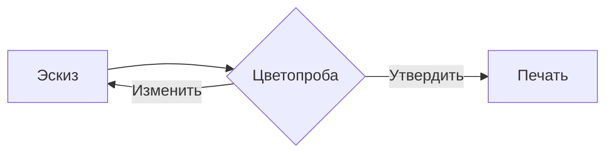

В строке: $F=8$. Отдельная формула:

```math
V-E+F = 6-12+8 = 2
```
````

</details>

<details>
<summary>Тема, размер экрана, уменьшение движения и видео</summary>

Браузер использует первый подходящий `<source>`. Для GIF сверху нужен статичный кадр, для карты файлов — вертикальная компоновка на телефоне, для двух оттисков — выбор по теме. Вот готовый блок города:

```html
<picture>
  <source media="(prefers-reduced-motion: reduce)" srcset="assets/contribution-city.png">
  
</picture>
```

```html
<picture>
  <source media="(max-width: 600px)" srcset="assets/repo-fingerprint-compact.svg">
  
</picture>

<picture>
  <source media="(prefers-color-scheme: dark)" srcset="assets/relief-phosphor.svg">
  
</picture>
```

На GitHub автозапуск GIF зависит и от **Settings → Accessibility → Motion → Autoplay animated images** ([справка GitHub](https://docs.github.com/en/account-and-profile/how-tos/account-settings/managing-accessibility-settings#managing-motion)). README не должен переопределять выбор читателя. Для **видеоплеера** перетащи MP4 в поле редактора GitHub и оставь выданный URL вложения отдельным абзацем. `` — синтаксис изображения, не плеера.

Подпись и волну можно нарисовать локально, как в карточке профиля, или получить из [Typing SVG](https://readme-typing-svg.demolab.com/demo/) и [Capsule Render](https://github.com/kyechan99/capsule-render):

```markdown


```

</details>

<details>
<summary>Бейджи, динамические счётчики и плитка стека</summary>

[Shields.io](https://shields.io/) рисует плашки, [Simple Icons](https://simpleicons.org/) даёт названия логотипов, [Skill Icons](https://github.com/tandpfun/skill-icons) собирает плитку. Стили: `flat`, `flat-square`, `for-the-badge`, `plastic`, `social`. В тексте бейджа пробел кодируется как `%20`, дефис — `--`, подчёркивание — `__`, плюс — `%2B`, процент — `%25`. `color` меняет правую часть плашки, `labelColor` — левую.

```markdown


[](#кейс-проекта)


```

Для статуса реально существующего workflow: `https://img.shields.io/github/actions/workflow/status/<USER>/<REPO>/ci.yml`. Плашка со словом *passing* сама ничего не проверяет. Ещё заготовки: [Markdown Badges](https://github.com/Ileriayo/markdown-badges).

**Технологические метки — строки для копирования:**

```markdown


```

</details>

<details>
<summary>Колонки, загадка, клавиши, цветное оповещение и сноска</summary>

```html

<p>Подпись обтекает рисунок слева.</p>
<br clear="right">

<details>
<summary>Проверить ответ</summary>
<p>Лa8#. Для раскрытия с клавиатуры — <kbd>Enter</kbd>.</p>
</details>
```

```markdown
> [!TIP]
> Оставь неподвижный кадр тем, кто предпочитает читать без анимации.

- [x] Результат виден на странице.[^demo]

[^demo]: Уточнение или источник данных.
```

Для остальных цветов используй `NOTE`, `IMPORTANT`, `WARNING` или `CAUTION`. Для подписи над иероглифами — `<ruby>色見本<rt>いろみほん</rt></ruby>`, для индексов — `<sub>` и `<sup>`.

</details>

**Ещё примеры и первоисточники:** [атлас форматов](atlas/README.md) · [карты и STL](atlas/relief.md) · [набор текста и диаграммы](atlas/native.md) · [20 разборов других проектов](atlas/inspiration.md) · [что оформляется вне README](atlas/surfaces.md). Идея навигации обложками встречается, например, у [Ray Tracing in One Weekend](https://github.com/RayTracing/raytracing.github.io#readme).

[^snapshot]: Источник отпечатка — [дерево gitEdit на 11ea344](https://github.com/overbaffe1/gitEdit/tree/11ea34407408f20f95becf35607f6f0e3b1c6394). Площади посчитаны по размерам Git-блобов, не по их сжатому размеру на диске.
