<p align="center"><a href="assets/night-shift/fold.gif"></a><a href="assets/night-shift/weeks-tape.svg"></a><a href="assets/night-shift/moth-projector.svg"></a></p>

<p align="center">
  <em>Три кадра — <a href="assets/night-shift/bench-master.jpg">одна панорама</a>.</em><br>
  <picture>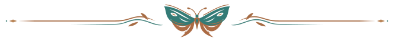</picture>
</p>

## Бюро странных вещей

<a href="atlas/foyer.md"><picture>
  <source media="(max-width: 640px) and (prefers-color-scheme: dark)" srcset="assets/foyer/cover-dark-mobile.svg">
  <source media="(max-width: 640px)" srcset="assets/foyer/cover-light-mobile.svg">
  <source media="(prefers-color-scheme: dark)" srcset="assets/foyer/cover-dark.svg">
  
</picture></a>

<a href="atlas/foyer-look.md"><picture>
  <source media="(max-width: 640px) and (prefers-color-scheme: dark)" srcset="assets/foyer/look-dark-mobile.svg">
  <source media="(max-width: 640px)" srcset="assets/foyer/look-light-mobile.svg">
  <source media="(prefers-color-scheme: dark)" srcset="assets/foyer/look-dark.svg">
  
</picture></a>

<a href="atlas/foyer-make.md"><picture>
  <source media="(max-width: 640px) and (prefers-color-scheme: dark)" srcset="assets/foyer/make-dark-mobile.svg">
  <source media="(max-width: 640px)" srcset="assets/foyer/make-light-mobile.svg">
  <source media="(prefers-color-scheme: dark)" srcset="assets/foyer/make-dark.svg">
  
</picture></a>

<a href="atlas/foyer-prove.md"><picture>
  <source media="(max-width: 640px) and (prefers-color-scheme: dark)" srcset="assets/foyer/prove-dark-mobile.svg">
  <source media="(max-width: 640px)" srcset="assets/foyer/prove-light-mobile.svg">
  <source media="(prefers-color-scheme: dark)" srcset="assets/foyer/prove-dark.svg">
  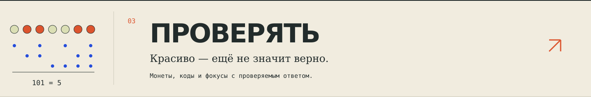
</picture></a>

**Три входа, без правильного порядка:** [смотреть](atlas/foyer-look.md) · [собирать](atlas/foyer-make.md) · [проверять](atlas/foyer-prove.md). Это короткие маршруты по уже существующим экспонатам, а не новая обязательная инструкция.

[Как устроено оформление и что подсмотрено в других README](atlas/foyer.md). Все старые экспонаты — дальше, без сокращений.

## Световой стол

Шесть диапозитивов из уже существующей галереи. **Нажми на изображение или подпись**, чтобы открыть экспонат: рамки декоративные, ссылки настоящие.

<table width="100%">
<tr>
<td width="50%" valign="top"><a href="atlas/printroom.md"><picture><source media="(prefers-color-scheme: dark)" srcset="assets/lighttable/engraving-dark.png">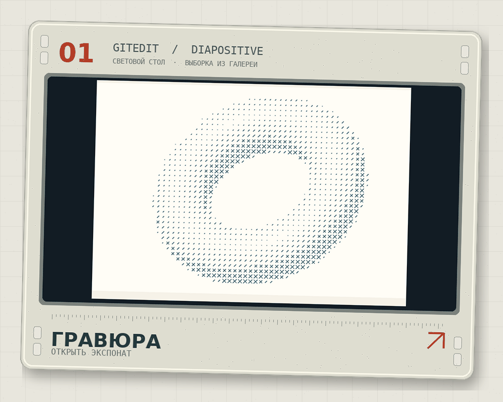</picture></a><br><a href="atlas/printroom.md"><strong>01 · Штриховая гравюра</strong></a><br><sub>Один рисунок. Другой язык печати.</sub></td>
<td width="50%" valign="top"><a href="atlas/afterlight.md"><picture><source media="(prefers-color-scheme: dark)" srcset="assets/lighttable/rosette-dark.png">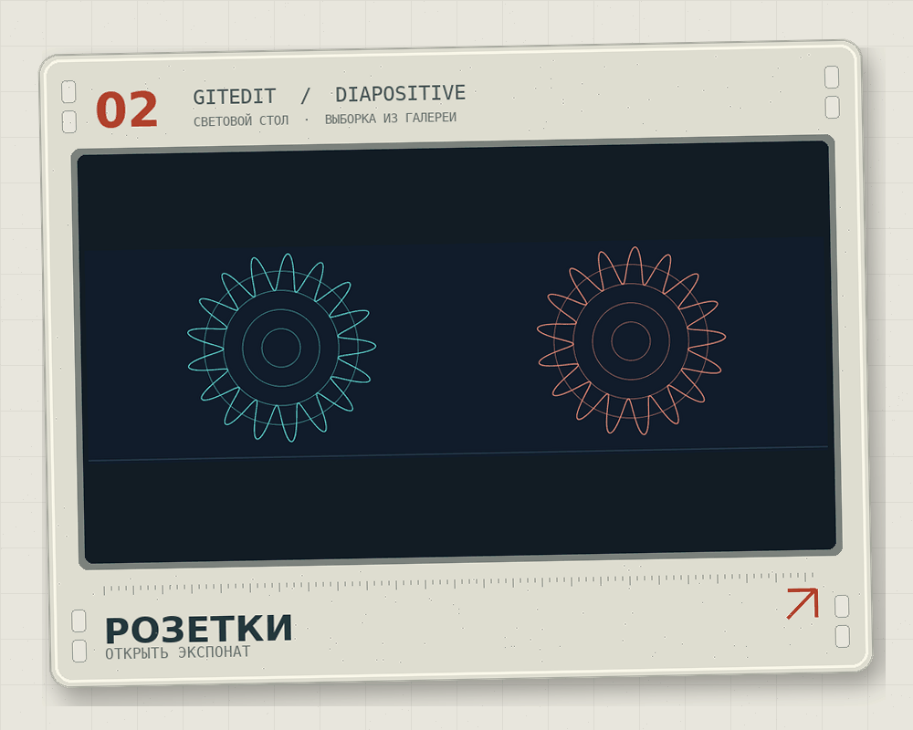</picture></a><br><a href="atlas/afterlight.md"><strong>02 · Гильоширные розетки</strong></a><br><sub>Линия вместо готовой текстуры.</sub></td>
</tr>
<tr>
<td width="50%" valign="top"><a href="atlas/threadmoon.md"><picture><source media="(prefers-color-scheme: dark)" srcset="assets/lighttable/moon-dark.png">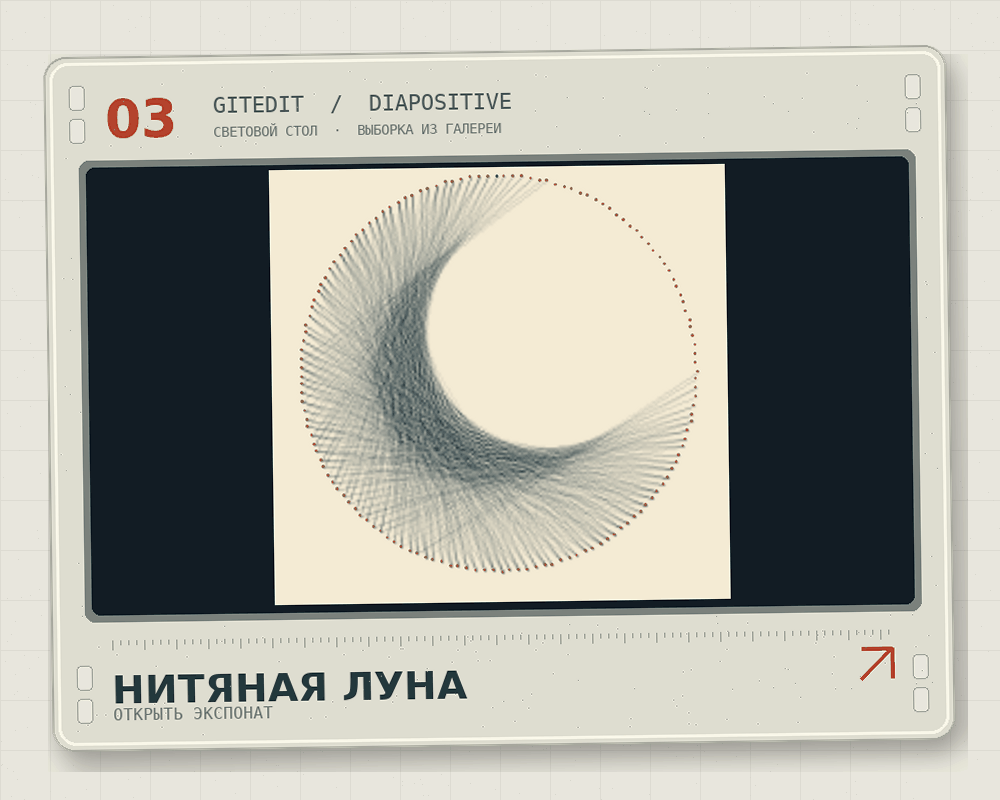</picture></a><br><a href="atlas/threadmoon.md"><strong>03 · Нитяная луна</strong></a><br><sub>Изображение становится маршрутом.</sub></td>
<td width="50%" valign="top"><a href="atlas/stereogram.md"><picture><source media="(prefers-color-scheme: dark)" srcset="assets/lighttable/depth-dark.png">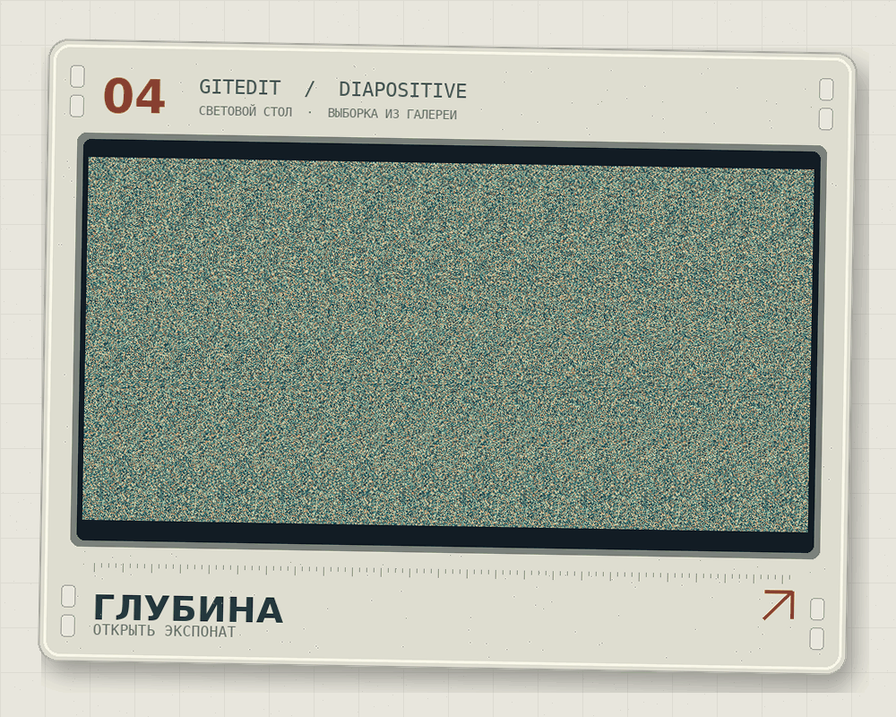</picture></a><br><a href="atlas/stereogram.md"><strong>04 · Скрытая глубина</strong></a><br><sub>Узор, в котором спрятан рельеф.</sub></td>
</tr>
<tr>
<td width="50%" valign="top"><a href="atlas/relief.md"><picture><source media="(prefers-color-scheme: dark)" srcset="assets/lighttable/fold-dark.png">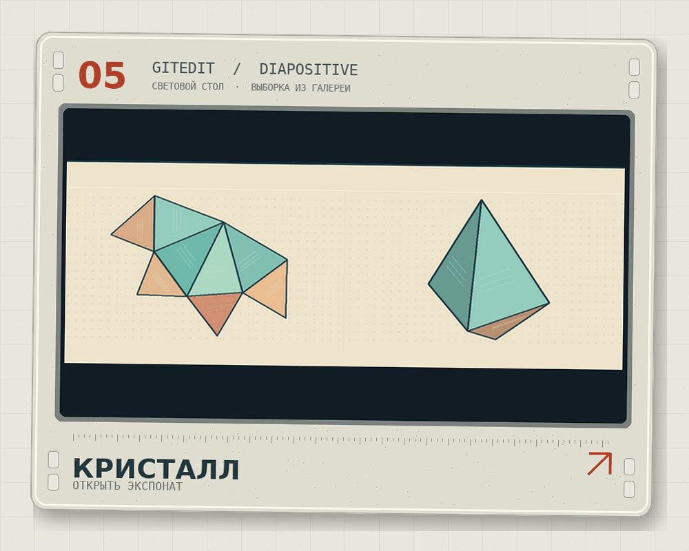</picture></a><br><a href="atlas/relief.md"><strong>05 · Бумажный кристалл</strong></a><br><sub>Из плоского листа — восемь граней.</sub></td>
<td width="50%" valign="top"><a href="atlas/rolling.md"><picture><source media="(prefers-color-scheme: dark)" srcset="assets/lighttable/rolling-dark.png">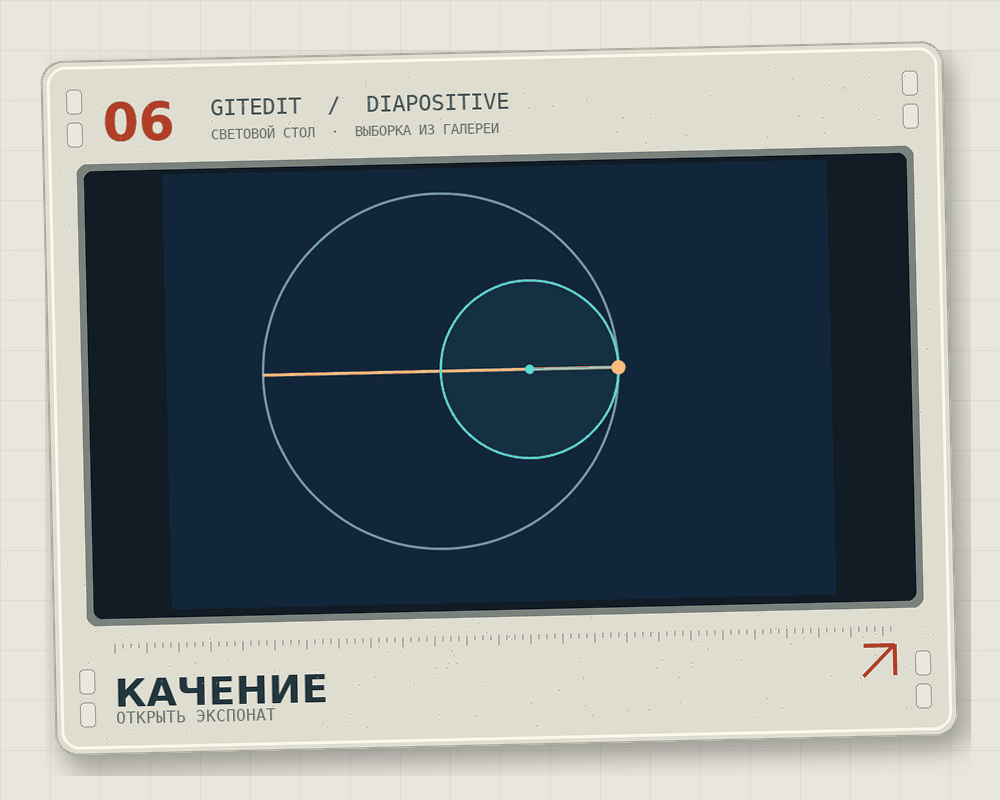</picture></a><br><a href="atlas/rolling.md"><strong>06 · Пара Туси</strong></a><br><sub>Два круга рисуют прямую.</sub></td>
</tr>
</table>

[Контактный лист крупно](assets/lighttable/contact-sheet.jpg) · [Текстовый каталог и устройство оформления](atlas/lighttable.md). Миниатюры кадрированы для навигации: стереограмму и точные рисунки рассматривай в оригиналах.

## Ночной тираж

<a href="atlas/pressroom.md"><picture>
  <source media="(max-width: 640px) and (prefers-reduced-motion: reduce)" srcset="assets/pressroom/still-mobile.svg">
  <source media="(prefers-reduced-motion: reduce)" srcset="assets/pressroom/still.svg">
  <source media="(max-width: 640px)" srcset="assets/pressroom/motion-mobile.svg">
  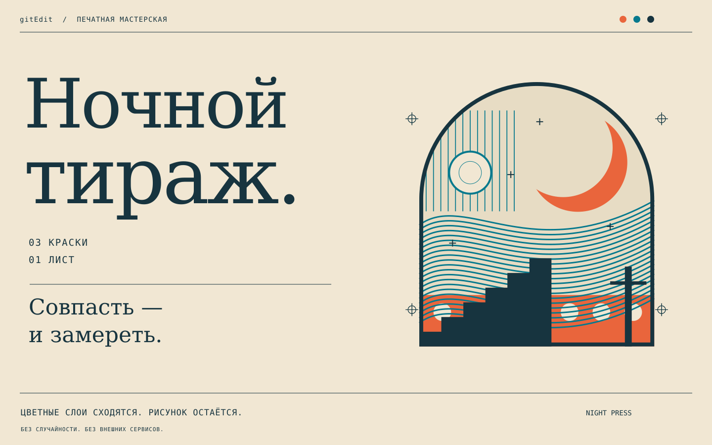
</picture></a>

Три цветовые формы медленно сходятся, затем рисунок надолго замирает. Это **графическая метафора приводки**, не симуляция печатного станка. Заголовок и подписи не двигаются.

[Неподвижный плакат PNG](assets/pressroom/still.png) · [Плакат A4 PDF](assets/pressroom/print-a4.pdf) · [Три слоя отдельно и устройство анимации](atlas/pressroom.md). При reduced-motion показывается статичная композиция; внутри SVG движение тоже отключается. Всё остальное в галерее сохранено.

## Материальная проба

<a href="atlas/materials.md"><picture>
  <source media="(max-width: 640px)" srcset="assets/materials/hero-mobile.jpg">
  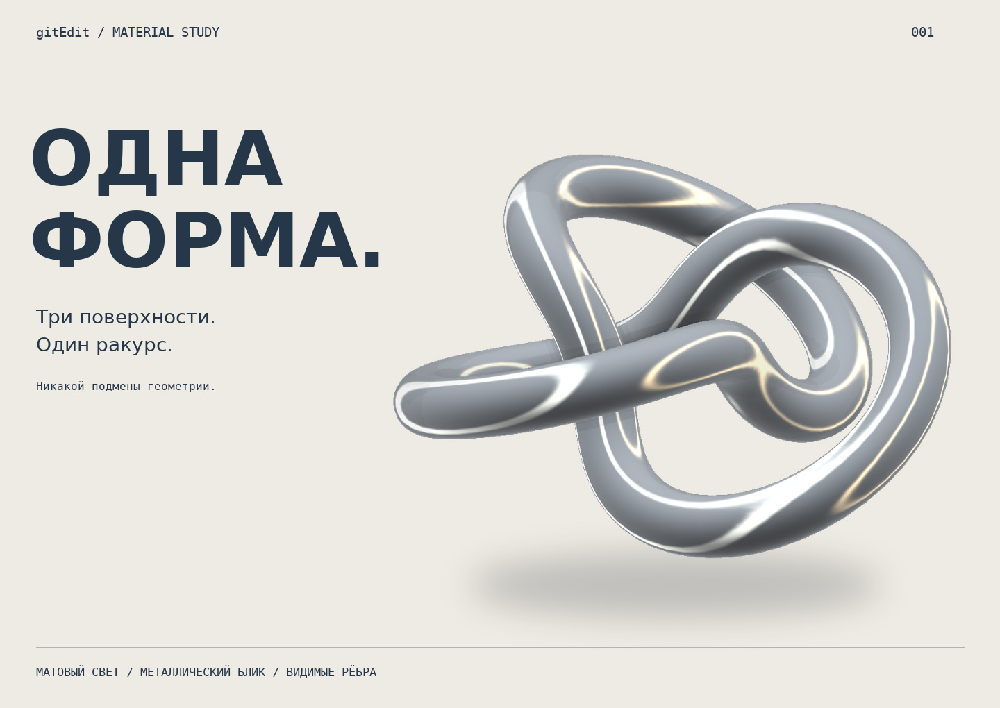
</picture></a>

<picture>
  <source media="(max-width: 640px)" srcset="assets/materials/comparison-mobile.jpg">
  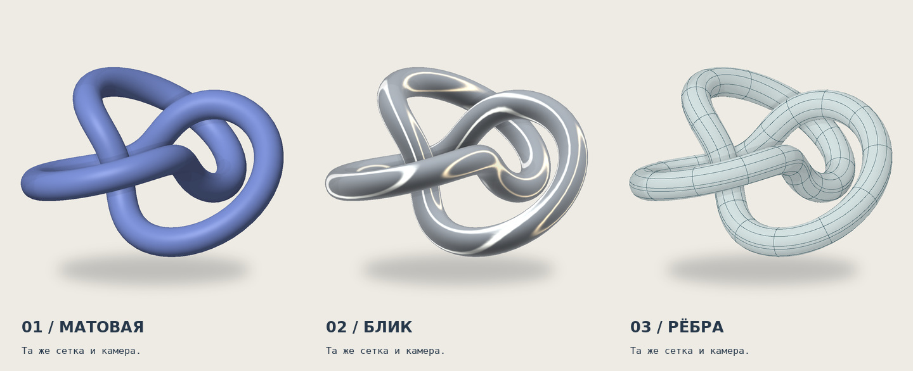
</picture>

**Одна геометрия, камера и видимость — три способа показать поверхность.** Это собственные иллюстративные шейдеры, не фотографии материалов и не физически точная модель отражения.

[Матовая крупно](assets/materials/matte.jpg) · [Металлический блик](assets/materials/metal.jpg) · [Рёбра крупно](assets/materials/wire.jpg) · [Модель STL](assets/materials/form.stl) · [Устройство и исследованные README](atlas/materials.md). В самом README — готовые статичные изображения: WebGL, GPU и внешние сервисы не требуются.

## Карта ночного бюро

<a href="atlas/wayfinding.md"><picture>
  <source media="(max-width: 640px) and (prefers-color-scheme: dark)" srcset="assets/wayfinding/map-dark-mobile.svg">
  <source media="(max-width: 640px)" srcset="assets/wayfinding/map-light-mobile.svg">
  <source media="(prefers-color-scheme: dark)" srcset="assets/wayfinding/map-dark.svg">
  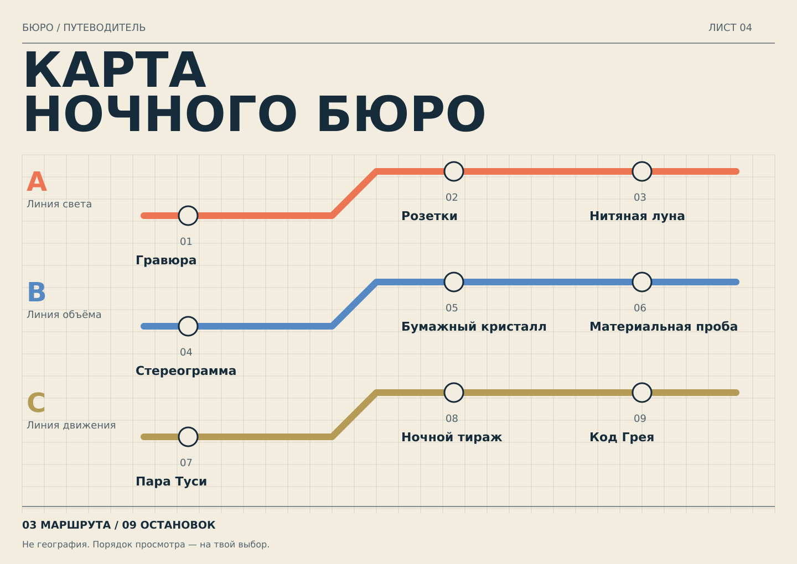
</picture></a>

Это **схема просмотра, не географическая карта**. Цвет дублируется буквами A/B/C и номерами; станции внутри картинки не кнопки. Открывай экспонаты по ссылкам:

**A · Линия света:** [01 Гравюра](atlas/printroom.md) → [02 Розетки](atlas/afterlight.md) → [03 Нитяная луна](atlas/threadmoon.md).

**B · Линия объёма:** [04 Стереограмма](atlas/stereogram.md) → [05 Бумажный кристалл](atlas/relief.md) → [06 Материальная проба](atlas/materials.md).

**C · Линия движения:** [07 Пара Туси](atlas/rolling.md) → [08 Ночной тираж](atlas/pressroom.md) → [09 Код Грея](atlas/gray.md).

На телефоне линии становятся вертикальными; для тёмной темы есть отдельная палитра. [Крупная схема](assets/wayfinding/map-light.svg) · [Дизайн, текстовый маршрут и исследование](atlas/wayfinding.md).

## Гербарий синего часа

<a href="atlas/bluehour.md"><picture>
  <source media="(max-width: 640px)" srcset="assets/bluehour/hero-mobile.svg">
  
</picture></a>

<a href="assets/bluehour/contact.svg"><picture>
  <source media="(max-width: 640px)" srcset="assets/bluehour/contact-mobile.svg">
  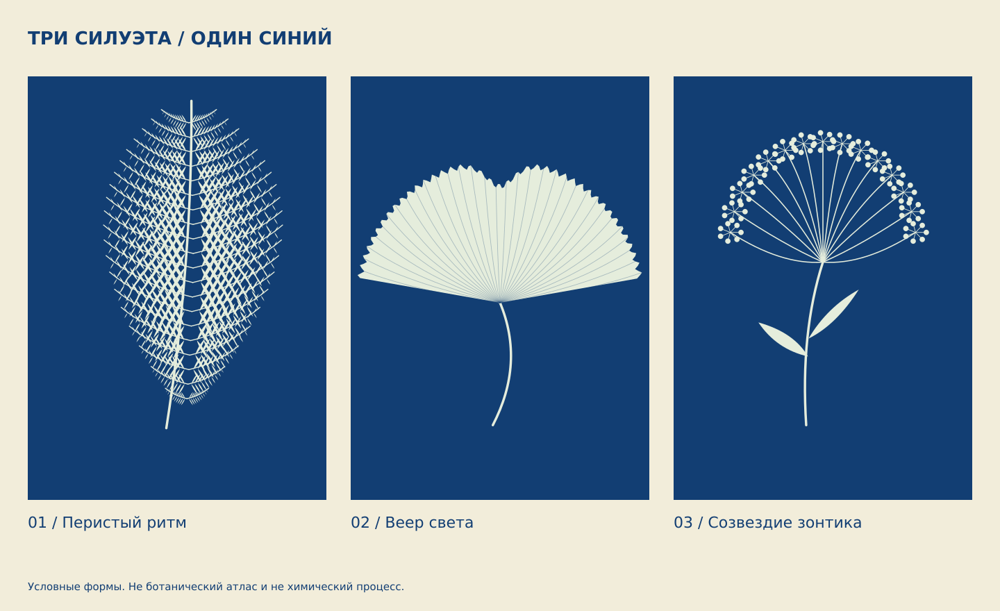
</picture></a>

**Не растение, а ритм его силуэта.** Собственная геометрия, стилизованная под цианотипный отпечаток: без фотографии, химической симуляции и претензии на ботаническую точность. Синее поле одинаково в обеих темах — как лист бумаги, а не интерфейс.

[01 · Перистый ритм](assets/bluehour/fern.svg) · [02 · Веер света](assets/bluehour/fan.svg) · [03 · Созвездие зонтика](assets/bluehour/umbel.svg) · [Как нарисовано и какие README исследованы](atlas/bluehour.md). Векторные оригиналы можно открыть крупно; скрипты и внешние сервисы для просмотра не нужны.

## Бумажная сцена

<a href="atlas/paperstage.md"><picture>
  <source media="(max-width: 640px)" srcset="assets/paperstage/hero-mobile.svg">
  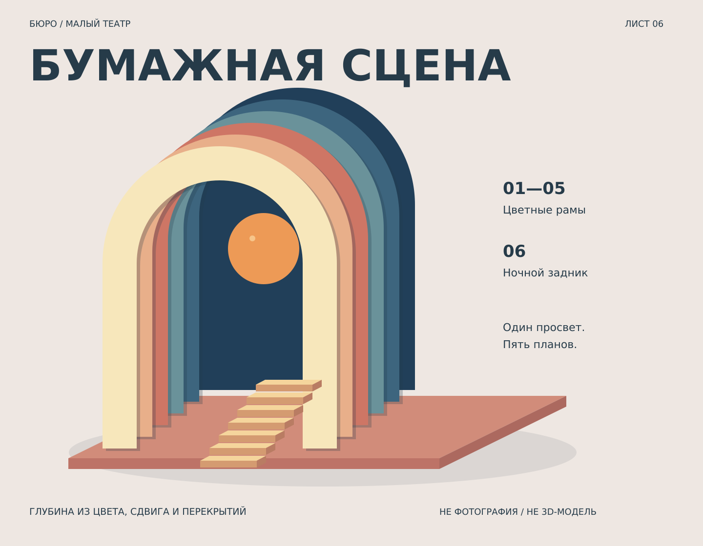
</picture></a>

<picture>
  <source media="(max-width: 640px)" srcset="assets/paperstage/layers-mobile.svg">
  
</picture>

**Пять рам. Один просвет.** Глубина возникает из сдвига, цвета и перекрытий — без WebGL, фотографии и настоящей 3D-модели. Нижний рисунок показывает те же контуры отдельно: это разбор иллюстрации, **не выкройка для резки**.

[Сцена крупно](assets/paperstage/hero.svg) · [Разбор по слоям](assets/paperstage/layers.svg) · [Параметры сцены JSON](assets/paperstage/scene.json) · [Как нарисовано и какие README исследованы](atlas/paperstage.md). На телефоне — отдельные композиции; цвет бумаги одинаков в обеих темах.

## Один шаг — один изменённый бит

<p align="center"><a href="assets/gray/bench.zip"><picture>
  <source media="(prefers-reduced-motion: reduce)" srcset="assets/gray/proof.png">
  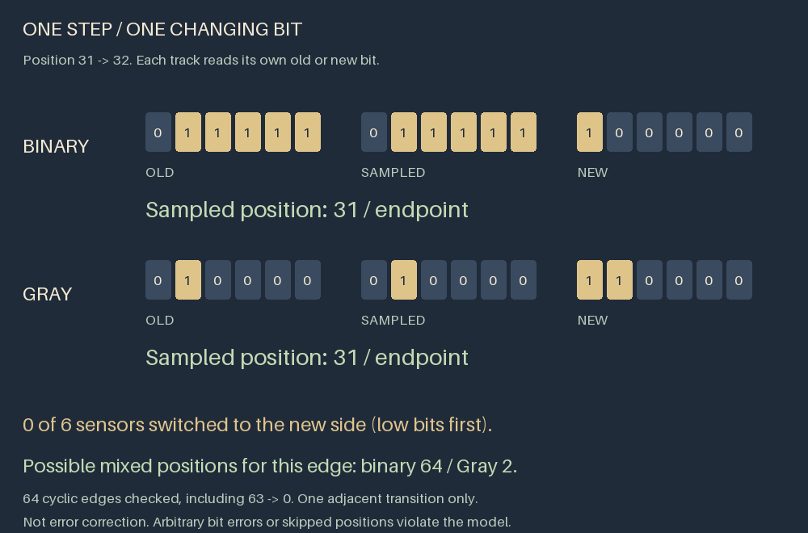
</picture></a></p>

Счётчик переходит **31 → 32**: `011111 → 100000`. Если шесть датчиков прочитают свои старые/новые биты не одновременно, можно получить **любое из 64 значений** — например, ноль. В отражённом **коде Грея** те же позиции записаны `010000 → 110000`: меняется только один бит, поэтому смесь даёт только **31 или 32**.

Проверены все **64 перехода кольца**, включая **63 → 0**, и все **4096 масок** старого/нового чтения. За полный оборот обычная запись меняет **126 бит**, код Грея — **64**. Это логические изменения, не измерение расхода энергии.

[Задерживать датчики и читать результат (офлайн ZIP)](assets/gray/bench.zip?raw=true) · [без движения](assets/gray/proof.png) · [диск A4](assets/gray/disk-a4.svg) · [сертификат всех переходов](assets/gray/certificate.json) · [проверка, границы и исследованные GitHub](atlas/gray.md).

Распакуй ZIP и открой `gray.html`: выбирай переход и старое/новое значение каждой дорожки. Гарантия относится **только к одному соседнему переходу и устойчивым старым/новым битам**. Это не код исправления ошибок: произвольная порча одного бита может превратить позицию 0 в 31. Печатный диск — учебная схема, не откалиброванный датчик. Сеть не нужна.

## Двенадцать монет — три взвешивания

<p align="center"><a href="assets/coins/bench.zip"><picture>
  <source media="(prefers-reduced-motion: reduce)" srcset="assets/coins/proof.png">
  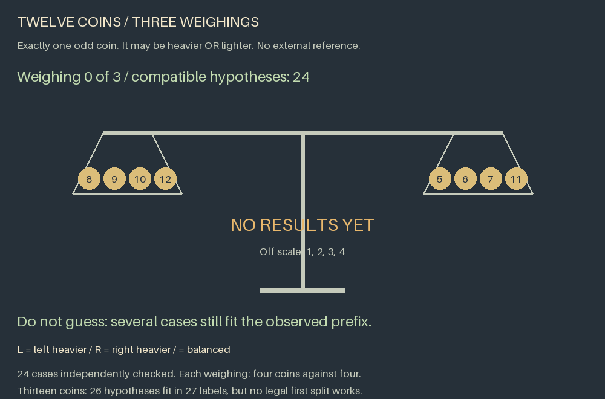
</picture></a></p>

Одна из **12 монет** отличается массой. Неизвестно, какая и в какую сторону. Три заранее заданных взвешивания — каждый раз **четыре против четырёх** — определяют и номер, и ответ **«тяжелее / легче»**. Все **24 случая** проверены отдельным сложением масс на чашах.

А **13 монет** уже нельзя: хотя **26 гипотез помещаются в 27 троек исходов**, первое взвешивание не даёт нужного разбиения. Чтобы ветка наклона поместилась в два оставшихся взвешивания, нужно **не больше четырёх монет на чаше**; чтобы поместилась ветка равновесия — **не меньше пяти**. Не поможет даже адаптивный план.

[Взвешивать и вводить свои показания (офлайн ZIP)](assets/coins/bench.zip?raw=true) · [без движения](assets/coins/proof.png) · [план и ответы A4](assets/coins/plan-a4.svg) · [план JSON](assets/coins/plan.json) · [24 случая CSV](assets/coins/cases.csv) · [доказательство, ограничения и исследованные GitHub](atlas/coins.md).

Распакуй ZIP и открой `coins.html`: выбери учебный случай или отдельно введи три результата настоящих весов. Условия существенны: **ровно одна** отличающаяся монета, идеальные чашечные весы, одинаковое число монет на чашах, без внешнего эталона. Бумажные подписи не заменяют разные массы. Сеть не нужна.

## Лучше в каждой группе — хуже в сумме

<p align="center"><a href="assets/simpson/bench.zip"><picture>
  <source media="(prefers-reduced-motion: reduce)" srcset="assets/simpson/proof.png">
  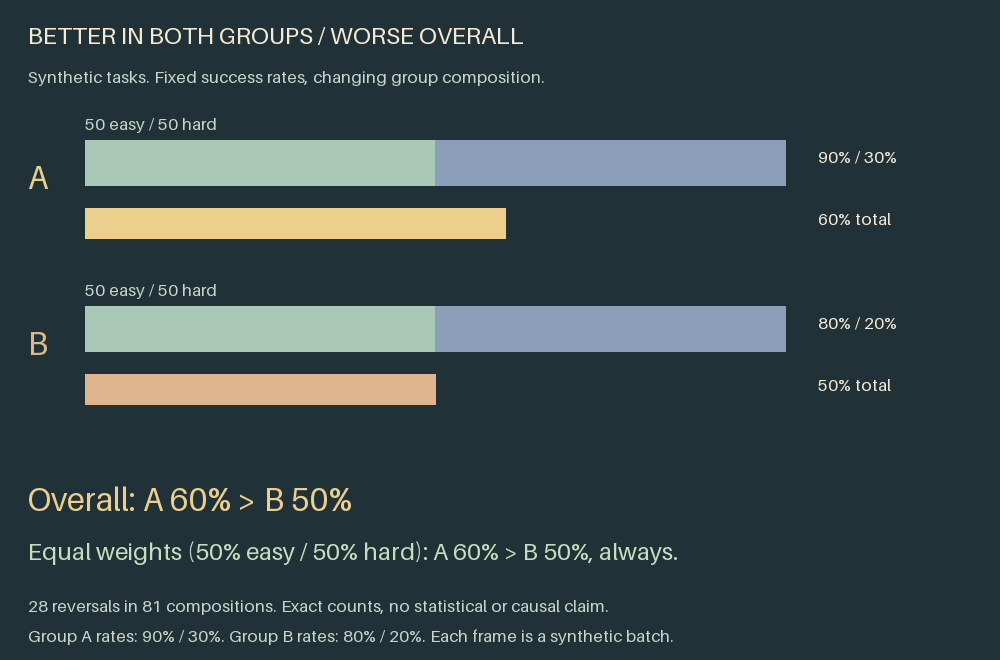
</picture></a></p>

A решает **90 % против 80 %** простых задач и **30 % против 20 %** сложных. Но общий результат — **36 % против 74 %**, уже в пользу B. Никакой ошибки в сложении: A получил 90 сложных задач, B — только 10.

Это **парадокс Симпсона** на вымышленных данных. Меняй состав выборок, не меняя групповые доли: из **81 состава** в **28** общий порядок переворачивается. При одинаковых весах групп A всегда впереди на **10 процентных пунктов**.

[Менять состав и общие веса (офлайн ZIP)](assets/simpson/bench.zip?raw=true) · [без движения](assets/simpson/proof.png) · [карта 81 состава](assets/simpson/grid.svg) · [объяснение A4](assets/simpson/mix-a4.svg) · [точное свидетельство](assets/simpson/reversal.json) · [арифметика, ограничения и исследованные GitHub](atlas/simpson.md).

Распакуй ZIP и открой `simpson.html`: две ручки задают составы, третья — одинаковые веса для сравнения. Все **891 пары стандартизованных долей** проверены точными дробями. Это не новые наблюдения и **не доказательство причинного превосходства**: ни общей, ни групповой таблицы самой по себе для такого вывода недостаточно. Сеть не нужна.

## Семь лампочек находят сломанную

<p align="center"><a href="assets/hamming/bench.zip"><picture>
  <source media="(prefers-reduced-motion: reduce)" srcset="assets/hamming/proof.png">
  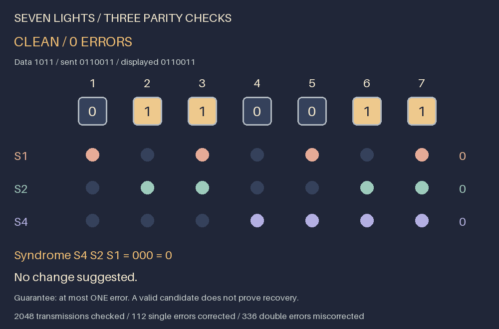
</picture></a></p>

Сломай одну лампочку — три проверки чётности назовут её номер. Например, **S4 S2 S1 = 101₂ = 5**: нужно изменить пятый бит. Код Хэмминга **(7,4)** добавляет к четырём битам данных три контрольных и исправляет любую одиночную ошибку.

А теперь измени **два бита: 3 и 5**. Синдром покажет **6**. Декодер послушно «исправит» шестой бит, все проверки пройдут — но сообщение станет **неправильным**. Допустимое кодовое слово ещё не доказывает, что восстановлено отправленное.

[Переключать биты и видеть проверки (офлайн ZIP)](assets/hamming/bench.zip?raw=true) · [без движения](assets/hamming/proof.png) · [памятка A4](assets/hamming/parity-a4.svg) · [свидетельство одной ошибки](assets/hamming/single.json) · [контрпример с двумя](assets/hamming/double.json) · [доказательство, полный аудит и исследованные GitHub](atlas/hamming.md).

Распакуй ZIP и открой `hamming.html`. Проверены все **2048 передач**: 16 сообщений × 128 масок повреждения. Все **112 одиночных ошибок** исправлены; все **336 двойных** обнаруживаются ненулевым синдромом, но слепое исправление даёт неверный результат. Гарантия — **не более одной ошибки**; это обычный (7,4), не расширенный (8,4) SECDED. Сеть не нужна.

## 32 лампочки хранят все 32 слова

<p align="center"><a href="assets/necklace/bench.zip"><picture>
  <source media="(prefers-reduced-motion: reduce)" srcset="assets/necklace/proof.png">
  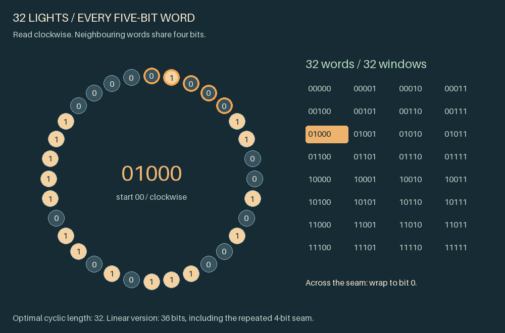
</picture></a></p>

Выбери любое слово из пяти нулей и единиц. На этом кольце оно найдётся **ровно в одном месте**. Все **32 слова** помещаются в **32 битах**, потому что соседние окна используют общие четыре бита. Это цикл де Брёйна, а не сжатие произвольных сообщений.

Короче нельзя: у кольца из 32 клеток только 32 начала окна. А если разрезать кольцо, потребуются **36 бит** — первые четыре нужно повторить за швом, иначе потеряются четыре слова.

[Двигать окно и находить слова (офлайн ZIP)](assets/necklace/bench.zip?raw=true) · [без движения](assets/necklace/proof.png) · [бумажное кольцо A4](assets/necklace/loop-a4.svg) · [лента JSON](assets/necklace/certificate.json) · [все позиции слов](assets/necklace/words.csv) · [построение, проверка и исследованные GitHub](atlas/necklace.md).

Распакуй ZIP и открой `necklace.html`: можно выбрать слово, пройти через шов или испортить бит в отдельной копии и проверить, какие слова пропали. Либо собери бумажную ленту из четырёх полосок. Сеть не нужна. Направление чтения и границы бит считаются известными; это **не шифр и не исправляющий ошибки код**.

## Две дырки — и мозаика невозможна

<p align="center"><a href="assets/domino/bench.zip"><picture>
  <source media="(prefers-reduced-motion: reduce)" srcset="assets/domino/proof.png">
  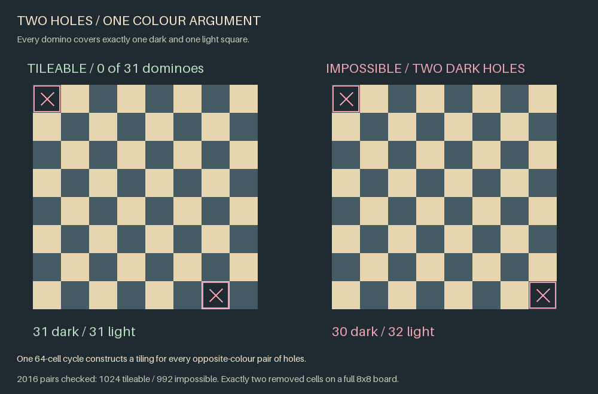
</picture></a></p>

Сдвинули одну дырку на соседнюю клетку — и вместо готового покрытия получили **доказуемую невозможность**. Каждое домино закрывает одну тёмную и одну светлую клетку. Когда осталось **30 / 32**, никакая перестановка 31 домино не поможет.

А если дырки разных цветов? Один замкнутый маршрут по всем 64 клеткам даёт покрытие **для любой такой пары**: разрежь его дырками, получи две чётные цепочки и объедини соседние клетки попарно. Проверены все **2016 пар**: **1024** допускают покрытие, **992** запрещены цветовым дисбалансом. Отдельный алгоритм паросочетания подтвердил каждый ответ.

[Выбрать две дырки и увидеть покрытие (офлайн ZIP)](assets/domino/bench.zip?raw=true) · [сравнение без движения](assets/domino/proof.png) · [доска A4](assets/domino/board-a4.svg) · [31 домино для вырезания](assets/domino/pieces-a4.svg) · [покрытие JSON](assets/domino/possible.json) · [доказательство, проверка и исследованные GitHub](atlas/domino.md).

Распакуй ZIP и открой `domino.html`: выбирай клетки, показывай маршрут и проверяй все пары без сети. Или распечатай оба листа A4 в **100 %** и попробуй руками. Утверждение о достаточности разных цветов относится **только к двум дыркам полной доски 8×8**, а не к любой вырезанной фигуре.

## Два вентиля, один предел

<p align="center"><a href="assets/flow/bench.zip"><picture>
  <source media="(prefers-reduced-motion: reduce)" srcset="assets/flow/proof.png">
  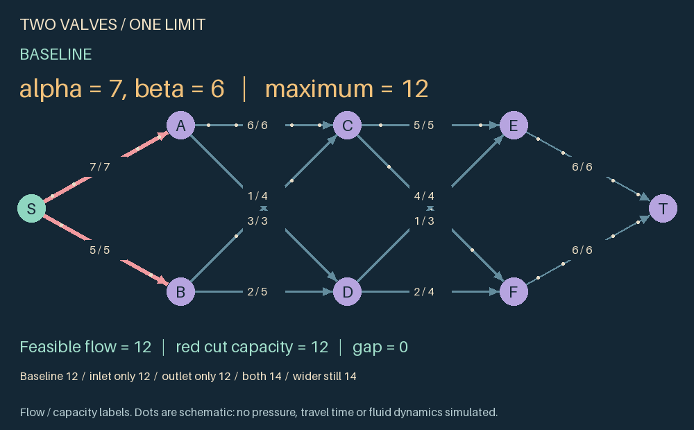
</picture></a></p>

Расширили вход — поток остался **12**. Расширили только выход — снова **12**. Расширили оба — получили **14**. Дальше эти два вентиля уже не помогут: другое узкое место пропускает не больше **5 + 3 + 6 = 14**.

Ответ здесь состоит из двух частей: допустимый поток показывает, сколько **можно**, а разрез сети — почему **больше нельзя**. Границы совпали — максимум доказан без доверия к решателю. Для всех **169** положений регуляторов дополнительно перебраны **10 816 разрезов**.

[Покрутить вентили и выбрать свой разрез (офлайн ZIP)](assets/flow/bench.zip?raw=true) · [сеть без движения](assets/flow/proof.png) · [карта всех положений](assets/flow/map.svg) · [свидетельство для потока 14](assets/flow/both.json) · [проверка, модель и исследованные GitHub](atlas/flow.md).

Распакуй ZIP и открой `flow.html`: можно исследовать любой из 64 разрезов или испортить поток и увидеть отказ проверки. Это управляемый поток с ограничениями ёмкости, не расчёт давления и не симуляция жидкости. Сеть стенду не нужна.

## Лампочки с двумя невидимыми печатями

<p align="center"><a href="assets/lights/bench.zip"><picture>
  <source media="(prefers-reduced-motion: reduce)" srcset="assets/lights/proof.png">
  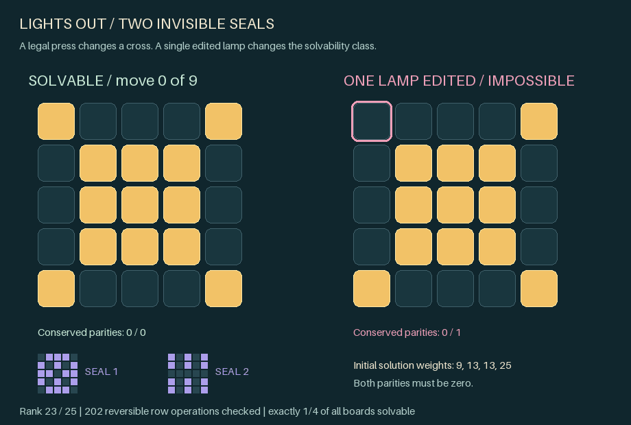
</picture></a></p>

Нажатие меняет крест из лампочек. Исходное поле можно погасить, нажав **все 25 кнопок**, но точный минимум — **9**. Измени только одну угловую лампу — и теперь погасить поле невозможно вообще.

Две «печати» считают чётность света под своими узорами. Любой разрешённый ход сохраняет обе. У погашенного поля — **0 / 0**, у невозможного двойника — **0 / 1**. Ранг матрицы **23 из 25** объясняет и запрет, и то, почему решаема ровно **четверть всех полей**.

[Играть, редактировать и выбирать решения (офлайн ZIP)](assets/lights/bench.zip?raw=true) · [сравнение без движения](assets/lights/proof.png) · [оба узора крупно](assets/lights/seals.svg) · [матричный сертификат](assets/lights/certificate.json) · [доказательство и исследованные GitHub](atlas/lights.md).

Распакуй ZIP и открой `lights.html`: у решаемого поля ровно четыре маски нажатий. У нашего — на **9, 13, 13 и 25** кнопок. Независимый проверяющий воспроизводит **202 обратимые операции строк** и проверяет весь набор решений. Сеть не нужна; редактор одиночных ламп явно отделён от игровых ходов.

## Два устойчивых ответа

<p align="center"><a href="assets/matching/bench.zip"><picture>
  <source media="(prefers-reduced-motion: reduce)" srcset="assets/matching/proof.png">
  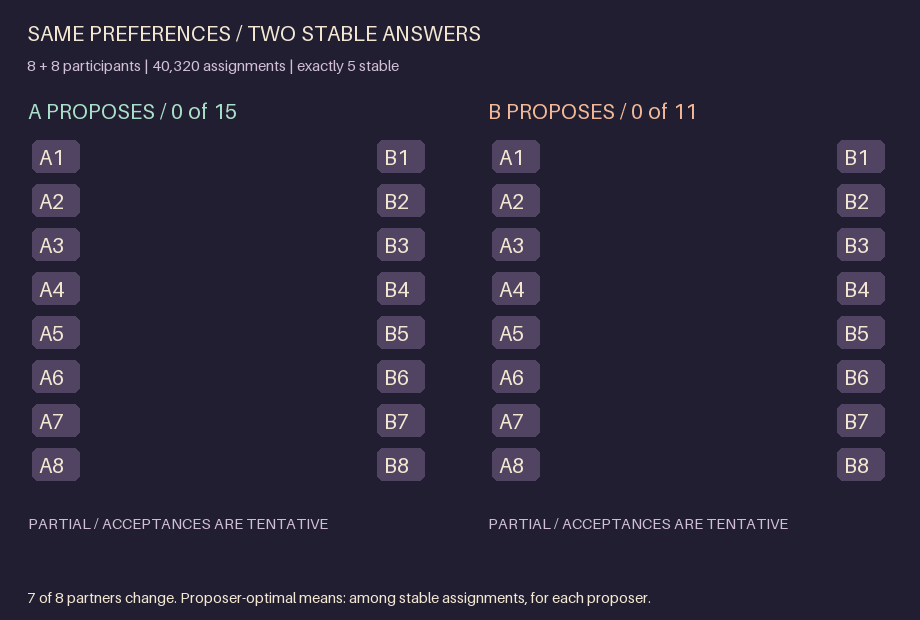
</picture></a></p>

Предпочтения не поменялись. Поменялась только сторона, которая делает предложения, — и **семь из восьми пар стали другими**. Оба ответа устойчивы: нет двух участников, которым обоим выгоднее выбрать друг друга вместо текущих партнёров.

Здесь перебраны **все 40 320 назначений**. Устойчивых ровно **пять**; каждый участник предлагающей стороны получает лучшего для себя партнёра **среди устойчивых вариантов**. Это не обещание первого места всем и не гарантия справедливости.

[Пройти предложения и обменять партнёров (офлайн ZIP)](assets/matching/bench.zip?raw=true) · [два ответа без движения](assets/matching/proof.png) · [все предпочтения](assets/matching/problem.json) · [полный сертификат](assets/matching/certificate.json) · [проверка, ограничения и исследованные GitHub](atlas/matching.md).

Распакуй ZIP, открой `matching.html`: можно пройти процесс по шагам, вручную обменять две пары и увидеть, кто теперь предпочитает друг друга. Стенд проверяет все **64 сочетания**, объясняет блокирующую пару и умеет полностью повторить перебор. Сеть не нужна.

## Лишняя дорога делает путь дольше

<p align="center"><a href="assets/braess/bench.zip"><picture>
  <source media="(prefers-reduced-motion: reduce)" srcset="assets/braess/proof.png">
  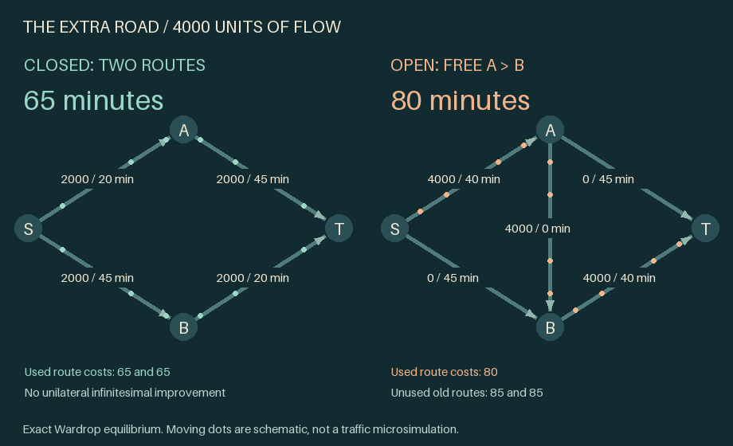
</picture></a></p>

Добавили бесплатную перемычку — получили **80 минут вместо 65**. Все выбирают кратчайший маршрут при сложившихся потоках, но новое равновесие хуже старого. Это парадокс Браесса: индивидуально разумный выбор не обязан давать лучший общий результат.

Здесь не случайная симуляция: потоки вычислены **точными дробями**, отдельный проверяющий заново собирает нагрузки рёбер и проверяет все доступные пути. При спросе 4000 новый путь стоит 80 минут, а старые альтернативы — по 85.

[Открыть перемычку и изменить спрос (офлайн ZIP)](assets/braess/bench.zip?raw=true) · [сети без движения](assets/braess/proof.png) · [график: когда дорога вредит](assets/braess/demand.svg) · [модель, проверка и исследованные GitHub](atlas/braess.md).

Распакуй ZIP, открой `roads.html` и подвигай спрос: ухудшение возникает только при **3000 < Q < 9000**. Это стационарная модель непрерывного потока, не прогноз для города; движущиеся точки — схема, не микросимуляция машин. Сеть стенду не нужна.

## Один обмен — и выхода нет

<p align="center"><a href="assets/puzzle/bench.zip"><picture>
  <source media="(prefers-reduced-motion: reduce)" srcset="assets/puzzle/proof.png">
  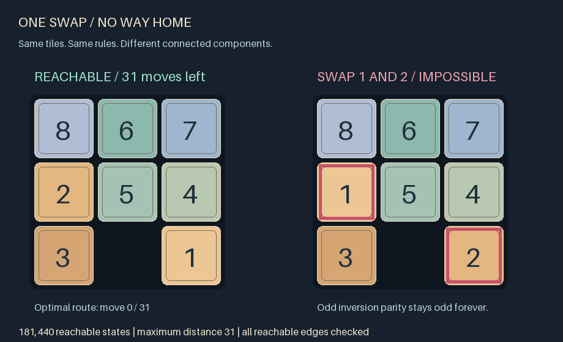
</picture></a></p>

Слева — **31 ход до дома**. Справа поменяли местами только 1 и 2 — и дом стал недостижим. Никакое терпение не поможет: каждый разрешённый сдвиг сохраняет чётность инверсий, а обмен двух фишек её меняет.

Это «восьмёрка», маленький родственник пятнашек. Для неё здесь рассчитаны **все 362 880 перестановок**: половина достижима, половина — нет. Число оставшихся ходов в стенде **точное**. Независимый проверяющий подтверждает его на всех **483 840 направленных переходах** достижимой части.

[Поиграть и обменять две фишки (офлайн ZIP)](assets/puzzle/bench.zip?raw=true) · [оба поля без движения](assets/puzzle/proof.png) · [сколько позиций на каждом расстоянии](assets/puzzle/histogram.svg) · [проверка и доказательство](atlas/puzzle.md).

Распакуй ZIP и открой `puzzle.html`: можно ввести свою раскладку и запросить оптимальный ход. Сеть не нужна. Цель фиксирована: **123 / 456 / 780**; для полного поля 4×4 эта таблица не подходит.

## Кости без чемпиона

<p align="center"><a href="assets/dice/table.zip"><picture>
  <source media="(prefers-reduced-motion: reduce)" srcset="assets/dice/proof.png">
  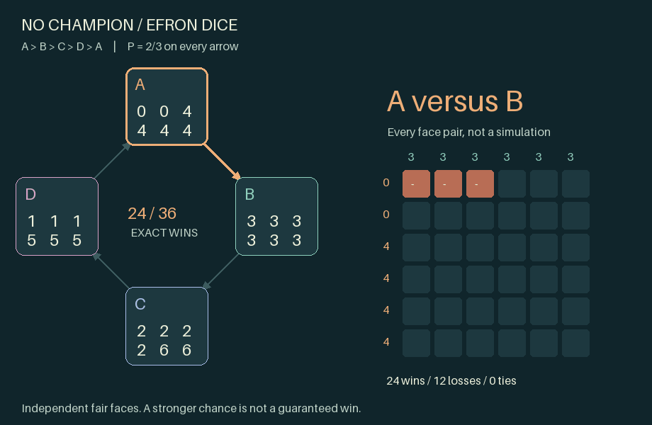
</picture></a></p>

Выбирай любую кость — найдётся другая, которая победит её с вероятностью **2/3**. Но и её можно побить: **A → B → C → D → A**. Это честные шестигранные кости с необычными числами, а не подстроенные броски.

Вместо тысячи случайных попыток — **все 36 исходов каждой пары**. А теперь измени правило: сравни суммы **двух** независимых бросков. Две стрелки развернутся, две останутся; преимущество второго выбора перестанет быть гарантированным.

[Выбрать кость и сменить правило (офлайн ZIP)](assets/dice/table.zip?raw=true) · [развёртки четырёх костей на A4](assets/dice/nets-a4.svg) · [неподвижный кадр](assets/dice/proof.png) · [точный аудит](assets/dice/audit.json) · [математика, проверка и исследованные GitHub](atlas/dice.md).

Распакуй ZIP, открой `table.html`: таблицы и каждый из 36 или 1296 исходов считаются без сети. Независимый Python-проверяющий перебирает **21 312 исходов**. Вероятность — не гарантия выигрыша; бумажные развёртки — учебная модель, а не откалиброванный генератор случайности.

## Переселение картинки с доказательством

<p align="center"><a href="assets/transport/bench.zip"><picture>
  <source media="(prefers-reduced-motion: reduce)" srcset="assets/transport/proof.png">
  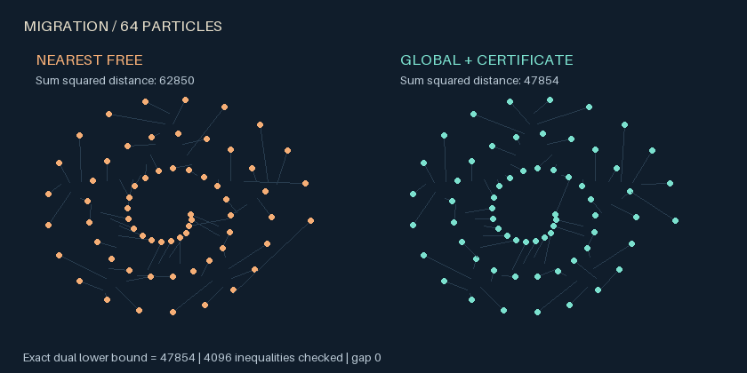
</picture></a></p>

Одна спираль, одна звезда, **64 частицы**. Слева каждая хватает ближайшую свободную цель. Справа назначения согласованы глобально: **47 854 вместо 62 850** — жадный вариант на 31,34 % дороже по сумме квадратов расстояний.

Это не только красивая траектория: к ответу приложены целые потенциалы. Независимый проверяющий проверяет **4096 неравенств** и получает ту же нижнюю границу **47 854**. Лучше уже нельзя — для этой задачи и этой цены.

[Подвигать время и испортить доказательство (офлайн ZIP)](assets/transport/bench.zip?raw=true) · [неподвижный кадр](assets/transport/proof.png) · [задача](assets/transport/problem.json) · [сертификат](assets/transport/certificate.json) · [проверка, математика и исследованные репозитории](atlas/transport.md).

Распакуй ZIP и открой `transport.html`: сеть не нужна. Движение — иллюстрация назначения, не обещание отсутствия столкновений; оптимизируется сумма **квадратов**, а не сумма длин. Всё, что было в галерее раньше, осталось ниже.

## Зеркальный конёк

<p align="center"><a href="assets/catoptric/sheet-a4.pdf"><picture>
  <source media="(max-width: 540px)" srcset="assets/catoptric/mirror.png">
  
</picture></a></p>

На листе медная отметка вытянута в овал. В цилиндрическом зеркале она становится круглой, хвост сворачивается спиралью, а надпись **HIPPOCAMPUS** снова читается слева направо. Это зеркальная анаморфоза: вид в зеркале рассчитан по готовому отпечатку, а не по картинке конька.

[Лист A4 для печати (PDF)](assets/catoptric/sheet-a4.pdf?raw=true) · [оба вида рядом (PNG)](assets/catoptric/proof.png) · [проследить луч без настоящего зеркала (ZIP)](assets/catoptric/bench.zip?raw=true).

На столе: печатай в масштабе **100 %** и поставь на круг гладкий зеркальный цилиндр **Ø 50 мм** высотой от 80 мм. Глаз — со стороны стрелки, в 28 см от оси по столу и в 24 см над листом. Без печати: распакуй ZIP, открой `mirror.html` и коснись глаза конька — второй прицел найдёт его на бумаге.

## Одна форма, три тени

<p align="center"><a href="assets/shadow-type/git.stl"><picture>
  <source media="(prefers-reduced-motion: reduce)" srcset="assets/shadow-type/proof.png">
  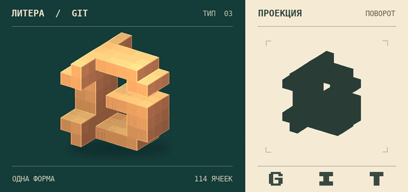
</picture></a></p>

Спереди видна **G**. Четверть оборота — и на её месте **I**. Сверху читается **T**. Меняется только ракурс: во всех трёх случаях это те же 114 кубиков.

[Повернуть фигуру самому (STL)](assets/shadow-type/git.stl) · [три проекции без движения (PNG)](assets/shadow-type/proof.png).

## Медуза, записанная звуком

<p align="center"><a href="assets/aurelia/swim.gif"><picture>
  <source media="(prefers-reduced-motion: reduce)" srcset="assets/aurelia/trace.png">
  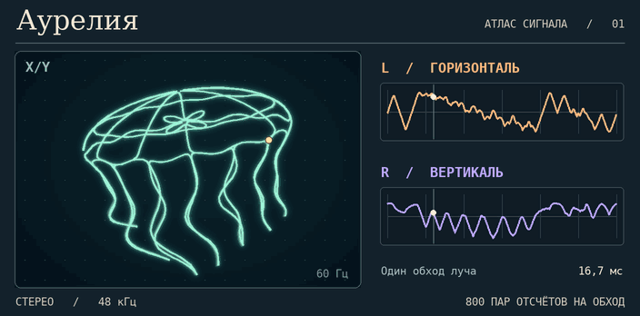
</picture></a></p>

В `aurelia.wav` нет ни одного видеокадра. Высота оранжевой дорожки в отмеченной точке задаёт **X**, высота сиреневой в тот же момент — **Y**. За 800 таких пар луч обводит медузу целиком. Этот GIF построен из готового WAV.

[Забрать стерео-WAV (4 секунды)](assets/aurelia/aurelia.wav?raw=true) · [карманный осциллограф (ZIP)](assets/aurelia/scope.zip?raw=true) · [кадр без движения (PNG)](assets/aurelia/trace.png).

Распакуй ZIP, открой `aurelia.html` и переключи **«Стерео» → «Моно»**. Медуза сложится в диагональ: на обе оси теперь идёт одно и то же значение. Это видно даже на паузе; сеть и звук не нужны.

## Сумеречный лист

<p align="center"><a href="assets/twilight/proof.png">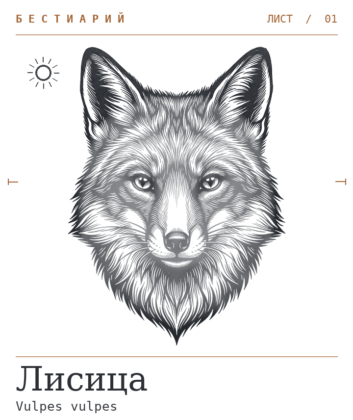</a></p>

Кто смотрит на тебя с листа? На белой странице — **лисица**, на тёмной — **сипуха**. Посмотри на зрачки: у обоих они на одной высоте. Это один прозрачный PNG, а не две картинки, которые README подбирает по теме.

<details open>
<summary>Подложить оба фона рядом, не меняя тему</summary>

<a href="assets/twilight/proof.png">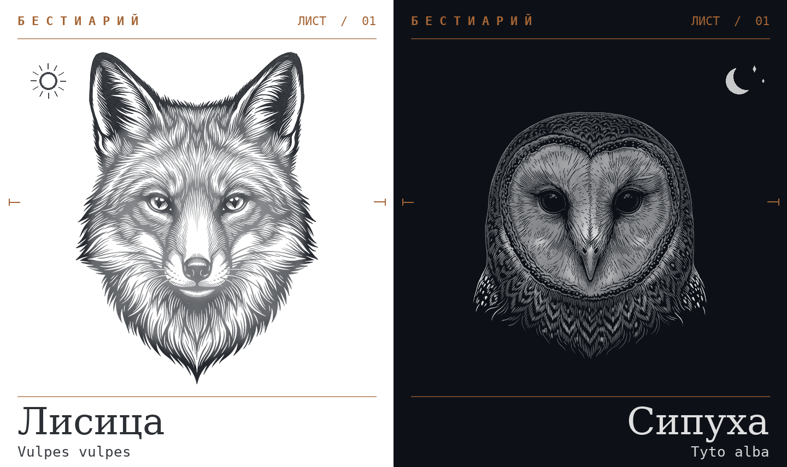</a>

Если просмотрщик обозначает прозрачность серой «шахматкой», на ней могут проступить оба рисунка.

</details>

[Забрать прозрачный лист](assets/twilight/glass.png?raw=true) · [световой стол с ползунком (ZIP)](assets/twilight/table.zip?raw=true). Распакуй архив и открой `table.html`: границу белой бумаги можно провести прямо между глазами.

## Шрифт-кладовщик

<p align="center"><a href="assets/typecase/delivery.gif"><picture>
  <source media="(prefers-reduced-motion: reduce)" srcset="assets/typecase/proof.png">
  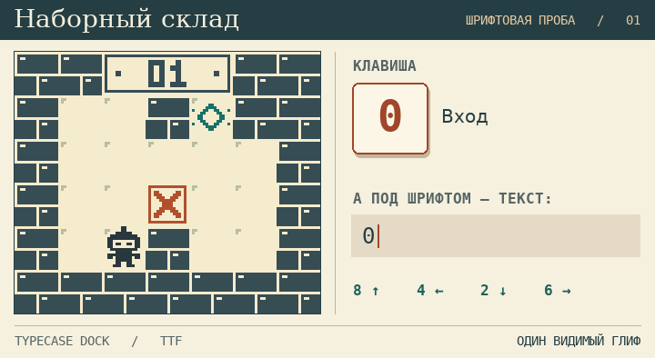
</picture></a></p>

`0866` — ящик застрял у правой стены. Сотри последнюю шестёрку: получится `086`, и ящик отойдёт на клетку назад. **Это одно текстовое поле.** В шрифте *Typecase Dock* каждому положению робота и ящика соответствует свой знак. Кадры GIF отпечатаны этим шрифтом; сыграть можно в офлайн-пробнике.

[Сыграть без установки шрифта (ZIP)](assets/typecase/typecase.zip?raw=true) · [забрать сам TTF](assets/typecase/dock.ttf?raw=true) · [два оттиска до и после Backspace](assets/typecase/proof.png).

Распакуй ZIP и открой `dock.html`. Доведи ящик с крестом до ромба: **8** ↑, **4** ←, **2** ↓, **6** →. Поставь галочку «Снять шрифт» — вместо комнаты увидишь свой маршрут цифрами.

## Бумажный кристалл

**Кристалл в 3D:** [студия «Грань» — текстуры и движение](https://rawcdn.githack.com/overbaffe1/gitEdit/7b8b2cb05c77223867c772de0d411330f1eddc9f/docs/index.html) · [синий просмотрщик GitHub — отдельный STL](assets/crystal.stl).

<p align="center"><a href="assets/night-shift/fold.gif"><picture>
  <source media="(prefers-reduced-motion: reduce)" srcset="assets/night-shift/fold-still.png">
  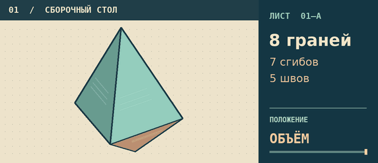
</picture></a></p>

**01 / Форма.** У кристалла разрезали пять рёбер. Остальные семь работают как сгибы: зелёные грани расходятся веером, абрикосовые ложатся вдоль края. Проследи за штрихами на любой грани — бумага поворачивается, но не растягивается.

<details open>
<summary><b>Разложить выкройку на столе</b></summary>

<a href="assets/night-shift/crystal-net.svg"></a>

Это раскрой именно этой модели. Режь по сплошным линиям, сгибай по пунктиру; **A** соединяется с **A**, **B** с **B** и так далее. Внизу листа — линейка 30 мм для проверки масштаба при печати.

</details>

<a href="assets/night-shift/weeks-tape.svg"></a>

### Покрути кристалл

<p><a href="https://rawcdn.githack.com/overbaffe1/gitEdit/7b8b2cb05c77223867c772de0d411330f1eddc9f/docs/index.html"><picture>
  <source media="(prefers-reduced-motion: reduce)" srcset="docs/poster.jpg">
  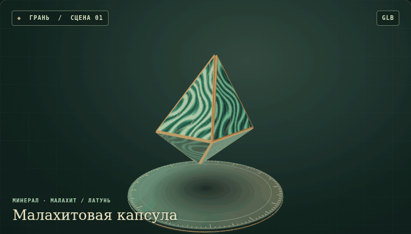
</picture></a></p>

**Малахитовая капсула.** Прожилки нанесены на те же восемь граней бумажного кристалла. За один оборот можно увидеть и камень снаружи, и гравировку на обратной стороне створок. Здесь идёт восьмисекундная кинопетля — раскрывать картинки не нужно.

**[Открыть 3D-студию «Грань» →](https://rawcdn.githack.com/overbaffe1/gitEdit/7b8b2cb05c77223867c772de0d411330f1eddc9f/docs/index.html)** · **[Включить парусник из MyWorkAiBrain →](https://rawcdn.githack.com/overbaffe1/gitEdit/7b8b2cb05c77223867c772de0d411330f1eddc9f/docs/index.html?scene=ship)**

Без текстур и клипа: **[открыть тот же кристалл в синем просмотрщике GitHub (STL)](assets/crystal.stl)**.

При первом открытии студии CDN может попросить подтвердить переход к странице `gitEdit`. В студии можно потянуть модель мышью или пальцем, остановить клип и передвинуть ползунок времени. У парусника проигрывается его собственная анимация парусов, волн и чайки. Можно открыть свой GLB или STL; для STL — добавить рисунок на поверхность. [Та же студия для работы без сети (ZIP)](https://github.com/overbaffe1/gitEdit/raw/refs/heads/main/assets/crystal-view.zip): распакуй и открой `crystal.html`. Паруснику при первом открытии нужен интернет или скачанный `ship.glb`.

### Кейс проекта

**Один кристалл, два прохода.** Слева — рёбра на чертёжной сетке, справа — те же грани под цветным светом. Граница сама проходит по рисунку. Верхушка не смещается: положение камеры в обоих кадрах одинаковое.

<p><a href="assets/crystal-wipe.gif"><picture>
  <source media="(prefers-reduced-motion: reduce)" srcset="assets/crystal-wipe.png">
  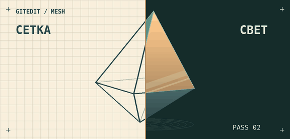
</picture></a></p>

<details open>
<summary>Положить оба кадра рядом и рассмотреть без движения</summary>

<a href="assets/crystal-wire.png"></a> <a href="assets/crystal-light.png"></a>

</details>

**Оттиск для терминала.** Тот же вид умещается в 20 столбцов текста. Светлые и тёмные знаки заменяют краску; этот кристалл останется виден даже без загрузки картинок.

<pre>
           ▒
          ▒▓▓
         ▒▒▓▓▓
        ▒▒▒▓▓▓
       ▒▒▒▓▓▓▓▓
     ▒▒▒▒▒▓▓▓▓▓▓
    ▒▒▒▒▒▒▓▓▓▓▓▓▓
   ▒▒▒▒▒▒▓▓▓▓▓▓▓▓
  ▒▒▒▒▒▒▒▓▓▓▓▓▓▓▓▓
 ▒▒▒▒▒▒▒▒▓▓▓▓▓▓▓▓▓▓
░▒▒▒▒▒▒▒▓▓▓▓▓▓▓▓▓▓▓▓
  ░░░░▒▒▓▓▓▓▓▓░░░░░
   ░░░░░░░░░░░░░░
     ░░░░░░░░░░
       ░░░░░
        ░░
</pre>

## Перфолента

<p align="center"><a href="assets/night-shift/weeks-tape.svg"><picture>
  <source media="(max-width: 600px)" srcset="assets/night-shift/weeks-tape-compact.svg">
  
</picture></a></p>

**02 / Данные.** У каждой недели свой столбец. Тёмный круг — пробитое отверстие: сложи веса напротив таких кругов. Ряд маленьких точек нужен для подачи ленты и в сумму не входит.

Это **398 коммитов LazyGit** за 6 января — 27 апреля 2025 года, не активность автора профиля. Издалека две выделенные недели почти одинаковы. **Чем № 15 отличается от № 07?**

<details open>
<summary><b>Положить колонки рядом и прочитать код</b></summary>

<a href="assets/night-shift/weeks-key.svg"></a>

**Одним отверстием в дорожке 1.** 17–23 февраля — 44 коммита, 14–20 апреля — 45. Те же шестнадцать недель превратились в [календарь](assets/snake-weeks.gif) и [квартал](assets/weekly-skyline.stl).

</details>

<a href="assets/night-shift/moth-projector.svg"></a>

### Приёмы из других README

#### Город вкладов

<p><a href="assets/contribution-city.gif"><picture>
  <source media="(prefers-reduced-motion: reduce)" srcset="assets/contribution-city.png">
  
</picture></a></p>

Башни растут прямо здесь. Первый кадр показывает **весь город**, а движение повторяется, так что его не пропустишь при прокрутке. В режиме уменьшенного движения останется тот же ночной вид. Это календарь из демонстрации **yoshi389111** за 2021–2022 годы, не статистика этого профиля. Это иллюстрация, а не вращаемая сцена. Для вращения есть [отдельный STL квартала](assets/weekly-skyline.stl).

#### Змейка на календаре

<p><a href="assets/snake-weeks.gif"><picture>
  <source media="(prefers-reduced-motion: reduce)" srcset="assets/snake-weeks.png">
  
</picture></a></p>

Один столбец — неделя, верхняя клетка — понедельник. Змейка гасит клетки по пути; чем светлее нетронутая клетка, тем больше в тот день было коммитов. Это наш рисунок по истории **LazyGit**: 398 коммитов за 16 недель, с 6 января по 27 апреля 2025 года. Ни бот, ни вход в аккаунт для просмотра не нужны.

#### Квартал в 3D

Каждый дом — одна неделя из календаря LazyGit, единица высоты — один коммит. На рисунке тот же квартал, что и в STL. Найди самый высокий дом и сравни его с соседями.

<p><a href="assets/weekly-skyline.stl"></a></p>

[Повернуть квартал на GitHub (STL)](assets/weekly-skyline.stl) · [открыть рисунок (SVG)](assets/weekly-skyline.svg)

<details open>
<summary>Какая неделя оказалась самой высокой?</summary>

**7–13 апреля: 59 коммитов.** Следующая неделя дала 45. В анимации клетки показывают отдельные дни, а в квартале хорошо видна сумма за неделю.

</details>

## Театр теней

<p align="center"><a href="assets/night-shift/moth-projector.svg"><picture>
  <source media="(max-width: 600px) and (prefers-reduced-motion: no-preference)" srcset="assets/night-shift/moth-projector-compact.svg">
  <source media="(max-width: 600px)" srcset="assets/night-shift/moth-still-compact.svg">
  <source media="(prefers-reduced-motion: no-preference)" srcset="assets/night-shift/moth-projector.svg">
  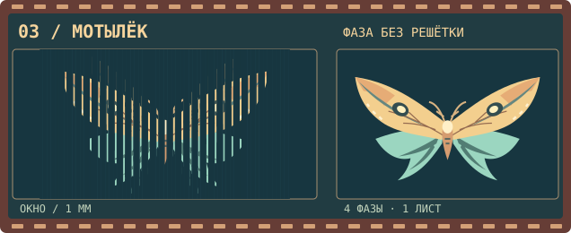
</picture></a></p>

**03 / Движение.** В первом окне мотылёк машет крыльями, хотя рисунок под решёткой неподвижен. Сдвинулась решётка — в просвет попали полоски следующей позы. Во втором окне для сравнения та же фаза целиком.

Одна позиция держится 1,4 секунды. Здесь решётка перемещается сама, не за курсором; при уменьшении движения остаётся неподвижная пара окон.

<details open>
<summary><b>Снять решётку и достать четыре кадра</b></summary>

**Так выглядит бумага без решётки.** На ней уже напечатаны все четыре положения крыльев вперемешку.

<a href="assets/night-shift/moth-paper.svg"></a>

**А это исходные позы.** Первую и третью легко различить даже без движения. Один миллиметр сдвига на печатном экземпляре меняет позу; четыре возвращают первую.

<a href="assets/night-shift/moth-poses.svg">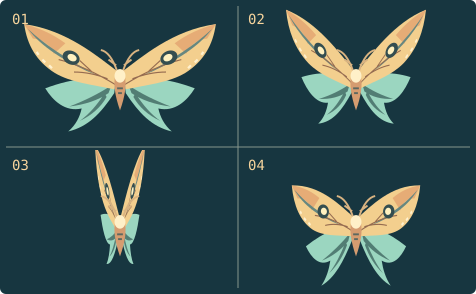</a>

</details>

<a href="assets/night-shift/bench-master.jpg">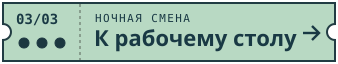</a>

### Кинолаборатория

На плёнке — история двух веток. Какие коммиты стали родителями кадра `M`?

<a href="assets/commit-reel.svg"></a>

<details open>
<summary>Свериться с монтажным листом</summary>

**B и C.** Коммит A — их общий предок, а не родитель M.

</details>

#### Граф коммитов

Та же история в готовой диаграмме Mermaid. Сравни две линии с кинолентой выше.

<p><a href="assets/mermaid/commits.png"></a></p>

#### Терминал в README

<p><a href="assets/facet-count.gif"><picture>
  <source media="(prefers-reduced-motion: reduce)" srcset="assets/facet-count.png">
  
</picture></a></p>

Команда ищет в STL строки `facet normal` и получает восемь граней. Это повторяющаяся запись терминала, не приглашение выполнить команду в браузере.

#### Партитура пауз

Три GIF на одной шкале. Справа — длительность одного цикла и ссылка на саму запись.

<pre>
 0    2    4    6  <b>t, с</b>  <b>ЛЕНТА</b>
╭┬────┬────┬────┬╮
│····▁▃▇▆▃▁      │ 3,71  <a href="/assets/facet-count.gif">Набор</a>
│··▂▅▅▅▅▂··▁▅▅▅▅▃│ 6,23  <a href="/assets/night-shift/fold.gif">Сгиб</a>
│██████████      │ 4,00  <a href="/assets/aurelia/swim.gif">Медуза</a>
╰────────────────╯
</pre>

Одна клетка — **0,4 с**. Высота — сколько кадров закончилось за это время: `·` — ни одного, `▁`…`█` — от 1 до 8. Пробел — за концом петли.

Первые **2 с** терминал держит на экране ответ «8». У кристалла пауза есть и в середине: развёртка лежит плоско **1,45 с**. У медузы полоска ровная — все 80 кадров длятся по **50 мс**.

[Забрать разметку партитуры](templates/blocks/cue-sheet.md?plain=1) · [построить по своим GIF](atlas/native.md).

#### Видео с перемоткой

Нажми ▶ в `commit_and_push.mp4`: это демонстрация коммита и отправки изменений из LazyGit. Здесь есть пауза и полоса перемотки; ролик не обязан стартовать сам.

https://github.com/user-attachments/assets/031799d1-740d-4cda-90cf-689513fa9860

#### Что осталось за кадром · D2

<a href="assets/staging.svg">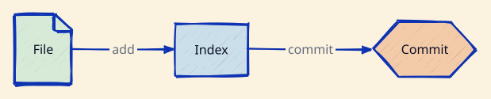</a>

На первом переходе выбранное содержимое попадает в индекс, на втором — в историю. Это готовый рисунок D2, а не ещё один нативный просмотрщик.

#### Шахматный этюд

Ход белых, мат в один. Белые: король g6 и ладья a7. Чёрные: король h8.

<a href="assets/mate-in-one.svg"></a>

<details open>
<summary>Проверить свой ход</summary>

**Лa8#**. Ладья даёт шах по восьмой горизонтали и отрезает g8. Белый король держит g7 и h7.

</details>

#### Проявочная

Один хребет, два оттиска. У «Ризографа» краска смещена относительно точечного растра. У «Фосфора» те же вершины светятся на сетке экрана.

<p align="center">
  <a href="assets/relief-riso.svg"></a>
  <a href="assets/relief-phosphor.svg"></a>
</p>

#### Картотека красок

<p align="center">
  <a href="assets/inkbook/press.svg"></a>
  <a href="assets/inkbook/blueprint.svg"></a>
  <a href="assets/inkbook/orbit.svg"></a>
</p>

На каждой карточке рисунок пересекает границу двух тем. Число в углу — контраст **текста с фоном**. Краски в каждой ячейке идут в порядке **фон · текст · акцент**.

| Светлая проба | Тёмная проба |
| :--- | :--- |
| **Ризограф**<br>`#FFF1D9` `#292948` `#EF6747` | **Фосфор**<br>`#102622` `#ADF2CB` `#FFD182` |
| **Чертёж**<br>`#F6F3FF` `#261D3C` `#61419A` | **Чертёж**<br>`#211B32` `#FAF5FF` `#D5BAFF` |
| **Созвездие**<br>`#EEF8F3` `#153B30` `#18654E` | **Созвездие**<br>`#142C27` `#F0FCF6` `#A0E8C9` |

У «Ризографа» тёмные буквы на кремовом дают **12,52:1**, а коралл на той же бумаге — только **2,81:1**. Поэтому кораллом напечатан диск, не мелкая подпись.

[Палитру для GIMP (.gpl)](assets/inkbook/inkbook.gpl?raw=true) можно импортировать целиком: в ней 18 подписанных красок. Для сайта есть [CSS-переменные для светлой и тёмной темы](assets/inkbook/inkbook.css) и [пример подключения](atlas/samples/inkbook/).

#### Печатный лист

<a href="atlas/samples/field-sheet.pdf">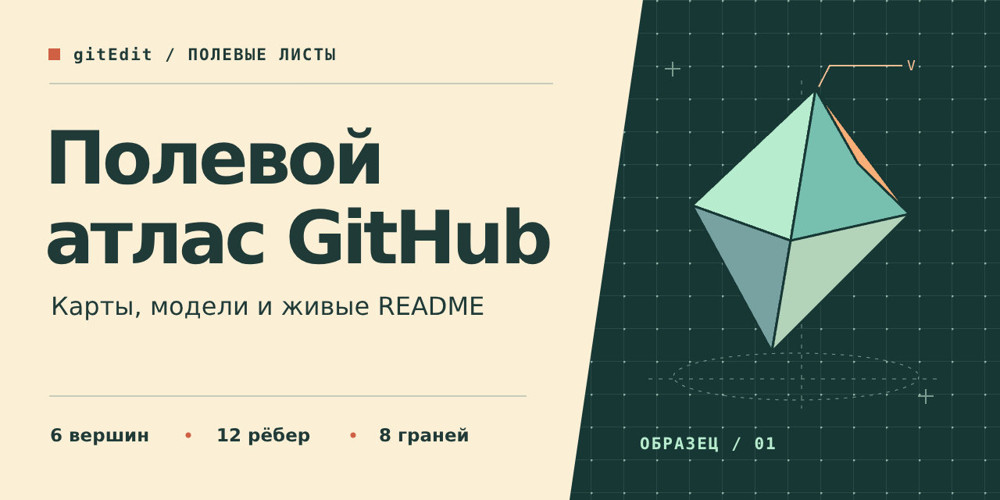</a>

Это содержимое одностраничного PDF в виде PNG. Та же картинка размером 1280 × 640 подходит для карточки ссылки на репозиторий.

<p align="center">
  <picture></picture>
</p>

## Что умеет README на GitHub

### Оглавление

Выбери экспонат, чтобы открыть его файл.

- **Форма:** [конёк для цилиндрического зеркала](assets/catoptric/sheet-a4.pdf) · [литера G/I/T](assets/shadow-type/git.stl) · [два оттиска одного PNG](assets/twilight/proof.png) · [выкройка кристалла](assets/night-shift/crystal-net.svg) · [кинопетля капсулы](assets/crystal-theatre.gif) · [сетка и свет](assets/crystal-wipe.gif) · [обложка «Север»](assets/polar-cover.svg).
- **Данные:** [перфолента](assets/night-shift/weeks-tape.svg) · [город вкладов](assets/contribution-city.gif) · [отпечаток репозитория](assets/repo-fingerprint.svg) · [маршрут](assets/survey.geojson) · [соседние листы](assets/sheets.topojson) · [размеры файлов](assets/mermaid/file-sizes.png).
- **Движение:** [медуза из стереозаписи](assets/aurelia/swim.gif) · [театр теней](assets/night-shift/moth-projector.svg) · [кинолента](assets/commit-reel.svg) · [терминал](assets/facet-count.gif) · [видео с перемоткой](https://github.com/user-attachments/assets/031799d1-740d-4cda-90cf-689513fa9860).
- **Игры:** [наборный склад (ZIP)](assets/typecase/typecase.zip?raw=true) · [шахматный этюд](assets/mate-in-one.svg).
- **Своё портфолио:** [шаблон проекта](templates/PROJECT-README-TEMPLATE.md) · [шаблон профиля](templates/PROFILE-README-TEMPLATE.md) · [палитры](atlas/samples/palettes.csv).

## Мастерская оформления

### Живой фон: где проходит край

<p><a href="assets/polar-cover.svg"><picture>
  <source media="(max-width: 600px) and (prefers-reduced-motion: no-preference)" srcset="assets/polar-cover-compact.svg">
  <source media="(max-width: 600px)" srcset="assets/polar-cover-compact-still.svg">
  <source media="(prefers-reduced-motion: no-preference)" srcset="assets/polar-cover.svg">
  
</picture></a></p>

На обложке **«Север»** посмотри на ближний берег: он сдвигается заметнее дальнего хребта. Световая завеса плывёт чуть вверх, а луна и заголовок стоят на месте. Открывать картинку не нужно. На узком экране луна остаётся в кадре, при системном уменьшении движения браузер выбирает неподвижную обложку.

Это **фон внутри картинки**, а не подложка под Markdown. За обычные заголовки и списки GitHub свой фон поставить не даёт. Для сравнения — тот же пейзаж на отдельной HTML-странице:

<details open>
<summary>Посмотреть, как выглядит фон за настоящим текстом сайта</summary>

<p><a href="assets/polar-page.png"><picture>
  <source media="(max-width: 600px)" srcset="assets/polar-page-compact.png">
  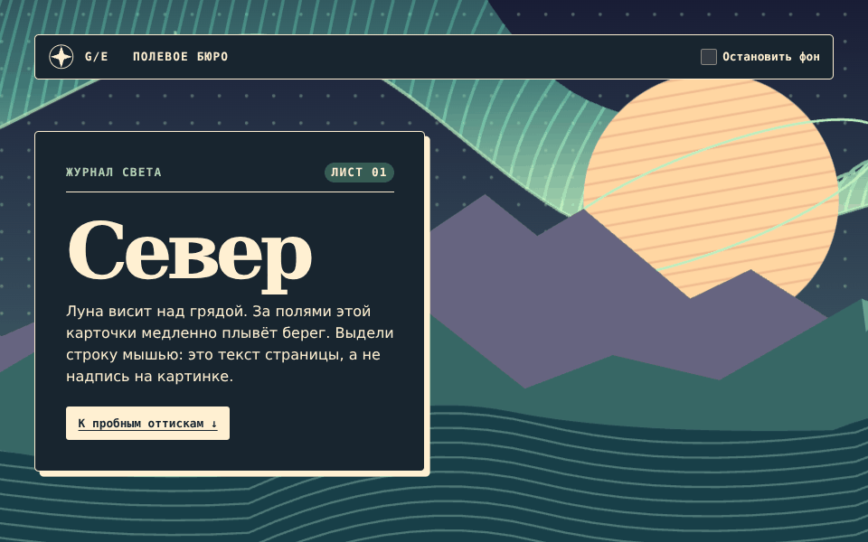
</picture></a></p>

Здесь показан **снимок**. На самой странице текст можно выделить, прокрутить до оттисков и остановить фон, не останавливая прокрутку. Для просмотра выставки покидать README не нужно.

</details>

### Два оттиска одного кольца

<p align="center">
  <a href="assets/ring-pen.svg">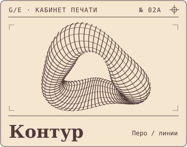</a>
  <a href="assets/ring-screen.svg">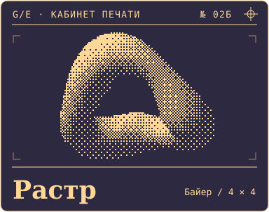</a>
</p>

Геометрия и камера одни и те же. **Перо** показывает изгиб линией; **растр** собирает свет из ячеек 4 × 4. Прищурься: отверстие видно на обеих карточках, хотя во второй нет ни одного обводящего штриха.

### Марки вместо меню

<p align="center">
  <a href="assets/crystal.stl"></a>
  <a href="assets/weekly-skyline.stl"></a>
  <a href="assets/commit-reel.svg"></a>
</p>

Марки открывают три файла: кристалл и квартал в формате STL и киноленту в SVG. Имя проекта задаёт число лепестков, поворот и краску. У «Кристалла» по окружности медленно идёт надпись, сама розетка и подпись не вращаются.

### Форзац из одной плитки

<a href="assets/tile-frieze.svg"></a>

Квадрат с двумя дугами можно оставить как есть или повернуть на четверть оборота. Получился узор для разделителя глав. **К какому номеру ведёт линия от А?**

<details open>
<summary>Проявить дорожку</summary>

<a href="assets/tile-route.svg"></a>

**А → 3.** Дорожка проходит 30 дуг. Плитки не поменялись: поверх тех же линий напечатан пунктир.

</details>

## Витрина шаблонов

Выбери обложку. «Чертёж» ведёт к сравнению сетки и света, «Созвездие» — к печатной подписи профиля.

<p align="center">
  <a href="assets/crystal-wipe.gif"></a>
  <a href="assets/portfolio-signature.svg"></a>
</p>

### Карточка профиля

<a href="assets/portfolio-signature.svg">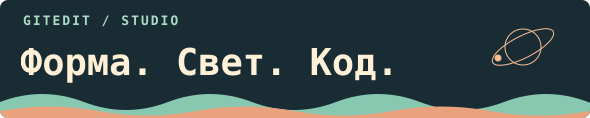</a>

Верхняя строка задаёт тему мастерской. Ниже — не список навыков, а пример работы с данными: вот что лежит внутри одного проекта.

### Отпечаток репозитория

<p><a href="assets/repo-fingerprint.svg"><picture>
  <source media="(max-width: 600px)" srcset="assets/repo-fingerprint-compact.svg">
  
</picture></a></p>

Один круг — один файл. Площадь соответствует числу байтов, цвет и внешний контур — каталогу первого уровня. Это снимок `gitEdit` на [коммите `11ea344`](https://github.com/overbaffe1/gitEdit/tree/11ea34407408f20f95becf35607f6f0e3b1c6394), **до** добавления этой карты, а не постоянно обновляемый счётчик. Площади посчитаны по размерам Git-блобов до сжатия.

<details open>
<summary>Что за самый большой круг с надписью SVG?</summary>

Это [рисунок «File → Index → Commit»](assets/staging.svg). В этом срезе он занимает 77 397 байт. У соседнего GIF с записью терминала — 61 627 байт. Так по отпечатку можно найти тяжёлую иллюстрацию, не просматривая каталоги.

</details>

### Карманное портфолио

Вместо списка навыков — по одному числу на работу. Нажми число на поле: откроется не главная репозитория, а именно тот кадр, расчёт или фрагмент кода, из которого оно взялось.

<table>
<thead>
<tr><th colspan="2" align="left"><sub>ЛИЧНЫЙ ТИРАЖ · № 01 · overbaffe1</sub><br>Три числа</th></tr>
</thead>
<tbody>
<tr>
<th scope="row" align="center"><a href="https://github.com/overbaffe1/OMLP/blob/1a4aa4a40c62e6b5e06d3d1db4aa0c4e16094e7e/docs/figures/detection.png" title="Термоснимок и маска"><strong>44</strong><br><sub>пикселя</sub></a></th>
<td><sub>02–03 · OMLP</sub><br><strong>След на тепловом кадре</strong><br>В маске кадра VIIRS огнём помечены 44 пикселя. Цветное наложение показывает попадания, пропуски и ложные тревоги детектора.<br><a href="https://github.com/overbaffe1/OMLP/blob/1a4aa4a40c62e6b5e06d3d1db4aa0c4e16094e7e/tools/make_figures.py#L45-L81">Как собран кадр</a></td>
</tr>
<tr>
<th scope="row" align="center"><a href="https://github.com/overbaffe1/CosmoH/blob/6cd3197af0412c22b782d90dbefde266cffdddad/solutions/fuel-contour/docs/evidence/response-grid.csv" title="Таблица расчёта"><strong>35</strong><br><sub>сценариев</sub></a></th>
<td><sub>04–05 · CosmoH</sub><br><strong>Цена опоздания</strong><br>При полном срыве поставки заказ в день сбоя закрывает дефицит. Если отложить заказ на 90 дней, не хватит 14,73 т.<br><a href="https://github.com/overbaffe1/CosmoH/blob/6cd3197af0412c22b782d90dbefde266cffdddad/solutions/fuel-contour/docs/evidence/response-grid.svg">Матрица сценариев</a></td>
</tr>
<tr>
<th scope="row" align="center"><a href="https://github.com/overbaffe1/MyWorkAiBrain/blob/3cbd01a7c9b6fa174be3dc6f96419df6f2db1db2/presentations/cantillon/models/make_models.py#L445-L463" title="Сборка струн арфы"><strong>13</strong><br><sub>струн</sub></a></th>
<td><sub>06–07 · MyWorkAiBrain</sub><br><strong>Глиссандо на слайде</strong><br>У каждой струны арфы своя кость. Колебание идёт по струнам и обратно. В PowerPoint движется сама модель, не видео.<br><a href="https://github.com/overbaffe1/MyWorkAiBrain/blob/3cbd01a7c9b6fa174be3dc6f96419df6f2db1db2/exports/cantillon-3d-presentation.pptx?raw=true">Презентация (.pptx)</a></td>
</tr>
</tbody>
</table>

Номера рядом с названиями проектов — страницы карманной книги. Вот разворот **04–05** из готового печатного листа:

<a href="assets/pocket-folio/issue-a4.pdf"></a>

[Скопировать блок в профиль](templates/blocks/pocket-folio.md?plain=1) · [лист A4 для печати (PDF)](assets/pocket-folio/issue-a4.pdf?raw=true) · [как сложить книжку или выпустить свою](atlas/samples/pocket_folio/). Один лист, один разрез, восемь страниц. На бумаге к источникам ведут QR-коды.

### Витрина визуальных находок — полистай и забирай

Хочешь что-то необычное, анимированное и сразу красивое? Все эти SVG живут прямо в репозитории — без внешних серверов, печатаются и уважают `prefers-reduced-motion`.

<p align="center"><a href="assets/neon-pill.svg"></a></p>

**Неоновые пилюли** — круглые кнопки с градиентом и мягким свечением. Три ссылки в одном файле. Меняешь текст, цвет и `href` — получаешь свои. [Исходник SVG](assets/neon-pill.svg) · как и у [марок проекта](assets/seal-crystal.svg), только ярче.

<p align="center"><a href="assets/orbit-stack.svg"></a></p>

**Орбита стека** — 8 технологий на двух вращающихся кольцах. Иконки остаются прямо, пока орбиты крутятся. Чистый SVG+CSS, без JS и внешних картинок. [Файл](assets/orbit-stack.svg) · пересобрать: `python3 atlas/samples/orbit-stack.py` · альтернатива плоской стене [skillicons](https://skillicons.dev).

<p align="center"><a href="assets/glass-panel.svg">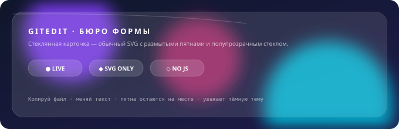</a></p>

**Стеклянная панель** — модный glassmorphism: размытые пятна + полупрозрачное стекло. Меняешь заголовок и бейджи — готова шапка или карточка секции. [Файл](assets/glass-panel.svg) · пересобрать: `python3 atlas/samples/glass-panel.py`.

<p align="center"><a href="assets/pixel-night.svg">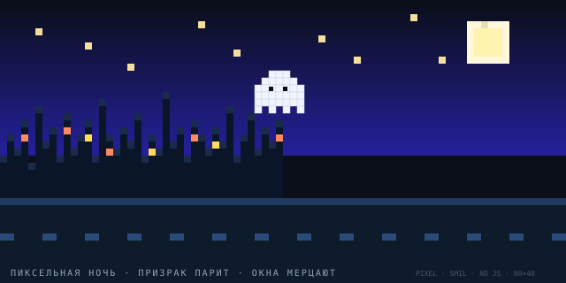</a></p>

**Пиксельная ночь** — ретро-пиксель-арт: город из блоков, призрак парит и моргает, окна и звёзды мерцают. Каждый пиксель — прямоугольник, анимация — чистый SMIL, без веб-шрифтов. [Файл](assets/pixel-night.svg) · пересобрать: `python3 atlas/samples/pixel-night.py` · идея из [pixel-profile](https://github.com/sknoyon324234234234/pixel-profile), рисунок свой.

<p align="center"><a href="assets/hologram-card.svg"></a></p>

**Голографическая карточка** — проектор с вращающимся глобусом-паутинкой, две орбиты и бегущий сканирующий луч. Справа — имя и теги с мягким свечением. Всё — один SVG, без внешних картинок. [Файл](assets/hologram-card.svg) · пересобрать: `python3 atlas/samples/hologram-card.py`.

<p align="center"><a href="assets/equalizer.svg">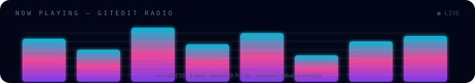</a></p>

**Эквалайзер** — 8 столбиков с десинхронизированной анимацией, как у DJ-календаря. Каждый свой `dur` и `delay`, чистый CSS, без JS, уважает `prefers-reduced-motion`. [Файл](assets/equalizer.svg) · пересобрать: `python3 atlas/samples/equalizer.py` · идея из [eq-visualizer](https://github.com/bryanhamiltondev/eq-visualizer).

<p align="center"><a href="assets/terminal-block.svg"></a></p>

**Терминал-блок** — окно zsh с набором команд: `whoami → cat stack.txt → ls projects`. Каждая строка появляется с задержкой, финальный курсор моргает. Чистый SMIL (`<animate>` на opacity), без внешних шрифтов. [Файл](assets/terminal-block.svg) · пересобрать: `python3 atlas/samples/terminal-block.py` · вдохновлён [terminal-typing-svg](https://github.com/VaidikV/terminal-typing-svg) и [terminal-readme](https://github.com/Grawty/terminal-readme), рисунок свой.

<p align="center"><a href="assets/liquid-blob.svg">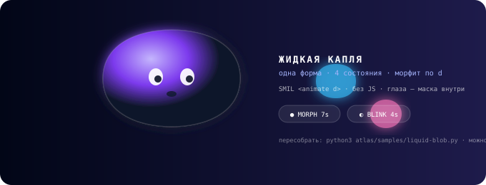</a></p>

**Жидкая капля** — один путь морфит между 4 состояниями по `d` (SMIL), два глаза-спутника тоже танцуют. Маслянистый градиент + моргание. [Файл](assets/liquid-blob.svg) · пересобрать: `python3 atlas/samples/liquid-blob.py` · техника из [bloub](https://github.com/blackscythe123/bloub) и [SVG-Morph](https://github.com/JulianCallejas/SVG-Morph), формы свои.

<p align="center"><a href="assets/wave-divider.svg"></a></p>

**Волнистый разделитель** — волна с бегущим `stroke-dash` и кометой (`animateMotion` по пути). Ставишь между секциями вместо `<hr>`. [Файл](assets/wave-divider.svg) · `python3 atlas/samples/wave-divider.py` · 908 байт.

<p align="center"><a href="assets/radar-skills.svg"></a></p>

**Радар скиллов** — 6 осей, заливка морфит по `points` за 4с. Меняешь точки — меняешь стек. [Файл](assets/radar-skills.svg) · `python3 atlas/samples/radar-skills.py`

<p align="center"><a href="assets/timeline-journey.svg"></a></p>

**Таймлайн пути** — линия 2.8с (`stroke-dashoffset`), точки всплывают по очереди. [Файл](assets/timeline-journey.svg) · `python3 atlas/samples/timeline-journey.py`

<p align="center"><a href="assets/marquee-icons.svg"></a></p>

**Бегущая строка** — 8 пилюль едут влево 8с, бесшовный луп (`translate -240`). Чистый SVG. [Файл](assets/marquee-icons.svg) · `python3 atlas/samples/marquee-icons.py` · идея из [icon-marquee](https://github.com/topics/icon-marquee)

<p align="center"><a href="assets/ascii-portrait.svg"></a></p>

**ASCII-портрет** — монохромный портрет из `⣿⣤⣿` + neofetch-карточка рядом, печатаются построчно. [Файл](assets/ascii-portrait.svg) · `python3 atlas/samples/ascii-portrait.py` · идея из [ASCII Portrait guide](https://www.avivashishta.com/blog/build-animated-github-profile-readme)

<p align="center"><a href="assets/heatmap-wave.svg"></a></p>

**Heatmap-волна** — 53 недели, клетки `10×10 rx=2`, диагональный reveal 0.3с каждая. [Файл](assets/heatmap-wave.svg) · `python3 atlas/samples/heatmap-wave.py` · цвета как у GitHub (Less→More)

<p align="center"><a href="assets/spotify-card.svg"></a></p>

**Now Playing** — карточка трека с 4 столбиками-эквалайзером (0.7-0.9с). Инлайн-обложка как в [spotify-readme-card](https://github.com/GautamVhavle/spotify-readme-card), но без бэкенда. [Файл](assets/spotify-card.svg) · `python3 atlas/samples/spotify-card.py`

<p align="center"><a href="assets/waka-bar.svg"></a></p>

**Waka-полоска** — 5 языков stacked bar, 32h 14m. [Файл](assets/waka-bar.svg) · `python3 atlas/samples/waka-bar.py`

<p align="center"><a href="assets/trophy-shelf.svg"></a></p>

**Полка трофеев** — 4 карточки: First PR, Streak 42, 100 Commits, Launch. Меняешь эмодзи/текст. [Файл](assets/trophy-shelf.svg) · `python3 atlas/samples/trophy-shelf.py` · как [github-profile-trophy](https://github.com/ryo-ma/github-profile-trophy)

<p align="center"><a href="assets/neofetch-card.svg"></a></p>

**Neofetch-карточка** — `OS/Host/Stack/Uptime` слева, ASCII-арт + STATS справа. [Файл](assets/neofetch-card.svg) · `python3 atlas/samples/neofetch-card.py`

<p align="center"><a href="assets/commit-pulse.svg"></a></p>

**Commit Pulse** — изометрический монолит: каждый день = столп, высота = коммиты, пульс 1-1.2с. [Файл](assets/commit-pulse.svg) · `python3 atlas/samples/commit-pulse.py` · идея из [CommitPulse](https://commitpulse.vercel.app/) + [github-city](https://github.com/Zain1024/github-city)

<p align="center"><a href="assets/neon-stadium.svg"></a></p>

**Neon Stadium** — календарь как 3D-стадион, неоновая петля бежит по контуру (`stroke-dashoffset` 1с). [Файл](assets/neon-stadium.svg) · `python3 atlas/samples/neon-stadium.py` · идея [Neon Arena](https://github.com/SandeepKomal/neon-arena)

<p align="center"><a href="assets/contrib-galaxy.svg"></a></p>

**Contribution Galaxy** — каждый коммит = звезда на орбите, закрутка 6-10с. [Файл](assets/contrib-galaxy.svg) · `python3 atlas/samples/contrib-galaxy.py` · альтернатива плоскому heatmap

<p align="center"><a href="assets/drago-card.svg"></a></p>

**Drago** — дракон-питомец `🐉` парит (1.4с), орбита 12с, полоса опыта пульсирует. [Файл](assets/drago-card.svg) · `python3 atlas/samples/drago-card.py` · идея [Drago](https://github.com/topics/drago)

<p align="center"><a href="assets/typing-banner.svg"></a></p>

**Печатающий баннер** — градиент `7c3aed→06b6d4` + курсор `blink 0.8с`, без внешних API. [Файл](assets/typing-banner.svg) · `python3 atlas/samples/typing-banner.py` · как [readme-typing-svg](https://github.com/DenverCoder1/readme-typing-svg), но селф-хостед

> Синий 3D-просмотрщик уже есть — это [кристалл в STL](assets/crystal.stl). Открой его в GitHub, он крутится прямо на странице без твоего кода. Новые штуки выше — такая же идея: открыл файл и смотри, без установок. Хочешь анимированную шапку извне — бери [волну+печаталку](templates/ANIMATED-HEADER-TEMPLATE.md).

### Склад одной строкой

Нужна волна, печаталка или стена скиллов за 30 секунд? В [складе](atlas/sklad.md) — 8 готовых строк: шапка-волна, печатающий текст, скиллы, бейджи, статистика, змейка, город и трофеи. Копируешь строку, меняешь `USER`. Без сборки. Если нужна печать без внешних картинок — бери [блоки без картинок](templates/blocks/).

## Afterlight · ещё двенадцать способов удивить

Не только синий STL: оптика, математические узоры, жидкие формы, бумага и набор текста по кривой. Новый зал целиком локальный — ни сервера статистики, ни JavaScript, ни внешних шрифтов. **Все старые экспонаты остаются на месте.** Здесь нет выдуманных метрик аккаунта: это декоративные и учебные рисунки.

Семь карточек двигаются через CSS, пять остаются статичными. При системном `prefers-reduced-motion: reduce` движение новых карточек отключается; рисунок не пропадает. Клик по любой карточке открывает её файл, а не запускает приложение. Встроенные в SVG ссылки не становятся отдельными кнопками внутри ``.

### 01 · Муаровый интерферометр

<p align="center"><a href="assets/afterlight/moire.svg"></a></p>

Большой рисунок рождается из двух маленьких шагов сетки. Одна решётка медленно поворачивается, и полосы биений плывут поперёк карточки. `clipPath` удерживает линии в окне. Подойдёт для оптической заставки; если частый узор утомляет глаза, переходи к спокойному шёлку ниже. [Взять SVG](assets/afterlight/moire.svg).

### 02 · Маятниковая волна

<p align="center"><a href="assets/afterlight/pendulum.svg"></a></p>

Каждый следующий маятник делает на одно колебание в минуту больше: от 18 до 33. Общий ритм постепенно распадается и снова собирается. Никаких покадровых GIF: геометрия одна, периоды CSS разные. Это стилизованные осцилляторы, не физический симулятор. [Взять SVG](assets/afterlight/pendulum.svg).

### 03 · Автограф гармонического маятника

<p align="center"><a href="assets/afterlight/harmonograph.svg"></a></p>

Гармонограф рисует сложную подпись из двух синусоид. Здесь линия проявляется **один раз**, затем остаётся на бумаге — полезная альтернатива бесконечному миганию. В режиме уменьшения движения сразу виден готовый узор. [Взять SVG](assets/afterlight/harmonograph.svg).

### 04 · Подсолнух из золотого угла

<p align="center"><a href="assets/afterlight/phyllotaxis.svg"></a></p>

Никакой ручной раскладки: $r_n=5\sqrt{n}$, угол растёт на $\pi(3-\sqrt5)$ на каждом шаге. Получается живой знак для математического профиля. [SVG](assets/afterlight/phyllotaxis.svg) · [тот же алгоритм с сохранённым результатом в notebook](assets/afterlight/phyllotaxis.ipynb).

### 05 · Топографический шёлк

<p align="center"><a href="assets/afterlight/contours.svg"></a></p>

Спокойная статичная обложка: рельеф похож на складки ткани или изолинии. Это аналитические кривые, не карта реальной местности. Можно использовать как фон раздела без тяжёлой фотографии и без анимации. [Взять SVG](assets/afterlight/contours.svg).

### 06 · Жидкий логотип из метасфер

<p align="center"><a href="assets/afterlight/metaballs.svg"></a></p>

Секрет слипания — не морфинг контура: `feGaussianBlur` размывает круги, а `feColorMatrix` повышает контраст их альфа-канала. Получается единая капля. SVG-фильтры могут слегка отличаться между браузерами; отдельный файл пригодится для проверки и настройки. [Взять SVG](assets/afterlight/metaballs.svg).

### 07 · Гильоширная печать

<p align="center"><a href="assets/afterlight/guilloche.svg"></a></p>

Графика как на банкноте или сертификате: радиус окружности промодулирован ещё одной косинусоидой. Неподвижная тонкая линия хорошо работает в печати и не зависит от стороннего генератора. Меняй число лепестков, радиус и толщину пера. [Взять SVG](assets/afterlight/guilloche.svg).

### 08 · Плитка, которая перестраивает лабиринт

<p align="center"><a href="assets/afterlight/truchet.svg"></a></p>

Один модуль — четверть окружности. Сдвиг фаз поворота меняет весь орнамент без смены самих плиток. В отличие от прежнего печатного форзаца, этот образец показывает медленную перестройку геометрии. [Взять SVG](assets/afterlight/truchet.svg).

### 09 · Заголовок на волне

<p align="center"><a href="assets/afterlight/textpath.svg"></a></p>

`textPath` укладывает обычный SVG-текст на кривую Безье. Это статичная типографика без веб-шрифта, не картинка из конструктора логотипов. Хорошо для шапки секции; доступную текстовую подпись всё равно оставляем рядом. [Взять SVG](assets/afterlight/textpath.svg).

### 10 · Проволочный объём без просмотрщика

<p align="center"><a href="assets/afterlight/spirograph.svg"></a></p>

Ни STL, ни WebGL: глубина возникает от наложения проекций эллипсов. Это **не вращаемая 3D-модель**, зато рисунок работает как обычная статичная иллюстрация прямо в README. [Взять SVG](assets/afterlight/spirograph.svg).

### 11 · Фазовые дорожки

<p align="center"><a href="assets/afterlight/phase.svg"></a></p>

Траектории не меняются — движется только `stroke-dashoffset`. Удобно показать направление потока между блоками или заменить обычную горизонтальную черту. При отключённой анимации остаётся многослойная волна. [Взять SVG](assets/afterlight/phase.svg).

### 12 · Цифровая бумага

<p align="center"><a href="assets/afterlight/paper.svg"></a></p>

Зерно создаёт `feTurbulence`, а не загруженная текстура. Фиксированный seed делает перепечатку воспроизводимой. Никакого мигания: статичная цифровая гравюра для тех, кто предпочитает бумажный README неону. [Взять SVG](assets/afterlight/paper.svg).

### За дверью README · ещё три настоящих просмотрщика

| Открыть экспонат | Что делает сам GitHub | Честная граница |
| --- | --- | --- |
| [Каталог CSV](assets/afterlight/catalog.csv) · [тот же TSV](assets/afterlight/catalog.tsv) | Показывает таблицу и поиск по строкам | Это отдельная страница файла, не фильтр внутри этой таблицы |
| [Блокнот с подсолнухом](assets/afterlight/phyllotaxis.ipynb) | Показывает код и сохранённый графический вывод | Python и интерактивный JavaScript в GitHub не запускаются |
| [Схема выбора формата `.mmd`](atlas/samples/afterlight/surfaces.mmd) | Рисует Mermaid при открытии файла | Для README здесь оставлены обычные картинки вместо новых тяжёлых встраиваний |

Помимо этого уже есть [карта GeoJSON](assets/survey.geojson), [карта TopoJSON](assets/sheets.topojson), [PDF-лист](atlas/samples/field-sheet.pdf) и [STL](assets/crystal.stl). Это разные встроенные просмотрщики, а не варианты одного синего 3D-окна. Поддерживаемые форматы и ограничения описаны в GitHub Docs. [1](https://docs.github.com/en/repositories/working-with-files/using-files/working-with-non-code-files)

### Ещё дальше: что нашлось при исследовании

Не только бейджи и печаталки: [Pac-Man по вкладам](https://github.com/abozanona/pacman-contribution-graph), [модульные метрики](https://github.com/lowlighter/metrics), [граф истории звёзд](https://github.com/star-history/star-history), [автолента блога](https://github.com/gautamkrishnar/blog-post-workflow), [постановочные записи терминала VHS](https://github.com/charmbracelet/vhs) и [код-плакаты Silicon](https://github.com/Aloxaf/silicon). Это инструменты для генерации контента, не исполняемые виджеты README. Для динамики потребуется свой процесс обновления; чужие API сюда намеренно не подключены.

**Разбор, ограничения и источники:** [исследование Afterlight](atlas/afterlight.md). Там же — `picture` для темы/ширины/уменьшения движения, осторожный разбор `foreignObject`, способы оформления без картинок и список того, что README не разрешает. Новые карточки пересобираются одной командой без зависимостей:

```sh
python3 atlas/samples/afterlight/generate.py
```

[Генератор](atlas/samples/afterlight/generate.py) · [каталог размеров](assets/afterlight/catalog.csv)

## Алгоритмарий · находки из чужих GitHub, рисунки свои

Продолжаем исследовать не только готовые украшения, но и **как они устроены**. Посмотрел исходники GeoPattern, snk, Readme Typing SVG и GitHub Readme Stats: генерацию узоров из строки, превращение последовательности ходов в SVG, анимационные шаблоны и компоновку карточек. [Разбор конкретных файлов с закреплёнными коммитами](atlas/algorithmarium.md).

Ниже — восемь новых собственных иллюстраций. Чужой код и картинки не перенесены. Вместо ещё одного набора неоновых виджетов — светлый бумажный зал: семь статичных построений и одна линия, которая рисуется один раз. Алгоритмы действительно вычисляются генератором, а не изображаются произвольным орнаментом.

### 01 · Клеточный гобелен · Rule 90

<p align="center"><a href="assets/algorithmarium/rule90.svg"></a></p>

Каждый новый бит — XOR двух соседей из прошлого ряда. Из одной клетки рождается целый тканый орнамент. Подойдёт для бордюра или шапки низкоуровневого проекта; это не замаскированная статистика вкладов. [Взять SVG](assets/algorithmarium/rule90.svg).

### 02 · Одна линия заполняет квадрат

<p align="center"><a href="assets/algorithmarium/hilbert.svg"></a></p>

Кривая Гильберта, порядки 1–4: от 4 до 256 точек, без пропусков клеток и скачков между соседними шагами. Линия рисуется один раз; при уменьшении движения сразу виден готовый рисунок. Хороший заголовок для проекта о пространственных индексах. [Взять SVG](assets/algorithmarium/hilbert.svg).

### 03 · Сортировка как плетение кос

<p align="center"><a href="assets/algorithmarium/sorting.svg"></a></p>

Каждое пересечение соответствует реальному обмену соседних элементов bubble sort. Можно проследить судьбу любого числа от входа до результата. Это вычисленная трасса алгоритма, а не декоративная сеть и не график производительности. [Взять SVG](assets/algorithmarium/sorting.svg).

### 04 · Закулисье кривой Безье

<p align="center"><a href="assets/algorithmarium/bezier.svg"></a></p>

Кривая не возникает из воздуха: повторяем линейную интерполяцию, пока не останется одна точка. Здесь видны контрольные точки и промежуточные отрезки для трёх значений t. Вариант для документации графической библиотеки или векторного редактора. [Взять SVG](assets/algorithmarium/bezier.svg).

### 05 · Как синус становится прямоугольником

<p align="center"><a href="assets/algorithmarium/fourier.svg"></a></p>

Одна формула, три уровня детализации. Чем больше нечётных гармоник, тем прямоугольнее сигнал; выбросы у скачков — эффект Гиббса. Научный README можно украсить настоящей математикой, а не случайной кардиограммой. [Взять SVG](assets/algorithmarium/fourier.svg).

### 06 · Витраж ближайших соседей

<p align="center"><a href="assets/algorithmarium/voronoi.svg"></a></p>

Каждая область принадлежит ближайшему зерну. Генератор сам отсекает многоугольники полуплоскостями — без графической библиотеки и без картинки с чужого сайта. Получается спокойная геометрическая обложка; координаты учебные. [Взять SVG](assets/algorithmarium/voronoi.svg).

### 07 · Рекурсивный гербарий

<p align="center"><a href="assets/algorithmarium/tree.svg"></a></p>

Восемь уровней, 255 сегментов, одна рекурсивная функция. Параметры угла и уменьшения длины превращают строгую схему в эмблему. Это иллюстрация двоичной рекурсии, не физическая модель ботаники. [Взять SVG](assets/algorithmarium/tree.svg).

### 08 · Два источника — целое поле полос

<p align="center"><a href="assets/algorithmarium/interference.svg"></a></p>

Здесь не муар двух сеток, а вычисленная разность расстояний до двух источников. Интенсивность показана размером точек. Учебная модель без затухания и препятствий — для акустического или оптического проекта, без шейдера в браузере. [Взять SVG](assets/algorithmarium/interference.svg).

**Повторить весь зал:** `python3 atlas/samples/algorithmarium/generate.py` — стандартная библиотека Python, без внешних API, токенов и шрифтов. [Генератор](atlas/samples/algorithmarium/generate.py) · [каталог размеров CSV](assets/algorithmarium/catalog.csv) · [исследование чужих репозиториев и объяснения алгоритмов](atlas/algorithmarium.md).

У всех новых иллюстраций есть текстовое описание, собственная подложка и самостоятельный SVG-файл. Внутри README это изображения, не интерактивные приложения. Настоящий поиск по каталогу открывается на странице CSV, а не в картинке. Старые залы, карты, видео и модели ниже остаются без изменений.

## Кабинет данных · репозиторий рисует сам себя

Можно украсить README **собственными файлами**, не подключая ещё один сервер статистики. Здесь — шесть разных взглядов на одну честную выборку: **12 файлов, по одному на формат; это не весь репозиторий и не объём загрузки README**. Все размеры, байты и доли вычислены из содержимого, а не придуманы для красоты.

Изучены исходники D3 Hierarchy и GitHub OCTO Repo Visualizer, а также объяснения диаграмм в Dust. [Что именно посмотрено и какие приёмы взяты на заметку](atlas/cabinet.md). Чужие код и графика не копировались; новый генератор свой, без зависимостей и API.

### 01 · Карта площадей вместо списка мегабайтов

<p align="center"><a href="assets/cabinet/files.csv"></a></p>

Большой файл действительно занимает больше площади. WAV и ZIP видны сразу, а маленькие текстовые материалы превращаются в тонкие плитки. Цвет связан с кодом файла в легенде. Клик открывает **таблицу с точными числами**, а не приложение внутри SVG. [Сам SVG](assets/cabinet/treemap.svg).

### 02 · Кольцевой атлас форматов

<p align="center"><a href="assets/cabinet/donut.svg"></a></p>

SVG, PNG, GIF, STL, GeoJSON, TopoJSON, TTF, WAV, PDF, notebook, CSV и ZIP — одна коллекция, разные носители. Сектор показывает **долю байтов**, не число файлов, популярность языка или важность экспоната. У мелких форматов есть точная подпись, даже если сектор почти незаметен. [Исходные данные](assets/cabinet/files.csv).

### 03 · Лестница Парето

<p align="center"><a href="assets/cabinet/pareto.svg"></a></p>

Какие несколько файлов определяют почти весь размер выборки? Столбики отсортированы по байтам, а линия суммирует доли слева направо. **У столбиков и линии разные шкалы**, они подписаны отдельно. Это иллюстрация состава материалов, не замер производительности страницы. [Расшифровать коды](assets/cabinet/files.csv).

### 04 · Лаборатория сжатия

<p align="center"><a href="assets/cabinet/compression.svg"></a></p>

Текст и уже сжатая картинка ведут себя по-разному. Генератор действительно сжимает содержимое каждого файла через zlib level 9 и показывает остаток в процентах. Это **не HTTP-размер GitHub**, не gzip/Brotli и не рекомендация повторно архивировать всё подряд. Версия zlib записана в [JSON измерений](assets/cabinet/measurements.json).

### 05 · Паспорт первых байтов

<p align="center"><a href="assets/cabinet/headers.svg"></a></p>

У форматов появляется собственное лицо: PNG начинается иначе, чем WAV, PDF или ZIP. Цвет не заменяет данные — каждый байт напечатан в hex. Это не универсальный детектор форматов и не криптографический хеш; настоящие SHA-256 сохранены в [CSV-паспорте](assets/cabinet/files.csv).

### 06 · Байтовый спектр

<p align="center"><a href="assets/cabinet/spectrum.svg"></a></p>

Рисуем не случайный эквалайзер, а распределение настоящих байтов. На всех четырёх графиках единая шкала: высота соответствует доле байтов файла от 0 до 100%. Сумма корзин проверяется тестами. По рисунку нельзя делать выводы о шифровании, безопасности или качестве материала. [Числа по всем 12 файлам](assets/cabinet/measurements.json).

**Пересобрать кабинет:** `python3 atlas/samples/cabinet/generate.py`. [Генератор](atlas/samples/cabinet/generate.py) · [разбор других GitHub, ограничения и рецепт переноса](atlas/cabinet.md). Это статичные SVG без скриптов, сторонних серверов и шрифтов; оригиналы не изменяются. Новый зал не входит в свою выборку, поэтому перепечатка не запускает бесконечный цикл изменения размеров.

## Печатная комната · один объём, шесть графических языков

Украсить README можно не только новой фигурой, но и **новым способом её напечатать**. Один и тот же тор ниже превращается в одноцветный оттиск, газетные точки, пиксельный растр, ASCII, штриховую гравюру и контуры. Объём вычислен собственным маленьким SDF-рендерером на Python — без фотографии, внешних моделей, WebGL и библиотек изображений.

Изучены исходники [ascii-image-converter](https://github.com/TheZoraiz/ascii-image-converter), [dither](https://github.com/makeworld-the-better-one/dither) и [Primitive](https://github.com/fogleman/primitive). [Разбор конкретных файлов и границ заимствованных идей](atlas/printroom.md): код и графика здесь свои, чужие реализации и шрифты не переносились.

### 01 · Индиговый оттиск

<p align="center"><a href="assets/printroom/indigo.svg"></a></p>

Ограничиваем палитру, а не форму. Исходные 128 × 80 отсчётов превращаются в 16 тонов, одинаковые соседние значения объединяются в полоски. Можно сделать свою монохромную заставку без загружаемой текстуры. Это стилизация, не физический процесс цианотипии. [Числа исходного изображения PGM](assets/printroom/source.pgm).

### 02 · Газетная полутоновая печать

<p align="center"><a href="assets/printroom/halftone.svg"></a></p>

Никакой полупрозрачной заливки — только круги одной краской. Темнота кодируется **площадью точки**, поэтому радиус растёт как квадратный корень. Векторная версия газетного растра для обложки или логотипа. Не случайное рассеивание точек: сетка намеренно регулярная.

### 03 · Два цвета, много тонов

<p align="center"><a href="assets/printroom/bayer.svg"></a></p>

Пороговая матрица Bayer 4 × 4 создаёт иллюзию полутонов из **двух состояний**. Подойдёт для ретроконсольной или e-ink-эстетики. В данных нет размытия и случайного шума; при масштабировании края может сглаживать сам браузер.

### 04 · Тор, который можно скопировать как текст

<p align="center"><a href="assets/printroom/torus.txt"></a></p>

Клик открывает **обычный TXT**, не только SVG. Усредняем блоки яркости и подбираем знак из десяти уровней. Пробелы сохранены; в разных моноширинных шрифтах плотность будет немного отличаться. [Сам SVG](assets/printroom/ascii.svg) · [скопировать текстовый рисунок](assets/printroom/torus.txt).

### 05 · Штриховая гравюра

<p align="center"><a href="assets/printroom/hatch.svg"></a></p>

Вместо точек — перо: тёмный участок удлиняет штрих, глубокая тень добавляет второй наклон. В светах гравюра почти растворяется в бумаге. Это тоновая стилизация; направление штрихов не моделирует кривизну поверхности.

### 06 · Контурный отпечаток света

<p align="center"><a href="assets/printroom/isolines.svg"></a></p>

Marching squares соединяет точки одинаковой **яркости**, а не высоты. Поэтому линия реагирует и на форму, и на освещение. Получается техническая гравюра без заливки; это не карта глубины и не набор горизонталей реального рельефа.

### Бонус · вообще без картинки

Тот же тор — ниже как настоящий текстовый блок GitHub. Его можно выделить и скопировать; это не SVG с нарисованными буквами. Обычное описание для доступности: **наклонённое кольцо с широким отверстием, светлым верхом и тёмной нижней стороной**.

```text

                           ....::::::::::..
                       ..:...............::--:.
                    .:.... ...:::::::::....:::-=:
                  .:.....:--==========--::...::-==.
                .:....:-==++**#######*+=--:...::-=+.
               :....:-=++*#%%%*==::::==*+-::...:-=++
             .:...::-=+*#%#=:            =-:...:-=+#
            .::..::-=+#%#-               :::..::-=+#=
            -:...:-=+*%+                 ::...:-=+*%.
            -:...:-=+#*                 .:...:-==*##
           :-::..::-=*=               .::...:-=+*#%:
            =-:...::--=             .:.....:-=+*#%-
            ==-::...:::--..    ...:......:-=+*#%#:
             +=-:::................ ..:--=+*#%%+.
             .++=--::::...........::-==++*#%%+.
               :**+===----------===++**#%%#+.
                 :=*#**++++++++***##%%%*=:
                    .-=**%%%%%%%#**=-:

```

**Перепечатать все шесть:** `python3 atlas/samples/printroom/generate.py`. [Генератор](atlas/samples/printroom/generate.py) · [исследование, формулы и советы по переносу](atlas/printroom.md) · [исходные отсчёты PGM](assets/printroom/source.pgm). Всё статично, локально и без скриптов; старые экспонаты остаются на своих местах.

## Качение без GIF · механизмы, которые рисуют

Готовая линия красива, но ещё интереснее увидеть, **как она получается**. В новом зале катящееся колесо ведёт отмеченную точку по траектории. Здесь настоящие соотношения радиусов и скоростей, а не случайно вращающиеся круги. Всё — локальные SVG с CSS, без GIF, видео, JavaScript и внешних сервисов.

При системном уменьшении движения README подставит **отдельный статичный SVG без анимаций**. След уже виден целиком: движущаяся точка объясняет его построение, а не накапливает рисунок. Это не интерактивный физический симулятор. [Исследование, формулы и просмотренные исходники SVG.js / Mathigon](atlas/rolling.md).

### 01 · Пара Туси · круг превращается в прямую

<p align="center"><a href="assets/rolling/tusi.svg"><picture><source media="(prefers-reduced-motion: reduce)" srcset="assets/rolling/tusi-still.svg"></picture></a></p>

Два круговых движения складываются в прямолинейное: **R:r = 2:1**. Колесо катится внутри опоры, точка на ободе ходит туда и обратно по диаметру. Для математического проекта это может быть живой знак вместо обычного спиннера. [Неподвижный кадр](assets/rolling/tusi-still.svg).

### 02 · Дельтоида · три острые вершины

<p align="center"><a href="assets/rolling/deltoid.svg"><picture><source media="(prefers-reduced-motion: reduce)" srcset="assets/rolling/deltoid-still.svg"></picture></a></p>

Уменьшаем колесо до **R:r = 3:1** — и та же конструкция рисует трёхвершинную гипоциклоиду. Бирюзовая спица показывает положение точки, а оранжевая линия — весь её след. В конце цикла замыкаются и кривая, и ориентация колеса. [Неподвижный кадр](assets/rolling/deltoid-still.svg).

### 03 · Астроида · рамка из четырёх дуг

<p align="center"><a href="assets/rolling/astroid.svg"><picture><source media="(prefers-reduced-motion: reduce)" srcset="assets/rolling/astroid-still.svg"></picture></a></p>

Ещё один шаг: **R:r = 4:1**. Получается астроида с координатами x = R cos³(t), y = R sin³(t). Её можно использовать как необычную рамку или эмблему; здесь рядом виден сам механизм, который её порождает. [Неподвижный кадр](assets/rolling/astroid-still.svg).

### 04 · Кардиоида · колесо выходит наружу

<p align="center"><a href="assets/rolling/cardioid.svg"><picture><source media="(prefers-reduced-motion: reduce)" srcset="assets/rolling/cardioid-still.svg"></picture></a></p>

Теперь одинаковое колесо катится **снаружи**, а не внутри опоры. Меняется направление локального вращения — и появляется кардиоида с одной острой вершиной. Простое изменение правила даёт совсем другой характер рисунка. [Неподвижный кадр](assets/rolling/cardioid-still.svg).

### 05 · Циклоида · путь точки на колесе

<p align="center"><a href="assets/rolling/cycloid.svg"><picture><source media="(prefers-reduced-motion: reduce)" srcset="assets/rolling/cycloid-still.svg"></picture></a></p>

За один оборот колесо проходит **2πr**, а точка обода поднимается и опускается, рисуя арку. Эта петля **намеренно со сбросом**: закончив арку, колесо возвращается влево; физического разворота или бесшовности здесь нет. [Неподвижный кадр](assets/rolling/cycloid-still.svg).

**Повторить:** `python3 atlas/samples/rolling/generate.py`. [Генератор](atlas/samples/rolling/generate.py) · [кинематика, ограничения, reduced-motion и источники](atlas/rolling.md). Все траектории посчитаны заранее, а CSS задаёт согласованные повороты колеса и его центра. Синий — неподвижная опора, бирюзовый — колесо, оранжевый — след точки. Старые залы ниже сохранены.

## Оптический зал · сначала посмотри, потом проверь

Ещё один приём для README: **маленькая зрительная загадка с проверкой по клику**. Каждая картинка ниже открывает отдельную версию с направляющими. Это обычная ссылка на SVG, не JavaScript и не скрытая игра. [Исследование чужих репозиториев и объяснения](atlas/perception.md).

Эффекты могут ощущаться по-разному — они зависят от масштаба, экрана и индивидуального восприятия. Это демонстрации, **не тест зрения**. Ниже проверяются реальные размеры и цвета фигур, а не то, что обязан увидеть каждый читатель.

### 01 · Два круга среди разных соседей

<p align="center"><a href="assets/perception/ebbinghaus-proof.svg"></a></p>

Какой оранжевый круг кажется больше? Окружение подталкивает к сравнению, но **оба радиуса равны 28**. Проверка приглушает соседей и проводит общие касательные. Так можно обыграть тему контекста в дизайн-системе. [Проверка](assets/perception/ebbinghaus-proof.svg) · [исходная картинка](assets/perception/ebbinghaus.svg).

### 02 · Наконечники меняют впечатление

<p align="center"><a href="assets/perception/muller-lyer-proof.svg"></a></p>

Сравни только горизонтальные стержни, не размах стрелок. У обоих концы находятся на x=260 и x=780 — **длина 520**. В проверке видны общие вертикальные направляющие. Классическая иллюзия Мюллера — Лайера. [Проверка](assets/perception/muller-lyer-proof.svg) · [исходная картинка](assets/perception/muller-lyer.svg).

### 03 · Стена кафе

<p align="center"><a href="assets/perception/cafe-wall-proof.svg"></a></p>

Кажется, будто кладка слегка заваливается? **Все швы горизонтальны**: в проверке по ним проходят прямые бирюзовые линии. Масштаб особенно влияет на этот эффект — на другом размере впечатление может ослабнуть. [Проверка](assets/perception/cafe-wall-proof.svg) · [исходная картинка](assets/perception/cafe-wall.svg).

### 04 · Прямые на веерном фоне

<p align="center"><a href="assets/perception/hering-proof.svg"></a></p>

Фон может заставить увидеть изгиб, которого нет. Оранжевые объекты — обычные SVG-отрезки с **постоянной координатой x**, не кривые. Иллюстрация Геринга для проекта о геометрии или визуальном восприятии. [Проверка](assets/perception/hering-proof.svg) · [исходная картинка](assets/perception/hering.svg).

### 05 · Одна краска — два впечатления

<p align="center"><a href="assets/perception/contrast-proof.svg"></a></p>

У обоих маленьких прямоугольников **одинаковый `fill="#888888"`**. На разных фонах они могут казаться разными по светлоте. Проверка соединяет их серой полосой — полезное напоминание для документации палитры и темы интерфейса. [Проверка](assets/perception/contrast-proof.svg) · [исходная картинка](assets/perception/contrast.svg).

### 06 · Треугольник без контура

<p align="center"><a href="assets/perception/kanizsa-proof.svg"></a></p>

Между дисками может появиться светлый треугольник. Но **его заливка совпадает с бумагой**, а видимого контура в исходнике нет. В проверке добавлен пунктир. Сам многоугольник в SVG есть: он вырезает секторы цветом фона — это не фокус с подменой исходника. [Проверка](assets/perception/kanizsa-proof.svg) · [исходная картинка](assets/perception/kanizsa.svg).

**Перепечатать все загадки и проверки:** `python3 atlas/samples/perception/generate.py`. [Генератор](atlas/samples/perception/generate.py) · [числовые факты JSON](assets/perception/facts.json) · [разбор и рецепт переноса](atlas/perception.md). Все рисунки свои, локальные и неподвижные; никаких чужих фото, токенов и внешних серверов. Старые экспонаты ниже не изменены.

## Не только GIF · три контейнера для одной петли

Анимация в README не обязана быть SVG или видео. Здесь **одни и те же 32 кадра** собственного ролика сохранены как GIF, анимированный PNG и lossless WebP: куб вращается, оранжевый след идёт по орбите. Все три петли по 2,56 секунды; Python нужен только для сборки, не для просмотра.

У APNG и WebP сохранены полупрозрачные края, след и тень. GIF намеренно напечатан на бумажной подложке и переведён в 256 цветов. Поэтому это **демонстрация компромиссов**, не конкурс полностью одинаковых кодирований и не обещание, что один формат всегда меньше другого. [Исследование Pillow/MDN и ограничения](atlas/motion-formats.md).

<table>
<tr><th>GIF · палитра и бумага</th><th>APNG · настоящая альфа</th><th>WebP · lossless и альфа</th></tr>
<tr>
<td><a href="assets/motion-formats/cube.gif"><picture><source media="(prefers-reduced-motion: reduce)" srcset="assets/motion-formats/poster-matte.png"></picture></a></td>
<td><a href="assets/motion-formats/cube-apng.png"><picture><source media="(prefers-reduced-motion: reduce)" srcset="assets/motion-formats/poster.png"></picture></a></td>
<td><a href="assets/motion-formats/cube.webp"><picture><source media="(prefers-reduced-motion: reduce)" srcset="assets/motion-formats/poster.png"></picture></a></td>
</tr>
</table>

### Сколько весят именно эти файлы

| Файл | Байты | Кадры | Цикл | Прозрачность |
| --- | ---: | ---: | ---: | --- |
| [GIF](assets/motion-formats/cube.gif) | 133060 | 32 | 2560 мс | Нет, подложка |
| [APNG](assets/motion-formats/cube-apng.png) | 295444 | 32 | 2560 мс | Полный альфа-канал |
| [WebP lossless](assets/motion-formats/cube.webp) | 221300 | 32 | 2560 мс | Полный альфа-канал |

В этой сцене GIF оказался самым компактным — зато с ограниченной палитрой и без полупрозрачности. Это измерение **одного ролика с конкретными настройками**, не общий рейтинг форматов. [CSV с размерами](assets/motion-formats/formats.csv) · [версии кодеков и параметры JSON](assets/motion-formats/formats.json).

### Один блок сам выбирает способ показа

<p align="center"><a href="assets/motion-formats/cube.webp"><picture><source media="(prefers-reduced-motion: reduce)" srcset="assets/motion-formats/poster.png"><source type="image/webp" srcset="assets/motion-formats/cube.webp"></picture></a></p>

Сначала проверяется **уменьшение движения**, затем поддержка WebP, а в `img` оставлен GIF. Это выбор по `media`/`type`, не универсальная защита от битой ссылки: при сетевой ошибке выбранного WebP нельзя обещать автоматический переход к GIF. Отдельной кнопки Pause внутри картинки нет. [Неподвижный прозрачный постер](assets/motion-formats/poster.png).

### Весь цикл без автозапуска

<p align="center"><a href="assets/motion-formats/storyboard.png"></a></p>

Это обычный **статичный PNG**, не скрытая анимация по спрайту. Удобно для печати, ревью и тех, кому важнее увидеть фазы, чем смотреть петлю. Во всех трёх анимированных примерах выше тоже есть отдельный PNG-fallback по `prefers-reduced-motion`; прямое открытие файла анимации не отключает его кадры.

**Собрать:** `python3 atlas/samples/motion_formats/generate.py` после установки [Pillow из requirements](atlas/samples/motion_formats/requirements.txt). [Генератор](atlas/samples/motion_formats/generate.py) · [разбор форматов и рецепт переноса](atlas/motion-formats.md). Чужие картинки, модели, шрифты и серверы не используются. Старые залы ниже сохранены.

## Координаты без цифр

<p align="center"><a href="assets/locator/poster.png"><picture>
  <source media="(prefers-reduced-motion: reduce)" srcset="assets/locator/poster.png">
  
</picture></a></p>

На этом узоре **63×65 клеток** все **4095 ориентированных окон 4×4 различны**. Но уникальность ещё не означает устойчивость к порче. Окна **6×6** образуют код с минимальным расстоянием **7** — любые три перевёрнутых бита позволяют однозначно вернуть координаты.

**[Живой опыт ZIP](assets/locator/bench.zip?raw=true)** · [чистый бинарный PNG](assets/locator/pattern.png) · [карта CSV](assets/locator/pattern.csv) · [все 4095 окон CSV](assets/locator/windows.csv) · [проверяемый сертификат JSON](assets/locator/certificate.json) · [без движения](assets/locator/poster.png) · [контрпример с четырьмя ошибками](assets/locator/outside-guarantee.png).

Распакуй ZIP и открой `bench.html`: двигай окно, переключай клетки, добавь три ошибки, затем попробуй **«Четыре: контрпример»**. Декодер получает только 36 наблюдаемых битов и карту, не истинные координаты. Симулятор отдельно показывает, верен ли ответ. Есть и отказ для окна, которое не близко ни к одному допустимому коду.

Граница честная: при четырёх ошибках возможно **неверное принятие**, а не обязательно предупреждение. Пример: вместо **(9,12)** декодер возвращает **(11,4)** с расстоянием 3 до чужого окна. Это не баг, скрытый анимацией, а предел выбранной гарантии.

[Восемь проектов, построение, доказательство расстояния и ограничения](atlas/locator.md) · [отдельный декодер CSV + TXT](atlas/samples/locator/locate.py) · [аудит узора без генератора](atlas/samples/locator/audit.py). Здесь известны ориентация и клеточная сетка; края математически склеены. **Нет камеры, перспективного распознавания и проверки печати**. Это не полный de Bruijn torus всех 36-битных слов. Всё прежнее в README сохранено.

## Одинаковый спектр, разные карты

<p align="center"><a href="assets/twins/poster.png"><picture>
  <source media="(prefers-reduced-motion: reduce)" srcset="assets/twins/poster.png">
  
</picture></a></p>

**Одинаковые собственные значения — ещё не одинаковая сеть.** У классической пары «ладейный граф 4×4 / Shrikhande» по 16 вершин, 48 рёбер и по шесть соседей у каждой вершины. Их спектры совпадают **точно**, не только после округления: для `L = D − A` это **0 × 1, 4 × 6, 8 × 9**.

Но слева есть **восемь полных четвёрок K₄**, а справа — **ни одной**. Это проверяемое отличие устройства связей, не эффект разных раскладок. Совпадает и `trace(exp(−tL))` — тепловой след; он не является уникальным паспортом графа.

**[Живой опыт ZIP](assets/twins/bench.zip?raw=true)** · [ладейная матрица CSV](assets/twins/rook.csv) · [Shrikhande CSV](assets/twins/shrikhande.csv) · [все рёбра CSV](assets/twins/edges.csv) · [точные сертификаты JSON](assets/twins/certificates.json) · [тепловые следы CSV](assets/twins/heat-trace.csv) · [без движения](assets/twins/poster.png) · [контроль с удалённым ребром](assets/twins/broken.png).

Распакуй ZIP и открой `bench.html`: меняй время и источник тепла, выдели K₄, запусти проверку всех 1820 четвёрок и **удали одно ребро справа**. После удаления совпадение уже не заявляется: тепловая матрица пересчитывается по новым связям, а не берётся из формулы исходной пары. Готовых кадров и сети приложению не нужно; в README работает только GIF/постер.

[Восемь проектов, целочисленное доказательство и границы опыта](atlas/twins.md) · [самостоятельная проверка CSV без зависимостей](atlas/samples/twins/certify.py) · [тепловой расчёт](atlas/samples/twins/heat.py). Это известные математические графы и собственная реализация опыта, **не новое открытие, не два физических барабана и не запись звука**. Раскладка декоративная, длины линий не задают проводимость. Всё прежнее в галерее сохранено.

## Одинаковый цвет, разный свет

<p align="center"><a href="assets/metamer/poster.png"><picture>
  <source media="(prefers-reduced-motion: reduce)" srcset="assets/metamer/poster.png">
  
</picture></a></p>

**Один RGB не определяет спектр материала.** Эти две искусственные поверхности под D65 дают одинаковые XYZ для стандартного наблюдателя CIE 1931 2° — не просто похожие округлённые пиксели. Меняется свет, материалы остаются прежними, и совпадение исчезает. Это метамерия в дискретной спектральной модели.

**[Живой опыт ZIP](assets/metamer/bench.zip?raw=true)** · [спектры и таблицы CSV](assets/metamer/spectra.csv) · [202 измерения CSV](assets/metamer/measurements.csv) · [без движения](assets/metamer/poster.png) · [совпадение под D65](assets/metamer/daylight.png).

Распакуй ZIP, открой `bench.html` и меняй смесь D65/A. Можно отключить **Bradford-адаптацию**, чтобы увидеть общий цветовой сдвиг освещения. Расчёт идёт из спектров через XYZ в sRGB, без готовых RGB-кадров и сети. В README — GIF/постер; приложение открывается отдельно.

Контроль: при D65 оба образца — **188,188,188**; при A после адаптации — **218,172,196** и **148,202,178**, **ΔE76 ≈ 44,98**. На 101 проверенной смеси с адаптацией оба внутри sRGB gamut: расхождение не создано обрезкой каналов. Это метрика модели, не измерение зрения человека и не ΔE2000.

[Восемь проектов, формулы, происхождение таблиц и ограничения](atlas/metamer.md) · [расчёт из одного CSV](atlas/samples/metamer/measure.py) · [собственный спектральный расчёт](atlas/samples/metamer/model.py). Экран показывает рассчитанные цвета, **не сами спектры**. Нет настоящих пигментов, рецепта печати и проверки на физическом мониторе; численное совпадение относится к выбранной сетке и наблюдателю. Всё прежнее в галерее сохранено.

## Маяк из осколков

<p align="center"><a href="assets/shards/poster.png"><picture>
  <source media="(prefers-reduced-motion: reduce)" srcset="assets/shards/poster.png">
  
</picture></a></p>

Картинка разобрана не на видимые кусочки, а на **десять блоков кода стираний**. Любые шесть возвращают **тот же PNG, байт в байт** — даже если потеряны четыре исходных data-блока и остались все четыре parity. Это не дорисовка, не нейросеть и не готовая картинка, спрятанная в декодере.

**[Живой опыт ZIP](assets/shards/bench.zip?raw=true)** · [все десять фрагментов ZIP](assets/shards/fragments.zip?raw=true) · [каждый фрагмент отдельно](assets/shards/fragments.md) · [210 успешных восстановлений CSV](assets/shards/recoveries.csv) · [постер без движения](assets/shards/poster.png) · [отказ с пятью](assets/shards/insufficient.png) · [исходный PNG для проверки](assets/shards/source.png).

Распакуй живой опыт и открой `bench.html`: выключай фрагменты, оставь шесть, испорти байт и скачай восстановленный файл. Внутри — только кодированные блоки, метаданные и собственная арифметика **GF(256)**. Для восстановления из JSON есть отдельный декодер без сторонних библиотек; исходный PNG ему не нужен.

Проверены **все 210 сочетаний «шесть из десяти»** в Python и браузере. С пятью код не гарантирует восстановление произвольного файла, поэтому отказывает. Порча байта обнаруживается контрольной суммой: повреждённый фрагмент нужно исключить вручную. Это **не исправление неизвестных ошибок, не шифрование и не secret sharing**; SHA-256 рядом с данными не заменяет цифровую подпись.

[Восемь исследованных проектов, математика, цена избыточности и границы](atlas/shards.md) · [самостоятельный декодер](atlas/samples/shards/codec.py) · [генератор маяка и фрагментов](atlas/samples/shards/generate.py). В README работает GIF/постер, локальное приложение запускается отдельно. Всё прежнее в галерее сохранено.

## Волна задом наперёд

<p align="center"><a href="assets/echo/proof.png"><picture>
  <source media="(prefers-reduced-motion: reduce)" srcset="assets/echo/poster.png">
  
</picture></a></p>

Импульс рассыпается на отражения, но затем **находит дорогу обратно через те же препятствия**. Это не GIF, прокрученный в обратную сторону: на середине опыта сохраняем смещения, меняем знак скоростей **во всём поле** и снова решаем волновое уравнение вперёд.

[Без движения](assets/echo/poster.png) · [исходник и три стадии опыта](assets/echo/proof.png) · [численный checkpoint](assets/echo/checkpoint.npz) · [пошаговые измерения CSV](assets/echo/trace.csv) · **[живой опыт ZIP](assets/echo/bench.zip?raw=true)**.

Распакуй ZIP и открой `bench.html`: пройди до рассеянного поля, выбери **`v → −v`**, **`v → 0`** или «оставить v» и посчитай дальше. Внутри — собственный интегратор, а не видео и не набор готовых кадров. Нет автопроигрывания и сетевых запросов; в README — только анимация/постер и ссылки.

**Одна картинка — ещё не полное состояние волны.** При обращении скоростей относительная L2-ошибка возврата здесь около **1,4 × 10⁻¹⁵**; если скорости стереть — **0,6709**, если не трогать — **1,3419**. При обнулении остаётся частичная фокусировка: линейная модель сохраняет смесь прямой и обратной волн, а не «полностью забывает» импульс.

[Восемь проектов, формулы, контроль энергии и ограничения](atlas/echo.md) · [интегратор без истории кадров](atlas/samples/echo/wave_local.py) · [продолжить расчёт только из checkpoint](atlas/samples/echo/resume.py). Это идеальная бездиссипативная решётка с полным управлением состоянием, **не физическое обращение времени, не запись звука и не зеркало из одних граничных датчиков**. Все прежние экспонаты сохранены.

## Предмет из одних теней

<p align="center"><a href="assets/tomograph/proof.png"><picture>
  <source media="(prefers-reduced-motion: reduce)" srcset="assets/tomograph/poster.png">
  
</picture></a></p>

Реконструктору не дали рисунок детали — **только 120 наборов линейных измерений по 256 отсчётов**. Несколько проекций дают полосатую догадку, полный набор с ramp-фильтром собирает сечение с отверстиями. Это своя вычислительная томография на синтетических данных, **без рентгена, медицинских снимков и нейросети**.

[Измерения CSV](assets/tomograph/projections.csv) · [реконструкция PNG](assets/tomograph/reconstruction.png) · [сравнить исходник, размытие и неполные углы](assets/tomograph/proof.png) · [без движения](assets/tomograph/poster.png) · **[живой реконструктор ZIP](assets/tomograph/bench.zip?raw=true)**.

Распакуй ZIP и открой `bench.html`: выбери число проекций и выключи ramp-фильтр. Внутри — только измерения, собственные FFT и обратная проекция; геометрии исходной детали и готовых кадров там нет. В README работает анимация/постер, не приложение.

Контрольный опыт: **8 проекций ≠ 120**, а 60 углов только из первой половины диапазона не заменяют 60 углов со всего диапазона. На опубликованной детали относительная L2-ошибка FBP — **0,1003**, у восьми проекций — **0,5534**. Метрика рассчитана по массивам до обрезки яркости; это не процент диагностической точности. Без фильтра масштаб показа другой и явно подписан.

[Восемь исследованных проектов, формулы, ошибки и границы модели](atlas/tomograph.md) · [отдельный CSV-реконструктор](atlas/samples/tomograph/reconstruct.py) · [генератор измерений](atlas/samples/tomograph/generate.py). Нет реального сканирования, шума детектора, рассеяния и клинического применения. Всё прежнее в галерее сохранено.

## Одна галактика · две дуги · одно кольцо

<p align="center"><a href="assets/lens/ring.png"><picture>
  <source media="(prefers-reduced-motion: reduce)" srcset="assets/lens/poster.png">
  
</picture></a></p>

Справа не нарисованы отдельные дуги. **Каждый пиксель послан обратно в одну и ту же плоскость источника** по уравнению тонкой точечной линзы: `β = θ − θ_E² θ / |θ|²`. Одна галактика даёт два изображения; на оси её яркое ядро растягивается в кольцо Эйнштейна.

[Кадр без движения](assets/lens/poster.png) · [исходная сцена](assets/lens/source.png) · [рассчитанное кольцо](assets/lens/ring.png) · [положения двух изображений CSV](assets/lens/images.csv) · **[живой локальный опыт ZIP](assets/lens/bench.zip?raw=true)**.

Распакуй ZIP, открой `bench.html`: двигай галактику и меняй **радиус Эйнштейна**. Это новый расчёт пикселей при каждом изменении, не выбор готового кадра. Поставь радиус в **0** — наблюдаемая картинка станет точно такой же, как источник. В README приложение не запускается; готовые PNG/GIF работают без него.

**Не симуляция чёрной дыры:** здесь одна тонкая линзовая плоскость и точечная масса, без горизонта событий, аккреционного диска, задержек и интегрирования релятивистских геодезических. Тёмная середина не означает «тень чёрной дыры». Галактика, звёзды и палитра свои, синтетические; единицы условные, масса и расстояния не измерены.

[Восемь исследованных проектов, формулы и границы модели](atlas/lens.md) · [генератор](atlas/samples/lens/generate.py) · [параметры JSON](assets/lens/facts.json). При `β = 0,55` два положения — примерно `+1,312123` и `−0,762123`; обратное отображение обоих возвращает один и тот же источник. Старые экспонаты сохранены.

## Два листа — один кораблик

<p align="center"><a href="assets/veil/proof.png"></a></p>

На каждом листе — шум. Совмести **два прозрачных PNG** — появится бумажный кораблик. Это визуальная криптография **2 из 2**: для светлого пикселя узоры совпадают, для тёмного дополняют друг друга. Обычное наложение чёрной краски, **без XOR, полупрозрачного подмешивания оригинала и декодирующего сервера**.

**[Совместить и раскрыть рисунок →](assets/veil/proof.png)** · [прозрачный лист A](assets/veil/sheet-a.png?raw=true) · [прозрачный лист B](assets/veil/sheet-b.png?raw=true) · [два печатных листа A4 PDF](assets/veil/sheets-a4.pdf) · [локальный стол совмещения ZIP](assets/veil/bench.zip?raw=true).

У каждого листа **ровно 50 % чёрного в каждом блоке 2×2**. После совмещения фон остаётся на 50 %, а кораблик становится на 100 % чёрным. Отдельный декодер читает только готовое наложение и восстанавливает **все 12 288 пикселей без ошибок** — не берёт оригинал из соседнего файла.

В ZIP можно двигать второй лист ползунком и переключать A / B / A+B. Для печати: **100 %**, контрольная линейка 50 мм; поле 128 × 96 мм, четыре совмещаемых креста. Нужна прозрачная плёнка, подходящая именно твоему принтеру, и белая подложка. Печать в материале не испытывалась; обычная непрозрачная бумага не заменяет прозрачный слой.

**Это не инструмент хранения секретов:** оба листа, исходник и детерминированный seed опубликованы. С публичным seed даже один лист B можно раскрыть, восстановив A. Здесь показан механизм; настоящая секретность требует свежей независимой случайности и правильного обращения с долями.

[Разбор схемы, ограничения и семь исследованных проектов](atlas/veil.md) · [генератор и PNG-декодер](atlas/samples/veil/generate.py). В README — только картинки и ссылки; стол работает отдельно после распаковки ZIP, без сети и установки Python.

## Пиксельный код · этот PNG печатает GIT

<p align="center"><a href="assets/pixelcode/program-24x.png"><picture>
  <source media="(prefers-reduced-motion: reduce)" srcset="assets/pixelcode/poster.png">
  
</picture></a></p>

Не QR-код и не схема поверх исходника: **сами цветные пиксели — программа на языке Piet**. Переход цвета задаёт команду, площадь блока — число для `push`, чёрное поле — стену. Лента вычисляет `7 × 10 + 1`, `8 × 9 + 1` и `7 × 12`, затем печатает соответствующие символы: **`GIT`**.

[Настоящий исходник — PNG 22 × 14](assets/pixelcode/program.png?raw=true) · [тот же код крупнее, codel = 24 px](assets/pixelcode/program-24x.png) · [трасса CSV](assets/pixelcode/trace.csv) · [без движения](assets/pixelcode/poster.png).

В конце — не таймер анимации, а настоящая остановка: у квадратного блока все **восемь выходов DP/CC заблокированы**. PNG проверен и своим учебным исполнителем, и независимым интерпретатором из исследованного проекта: оба выводят `GIT` и завершаются. GIF построен по реальной трассе; обводки и подписи есть только в превью, не в исходном коде.

Запустить после установки [Pillow](atlas/samples/pixelcode/requirements.txt): `python3 atlas/samples/pixelcode/runner.py assets/pixelcode/program.png`. Учебный runner поддерживает только шесть нужных здесь команд, **не весь Piet**. В GitHub картинка сама не исполняется: для запуска нужен отдельный интерпретатор. JPEG, сглаживание и произвольное изменение палитры могут сломать программу.

[Восемь исследованных проектов, устройство ловушки и независимая проверка](atlas/pixelcode.md) · [генератор](atlas/samples/pixelcode/generate.py) · [исполнитель](atlas/samples/pixelcode/runner.py). Чужие программы и рисунки не переносились; код картинки и трассировка свои.

## Скрытый рельеф · объём из одной неподвижной картинки

<p align="center"><a href="assets/stereogram/proof.png"></a></p>

Это **один статичный PNG**, не GIF, не 3D-просмотрщик и не смена картинки при наведении. При параллельном сведении — словно смотришь немного за экран — узор может раскрыться в **объёмное кольцо с маленьким спутником**. Если картинка ужалась, [открой оригинал](assets/stereogram/stereogram.png); мелкие экраны и интерполяция могут мешать.

Не нужно добиваться эффекта силой. При дискомфорте прекрати просмотр; если объёма не видно, это не ошибка и не проверка зрения. **[Раскрыть форму без стереозрения →](assets/stereogram/proof.png)**

Чтобы не выдавать случайный шум за эффект, здесь есть проверка: отдельный декодер получает **только готовый PNG** и ищет горизонтальные соответствия. Он восстанавливает кольцо и спутник без исходной карты и без знания случайного зерна. В центральной проверяемой области совпадение масок по IoU — **0,962**; это численная проверка этого файла, не обещание, что каждый человек увидит объём.

[Стол соответствий ZIP](assets/stereogram/bench.zip?raw=true) · [исходная карта глубины](assets/stereogram/depth.png) · [восстановлено только из PNG](assets/stereogram/recovered.png) · [семь исследованных проектов и устройство эффекта](atlas/stereogram.md).

Распакуй ZIP и открой `bench.html`: ползунок выделяет пару равных пикселей в средней строке, кнопка раскрывает исходную карту. Это отдельная локальная страница без сети, а не JavaScript внутри README. Важная информация об экспонате остаётся обычным текстом; стереозрение не требуется.

## Нитяная луна · картинка, которую можно намотать

<p align="center"><a href="assets/threadmoon/route.csv"><picture>
  <source media="(prefers-reduced-motion: reduce)" srcset="assets/threadmoon/moon.png">
  
</picture></a></p>

**144 гвоздика, 459 переходов, ни одного разрыва нити.** Луна появляется из перекрывающихся прямых отрезков: каждый новый ход действительно уменьшает ошибку относительно собственного рисунка-цели. Финальная картинка восстановлена из опубликованного маршрута, без наложения силуэта сверху.

[Маршрут намотки CSV](assets/threadmoon/route.csv) · [шаблон гвоздиков A4 PDF](assets/threadmoon/pins-a4.pdf) · [луна без движения PNG](assets/threadmoon/moon.png) · [скачать локальный счётчик шагов HTML](assets/threadmoon/counter.html?raw=true).

На бумаге: окружность **Ø 160 мм**, `000` сверху, нумерация по часовой стрелке. Печатай PDF в масштабе **100 %** и проверь отрезок 50 мм. Идеальные хорды требуют около **65,37 м** нити — **без** обхватов гвоздиков, узлов и запаса. Это плотная разметка с шагом около 3,49 мм; нужны подходящие тонкие гвоздики и прочное основание. Изготовление в материале не испытывалось, реальная нить не обязана выглядеть как растровая модель.

Скачанный HTML открывается отдельно от GitHub: «Назад», «Дальше» и ползунок помогают не потерять текущий переход. В README он **не исполняется**. Нет сети, токенов и автопроигрывания; автосохранения тоже нет — номер шага перед закрытием запиши сам.

[Как устроено + восемь исследованных string-art проектов](atlas/threadmoon.md) · [свой генератор](atlas/samples/threadmoon/generate.py) · [числовая проверка и полный маршрут JSON](assets/threadmoon/facts.json). Новый тематический обзор: восемь README, два выбранных исходных файла, закреплённые источники; это не полный аудит чужих проектов. Их код, фотографии и маршруты не копировались.

## Станция «Палимпсест» · теперь по README можно ходить

Вместо ещё одной анимации — **маленький иллюстрированный квест без игрового движка**. Девять комнат, два предмета, маяк, который нужно зажечь. Кликаешь направление — открывается следующая обычная Markdown-страница. Инвентарь уже закодирован в её имени.

<p align="center"><a href="atlas/wayfinder/r00-i0.md"></a></p>

**[Войти через док →](atlas/wayfinder/r00-i0.md)** · [Правила без спойлеров](atlas/wayfinder/README.md)

Найди **латунный ключ в мастерской** и **линзу в обсерватории**, затем доберись до маяка. Предметы подбираются при входе, а переходы подписаны текстом под картинкой. Сам рисунок комнаты не содержит отдельных кликабельных дверей.

| Что выглядит как игра | Что происходит на самом деле |
| --- | --- |
| Девять комнат и инвентарь | 32 заранее рассчитанных достижимых состояния |
| Ход по направлению | Обычная ссылка на другой `.md`, без запроса к игровому серверу |
| Сохранение позиции | Закладка или ссылка на текущую страницу; Back откатывает ход |
| Личная партия | Ничего не меняется у других посетителей и не записывается в репозиторий |

**Нет JavaScript, сервера, Issues, токенов, workflow, cookie и общего состояния игроков.** На публичном GitHub для переходов не нужен вход в аккаунт. Все страницы и финал открыты: можно подсмотреть или открыть победу напрямую — это не защищённое соревнование. Названия, действия и инвентарь доступны текстом, поэтому картинки для прохождения необязательны.

### Откуда взялась идея · экспедиция по 102 GitHub

В этот раз первичный обзор охватил **102 уникальных репозитория**, а не очередные три генератора бейджей. Для восьми дополнительно посмотрены девять конкретных файлов исходников/workflow. Это обзор README и выбранных механизмов, **не полный аудит 102 кодовых баз**. [Весь реестр с Git blob SHA и уровнями просмотра](atlas/samples/expedition/survey.csv) · [методика и закреплённые исходники](atlas/samples/expedition/sources.json).

| Необычная находка | Почему не просто скопировать |
| --- | --- |
| [Крестики-нолики kylepls](https://github.com/kylepls/kylepls) — дерево игры заранее записано в Markdown | Один огромный документ и якоря заменили маленькими отдельными страницами своего квеста |
| [Royal Game of Ur](https://github.com/rossjrw/rossjrw) и [Connect Four](https://github.com/JonathanGin52/JonathanGin52) — коллективные партии | Ходы оформляются через Issues; у нашего одиночного квеста нет таких побочных эффектов |
| [Pokémon в профиле HFO4](https://github.com/HFO4/HFO4) | Кнопки обращаются к внешнему сервису; это не эмулятор внутри Markdown, чужие спрайты не переносим |
| [Nagare](https://github.com/monex00/nagare) — вклад как река туши с рыбами кои | Красивый язык данных, но требует объяснять, что именно означает каждый поток и размер |
| [vaaski](https://github.com/vaaski/vaaski) — профиль почти из одного космического SVG | Интересна композиция без стены карточек; SMIL и доступность нужно проверять отдельно |
| [ASCII Magic Art](https://github.com/kailashsr38/ascii-magic-art) — сценическая текстовая графика | Библиотечный runtime не запускается сам внутри README: нужен экспорт или приложение |

[Подробный разбор экспедиции, ещё находки и архитектура квеста](atlas/expedition.md). Код, комнаты и рисунки станции свои; чужие игровые движки, графика и профили не переносились. Внешние игры не запускались, ходы и Issues при исследовании не отправлялись.

**Перепечатать станцию:** `python3 atlas/samples/expedition/generate.py`. [Генератор](atlas/samples/expedition/generate.py) использует только стандартную библиотеку Python и не редактирует корневой README. Такой же приём годится для ветвящегося комикса, экскурсии по проекту или учебника с выбором пути. Старые залы ниже сохранены.

## Две карты

### Маршрут по точкам · GeoJSON

Две метки обозначают концы ломаной, между ними ещё два отсчёта. Координаты учебные.

<p><a href="assets/survey.geojson"></a></p>

[Приблизить маршрут в отдельном GeoJSON](assets/survey.geojson) · [рисунок маршрута](assets/survey.svg)

### Два листа с общей границей · TopoJSON

На рисунке пунктиром отмечен стык участков. В TopoJSON общая дуга записана один раз: западный лист проходит её в одну сторону, восточный — в обратную.

<p><a href="assets/sheets.topojson"></a></p>

[Рассмотреть участки в отдельном TopoJSON](assets/sheets.topojson) · [рисунок границы](assets/sheets.svg)

## Графики из данных

### Что весит больше: модель или её обложка?

STL кристалла занимает **1,2 КиБ**. У печатного листа три версии: SVG — **2,8 КиБ**, PDF — **41,6 КиБ**, PNG — **53,8 КиБ**. Это размеры файлов выставки.

<p><a href="assets/mermaid/file-sizes.png"></a></p>

### Куда ушли эскизы? · Диаграмма Санкея

Из 12 эскизов четыре ушли в архив, восемь — на цветопробу. Из них пять отправили в печать, три — на экран. Теперь число задаёт толщину потока, а не высоту столбца.

<p><a href="assets/mermaid/sketch-flow.png"></a></p>

## Схемы Mermaid

Схемы уже отрисованы: каждая открывается как отдельный PNG. Движок Mermaid при чтении страницы не запускается.

**Цветопроба.** Проследи путь от эскиза до тиража. Какое решение возвращает работу на предыдущий этап?

<p><a href="assets/mermaid/edition.png"></a></p>

**Доли.** Из десяти частей макета шесть отведены бумаге, три — чернилам, одна — акценту.

<p><a href="assets/mermaid/ink-share.png"></a></p>

**Сроки.** Эскиз, цветопроба и печать занимают разное время; каждая работа начинается после предыдущей.

<p><a href="assets/mermaid/schedule.png"></a></p>

**Архитектура.** Для презентации два пути — подготовка 3D и сборка слайдов — сходятся в одном файле.

<p><a href="assets/mermaid/presentation.png"></a></p>

**Диалог сервисов.** Здесь важны не размеры и не доли, а порядок запроса, записи и ответа.

<p><a href="assets/mermaid/task-sequence.png"></a></p>

## Палитра Markdown

### Бейджи и иконки

Пять стилей одной плашки: плоская, квадратная, крупная, объёмная и социальная. Ниже две кнопки открывают файлы работ.

    

[](assets/crystal-wipe.gif) [](assets/repo-fingerprint.svg)

**Примеры технологических меток**, не перечень зависимостей gitEdit:

              

**Живые счётчики gitEdit** — последнее обновление, размер и звёзды. Этот ряд, плашки и плитки стека загружаются с внешних сервисов; для просмотра города и кейсов эти сервисы не нужны.


**Python / 3D:**


**Fullstack / DevOps:**


### Пять видов оповещений

> [!NOTE]
> **Заметка (`[!NOTE]`):** Полезный контекст или справочная деталь, на которую стоит обратить внимание.

> [!TIP]
> **Совет (`[!TIP]`):** Лайфхак, ускоряющий работу — например, запуск в быстром режиме `FAST=1`.

> [!IMPORTANT]
> **Важно (`[!IMPORTANT]`):** Ключевое требование, без которого проект не запустится как задумано.

> [!WARNING]
> **Внимание (`[!WARNING]`):** Потенциальный подводный камень или ограничение совместимости.

> [!CAUTION]
> **Опасно (`[!CAUTION]`):** Действие может удалить данные или сломать сборку.

### Вёрстка и текст

<a href="assets/relief-riso.svg"></a>

Подпись обтекает оттиск. При узком экране рисунок занимает чуть больше трети строки, а не вытесняет текст целиком.

<br clear="right">

<ruby>色見本<rp> (</rp><rt>いろみほん</rt><rp>)</rp></ruby> — «образец цвета»: чтение набрано над иероглифами. Нижний и верхний индексы тоже остаются текстом: H<sub>2</sub>O и м<sup>2</sup>.

Для кристалла с $V=6$ вершинами, $E=12$ рёбрами и $F=8$ гранями формула Эйлера выглядит так:

```math
V - E + F = 6 - 12 + 8 = 2
```

```diff
- Показать только название проекта.
+ Показать работу, а название оставить в подписи.
```

- [x] Кейс понятен по неподвижному кадру.
- [ ] Подставить собственную работу при копировании.

<details open>
<summary>Проверить раскрытие с клавиатуры</summary>

На заголовок можно перейти клавишей <kbd>Tab</kbd>, раскрыть или закрыть его — <kbd>Enter</kbd> или <kbd>Пробел</kbd>. Галочки выше — состояние документа, а не голосование.

</details>

## Где заканчивается README

В README кристалл движется в записанной кинопетле. Свой JavaScript и WebGL GitHub сюда не встраивает: свободное вращение и управление клипами работают в студии по ссылке. Чтобы повернуть STL или приблизить карту, открой файл экспоната. В README остаются их рисунки; у видео по-прежнему есть кнопка Play. У GIF нет ручной перемотки, а у нашего сравнения нет перетаскиваемой ручки. Переключатель автозапуска GIF в GitHub и системное уменьшение движения — разные настройки. Если система просит меньше движения, «Север» останется неподвижным. Поиск по CSV и просмотр самого PDF работают в просмотрщиках файлов; для своего JavaScript или игры с сохранением ходов нужен другой интерфейс.

---

## Исходники README

[Весь Markdown одним файлом (Raw)](https://github.com/overbaffe1/gitEdit/raw/refs/heads/main/README.md) · [Код с номерами строк](https://github.com/overbaffe1/gitEdit/blob/main/README.md?plain=1) · [Скачать README со всеми картинками (ZIP)](https://github.com/overbaffe1/gitEdit/archive/refs/heads/main.zip)

### Собрать триптих из трёх кадров

**[Шаблон с триптихом](templates/EXHIBITION-README-TEMPLATE.md)** начинается с трёх соседних JPG. Ниже — три работы и их файлы. Возьми каталог `assets/night-shift/` из ZIP выше. У шаблона в `templates/` ссылки начинаются с `../assets/`; когда кладёшь его в корень своего репозитория, замени этот префикс на `assets/`.

| Что переносить в своё портфолио | Мастера и материалы | Разобранный пример |
|---|---|---|
| **Три кадра встык.** У фрагментов общая высота и одна линия стола: даже на узком экране они читаются как одна иллюстрация. | [Цельная иллюстрация](assets/night-shift/bench-master.jpg) · [нарезка и билеты](atlas/samples/night_shift/bench.py). Иллюстрация мастерской сгенерирована для gitEdit; это воображаемый интерьер, не фотография приборов. | В портфолио-комнате **pixel** [1](https://github.com/ayush6447/pixel) предмет открывает панель веб-приложения. Здесь не нужны карта кликов, JavaScript или кликабельные элементы внутри SVG. |
| **Объект → инструкция.** Для объёмной работы покажи способ сборки, а не только красивый ракурс. | [STL](assets/crystal.stl) · [кинопетля](assets/night-shift/fold.gif) · [два неподвижных положения](assets/night-shift/fold-still.png) · [выкройка А4](assets/night-shift/crystal-net.svg) · [разворачивание по рёбрам](atlas/samples/night_shift/crystal.py). Для печати открой скачанный SVG, выбери альбомный A4 и 100 %, проверь линейку. | **Papercraft lab** [3](https://github.com/sderosiaux/papercraft-lab) показывает переход от меша к бумаге, парные номера и клапаны. Здесь своя развёртка восьми граней, без Blender. |
| **Данные → материальный носитель.** Вместо счётчика дай читателю расшифровать одну разницу. | [112 дней CSV](atlas/samples/snake-weeks.csv) · [лента](assets/night-shift/weeks-tape.svg) · [раскладка для телефона](assets/night-shift/weeks-tape-compact.svg) · [ключ](assets/night-shift/weeks-key.svg) · [набор ленты](atlas/samples/night_shift/tape.py). | Снимки настоящей ленты и объяснение отверстий подачи — **ICL CES** [2](https://iclces.uk/articles/reading_punched_paper_tape.html). Наши шесть весов — собственный код для чисел 0–63, не историческая лента ASCII. |
| **Движение → оптическая игрушка.** Из четырёх силуэтов собери один полосатый отпечаток. | [Проектор](assets/night-shift/moth-projector.svg) · [стоп-кадр](assets/night-shift/moth-still.svg) · [четыре позы](assets/night-shift/moth-poses.svg) · [бумага](assets/night-shift/moth-paper.svg) и [решётка](assets/night-shift/moth-grille.svg) · [генератор](atlas/samples/night_shift/projector.py). Печатай пару **120 × 72 мм** в одном масштабе: рисунок на бумаге, решётку на прозрачной плёнке. | Для прямых полос — [animbar](https://github.com/jtojnar/animbar); у **FabObscura** [4](https://github.com/tichaesque/FabObscura) есть и криволинейные барьеры. Рисунок мотылька и разбиение на фазы здесь свои. |

<details open>
<summary>Пересобрать экспонаты и подставить свои работы</summary>

Из корня, Python 3. Для нарезки панорамы нужен Pillow ≥ 10; для подписей в GIF со сгибами — ещё и шрифты DejaVu Sans/Mono. Лента и проектор собираются одной стандартной библиотекой. Скрипты не обращаются к сети.

```sh
python3 atlas/samples/night_shift/bench.py
python3 atlas/samples/night_shift/crystal.py
python3 atlas/samples/night_shift/tape.py
python3 atlas/samples/night_shift/projector.py
```

Для такой склейки возьми три фото одинаковых пропорций. Выставь горизонт на одной высоте, а теги `</a><a>` поставь подряд **без пробела**. У каждого изображения в шаблоне ширина `33%`: три кадра умещаются в строку и на телефоне. Для варианта без ссылок достаточно одной строки:

```html
<p align="center"></p>
```

</details>

### Забрать оформление

- **[Шаблон проекта](templates/PROJECT-README-TEMPLATE.md)** и **[шаблон профиля](templates/PROFILE-README-TEMPLATE.md)**. README публичного репозитория `логин/логин` появляется в профиле. Сами обложки: [«Чертёж»](assets/cover-project.svg) и [«Созвездие»](assets/cover-profile.svg).
- **Предыдущая шапка:** [узкая](assets/banner-compact.svg), [светлая](assets/banner-light.svg), [тёмная](assets/banner-dark.svg), [полоса-разделитель](assets/divider.svg). **Подпись с волной и печатью:** [самодостаточный SVG](assets/portfolio-signature.svg).
- **[Заготовка workflow для личной змейки](templates/profile-snake-workflow.yml)** рассчитана на Platane/snk и отдельную ветку с картинками. Это шаблон, а не включённая автоматизация; для просмотра выставки Actions не нужны.

<details open>
<summary>Скопировать мини-портфолио целиком</summary>

Положи изображения из архива в `assets/` рядом со своим README. Обложки здесь открывают файлы работ из `assets/`. Замени подписи и работы на свои.

```markdown
# Мастерская

[Кейс](assets/crystal-wipe.gif) · [Профиль](assets/repo-fingerprint.svg)

<p>
  <a href="assets/crystal-wipe.gif"></a>
  <a href="assets/repo-fingerprint.svg"></a>
</p>

## Кейс

<picture>
  <source media="(prefers-reduced-motion: reduce)" srcset="assets/crystal-wipe.png">
  
</picture>

Одинаковая камера, две обработки. Что изменилось и как это проверить?

## Профиль


```

</details>

### Повторить мастерскую оформления

| Приём | Забрать и изменить | Откуда идея |
|---|---|---|
| Пейзаж за названием | «Север»: [широкая](assets/polar-cover.svg) и [узкая](assets/polar-cover-compact.svg) композиции; [широкий](assets/polar-cover-still.svg) и [узкий](assets/polar-cover-compact-still.svg) неподвижные оттиски. В [генераторе](atlas/samples/polar-press.py) поменяй короткое `NAME`, подпись `STRAP` и две палитры. | [Haikei](https://haikei.app/) раскладывает фон на волны и пики; здесь свой берег и завеса из кривых. Двигаются группы SVG, а не текст README. |
| Фон за текстом страницы | [Сайт одним HTML-файлом](atlas/north.html) + [фоновый слой без надписи](assets/polar-plate.svg) + оба кольца из строки ниже. Снимки для README: [960 × 600](assets/polar-page.png) и [360 × 640](assets/polar-page-compact.png). | У [Vanta](https://github.com/tengbao/vanta) фон прикрепляется к элементу сайта с помощью JS. Нашему примеру хватает CSS: слой закреплён за текстом, галочка ставит на паузу только его движение. |
| Линия и точка | [Перо](assets/ring-pen.svg) · [растр](assets/ring-screen.svg) · [генератор кольца](atlas/samples/print-ring.py). Из одной проекции берутся видимые линии поверхности и освещённость для пороговой матрицы Байера. | [Перьевой этюд Stéphane Tombeur в canvas-sketch](https://github.com/mattdesl/canvas-sketch/blob/master/examples/pen-plotter-circle-segments.js) и [виды дизеринга](https://github.com/makew0rld/dither). Оба наших оттиска — SVG без растровой подложки. |
| Серия марок | [Кристалл](assets/seal-crystal.svg) · [квартал](assets/seal-skyline.svg) · [кинолента](assets/seal-reel.svg). [Генератор](atlas/samples/maker-seals.py) берёт байты SHA-256 имени; одинаковое имя даёт ту же форму и палитру. Это не уникальный идентификатор. | [Jdenticon](https://jdenticon.com/) строит знаки из значения. У нас своя формула розетки, а [textPath](https://developer.mozilla.org/en-US/docs/Web/SVG/Reference/Element/textPath) укладывает буквы по кольцу. |
| Модульный форзац | [Узор](assets/tile-frieze.svg) · [проявленная дорожка](assets/tile-route.svg) · [четыре строки набора и трассировка](atlas/samples/tile-frieze.py). Цифра выбирает ориентацию плитки, не цвет. | [Truchet Tiles](https://github.com/evoluteur/truchet-tiles) показывает, как из поворотов одного квадрата получаются петли. В README вместо редактора — наш набор и второй оттиск внутри `<details>`. |

<details open>
<summary>Вставить обложку, напечатать свою марку или открыть фон на весь экран</summary>

Скопируй четыре файла `polar-cover*.svg` в `assets/` рядом с README. У каждого размера есть завершённый неподвижный вариант; если условия `<source>` не поддерживаются, останется обычный ``. Краски дня и ночи заданы **внутри** SVG.

```html
<picture>
  <source media="(max-width: 600px) and (prefers-reduced-motion: no-preference)" srcset="assets/polar-cover-compact.svg">
  <source media="(max-width: 600px)" srcset="assets/polar-cover-compact-still.svg">
  <source media="(prefers-reduced-motion: no-preference)" srcset="assets/polar-cover.svg">
  
</picture>
```

Все векторные листы этой мастерской собираются из корня репозитория на Python 3, без дополнительных пакетов, шрифтов для загрузки, токенов и Actions:

```sh
python3 atlas/samples/polar-press.py
python3 atlas/samples/print-ring.py
python3 atlas/samples/maker-seals.py
python3 atlas/samples/tile-frieze.py
# Своя марка: ключ рисунка, файл и надпись. Без --orbit буквы стоят на месте.
python3 atlas/samples/maker-seals.py my-project my-mark.svg --label 'Мой проект' --orbit
```

**Чтобы получить фон под обычным текстом**, распакуй ZIP репозитория и открой `atlas/north.html` в браузере. Сборка или сервер не нужны. Это отдельная страница: ссылка на `.html` в списке файлов GitHub показывает **исходник**, а не действующий сайт. Для публикации подойдёт [GitHub Pages](https://docs.github.com/en/pages/getting-started-with-github-pages/what-is-github-pages); бюро «Север» осталось офлайн-примером, а отдельная страница отведена студии «Грань».

**Почему не `<style>` в README?** В [описании обработки GitHub Markup](https://github.com/github/markup#github-markup) есть отдельный этап очистки HTML. При проверке через GitHub `/markdown` блок `<style>` стал текстом, а у обычного `<div>` исчезли `class` и `style`. `<picture>` и условия `media` у `<source>` сохранились. Поэтому пейзаж с надписью экспортирован как картинка, а не как попытка оформить `body` страницы GitHub.

</details>

### Откуда взялись экспонаты

| Экспонат | Готовый файл и воспроизводимый исходник |
|---|---|
| Зеркальный конёк | [Опыт FeichenFD с цилиндрическим зеркалом](https://github.com/FeichenFD/cylindricalmirror/blob/e64bd8cf896f9e0e85fdb997b331ab9c9aae168e/README.md) · [как рассчитан наш лист и где поставить зеркало](atlas/samples/catoptric/README.md). |
| Одна форма, три тени | [Кинопетля](assets/shadow-type/git.gif) · [неподвижный лист](assets/shadow-type/proof.png) · [та же сетка в STL](assets/shadow-type/git.stl). Идея трёх проекций — [модель букв в OpenSCAD у ondras/3](https://github.com/ondras/3/blob/3749f6a674fc7fdc233ff7aea082af28939f5c2b/geb.scad). Наш [генератор](atlas/samples/shadow_type.py) оставляет в сетке 7 × 7 × 7 только ячейки, разрешённые всеми тремя силуэтами. Кадры и STL построены по одним граням. Пересборка: `python3 atlas/samples/shadow_type.py` (Python 3.10+, Pillow и шрифты DejaVu). |
| Аурелия | [Стереозапись](assets/aurelia/aurelia.wav) · [контур и его два канала](assets/aurelia/trace.png). Приём — [осциллографический синтез у James Ball](https://github.com/jameshball/osci-render/blob/25f5938e5983af8803b5b090176bde1b7e35180e/README.md); [ещё один пример и разбор](atlas/inspiration.md). Наш [синтезатор](atlas/samples/aurelia/xy_signal.py) записывает только PCM. [Сборка GIF, PNG и осциллографа](atlas/samples/aurelia/render.py): `python3 atlas/samples/aurelia/render.py` (Python 3.10+, Pillow ≥ 10 и шрифты DejaVu). |
| Сумеречный лист | [Прозрачный PNG](assets/twilight/glass.png) · [проба на двух фонах](assets/twilight/proof.png). Приём в действии — [демо HideImageMaker](https://github.com/wuyr/HideImageMaker/blob/9fc2d095f4c7bd1119f1be35c4080cfe03472553/preview.gif); наши [печатные формы и разбор](atlas/inspiration.md). [Пересборка](atlas/samples/twilight/print.py): `python3 atlas/samples/twilight/print.py` (Python 3.10+, Pillow и шрифты DejaVu). |
| Наборный склад | [Как набрана игра Fontemon](https://github.com/mmulet/code-relay/blob/3a6b651445aac3b8dc6fad64b4234b6950828dbe/markdown/HowIDidIt.md) · [сборка нашего шрифта из плана комнаты](atlas/samples/typecase/README.md). |
| Город вкладов | [GIF](assets/contribution-city.gif) · [полный неподвижный кадр](assets/contribution-city.png) · [скрипт экспорта](atlas/samples/render-city.py). Кадры сняты с [оригинального SVG yoshi389111](https://github.com/yoshi389111/github-profile-3d-contrib/blob/e235d118909be71eb7edb05482a3de4e76156df3/docs/demo/profile-night-view.svg) (© SATO, Yoshiyuki, [MIT](assets/licenses/contribution-city-MIT.txt)). В оригинале `dur="3s"`, `repeatCount="1"`: при открытии файла с начала виден ещё один проход. Здесь первый кадр уже заполнен, затем идёт обратный ход и повтор роста. |
| Змейка | [GIF](assets/snake-weeks.gif) · [PNG](assets/snake-weeks.png) · [данные за 112 дней](atlas/samples/snake-weeks.csv) · [наш отрисовщик](atlas/samples/render-calendar.py). Идея календаря — [Platane/snk](https://github.com/Platane/snk). Это собственный маршрут по **коммитам репозитория**, не копия рисунка Platane и не календарь вкладов пользователя. Даты коммитера в UTC посчитаны по [Commits API LazyGit, страницы по 100 записей](https://api.github.com/repos/jesseduffield/lazygit/commits?sha=bb64e3ccb6524368945ba0dfd3134b4189644eed&since=2025-01-06T00:00:00Z&until=2025-04-27T23:59:59Z&per_page=100). |
| Квартал в 3D | [STL 16 недель](assets/weekly-skyline.stl) · [генератор на чистом Python](atlas/samples/weekly-skyline.py). Читает тот же CSV, печатает два треугольника на каждую сторону дома. `python3 atlas/samples/weekly-skyline.py` обновляет STL и [статичный вид](assets/weekly-skyline.svg), не переписывая README. |
| Грань · кинетический кабинет | [Кинопетля](assets/crystal-theatre.gif) · [стоп-кадр](docs/poster.jpg) · [текстурированная капсула GLB](docs/malachite.glb). [Как изготовить модель, собрать просмотрщик, записать клип и вставить его в другой README](studio/README.md). Сетка граней взята из [crystal.stl](assets/crystal.stl); UV, карты материала и анимация добавлены при сборке GLB. Обычный STL хранит геометрию, а не текстуры и клипы. [Исходный парусник](https://github.com/overbaffe1/MyWorkAiBrain/blob/4131aaf20ce8aa92066aaab203ee7a465cad6d91/presentations/cantillon/models/glb/ship.glb) загружается из MyWorkAiBrain только по выбору; это GLB со скелетом, не его одноцветный STL-слепок. |
| Сетка ↔ свет | [GIF](assets/crystal-wipe.gif) · [кадр сравнения](assets/crystal-wipe.png) · [сетка](assets/crystal-wire.png) · [свет](assets/crystal-light.png) · [отрисовщик по настоящему STL](atlas/samples/render-passes.py). Ползунок для сайта и GIF-переход для документа — два подхода у [Knight Lab](https://juxtapose.knightlab.com/) ([JuxtaposeJS](https://github.com/NUKnightLab/juxtapose)). Здесь свой GIF, без встроенного JS. |
| Оттиск символами | Тот же `render-passes.py --stamp` печатает проекцию гранями разной плотности. Ещё один подход к графике в терминале — [Chafa](https://github.com/hpjansson/chafa); наш оттиск рассчитан из вершин, а не взят из чужого скриншота. |
| Отпечаток репозитория | [Широкий SVG](assets/repo-fingerprint.svg) · [мобильный SVG](assets/repo-fingerprint-compact.svg) · [скрипт по `git ls-tree`](atlas/samples/repo-fingerprint.mjs). Идея упаковки файлов в круги — [эксперимент GitHub Next](https://githubnext.com/projects/repo-visualization/) и [реальный README с repo-visualizer](https://github.com/githubocto/repo-visualizer-demo). У нас статичный экспорт D3, не iframe и не запущенный Action. |
| Видео, терминал, рисунок | Вложение взято из [README LazyGit](https://github.com/jesseduffield/lazygit#readme). Наши [терминальная запись `.cast`](atlas/samples/facet-count.cast), [GIF](assets/facet-count.gif) и [PNG](assets/facet-count.png); похожие инструменты — [asciinema/agg](https://github.com/asciinema/agg) и [VHS](https://github.com/charmbracelet/vhs). Для схемы рядом — [файл D2](atlas/samples/staging.d2) и [экспорт SVG](assets/staging.svg). |
| Кинолента, печать, шахматы | [Граф веток](assets/commit-reel.svg), [ризограф](assets/relief-riso.svg), [фосфор](assets/relief-phosphor.svg), [палитры CSV](atlas/samples/palettes.csv), [мастер печатного листа](atlas/samples/atlas-plate.svg), [PNG](atlas/samples/social-preview.png), [PDF](atlas/samples/field-sheet.pdf), [наш этюд](assets/mate-in-one.svg). У [Tim Burgan](https://github.com/timburgan/timburgan#tims-community-chess-tournament) ход делают через Issues; здесь это задача с открываемым ответом. |

<details open>
<summary>Повторить экспорт: геометрия, календарь и карта файлов</summary>

Из корня репозитория, с Python 3, Pillow и шрифтами DejaVu Sans:

```sh
python atlas/samples/render-passes.py
python atlas/samples/render-passes.py --stamp
python atlas/samples/render-calendar.py
```

Для отпечатка нужен Node.js и `d3-hierarchy@3`. Передай нужный коммит вместо `11ea344`: скрипт обновит обе раскладки и напечатает общий размер. Для чужого SVG города отдельно нужны Playwright и Chromium; скрипт экспорта принимает файл ровно той версии, на которую ведёт ссылка в таблице.

```sh
npm install --no-save --package-lock=false d3-hierarchy@3
node atlas/samples/repo-fingerprint.mjs 11ea344
```

</details>

### Рецепты GitHub Markdown

<details>
<summary>3D, карты, формулы и Mermaid</summary>

- **STL:** вставь полный **текст** [crystal.stl](assets/crystal.stl) между строками ` ```stl ` и ` ``` `. Имя файла или двоичный STL в блоке не сработают. [Блокнот](atlas/samples/crystal.ipynb) проверяет вершины, рёбра и грани. Для объёмного календаря вместо картинки есть генератор STL [gh-skyline](https://github.com/github/gh-skyline).
- **Карты:** точно так же вложи [данные маршрута](assets/survey.geojson) в `geojson`, [данные двух листов](assets/sheets.topojson) — в `topojson`. В координатах сначала долгота. [Документация встроенных просмотрщиков](https://docs.github.com/en/get-started/writing-on-github/working-with-advanced-formatting/creating-diagrams).
- **Как сделаны картинки на витрине:** [скрипт экспорта схем](atlas/samples/render-diagrams.sh) использует Mermaid CLI 11.12.0 (`mmdc` в `PATH`), Chromium и [палитру](atlas/samples/diagram-style.json). Результат — PNG в `assets/mermaid/`. Источники: [коммиты](atlas/samples/commits.mmd), [размеры](atlas/samples/file-sizes.mmd), [потоки](atlas/samples/sketch-flow.mmd), [цветопроба](atlas/samples/edition.mmd), [доли](atlas/samples/ink-share.mmd), [сроки](atlas/samples/schedule.mmd), [презентация](atlas/samples/presentation.mmd), [диалог](atlas/samples/task-sequence.mmd). Данные карт и копии файлов для отдельных просмотрщиков обновляет [экспорт листов](atlas/samples/file_plates.py); модели и данные в `atlas/samples/` по-прежнему доступны по старым адресам.
- **Mermaid в своём Markdown:** возьми [схему состояний](atlas/samples/edition.mmd) или короткий пример ниже. Для графиков есть [XY](https://mermaid.js.org/syntax/xyChart.html) и [Sankey](https://mermaid.js.org/syntax/sankey.html); версия движка на GitHub может отличаться от [редактора](https://mermaid.live/).

````markdown


В строке: $F=8$. Отдельная формула:

```math
V-E+F = 6-12+8 = 2
```
````

</details>

<details>
<summary>Тема, размер экрана, уменьшение движения и видео</summary>

Браузер использует первый подходящий `<source>`. Для GIF сверху нужен статичный кадр, для карты файлов — вертикальная компоновка на телефоне, для двух оттисков — выбор по теме. Вот готовый блок города:

```html
<picture>
  <source media="(prefers-reduced-motion: reduce)" srcset="assets/contribution-city.png">
  
</picture>
```

```html
<picture>
  <source media="(max-width: 600px)" srcset="assets/repo-fingerprint-compact.svg">
  
</picture>

<picture>
  <source media="(prefers-color-scheme: dark)" srcset="assets/relief-phosphor.svg">
  
</picture>
```

На GitHub автозапуск GIF зависит и от **Settings → Accessibility → Motion → Autoplay animated images** ([справка GitHub](https://docs.github.com/en/account-and-profile/how-tos/account-settings/managing-accessibility-settings#managing-motion)). README не должен переопределять выбор читателя. Для **видеоплеера** перетащи MP4 в поле редактора GitHub и оставь выданный URL вложения отдельным абзацем. `` — синтаксис изображения, не плеера.

Подпись и волну можно нарисовать локально, как в карточке профиля, или получить из [Typing SVG](https://readme-typing-svg.demolab.com/demo/) и [Capsule Render](https://github.com/kyechan99/capsule-render):

```markdown


```

</details>

<details>
<summary>Бейджи, динамические счётчики и плитка стека</summary>

[Shields.io](https://shields.io/) рисует плашки, [Simple Icons](https://simpleicons.org/) даёт названия логотипов, [Skill Icons](https://github.com/tandpfun/skill-icons) собирает плитку. Стили: `flat`, `flat-square`, `for-the-badge`, `plastic`, `social`. В тексте бейджа пробел кодируется как `%20`, дефис — `--`, подчёркивание — `__`, плюс — `%2B`, процент — `%25`. `color` меняет правую часть плашки, `labelColor` — левую.

```markdown


[](assets/crystal-wipe.gif)


```

Для статуса реально существующего workflow: `https://img.shields.io/github/actions/workflow/status/<USER>/<REPO>/ci.yml`. Плашка со словом *passing* сама ничего не проверяет. Ещё заготовки: [Markdown Badges](https://github.com/Ileriayo/markdown-badges).

**Технологические метки — строки для копирования:**

```markdown


```

</details>

<details>
<summary>Колонки, загадка, клавиши, цветное оповещение и сноска</summary>

```html

<p>Подпись обтекает рисунок слева.</p>
<br clear="right">

<details>
<summary>Проверить ответ</summary>
<p>Лa8#. Для раскрытия с клавиатуры — <kbd>Enter</kbd>.</p>
</details>
```

```markdown
> [!TIP]
> Оставь неподвижный кадр тем, кто предпочитает читать без анимации.

- [x] Результат виден на странице.[^demo]

[^demo]: Уточнение или источник данных.
```

Для остальных цветов используй `NOTE`, `IMPORTANT`, `WARNING` или `CAUTION`. Для подписи над иероглифами — `<ruby>色見本<rt>いろみほん</rt></ruby>`, для индексов — `<sub>` и `<sup>`.

</details>

**Ещё примеры и первоисточники:** [атлас форматов](atlas/README.md) · [карты и STL](atlas/relief.md) · [набор текста и диаграммы](atlas/native.md) · [приёмы из других проектов](atlas/inspiration.md) · [что оформляется вне README](atlas/surfaces.md). Идея навигации обложками встречается, например, у [Ray Tracing in One Weekend](https://github.com/RayTracing/raytracing.github.io#readme).
