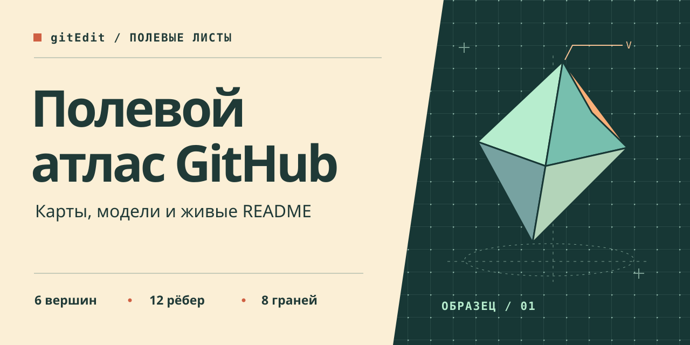

# Полевой атлас GitHub

**На главной витрине:** [покрути кристалл](../README.md#покрути-кристалл) · [приблизь карты](../README.md#две-карты) · [реши шахматный этюд](../README.md#шахматный-этюд). Здесь собраны исходные файлы и примеры из других проектов.

## Выбери маршрут

| Хочу… | Куда идти |
|---|---|
| Вставить модель, карту, формулу или диаграмму **прямо в Markdown** | [Карты и 3D](relief.md) · [диаграммы, формулы и типографика](native.md) — живой результат, исходник и способ повторить |
| Посмотреть, как GitHub показывает **обычный файл** | [Витрина файлов](#витрина-файлов) — от фильтра в CSV до блокнота Jupyter |
| Подсмотреть идею **в другом проекте** | [Разбор публичных репозиториев](inspiration.md) — готовые GIF, SVG, профили, игры и сайты; рядом указано, чем их сделали |
| Оформить **не только README** | [Профиль, карточка ссылки, формы, релизы, Wiki и Pages](surfaces.md) — где виден результат и что надо включить |
| Забрать готовую шапку, бейджи, змейку или целый шаблон | [Основная витрина gitEdit](../README.md#витрина-шаблонов) и [исходники и готовые блоки](../README.md#исходники-readme) |

## Витрина файлов

Открывай **название**, не кнопку Raw: нам нужен просмотрщик GitHub. Все экспонаты в таблице хранятся в этом репозитории. Чтобы просто посмотреть, ничего устанавливать, запускать или авторизовывать не нужно.

| Экспонат | Что попробовать |
|---|---|
| [3D · Кристалл (`.stl`)](samples/crystal.stl) | Потяни за модель, приблизь колесом, переключи поверхность на каркас. Это настоящая замкнутая сетка, а не анимация вращения. |
| [Карта · Две точки и профиль (`.geojson`)](samples/survey.geojson) | Приблизь ломаную между A и B. Это учебные координаты, не туристический трек. |
| [Карта · Соседние листы (`.topojson`)](samples/sheets.topojson) | Найди общий край двух полигонов. В исходнике он записан один раз. |
| [Таблица · Краски gitEdit (`.csv`)](samples/palettes.csv) | Введи `Чертёж` в фильтр над таблицей: останутся светлый и тёмный наборы. Номер строки даёт ссылку на неё. TSV работает аналогично. |
| [Блокнот · Пересчёт граней (`.ipynb`)](samples/crystal.ipynb) | Под ячейкой Python уже сохранён результат `6 − 12 + 8 = 2`. На GitHub это просмотр, не работающий Jupyter-сервер. Для пересчёта нужны блокнот и STL рядом. |
| [Схема · Путь от эскиза до тиража (`.mmd`)](samples/edition.mmd) | Открой схему состояний отдельным файлом; [тот же рисунок в Markdown](native.md#схема-состояний) не требует перехода со страницы. |
| [Печатный лист (`.pdf`)](samples/field-sheet.pdf) | Одна страница, которую можно рассмотреть или скачать для печати. Важные ссылки оставляй рядом в Markdown: просмотрщик PDF их игнорирует. |
| [Карточка ссылки (`.png`)](samples/social-preview.png) · [мастер (`.svg`)](samples/atlas-plate.svg) | Готовый PNG 1280 × 640 для Social preview. Открой SVG как текст, чтобы заменить надписи и цвета, затем экспортируй новый PNG. [Куда его загружать →](surfaces.md#карточка-ссылки) |

**Не только Markdown:** сравни [README проекта Asciidoctor в `.adoc`](https://github.com/asciidoctor/asciidoctor/blob/main/README.adoc) и [руководство Python в `.rst`](https://github.com/python/cpython/blob/main/Doc/howto/argparse.rst). Перечень распознаваемых форматов — в [github/markup](https://github.com/github/markup). Это не значит, что GitHub выполнит все директивы полноценной сборки документации.

**Если вместо экспоната виден код:** сначала открой файл на github.com. Для 3D проверь поддержку WebGL. Большие файлы могут не получить предпросмотр; например, для STL документация указывает предел 10 МБ. Для любого важного демо оставляй подпись и ссылку на исходник. Управление, лимиты и режимы просмотра: GitHub Docs [1](https://docs.github.com/en/repositories/working-with-files/using-files/working-with-non-code-files).

*Срез для github.com: 17 ноября 2026 года. Это атлас оформления и представления проектов, не перечень всех настроек платформы. Авторы, исходные проекты и условия переиспользования экспонатов указаны [под главной витриной](../README.md#откуда-взялись-экспонаты).*
