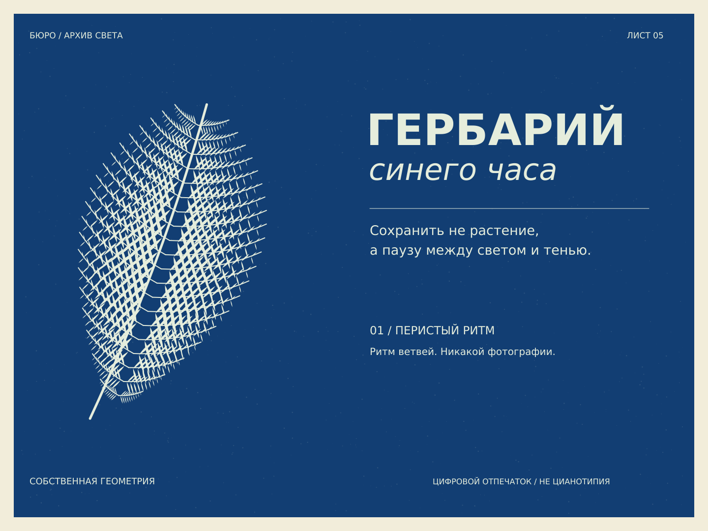
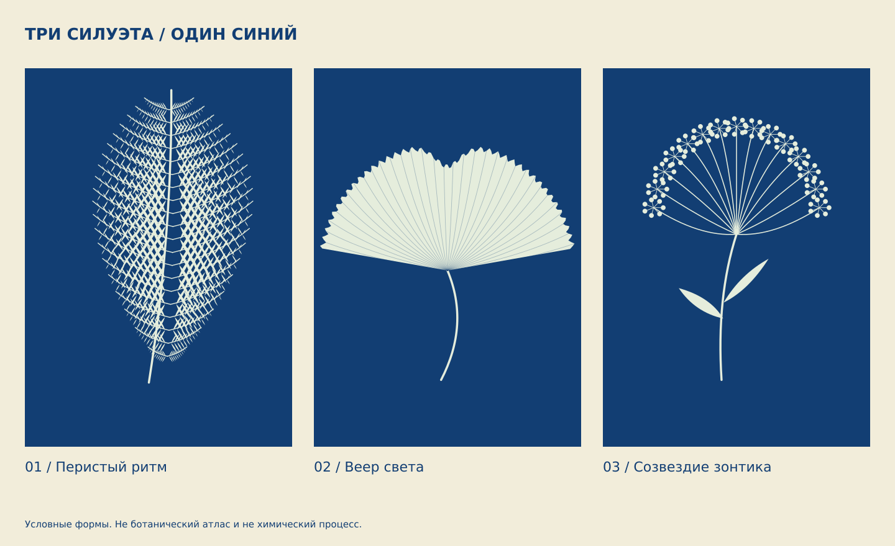

# Гербарий синего часа

[← Галерея](../README.md)



## Другая визуальная интонация

После маршрутной схемы — органический силуэт и большое цветовое поле. Светлые формы напоминают отпечатки на синей бумаге, но **это не настоящая цианотипия, не фотография и не симуляция её химии**. Здесь нет сканов растений, заимствованных фотографий, ботанических данных или измеренной экспозиции. Все три формы построены собственным кодом.

Бумажные поля, сдержанная музейная подпись, крупный заголовок и разреженный декоративный крап образуют самостоятельный редакционный разворот. Синее поле сохраняется в тёмной теме намеренно: это цвет самого листа, не цвет UI. Контактный лист — продолжение композиции, а не три новых головоломки.

## Три условных силуэта

| Лист | Что изображено | Как построено |
|---|---|---|
| [01 · Перистый ритм](../assets/bluehour/fern.svg) | Ветвь, напоминающая вайю папоротника | Центральная кривая, 20 пар боковых веточек, по 10 пар листочков на каждой; размер плавно меняется вдоль стебля. |
| [02 · Веер света](../assets/bluehour/fan.svg) | Веерный лист с небольшой выемкой | Радиальная граница из 161 точки, декоративная волна края и расходящиеся жилки. |
| [03 · Созвездие зонтика](../assets/bluehour/umbel.svg) | Соцветие с тонкими лучами и светлыми точками | 15 лучей, по семь маленьких цветочных кружков на каждом, два условных листа. |

Это **не определитель растений**. Листья, ветвление и соцветия обобщены ради силуэта; не стоит определять по ним вид, анатомию или закономерности роста. Названия — авторские подписи к графике, не таксоны.



## Адаптивная композиция

- Обложка: 1440×1080; на телефоне — отдельная композиция 720×1220, заголовок над ветвью, а не рядом.
- Контактный лист: 1440×880; на телефоне — три вертикальных отпечатка 720×2140.
- Три отдельных оригинала: 620×800. Это SVG без фиксированного печатного масштаба.

GitHub получает обычные SVG через `<picture><source>`. Никакого canvas, JavaScript, WebGL, внешних изображений, шрифтовых запросов и анимации. Если source не поддерживается, видна настольная версия. В SVG есть title/desc, в README — alt и обычные ссылки с номерами. Шрифты системные: метрики и вид букв на разных платформах могут немного отличаться. Текст внутри изображения не заменяет описание в Markdown.

Крап — 950 псевдослучайных светлых точек с фиксированным seed; это стилизация фактуры, не модель бумаги. Текстура не меняется при загрузке страницы. Нет blur/filter и внешних ресурсов. Геометрия каждого силуэта одинакова в обложке, контактном листе и отдельном оригинале; меняются только преобразования и поля.

## Что исследовано в других README

Прочитаны начальные части **восьми корневых README**, до 3700 символов каждого. Точные SHA, постоянные ссылки и границы чтения — в [sources.json](samples/bluehour/sources.json). Это не аудит всех исходников. Картинки, сайты и примеры по ссылкам не открывались; чужие рисунки не копировались.

| Проект | Наблюдение → решение |
|---|---|
| processing/p5.js | Небольшой пример кода соседствует с изображением результата; у нас готовая работа отделена от воспроизводящего генератора. Интерактивный sketch runtime не переносится в README. |
| paperjs/paper.js | Пример canvas setup и onFrame требует JS-контекста; здесь геометрия заранее записана в SVG и ничего не исполняется при просмотре. |
| abey79/vsketch | Generative-art toolkit — повод разделить алгоритм и готовый артефакт; используется собственная простая геометрия, не toolkit. |
| abey79/vpype | README различает создание, раскладку и оптимизацию plotter graphics; наша работа — экранный отпечаток, не оптимизированные траектории пера. |
| fogleman/gg | Начало README показывает 2D primitives, кривые и преобразования; аналогичные базовые средства достаточно выразительны для самостоятельной композиции. Go и библиотека не используются. |
| svg/svgo | README объясняет лишние данные SVG и оптимизацию; здесь сразу генерируется небольшой ограниченный набор элементов, без редакторских метаданных. SVGO не запускался. |
| linebender/resvg | Начало README подчёркивает сложность SVG и отличие статичного рендера от браузерной динамики; выбран статический поднабор без скриптов/фильтров, результат проверяется в Chromium. resvg не запускался. |
| mozman/svgwrite | README явно сообщает неактивный статус и показывает создание SVG; для этой небольшой работы достаточно стандартной библиотеки Python без дополнительной зависимости. |

Это исследование формата публикации и способов генерации, не историческое исследование цианотипии. Мы не приписываем проектам авторство нашей палитры или растительных форм.

## Воспроизвести

```sh
python atlas/samples/bluehour/generate.py
python -m unittest discover -s tests -p test_bluehour.py -v
```

Генератор требует только стандартную библиотеку Python. Он создаёт семь SVG, контрольные суммы и локальный proof; **README не редактирует**. [Генератор](samples/bluehour/generate.py) · [SHA-256](../assets/bluehour/manifest.json) · [Локальная проверочная страница](../assets/bluehour/proof.html) · [Chromium checker](samples/bluehour/check-browser.cjs).

Тесты проверяют XML, отсутствие внешних ресурсов и исполняемых элементов, четыре размера композиций, повторное использование одной геометрии, контрольные суммы, ссылки и детерминированную перегенерацию. Браузерный checker проверяет две ширины × две темы: загрузку, выбор мобильных source, отсутствие переполнения и внешних HTTP-запросов, JS-ошибки и переход к ссылке клавишей Tab. Локальная HTML-страница не равна github.com; прохождение блоком GitHub Markdown sanitizer проверяется отдельно через API.
