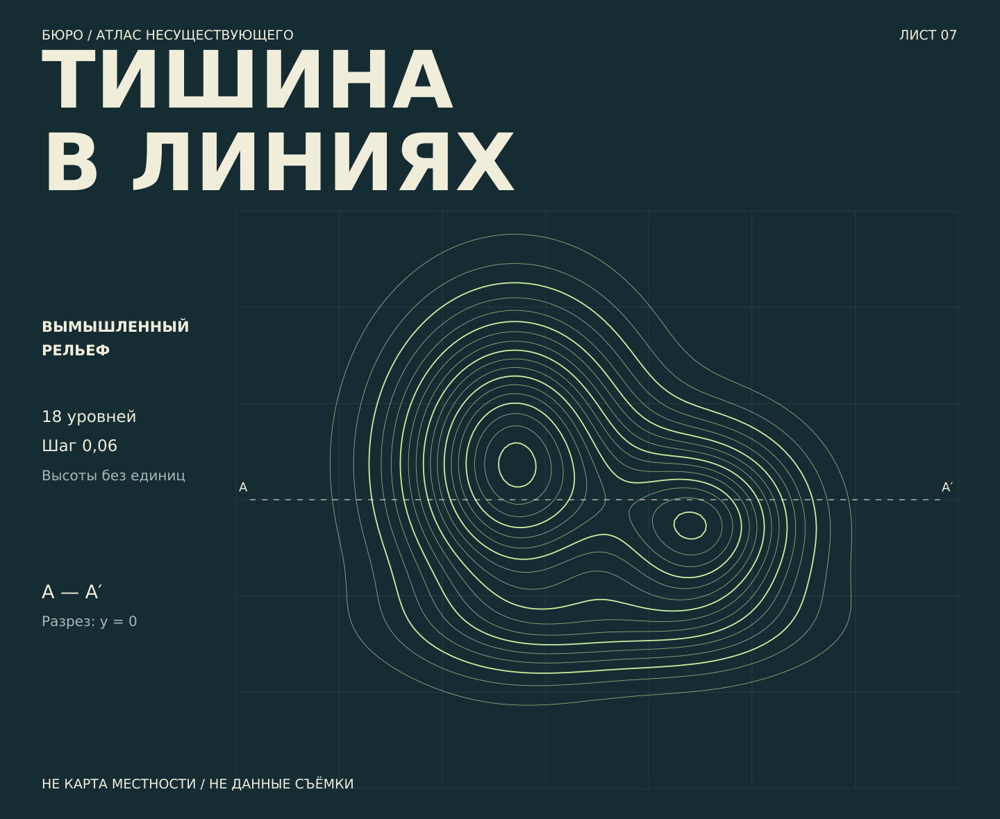
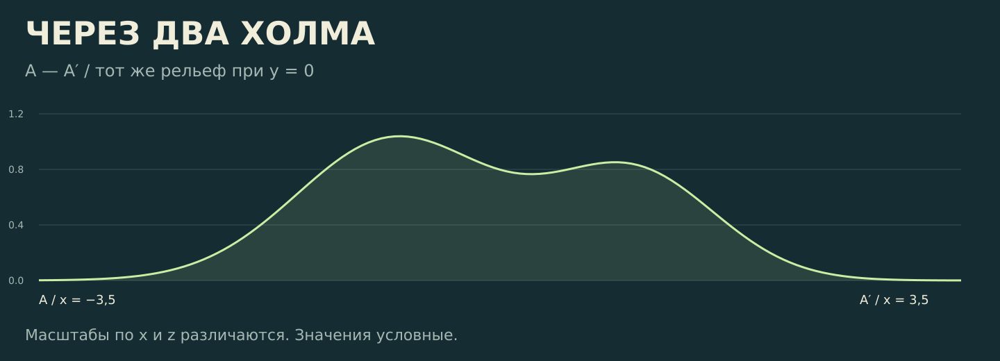

# Тишина в линиях

[← Галерея](../README.md)



## Топография как язык оформления

Тёмный сине-зелёный фон, тонкие светло-зелёные линии, крупный кремовый заголовок и сдержанные технические подписи. Плакат использует язык топографии, но не изображает настоящую местность. Это **собственное синтетическое скалярное поле**, не геоданные, не результаты съёмки, не карта для навигации и не научная модель ландшафта.

Контуры не дорисованы от руки: они действительно соответствуют уровням одной дискретизированной поверхности. Разрез ниже — строка той же сетки. Здесь нет загадки, которую нужно разгадать: композицию можно просто рассматривать как самостоятельную графику. Все прежние разделы README сохранены.

## Одно поле, два вида

Область: `x ∈ [−3,5; 3,5]`, `y ∈ [−2,8; 2,8]`. Высота — сумма трёх положительных функций:

```text
z(x,y) = 1.10 exp(−((x+0.8)²/1.1 + (y−0.35)²/1.7))
       + 0.86 exp(−((x−1.0)²/0.8 + (y+0.25)²/0.7))
       + 0.25 exp(−((x−0.1)²/3.0 + (y+1.2)²/0.25))
```

Сетка **141×113 точек**, каждый прямоугольник разделён одной фиксированной диагональю на два треугольника: всего **31 360 треугольников**. Для уровней **0,06…1,08 с шагом 0,06** на рёбрах ищутся пересечения линейной интерполяцией; соседние сегменты сшиваются по идентификаторам общих рёбер, а не по округлённым экранным координатам. Получается **18 уровней**; каждый третий рисуется толще.

Это собственная небольшая реализация **marching triangles**, не вызов библиотек и не marching squares. Контуры относятся к кусочно-линейному приближению поля, а не к точному аналитическому решению. Интерполяция, конечная сетка и округление координат SVG вносят погрешность. Не используется сглаживание, меняющее контуры ради картинки.

Для выбранной области и уровней все цепочки замкнуты и не ветвятся; генератор проверяет степень 2 у узлов сшивки. Это не универсальный обработчик любых полей: касания уровня точно в вершинах, плато, открытые границы, NaN и произвольные вырожденные данные специально не поддерживаются. Переиспользование с другим полем требует новых проверок.



Пунктир **A — A′** проходит по `y=0` слева направо. График использует **141 значение именно этой строки сетки**. [CSV разреза](../assets/contourpress/profile.csv) содержит `x,y,z`. Вертикальный и горизонтальный экранные масштабы различаются, поэтому по рисунку нельзя измерять физический угол склона. Все единицы условные; нет метров, координатной системы, масштаба расстояний и географической привязки.

## Публикация и доступность

- Обложка: 1440×1180; мобильная композиция 720×1100 с перенесёнными под карту подписями. Поле целиком, без обрезки; карта не растянута по одной оси.
- Разрез: 1440×520; мобильный 720×620 с более высоким графиком и теми же данными.
- [Контуры без плакатной типографики](../assets/contourpress/contours.svg) — отдельный крупный оригинал.
- Палитра одна для обеих тем: тёмное поле — часть плаката. `picture/source` выбирает мобильную композицию, а не включает скрипт.
- SVG без изображений, фильтров, анимации, WebGL и внешних шрифтов. Для просмотра не требуются токены, API и картографические тайлы.
- Alt, внутренние title/desc и Markdown-описание объясняют смысл рисунков. CSV даёт текстовый доступ к разрезу; более толстые линии дублируют различие уровней не только цветом. Системный шрифт может выглядеть немного по-разному на разных устройствах.

## Исследованные README

Начала **шести корневых README**, до 2300 символов каждого. Точные SHA и постоянные ссылки закреплены в [sources.json](samples/contourpress/sources.json). Изображения, исходники, демо и документы по ссылкам не открывались; библиотеки и приложения не запускались. Это ограниченное чтение README, не сравнительный тест алгоритмов.

| Проект | Что прочитано и какое принято решение |
|---|---|
| d3/d3-contour | Краткое описание contour polygons через marching squares по прямоугольному массиву. Мы тоже явно называем исходную сетку, но используем свою триангуляцию ячеек и marching triangles, не перенос реализации D3. |
| contourpy/contourpy | Picture-логотип и описание contours для 2D quadrilateral grids, C++/pybind11 и нескольких алгоритмов. Отделяем статичную оболочку публикации от способа расчёта и не выдаём свой простой генератор за полноценный contouring package. |
| scikit-image/scikit-image | В прочитанном начале — каналы поддержки, документация и установка. Отсюда нет выводов о find_contours или его реализации: эти разделы и код не изучались. Большая image-processing зависимость для этой работы не нужна. |
| OSGeo/gdal | В пределах прочитанного начала — заголовок проекта и многочисленные badges. Это не исследование API GDAL, DEM или CRS; не делаем из этого фрагмента технических выводов. GDAL не используется. |
| QGIS/QGIS | GIS, оглавление с beautiful cartography и началом перечня данных. Важно явно не смешивать плакатную стилизацию с полноценным GIS и анализом реальных пространственных данных. |
| mapbox/earcut | Триангуляция полигонов, приоритеты скорости и оговорки о корректности. У нас не триангуляция произвольного полигона: прямоугольная сетка режется фиксированной диагональю. Earcut не используется, качество/скорость с ним не сравниваются. |

Ни одна чужая карта, палитра или иллюстрация не копировалась. Эти ссылки не являются источниками географических данных — таких данных в работе нет.

## Воспроизведение

```sh
python atlas/samples/contourpress/generate.py
python -m unittest discover -s tests -p test_contourpress.py -v
```

Только стандартная библиотека Python; генератор README не редактирует. [Генератор](samples/contourpress/generate.py) · [Параметры и число цепочек](../assets/contourpress/audit.json) · [SHA-256](../assets/contourpress/manifest.json) · [Локальный proof](../assets/contourpress/proof.html) · [Chromium checker](samples/contourpress/check-browser.cjs).

Проверки покрывают сетку, интерполяцию, замкнутость цепочек выбранных уровней, совпадение разреза с исходной строкой, повторное использование геометрии, безопасный SVG, контрольные суммы, ссылки и перегенерацию без изменения README. Chromium проверяет две ширины × две темы, загрузку, выбор source, отсутствие переполнения/внешних HTTP-запросов/JS-ошибок и клавиатурную ссылку. Это локальная проверочная HTML-страница, не точная копия github.com; GitHub Markdown sanitizer проверяется отдельно API.
