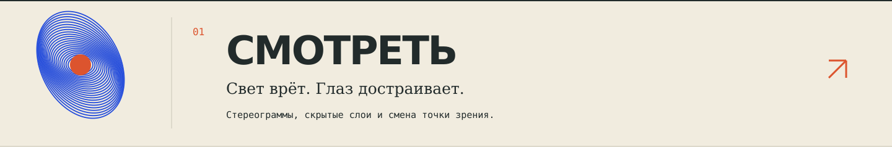
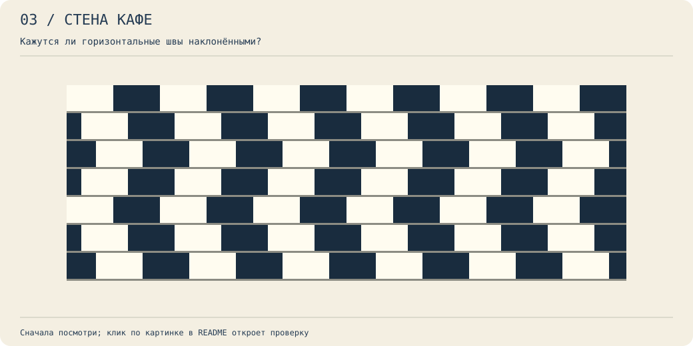
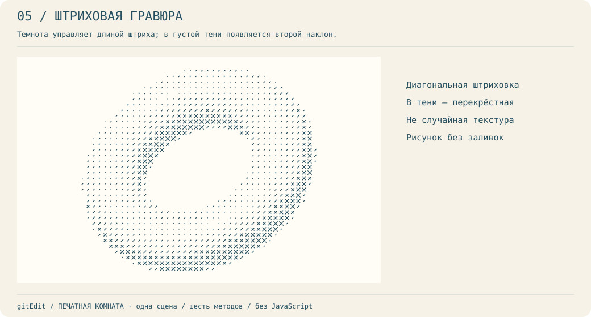

[← Бюро](foyer.md) · [Вся галерея](../README.md) · [Собирать](foyer-make.md) · [Проверять](foyer-prove.md)

<picture>
  <source media="(max-width: 640px) and (prefers-color-scheme: dark)" srcset="../assets/foyer/look-dark-mobile.svg">
  <source media="(max-width: 640px)" srcset="../assets/foyer/look-light-mobile.svg">
  <source media="(prefers-color-scheme: dark)" srcset="../assets/foyer/look-dark.svg">
  
</picture>

# Смотреть

Три остановки без установки программ. Не нужно проходить их по порядку или добиваться оптического эффекта любой ценой.

## 01 / Сначала усомнись в прямой

**Нажми на рисунок** — откроется разметка-проверка. Линии не меняются, меняется контекст вокруг них. [Остальные оптические опыты и ограничения](perception.md).

## 02 / Потом найди скрытую глубину

[Открыть автостереограмму](../assets/stereogram/stereogram.png) · [Сразу посмотреть раскрытие](../assets/stereogram/proof.png) · [Как это устроено](stereogram.md).

Не нужно приближать лицо к экрану, удерживать напряжение или продолжать при дискомфорте. Если стереограмма не складывается, раскрытие — полноценный способ посмотреть экспонат, а не «неправильный ответ».

## 03 / Наконец смени сам способ печати

Один массив отсчётов превращается в штриховку, растр, изолинии и ASCII. [Все шесть оттисков и исходники](printroom.md).

---

**Дальше:** [с экрана на стол](foyer-make.md) или [от впечатления к проверке](foyer-prove.md). Это редакционная подборка существующих работ; их файлы и расчёты не изменены.
