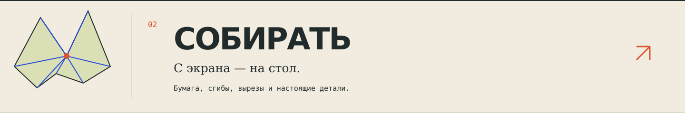
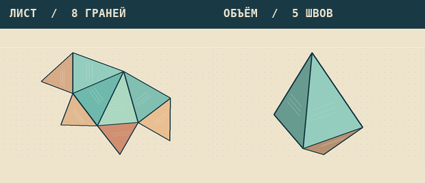
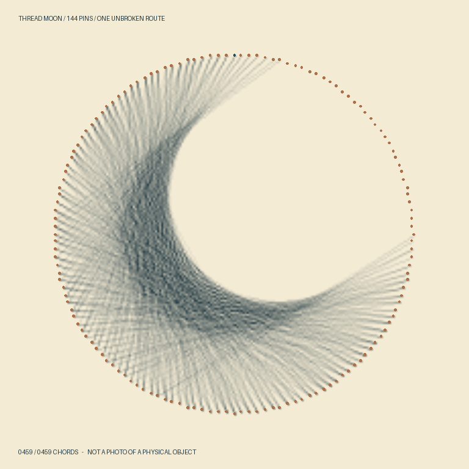

[← Бюро](foyer.md) · [Вся галерея](../README.md) · [Смотреть](foyer-look.md) · [Проверять](foyer-prove.md)

<picture>
  <source media="(max-width: 640px) and (prefers-color-scheme: dark)" srcset="../assets/foyer/make-dark-mobile.svg">
  <source media="(max-width: 640px)" srcset="../assets/foyer/make-light-mobile.svg">
  <source media="(prefers-color-scheme: dark)" srcset="../assets/foyer/make-dark.svg">
  
</picture>

# Собирать

Три разных жеста: согнуть, совместить, протянуть нить. Здесь картинка становится инструкцией для рук. Перед печатью прочти размеры и ограничения каждого экспоната.

## 01 / Из плоскости — объём

[Развёртка кристалла SVG](../assets/night-shift/crystal-net.svg) · [Посмотреть вращаемую модель STL](../assets/crystal.stl) · [О модели и нативных просмотрщиках GitHub](relief.md).

SVG — шаблон детали, а STL — отдельный просмотрщик. Анимация лишь показывает складывание; сама бумага складывается руками.

## 02 / Два листа — один силуэт

[Два листа A4 PDF](../assets/veil/sheets-a4.pdf) · [Посмотреть совмещение PNG](../assets/veil/proof.png) · [Инструкция и ограничения](veil.md).

Для физического наложения нужна подходящая прозрачная основа. Это публичная учебная демонстрация: оба листа и исходник доступны, никакой секретности нет.

## 03 / Из маршрута — луна

[Гвоздики A4 PDF](../assets/threadmoon/pins-a4.pdf) · [Маршрут CSV](../assets/threadmoon/route.csv) · [Счётчик шагов HTML](../assets/threadmoon/counter.html) · [Разбор](threadmoon.md).

Это более длинный маршрут, не обещание поделки за несколько минут. Гвоздики, натяжение и инструменты требуют аккуратного обращения; экранный счётчик не заменяет физическую безопасность.

---

**Дальше:** [вернуться к оптике](foyer-look.md) или [проверить красивый ответ](foyer-prove.md). Новое здесь — маршрут и оформление, не новые версии физических шаблонов.
