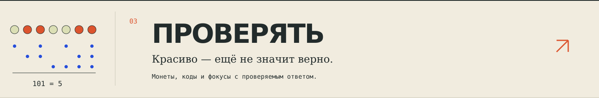
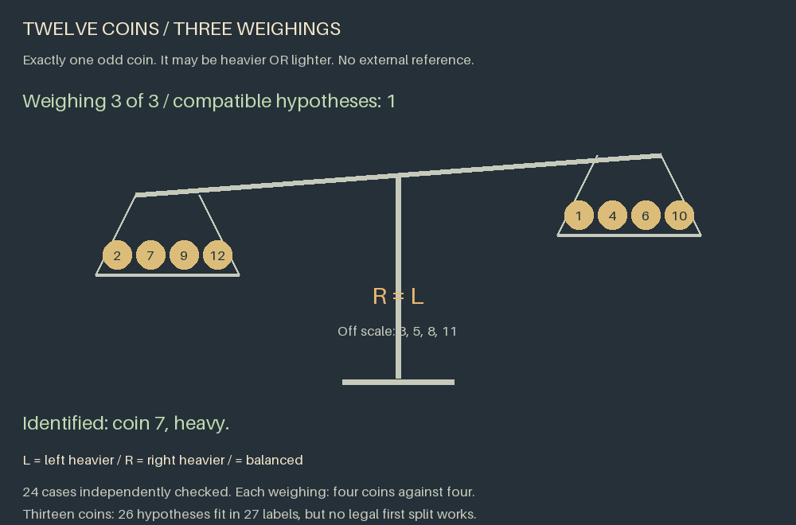

[← Бюро](foyer.md) · [Вся галерея](../README.md) · [Смотреть](foyer-look.md) · [Собирать](foyer-make.md)

<picture>
  <source media="(max-width: 640px) and (prefers-color-scheme: dark)" srcset="../assets/foyer/prove-dark-mobile.svg">
  <source media="(max-width: 640px)" srcset="../assets/foyer/prove-light-mobile.svg">
  <source media="(prefers-color-scheme: dark)" srcset="../assets/foyer/prove-dark.svg">
  
</picture>

# Проверять

Три опыта, где важно не довериться эффектной картинке. У каждого уже есть автономный стенд, свидетельства и независимая проверка.

## 01 / Услышать три ответа весов

[Стенд ZIP](../assets/coins/bench.zip?raw=true) · [План A4](../assets/coins/plan-a4.svg) · [План JSON](../assets/coins/plan.json) · [Почему 12 можно, а 13 нельзя](coins.md).

Нужно определить и номер, и направление отличия. Правила — ровно одна отличающаяся монета, идеальные чашечные весы и одинаковое число монет на чашах, без внешнего эталона.

## 02 / Поймать неверное «исправление»

[Семь лампочек: стенд ZIP](../assets/hamming/bench.zip?raw=true) · [Неподвижный пример](../assets/hamming/proof.png) · [Разбор](hamming.md).

Код Хэмминга (7,4) исправляет одну ошибку. Но две могут превратиться в уверенный неправильный ответ. Это обычный (7,4), не расширенный SECDED.

## 03 / Увидеть, как меняется общий победитель

[Парадокс Симпсона: стенд ZIP](../assets/simpson/bench.zip?raw=true) · [Карта 81 состава](../assets/simpson/grid.svg) · [Разбор и точные дроби](simpson.md).

A выигрывает в каждой группе, но может проиграть в сумме. Все данные вымышленные; арифметический переворот сам по себе не даёт причинного вывода.

---

**Дальше:** [смотреть, не вычисляя](foyer-look.md) или [перенести опыт на стол](foyer-make.md). Упаковка новая, а исходные сертификаты и границы гарантий сохранены.
