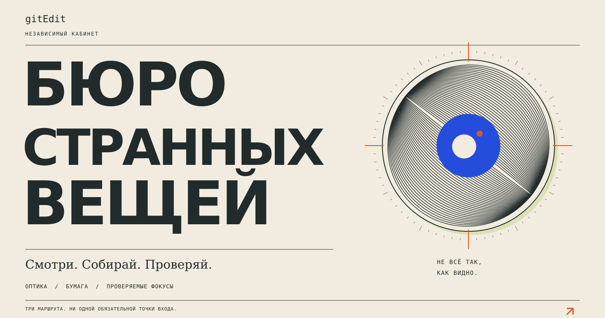

[← Вся галерея](../README.md) · [Смотреть](foyer-look.md) · [Собирать](foyer-make.md) · [Проверять](foyer-prove.md)

<picture>
  <source media="(max-width: 640px) and (prefers-color-scheme: dark)" srcset="../assets/foyer/cover-dark-mobile.svg">
  <source media="(max-width: 640px)" srcset="../assets/foyer/cover-light-mobile.svg">
  <source media="(prefers-color-scheme: dark)" srcset="../assets/foyer/cover-dark.svg">
  
</picture>

# Бюро странных вещей

[Посмотреть весь светлый макет PNG](../assets/foyer/preview.png) · [Локальная цветопроба HTML](../assets/foyer/proof.html).

Не ещё один вычислительный экспонат, а **новый визуальный вход в уже существующую галерею**. Вместо ряда одинаковых «заголовок → GIF → цифры» — редакционный плакат и три полноширинных маршрута. Это добавление: исходный триптих остаётся первым, все старые строки README сохранены в прежнем порядке без изменений.

**Выбирай не технологию, а действие:**

- [Смотреть](foyer-look.md): оптический рисунок с раскрытием, скрытая глубина и смена способа печати.
- [Собирать](foyer-make.md): бумажный кристалл, совмещение листов и луна из нити.
- [Проверять](foyer-prove.md): весы, неверное «исправление» кода и переворот общего процента.

Это короткая редакционная подборка, не полное оглавление и не обязательная последовательность. Файлы экспонатов, сертификаты и их ограничения не переписаны.

## Что изменилось именно в оформлении

**Крупный набор вместо мелких плашек.** «БЮРО / СТРАННЫХ / ВЕЩЕЙ» занимает основное поле. Служебная моноширинная строка не соперничает с названием; подзаголовок засечковым шрифтом меняет ритм. Межстрочный воздух, линии и маленькая диагональная стрелка повторяются во всём комплекте.

**Один графический предмет.** Диафрагма из 36 вложенных повёрнутых эллипсов, кобальтовая втулка, оранжевая метка и шкала из 72 делений. Это собственная векторная композиция, не фотография, не скачанный логотип и не новое утверждение об оптической иллюзии. Три малых мотива рифмуются с экспонатами: линейное поле, бумажные грани, лампы и группы чётности.

**Ограниченная палитра.** Светлая версия — тёплая бумага, угольный набор, кобальт и терракотовый акцент. Тёмная — отдельный набор красок с более светлыми акцентами, а не инверсия фильтром. Фон нарисован внутри SVG, поэтому рисунок не исчезает на фоне GitHub.

**Не просто уменьшение для телефона.** Для ширины viewport до 640 px используется отдельная композиция: обложка **720×920** вместо **1440×760**, маршрут **720×354** вместо **1440×238**. У обложки текст над графикой; у маршрута крупный заголовок над меньшим мотивом. Это art direction через `<picture>`, не CSS-сетка, которую GitHub вырежет.

**Тишина вместо ещё одной анимации.** Ни GIF, ни таймера, ни печатающейся строки, ни мерцания. `prefers-reduced-motion` не нужен: движение отсутствует изначально. Статичный блок служит паузой между существующими анимированными работами.

## Что действительно работает в GitHub README

Вставка использует только обычные ссылки, `<picture>`, `<source media>`, `` и Markdown. Никаких `style`, `script`, iframe, hover-обещаний, исполняемого SVG или кастомных шрифтов на странице GitHub.

Порядок источников важен:

1. Мобильная тёмная версия: одновременно max-width и dark.
2. Мобильная светлая версия.
3. Десктопная тёмная версия.
4. Светлый десктопный `` как fallback.

Это **предпочтение цветовой схемы, видимое браузеру**, а не надёжный датчик ручного переключателя темы GitHub: если сайт принудительно выбрал тему, отличающуюся от media preference, вариант может не совпасть с интерфейсом. Обе картинки имеют собственный фон и остаются читаемыми. Ширина относится к viewport браузера, не к ширине колонки README.

Каждая полоса целиком является ссылкой на отдельный Markdown-файл. Стрелка на картинке не отдельная кнопка, а часть графики. Ссылки не спрятаны только в SVG: их цели заданы настоящим HTML, есть `alt` и **текстовая навигация ниже**. Внутренние SVG-ссылки не используются. Если просмотрщик проигнорирует `<source>`, останется светлая обложка, а текстовые маршруты по-прежнему доступны.

## Типографика и воспроизведение

Шрифты **DejaVu Sans Bold, DejaVu Sans Mono и DejaVu Serif** используются локальным генератором. В итоговом SVG буквы преобразованы в геометрические контуры и переиспользуются через локальные `<use>`. Нет загрузки веб-шрифта и зависимости от того, установлен ли шрифт у читателя. Это отрисованные надписи, а не встраивание шрифтовой программы. Доступное текстовое название каждой картинки задано снаружи через `alt`; дополнительно есть SVG `<title>` и текстовые подписи в документах. Контуры не предназначены для выделения/копирования текста.

```sh
python3 -m venv .venv
.venv/bin/pip install -r atlas/samples/foyer/requirements.txt
.venv/bin/python atlas/samples/foyer/generate.py
.venv/bin/python -m unittest discover -s tests -p test_foyer.py -v
```

Нужны локальные DejaVu в `/usr/share/fonts/truetype/dejavu`. Генератор создаёт **16 статичных SVG** — четыре предмета × две темы × две композиции — и [блок для README](samples/foyer/readme-block.md), [реестр маршрутов](../assets/foyer/routes.json), [SHA-256 изображений](../assets/foyer/manifest.json), [офлайн-цветопробу HTML](../assets/foyer/proof.html). **README генератор не меняет.** Повторная генерация проверяется побайтно в одном окружении шрифтов; перенос между разными версиями шрифта не объявляется побайтно идентичным.

`proof.html` — только локальная цветопроба графики и media selection, **не новый сайт вместо README**. В ней для удобства есть CSS; этот CSS не вставляется в README. Ссылки работают при открытии файла внутри полного репозитория, отдельный ZIP с экспонатами здесь не нужен.

`check-browser.cjs` проверяет четыре сочетания desktop/mobile × light/dark через `file://`: выбранные 16 SVG, загрузку всех картинок, отсутствие горизонтального скролла, keyboard Tab, существование целей ссылок и отсутствие HTTP/JS-ошибок. По `FOYER_SHOTS=/tmp/foyer-shots` сохраняет цветопробы; `preview.png` — сохранённый браузерный снимок светлого десктопного макета, не исходник и не часть SVG-генератора. Проверка GitHub Markdown API отдельно подтверждает, что `<picture>`, media и ссылки не вырезаны. Это не обещание пиксельного совпадения всех альтернативных Markdown-просмотрщиков с GitHub.

## Что исследовано в других README

Сначала выполнен **новый просмотр 13 README**, включая три профиля из раздела Minimalistic каталога awesome-github-profile-readme. Адреса закреплены SHA в [sources.json](samples/foyer/sources.json). Для длинных документов изучены первые блоки и выбранные фрагменты: это **не аудит 13 приложений, не просмотр всех картинок и не полный обход всех профилей каталога**. Внешние сервисы, баннеры, видео и шрифты не скачивались/не переносились. Команды в чужих README не исполнялись.

Что взято как приём, а что сознательно отвергнуто:

| README | Наблюдение по разметке / решение здесь |
|---|---|
| charmbracelet/gum | Предметный образ перед инструкцией и отдельное демо с подписью. Здесь один собственный графический предмет на обложке; чужие картинки/GIF не изучались и не копировались. |
| charmbracelet/glow | Сначала название/обещание, затем крупное демо. Отсюда иерархия «узнать характер → выбрать действие», а не начинать с технической таблицы. Чужой внешний GIF не загружался. |
| typst/typst | Раздел Example прямо предлагает показать возможности одним изображением. Здесь тоже одна законченная графическая композиция, а не россыпь маленьких бейджей; исходник и проверка доступны отдельно. Изображение Typst не копировалось. |
| niri-wm/niri | Компактная строка Getting Started / Configuration / Showcase до большого скриншота. Полезно дать несколько ясных входов, не заставляя читать всё подряд. Наши входы названы действиями читателя. Скриншоты niri не анализировались. |
| jesseduffield/lazygit | В первых блоках крупные спонсорские/демо-медиа. Не переносим их вес в собственную шапку и не добавляем карусель логотипов; это скорее контрпример лишней конкуренции за внимание. Видео не запускалось. |
| daytonaio/daytona | Реальная `<picture>`-разметка с белым/чёрным логотипом для тем. У нас отдельные собственные цветовые версии и отдельная мобильная композиция. Уведомление о прекращении поддержки репозитория прочитано; продукт не представляется как актуальная рекомендация. |
| DenverCoder1/readme-typing-svg | README объясняет внешний генератор печатающихся строк. Для этой галереи отказались: движения уже достаточно, а внешняя зависимость не нужна. Сервис не вызывался. |
| antonkomarev/github-profile-views-counter | README описывает внешний счётчик и сам предупреждает о накрутке. Не добавляем ещё один числовой бейдж и не выдаём количество просмотров за качество оформления. |
| abhisheknaiidu/awesome-github-profile-readme | Каталог различает Minimalistic, GIFs, Badges и другие подходы. Просмотрены оглавление/выбранные группы, не каждый перечисленный профиль. Из Minimalistic отдельно получены три README ниже; ярлык категории не равен оценке актуального оформления. |
| github/docs | Quick links by contributor type организует вход по **потребности человека**. Здесь аналогичный принцип: смотреть/собирать/проверять, а не SVG/Python/JSON. README документации не считается доказательством технической поддержки `<picture>`; это проверено нашей вставкой через API. |
| caneco/caneco | Короткая текстовая иерархия без большого баннера. Напоминание, что все критичные ссылки должны жить и без картинки. Здесь под полосами оставлена текстовая строка маршрутов. |
| moertel/moertel | Группировка бейджей и разделение двух ролей. Взята идея ясных групп, не бейджи/иконки/чужой стиль neo-noir. Работы из внешней галереи не просматривались. |
| maximousblk/maximousblk | В первых разделах чёткие подписи групп ссылок и автоматически обновляемые блоки активности. Подписи полезны, автообновление здесь не нужно: маршруты редакционные и не притворяются «живой» статистикой. |

В итоге — собственный макет, палитра, рисунки, кириллическая типографика и маршруты. Это не новая обёртка чужого баннера и не сборка виджетов по внешним URL.
