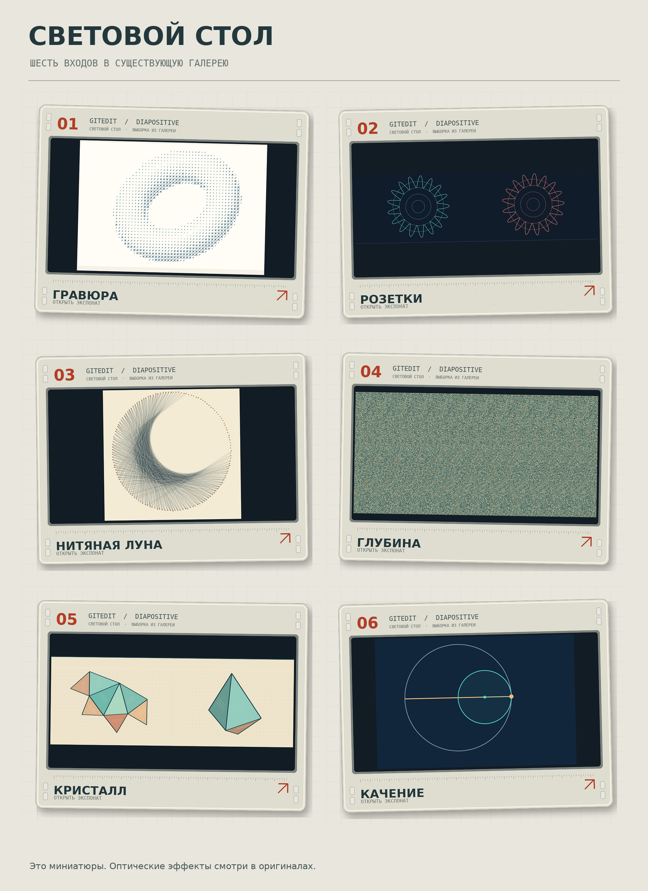

[← Вся галерея](../README.md) · [Бюро странных вещей](foyer.md) · [Контактный лист JPG](../assets/lighttable/contact-sheet.jpg) · [Локальная цветопроба](../assets/lighttable/proof.html)

# Световой стол



Новый способ **оформить выбор работ**, а не очередной математический экспонат. После крупного плаката «Бюро» — контактный лист: реальные изображения галереи в собственных рамках со слегка повёрнутыми гранями, мягкой тенью, перфорацией, номерами и служебной типографикой. Читатель выбирает картинку, не разбирая длинный список форматов.

В README это **шесть отдельных изображений-ссылок**, не один некликабельный коллаж и не обещание image map. Контактный лист выше — отдельная крупная обзорная картинка. Внутри неё шесть зон не становятся кнопками; рабочие ссылки — ниже и в таблице README.

## Текстовый каталог

| № | Работа | Оригинал | Куда ведёт диапозитив |
|---:|---|---|---|
| 01 | Штриховая гравюра | [SVG](../assets/printroom/hatch.svg) | [Шесть способов напечатать один рисунок](printroom.md) |
| 02 | Гильоширные розетки | [SVG](../assets/afterlight/guilloche.svg) | [Afterlight: зал графических приёмов](afterlight.md) |
| 03 | Нитяная луна | [PNG](../assets/threadmoon/moon.png) | [Изображение как маршрут нити](threadmoon.md) |
| 04 | Скрытая глубина | [PNG](../assets/stereogram/stereogram.png) | [Автостереограмма и раскрытие](stereogram.md) |
| 05 | Бумажный кристалл | [Неподвижный PNG](../assets/night-shift/fold-still.png) | [Модель и нативные просмотрщики GitHub](relief.md) |
| 06 | Пара Туси | [Неподвижный SVG](../assets/rolling/tusi-still.svg) | [Качение: пять механизмов](rolling.md) |

Ссылка на разбор выбрана сознательно: там и оригинал, и условия просмотра, и исходники. Под изображением в README есть обычная текстовая ссылка с названием — рамку не обязательно видеть или точно попадать в нарисованную стрелку.

## Что нового в графике

- **Материальный слой вместо ещё одного баннера.** Тёплая светлая рамка, срезы, выемки и тень создают вид диапозитива на подсвеченном столе. Это нарисованная имитация материала, не фотография физического объекта и не альфа-прозрачная модель плёнки.
- **Реальные работы, не абстрактные заглушки.** Все шесть изображений уже существовали в этом репозитории. Новые рамки, сетка, зерно и компоновка написаны здесь отдельно. Чужие фото, мокапы, текстуры, логотипы и генеративные изображения не использовались.
- **Светлая/тёмная подложка.** Две версии каждого кадра: на тёмной теме вокруг светлой рамки остаётся тёмный стол, а не белый прямоугольник. Сами экспонаты не перекрашиваются под тему. Media query следует предпочтению браузера; принудительная тема сайта может отличаться от него.
- **Маленький наклон, неподвижное содержимое.** Рамки повёрнуты менее чем на полтора градуса, не пересекаются и не выскакивают за границы ячеек. Никакой анимации, мерцания, параллакса или hover-состояний.
- **Полезная служебная графика.** Номер повторён в картинке и в живой подписи, а не служит скрытым идентификатором. Стрелка — иллюстрация обычной ссылки, не отдельная кнопка.

## Миниатюра — не оптический опыт

Источники читаются **без изменения файлов**. Из SVG делается статичный растр, из GIF/PNG при необходимости берётся первый кадр. Затем берётся явно заданная область, равномерно уменьшается до окна рамки и располагается без растяжения по одной оси. Сверху на саму иллюстрацию не накладываются зерно или цветовой фильтр; фактура принадлежит рамке/столу.

Готовые PNG уменьшены до **256 цветов без dithering**, чтобы снизить вес таблицы. Это **потеря цветовой точности миниатюры**, не преобразование исходных экспонатов. При вращении и масштабировании также есть интерполяция. Поле `[raster_crop_px]` в [каталоге JSON](../assets/lighttable/catalog.json) хранит фактический прямоугольник кадрирования, а `source_sha256` — хеш источника. Это происхождение изображения, не сертификат физической/оптической точности превью.

**Стереограмму нельзя оценивать по этой карточке:** кадрирование, масштаб и палитра могут нарушить её чтение. Открывай [оригинал](../assets/stereogram/stereogram.png) или [раскрытие](../assets/stereogram/proof.png). Не напрягай зрение, не приближай лицо и не продолжай при дискомфорте. То же правило масштаба относится к точным линиям и печатным шаблонам: диапозитив — навигация, не измерительный рисунок.

## Нативный GitHub, а не отдельный сайт

Разметка — обычная HTML-таблица **3 ряда × 2 столбца**. В ячейке ссылка, `<picture>` с тёмной версией, ``, живое название и короткая подпись. Ни CSS, ни JS, ни iframe, ни сторонних CDN в README нет. Родные рамки/отступы таблицы GitHub не скрываются. Два столбца остаются двумя и на телефоне: это не обещание CSS-grid или автоматической перекладки в одну колонку.

На узком экране служебный мелкий текст внутри картинок декоративен; название и ссылка под каждой картинкой остаются обычным текстом. Это честнее, чем притворяться, что микротипографика остаётся одинаково читаемой при любом масштабе. Для крупного просмотра есть контактный лист и оригиналы.

Обе темы используют PNG с собственным фоном, поэтому fallback в светлую версию остаётся видимым. Все шесть работ статичны: reduced-motion не нужен для остановки движения. Если просмотрщик не поддержит `<picture>`, останется обычный `` и живая подпись-ссылка.

Блок добавлен **после Бюро, перед старой лентой экспонатов**. Прежний триптих, все существующие тексты, иллюстрации и ссылки сохранены побайтно и в прежнем порядке. Каталог не требует заменить другие входы.

## Воспроизведение

```sh
python3 -m venv .venv
.venv/bin/pip install -r atlas/samples/lighttable/requirements.txt
.venv/bin/python atlas/samples/lighttable/generate.py
.venv/bin/python -m unittest discover -s tests -p test_lighttable.py -v
```

Нужны Pillow **13.0.0**, PyMuPDF **2.1** и локальные DejaVu Sans/Sans Mono в `/usr/share/fonts/truetype/dejavu`. Генератор создаёт 12 PNG 1000×800 (шесть кадров × две подложки), контактный JPG 1600×2200, каталог с кропами и хешами, [реестр PNG](../assets/lighttable/manifest.json), [готовый блок README](samples/lighttable/readme-block.md) и [цветопробу HTML](../assets/lighttable/proof.html).

Генератор **не меняет README и источники**. Зерно имеет фиксированный seed, регенерация сравнивается побайтно в том же окружении шрифтов/библиотек. Отдельного ZIP нет: это оформление каталога репозитория, а не автономный экспонат. Цветопроба содержит локальный CSS только для проверки сетки/тем и не выдаётся за точную копию всех стилей GitHub.

Восемь тестов: происхождение всех шести изображений; 12 статичных индексированных PNG и лимит веса; SHA-256; нативная таблица/6 alt/12 ссылок; разные темы и контактный JPG; наличие блока после Бюро; восемь README-источников; побайтная регенерация при неизменности README и исходных работ.

`check-browser.cjs` проверяет светлую/тёмную тему при ширинах 1100 и 390: выбор всех 24 картинок за четыре прохода, сетку 3×2, 12 рабочих ссылок, клавиатурный Tab, отсутствие горизонтального скролла, HTTP и JS-ошибок. С `LIGHTTABLE_SHOTS=/tmp/lighttable-shots` сохраняет цветопробы. Отдельно проверяется вывод GitHub Markdown API: настоящая таблица, картинки/подписи-ссылки и `<source>` должны остаться в итоговой разметке. Это проверка нашей разметки и локального макета, не пиксельная гарантия для всех Markdown-клиентов.

## Что просмотрено в других README

[sources.json](samples/lighttable/sources.json) фиксирует **восемь README с SHA**. Для длинных документов просмотрены начало, структура и выбранные фрагменты; это не восемь аудитов приложений, не полный просмотр всех картинок и не анализ каждого проекта из каталогов. Чужие изображения не скачивались, внешние демо/команды не запускались.

| README | Приём или причина отказа |
|---|---|
| terkelg/awesome-creative-coding | В начале обложка, затем обширный тематический индекс. Для нашей галереи нужен короткий визуальный выбор, не ещё одна длинная классификация. Чужая обложка не использовалась. |
| bradtraversy/50projects50days | Настоящая таблица раздельных ссылок Project / Live Demo. Здесь тоже каждая ячейка ведёт в понятное место, а не обещает интерактивность внутри картинки. Сайты с демо не открывались. |
| sindresorhus/awesome | Крупная марка и вынесенные спонсорские блоки занимают значительную часть начала. Наш новый блок не ещё одна гигантская обложка и не полоса внешних логотипов: внимание отдано работам. |
| sindresorhus/awesome-electron | Небольшой знак и структура категорий Apps/Tools/Components. Название/навигация полезны, но перечень сам по себе не показывает рисунок: добавляем реальные миниатюры, сохраняя текстовые подписи. Приложения не тестировались. |
| kognise/water.css | README про classless CSS для обычной страницы. Не подключаем такой CSS в README: GitHub не даёт произвольную тему страницы из `<link>`. Цветопроба и реальная разметка отделены. |
| picocss/pico | В начале тематические `<picture>`-источники логотипа. Используем тот же стандартный механизм, но собственные PNG. Уведомление о прекращении поддержки прочитано; CSS-фреймворк не устанавливался и не рекомендуется как новая зависимость. |
| microsoft/fluentui-emoji | README представляет коллекцию одним баннером. Для обзора это хорошо, но баннер не делает каждый предмет отдельной ссылкой. У нас обзорный JPG отдельно, а рабочая навигация — шесть настоящих изображений-ссылок. Чужие emoji не переносились. |
| catppuccin/catppuccin | Просмотрены начальная навигация, `<picture>` и выбранная разметка таблиц палитры: изображение рядом с текстовым названием/значением. Здесь тоже дублируем картинку читаемой подписью; чужие иконки, палитра и artwork не копировались. |

Результат — собственная материальная оболочка вокруг **наших уже существующих работ**, а не новый эффект ради ещё одного числа или скачанная витрина чужих изображений.
