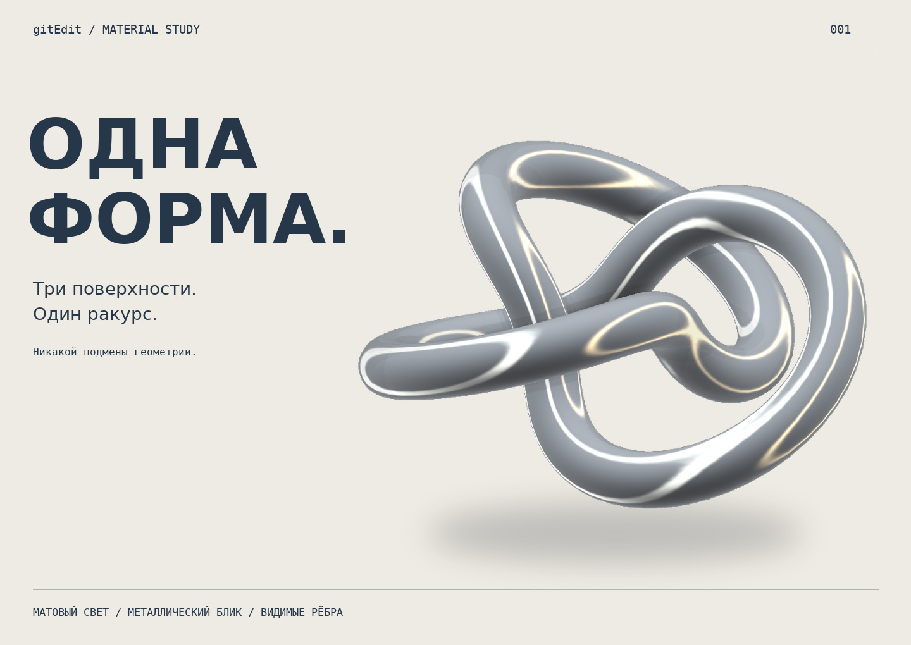

[← Галерея](../README.md) · [Бюро](foyer.md) · [Световой стол](lighttable.md) · [Ночной тираж](pressroom.md)

# Материальная проба



После плоского плаката — **предметная композиция**. Один собственный 3D-объект с крупными планами и тремя отделками. Здесь нет новых счётчиков, случайных фото из портфолио или браузерного приложения, которое нужно ждать при открытии README.

[Матовая крупно](../assets/materials/matte.jpg) · [Металлические блики](../assets/materials/metal.jpg) · [Линии сетки](../assets/materials/wire.jpg) · [Сравнение крупно](../assets/materials/comparison.jpg) · [Вертикальное сравнение](../assets/materials/comparison-mobile.jpg).

## Дизайн

**Один предмет держит композицию.** Светлый студийный фон, крупный объект справа и спокойная типографика слева. Нет рамки диапозитива: форма словно стоит перед набором, а мягкое пятно снизу отделяет её от фона. Это нарисованная постановка, не фотография настоящего изделия.

**Сравниваются поверхности, не силуэты.** Для всех трёх видов повторно используется один буфер глубины и нормалей. Ракурс, размеры и перекрытия витков не подменяются ради удачного кадра. Обзорный блок просто повторяет эти рендеры одинакового масштаба. Обложка отдельно увеличивает металлический вариант для акцента — это редакционный макет, а не сравнительное измерение размеров.

**На телефоне — последовательность вместо микроскопических колонок.** Обложка меняется с 1440×1020 на 720×1120, а три варианта сравнения — с горизонтальных 1440×586 на вертикальные 720×2160. `<picture>` выбирает их при viewport до 640 px. Это отдельные раскладки, не обещание CSS-grid в Markdown.

**Без движения.** Нет автоповорота, глитча, смены материала по таймеру или имитации drag-to-rotate. Ссылки на варианты всегда видны обычным текстом. Изображения имеют собственный светлый фон, поэтому одинаковы в светлой и тёмной теме. Это сознательно светлая предметная съёмка, а не ошибка автоматического dark mode.

## Что именно построено

Форма — трубка вокруг периодической пространственной кривой:

`c(t) = ((2+cos(3t)) cos(2t), (2+cos(3t)) sin(2t), sin(3t))`.

По t взяты **160** отсчётов, по окружности трубки — **28**, радиус трубки **0.36** в условных единицах. Локальный репер строится из касательной и фиксированной вертикали, а нормали поверхности — центральными разностями по двум параметрам. Периодические индексы замыкают оба направления.

Итог: **4480 вершин и 8960 треугольников**. [Аудит JSON](../assets/materials/audit.json) фиксирует конечность координат, нормировку нормалей, число рёбер, общую маску видимости и параметры вывода. Каждое ребро принадлежит двум треугольникам, ориентированные пары согласованы, связность проверена, характеристика Эйлера равна 0.

Это проверки дискретной сетки, **не** автоматическое доказательство отсутствия самопересечений, не топологическая классификация узла и не сертификат пригодности к изготовлению. Геометрическая формула известного семейства пространственных кривых не выдаётся за новое открытие.

[Модель OBJ](../assets/materials/form.obj) · [Модель STL](../assets/materials/form.stl).

В OBJ есть вершины, нормали и грани; binary STL содержит ту же триангуляцию. Единицы **условные**, масштаб печати не задан, минимальная толщина/допуски не рассчитаны. Встроенный просмотрщик GitHub для отдельного STL может показать модель со своим стандартным материалом, а не с нашими бликами. Ссылка на модель — отдельная возможность, **не условие просмотра README** и не обещание PBR-материала внутри STL.

## Как сделаны картинки

Собственный небольшой рендерер на Python/NumPy:

1. Ортографическая камера смотрит на форму с фиксированного направления.
2. Треугольники проецируются на сетку 1100×1000; для пикселей вычисляются барицентрические веса.
3. Буфер глубины выбирает ближайшую поверхность, нормали линейно интерполируются и нормируются.
4. Из одного и того же результата видимости рассчитываются три вида поверхности.

**Матовая стилизация.** Фиолетовый основной цвет, направленный рассеянный свет и слабый широкий блик.

**Металлическая стилизация.** Отражённое направление чтения нормали используется для аналитических светлых полос и цветовых акцентов, напоминающих студийные софтбоксы. Никаких скачанных HDRI, фотографий помещения или карт отражения нет. Отражения других витков физически не просчитываются.

**Сетка.** На светлом полупрозрачном по впечатлению, но непрозрачном в расчёте теле нанесены **выбранные параметрические линии**, проверенные по глубине. Это не все диагонали всех треугольников. Поэтому название «рёбра» означает графический вид сетки, а не полный debug-wireframe триангуляции. Задние линии отсекаются приближённым сравнением глубины с допуском.

Тёмные места дополнительно подчёркнуты локальным сравнением соседних глубин. Пятно снизу — размытый эллипс, **не трассированная падающая тень**. Освещение, тоновая кривая и блики служат художественной иллюстрации; нет измеренной BRDF, спектрального расчёта, глобального освещения, физического закона сохранения энергии или утверждения о реальном металле/покрытии. Это не замена предметной фотосъёмке образцов.

## Нативный README и доступность

Вставка — два `<picture>` с JPEG и обычные текстовые ссылки. Ни JavaScript, ни canvas, ни WebGL/WebGPU, ни iframe, ни `<model-viewer>`, ни сетевых шрифтов/служб. На стороне читателя ничего не рендерится в 3D: всё уже записано в репозиторий.

Картинки статичны и при reduced-motion остаются теми же. У каждой содержательный `alt`, сравнение подписано, крупные варианты доступны отдельно. Текст внутри JPEG не выделяется, поэтому ключевое утверждение и ссылки продублированы обычным Markdown. Если `<source>` не поддержан, остаётся десктопный JPEG с тем же содержанием, но меньшими подписями.

Блок добавлен **после «Ночного тиража», перед старой лентой экспонатов**. Все прежние байты README и их порядок сохранены. Исходные иллюстрации других разделов не использовались и не изменялись.

## Воспроизведение

```sh
python3 -m venv .venv
.venv/bin/pip install -r atlas/samples/materials/requirements.txt
.venv/bin/python atlas/samples/materials/generate.py
.venv/bin/python -m unittest discover -s tests -p test_materials.py -v
```

Зависимости: **NumPy 2.4.6**, **Pillow 13.0.0**, локальные DejaVu Sans/Sans Mono в `/usr/share/fonts/truetype/dejavu`. Генерация CPU-only; браузер, GPU, Three.js, Blender и интернет не нужны. Нет случайного seed, скачанных моделей, текстур или карт окружения.

Генератор создаёт семь JPEG, OBJ, binary STL, аудит, [хеши](../assets/materials/manifest.json), [готовую вставку README](samples/materials/readme-block.md) и [локальную цветопробу](../assets/materials/proof.html). README сам генератор не меняет. Побайтная воспроизводимость проверена в том же окружении библиотек/шрифтов; идентичность всех численных результатов на произвольных архитектурах не обещается.

Восемь тестов: замкнутая согласованная сетка/нормали; связность; одинаковая alpha-маска трёх шейдеров/видимые линии; обратная проверка OBJ и записей STL; размеры JPEG/отсутствие кадров; manifest/восемь источников; наличие и порядок вставки; регенерация без изменения README.

`check-browser.cjs` проверяет четыре сочетания desktop/mobile × light/dark через `file://`: восемь JPEG-загрузок, выбор мобильных композиций, реальную ссылку с клавиатуры, отсутствие горизонтального переполнения, canvas/script/iframe/model-viewer, анимаций, HTTP и JS-ошибок. Цветопроба — удобство проверки изображений, не новый сайт вместо README. GitHub Markdown API отдельно проверяется на сохранение `<picture>` и ссылок. Это не обещание одинаковой реализации 3D-просмотрщика STL на всех клиентах GitHub.

## Исследование GitHub

[sources.json](samples/materials/sources.json) фиксирует **восемь README с SHA**. Для длинных документов просмотрены начало и выбранные фрагменты. Это не аудит восьми рендереров, не просмотр всех демосцен и не исследование всех связанных статей. Внешние изображения/HDRI/сцены не скачивались, чужие программы и примеры не запускались. Код/модели/текстуры не переносились.

| README | Приём и граница заимствования идеи |
|---|---|
| mrdoob/three.js | README явно создаёт сцену, камеру и WebGL-renderer внутри страницы. Полезно отделять объёмный результат от рантайма: в нашем README только готовый рендер. Библиотека не устанавливалась. |
| blender/blender | Короткое описание полного 3D-конвейера и ссылка на внешний скриншот. Не выдаём статичный предметный кадр за работу внутри Blender; Blender и изображение не использовались. |
| mikedh/trimesh | Акцент README на watertight surfaces, форматах и проверках сетки. Свою дискретную геометрию проверяем отдельно от красивого шейдинга, не полагаемся на внешний mesh-repair. Библиотека не запускалась. |
| isl-org/Open3D | В README разнесены обработка, визуализация, Viewer и PBR. Здесь нет обещания всего этого стека: результат — статичные художественные виды одной сетки. Облака точек и API не копировались. |
| pmndrs/drei | README показывает готовые абстракции для React-three-fiber и JSX-импорты. Такие компоненты требуют приложения; их нельзя объявить нативными виджетами GitHub Markdown. React/Drei не подключались. |
| google/model-viewer | Корневой README — карта web component, effects, shared-assets и fidelity tools. Подпроекты и их модели не изучались; сам web component не встраиваем, а ссылки на геометрию отделяем от картинок. |
| mmp/pbrt-v4 | README перечисляет спектральный расчёт, материалы и физические модели. Это ориентир для честного **разграничения**, а не источник заявлений о нашей точности: маленький художественный шейдер не назван physically based renderer. Книга/исходники/сцены не аудировались. |
| fogleman/primitive | В README один предмет сравнивается при разных типах примитивов/итерациях. Здесь тот же принцип контролируемого визуального сравнения, но собственная 3D-форма и три отделки. Чужие фотографии/прогрессии не скачивались. |

Итог — другой визуальный материал галереи: объём, блик и крупный предметный кадр вместо ещё одной плоской карточки. Красивый вид не подменяет явное описание того, что посчитано, а что стилизовано.
