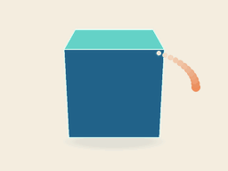

[← README](../README.md) · [Генератор](samples/motion_formats/generate.py) · [Таблица](../assets/motion-formats/formats.csv) · [Параметры кодеков](../assets/motion-formats/formats.json)

# Не только GIF: одна петля в трёх форматах

18 ноября 2026. В предыдущих залах движение было в SVG. Здесь другой приём: **сам файл картинки содержит несколько растровых кадров**. Один авторский ролик сохранён как GIF, APNG и lossless animated WebP. Так можно оформить логотип, демонстрацию интерфейса или небольшой объект, не встраивая видеоплеер.

## Что действительно одинаково

Все три файла получены из одних 32 кадров 256 × 192. Задержка кадра — 80 мс, полный цикл — 2560 мс, повторение бесконечное. У GIF общая 256-цветная палитра и заранее подложенная бумага. У APNG и WebP остаются RGBA и полупрозрачные края/след.

Следовательно, это **не строгий конкурс трёх одинаковых представлений**: GIF теряет полупрозрачность и часть цветов. Таблица размеров описывает только эту конкретную сцену и параметры кодирования. Не делаем вывода «WebP всегда меньше GIF» или «APNG всегда лучше».

В данном выпуске GIF действительно получился меньше APNG и lossless WebP. Это нормальный результат для маленькой палитровой сцены; он не опровергает преимущества других форматов на других данных.

## Источники исследования: исходники, а не обещания виджетов

Посмотрены конкретные файлы Pillow на [коммите a324a7c](https://github.com/python-pillow/Pillow/commit/a324a7c37b7ec37c74871c523483549a9e857e30):

- [PngImagePlugin.py](https://github.com/python-pillow/Pillow/blob/a324a7c37b7ec37c74871c523483549a9e857e30/src/PIL/PngImagePlugin.py): сохранение нескольких кадров, `duration`, `loop`, `disposal`, `blend`; отдельное понятие default image. У нашего APNG **нет дополнительного постера внутри анимации**: все 32 кадра участвуют в цикле, а статичный постер выпущен отдельным PNG.
- [WebPImagePlugin.py](https://github.com/python-pillow/Pillow/blob/a324a7c37b7ec37c74871c523483549a9e857e30/src/PIL/WebPImagePlugin.py): `lossless`, параметры анимации, время кадра и прозрачный background. У нас выбран lossless, не сравнение качества при потерях.
- [GifImagePlugin.py](https://github.com/python-pillow/Pillow/blob/a324a7c37b7ec37c74871c523483549a9e857e30/src/PIL/GifImagePlugin.py): палитра, прозрачный индекс и работа с несколькими кадрами. Индекс прозрачности GIF не даёт полноценного 8-битного альфа-канала; здесь намеренно используется непрозрачная подложка.

Также просмотрена [таблица форматов MDN](https://github.com/mdn/content/blob/29176e3a605ea39ddc6a46d24d29999cce73b252/files/en-us/web/media/guides/formats/image_types/index.md): APNG может иметь расширение `.png`, а GIF, APNG и WebP рассматриваются как разные способы хранить анимацию. Поддержка формата в браузере не гарантирует одинакового поведения всех просмотрщиков, кешей и мобильных клиентов GitHub.

Кодек Pillow используется как зависимость с его собственной лицензией. Сцена и генератор свои; чужие примеры, изображения, шрифты или модели не переносились.

## Сам ролик

Куб строится из восьми вершин и шести граней. Вершины поворачиваются, проецируются в перспективе, грани рисуются от дальних к ближним. Полупрозрачный оранжевый след движется по экранному эллипсу; он намеренно накладывается поверх куба, а не рассчитывает пространственное перекрытие с ним. Мягкая тень — графическая стилизация, не физическая симуляция света.

Рисование идёт в тройном разрешении, затем изображение уменьшается фильтром Lanczos. В прозрачных пикселях RGB нормализован, чтобы не сохранять невидимый мусор. Кадры не имеют внешнего фона: поэтому PNG/WebP могут вписаться в светлый или тёмный README, хотя контраст графики всё равно нужно проверить на обеих темах.

Генератор не читает GitHub API, не исполняет внешние команды и не меняет README. Единственная зависимость — Pillow с поддержкой WebP. Версии Pillow, libwebp и zlib записаны в JSON: кодирование может отличаться между версиями библиотек, даже если исходные кадры те же.

## Прозрачность: честное сравнение

У APNG и WebP есть полностью прозрачные, полупрозрачные и непрозрачные пиксели. Тень и оранжевый след могут просвечивать на реальный фон страницы. У GIF в этом наборе **прозрачности нет вообще**: каждая RGBA-картинка заранее наложена на `#f4efe2`, затем переведена в общую палитру без dithering. Отдельный `poster-matte.png` сохраняет ту же бумагу для неподвижного fallback GIF.

SVG тут не нужен для воспроизведения: браузер декодирует обычное изображение. Но анимированный PNG — не тот же самый формат, что PNG-постер: расширение одинаковое, а в APNG есть дополнительные управляющие блоки `acTL`/`fcTL`/`fdAT`.

## Уменьшение движения

У растровой анимации нельзя отключить кадры CSS-правилом внутри файла. Поэтому во всех трёх демонстрациях используется `<picture>`: первым источником стоит неподвижный постер при `prefers-reduced-motion: reduce`. Это предпочтение системы, не гарантия отсутствия движения у любого клиента и не тот же переключатель, что настройка автозапуска GIF в GitHub.

Адаптивный блок выбирает сначала постер, затем WebP, а в `img` оставляет GIF. Пример с путями относительно этой страницы:

```html
<picture>
  <source media="(prefers-reduced-motion: reduce)" srcset="../assets/motion-formats/poster.png">
  <source type="image/webp" srcset="../assets/motion-formats/cube.webp">
  
</picture>
```

При переносе в корень README убери `../`. Важная граница: `picture` выбирает по media/type, **но не является универсальным обработчиком сетевых ошибок**. Если поддерживаемый WebP выбран, но URL возвращает ошибку, нельзя обещать автоматический переход к GIF. Внутри картинки также нет кнопки Pause. Для ручного управления лучше видео или отдельный сайт.

## Статичная раскадровка

[Восемь фаз одним PNG](../assets/motion-formats/storyboard.png) показывают цикл без какого-либо автозапуска. Это не скрытая sprite-анимация: сетка остаётся неподвижной. Такой вариант полезен для печати, code review, уменьшения движения и читателей, которым нужна структура процесса, а не бесконечная петля.

## Повторить

```sh
python3 -m pip install -r atlas/samples/motion_formats/requirements.txt
python3 atlas/samples/motion_formats/generate.py
python3 atlas/samples/motion_formats/generate.py --output /tmp/motion-formats
python3 -m unittest discover -s tests -v
```

Просмотр README не требует Python. Проверки декодируют все форматы: число кадров, длительности, прозрачность, совпадение кадров APNG/lossless WebP с исходной сценой, общую длительность и фактические размеры файлов. Побайтовая перепечатка ожидается при одинаковых версиях Pillow и кодеков. Сам вид рендера и настройки автозапуска остаются на стороне клиента.

## Необязательная браузерная проверка

Дополнительно в Chromium проверено, что все три локальных файла реально меняют видимые кадры, адаптивный блок выбирает WebP, а при reduced-motion все четыре `picture` выбирают неподвижные постеры. Снимки каждого постера через интервал остаются одинаковыми. Это не проверка всех клиентов GitHub или его прокси изображений.

[Браузерный скрипт](samples/motion_formats/check-browser.cjs) можно повторить с установленным Chromium и отдельным Playwright Core:

```sh
npm install --prefix /tmp/motion-browser playwright-core
NODE_PATH=/tmp/motion-browser/node_modules CHROMIUM_PATH=/usr/bin/chromium \
  node atlas/samples/motion_formats/check-browser.cjs
```

Подставь свой путь к Chromium. Sandbox включён по умолчанию; для изолированной среды без поддержки sandbox есть явный `MOTION_NO_SANDBOX=1`. Скрипт создаёт и удаляет временный HTML вне репозитория. Ни браузер, ни Playwright не нужны обычному читателю README или Python-генератору.
