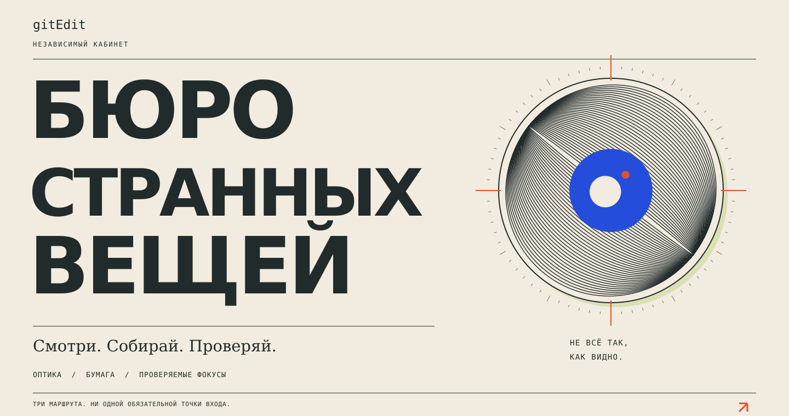

# Нативная лаборатория GitHub

[← Вернуться в README](../README.md)

Теперь в начале README стоят **настоящие блоки** `stl`, `geojson`, `topojson`, пять `mermaid`, `math`, раскрывающийся блок и сноска. Это сознательная смена прежнего подхода «картинка → файл»: пользователь попросил видеть возможности платформы непосредственно в README. Все прежние байты README оставлены на месте.

## Где именно работает каждая возможность

| Возможность | В README | При открытии файла / истории | Что попробовать |
|---|---|---|---|
| ASCII STL | Да, блок `stl` | Да, [orbit.stl](../assets/native-lab/orbit.stl) | Вращение, масштаб, Wireframe; нужен WebGL |
| GeoJSON | Да, блок `geojson` | Да, [survey.geojson](../assets/native-lab/survey.geojson) | Перемещение карты и масштаб |
| TopoJSON | Да, блок `topojson` | Да, [sheets.topojson](../assets/native-lab/sheets.topojson) | Те же действия, другая запись общих границ |
| Кластеризация маркеров | Карта поддерживает большие наборы; в README не дублируем 800 точек | [clusters.geojson](../assets/native-lab/clusters.geojson) | Менять масштаб; группировка зависит от просмотрщика и масштаба |
| Mermaid | Да, пять работающих блоков | [flow.mmd](../assets/native-lab/flow.mmd) и остальные `.mmd` | Текст превращается в схему; UI управления зависит от версии GitHub |
| Версия Mermaid | В блоке `mermaid` с командой `info` | [version.mmd](../assets/native-lab/version.mmd) | Посмотреть установленную на GitHub версию, а не предполагать её |
| Image diff | Нет, в README только ссылка | Ссылка на неизменяемый коммит в README | 2-up, Swipe, Onion Skin — если доступны в интерфейсе |
| CSV и TSV | Не интерактивная Markdown-таблица | [CSV](../assets/native-lab/catalog.csv), [TSV](../assets/native-lab/catalog.tsv) | Поиск, номера строк и ссылки на строки; UI может меняться |
| Jupyter notebook | Нет, ссылка | [mesh.ipynb](../assets/native-lab/mesh.ipynb) | Код и сохранённый вывод, **без исполнения** |
| PDF | Нет, ссылка | [Существующий PDF](../assets/pressroom/print-a4.pdf) | Просмотр документа; ссылки внутри PDF могут игнорироваться |
| reStructuredText | Не внутри Markdown | [notes.rst](../assets/native-lab/notes.rst) | Открыть документ в другом формате разметки |
| AsciiDoc | Не внутри Markdown | [notes.adoc](../assets/native-lab/notes.adoc) | Таблица и заголовок средствами AsciiDoc |
| Org | Не внутри Markdown | [notes.org](../assets/native-lab/notes.org) | Ещё один поддерживаемый формат разметки |
| Математика | Да, inline и block | Также в Markdown-файлах | Набор формулы GitHub, не PNG |
| Details/summary | Да | Также в Markdown-файлах | Свернуть/развернуть мышью или клавиатурой |
| Сноски | Да | Также в Markdown-файлах | Перейти к примечанию и обратно |
| Alerts | Да | Также в Markdown-файлах | Пять типов служебных выделений, примеры ниже |
| Picture | Да, уже используется в галерее | Также в Markdown-файлах | Выбор изображения по теме/ширине/предпочтениям; не произвольный CSS |
| Task lists | Отображаются | В issues/PR есть отдельные рабочие процессы | Не обещаем, что клик в README запишет изменение в Git |
| Цветовые образцы | **Не обещаем в README** | Документированы в issues, PR, discussions | Написать `#0969DA` в обратных кавычках в соответствующем контексте |
| Видео GitHub attachment | Требуется настоящий URL загруженного вложения | Нативно в issues/PR/comments с вложением | Не равен ссылке на локальный MP4; подробности ниже |

Это реестр найденного и проверенного по документации, **не обещание, что перечислены все функции GitHub навсегда**. Нативные рендереры, UI и доступность внешних картографических ресурсов могут меняться. На GitHub Enterprise карта может требовать включения администратором; в некоторых окружениях с data residency карты недоступны.

## Что именно создано для демонстрации

### Модель

Собственная геометрия: низкополигональный тор и отдельный октаэдр внутри отверстия. **78 вершин, 228 рёбер, 152 грани, две компоненты**. У каждой компоненты каждое ребро принадлежит двум треугольникам. Формула `V−E+F=2` верна для суммы характеристик тора (0) и октаэдра (2), а не доказывает, что весь объект — одна связная сфера.

Ориентация граней и нормали проверяются тестами. Это экранный экспонат: нет масштаба печати, допусков, креплений и гарантии производственной пригодности. ASCII STL вставлен целиком, а не заменён именем файла. Модель небольшая, чтобы не раздувать и без того длинный README.

### Карты

Встроены данные уже существующих `assets/survey.geojson` и `assets/sheets.topojson`; их прежние версии не менялись. Точки, маршрут и участки учебные. Ни одна линия не означает безопасную тропу, реальное право собственности или результат съёмки. В координатах сначала долгота, затем широта.

Отдельный набор из **800 точек** создан регулярной сеткой для демонстрации документированной кластеризации больших GeoJSON. Это не реальные адреса, не наблюдения и не расположение пользователей. Свой Leaflet/Mapbox-код и токены не добавлены. Подложка и интерфейс принадлежат картографическому просмотрщику GitHub; загрузка подложки может требовать доступности сторонних сервисов, поэтому это не офлайн-возможность.

### Mermaid

Пять различных грамматик: flowchart, sequenceDiagram, stateDiagram-v2, gitGraph и pie. Плюс отдельный `info` для проверки версии. Git-граф учебный, он не читает реальную историю репозитория. Pie содержит условные доли, не измерения аудитории. Схемы не экспортировались в PNG. Callback, произвольные JS-обработчики, редактирование графа и запуск процесса не обещаются. Новые типы Mermaid следует сверять с реальной версией GitHub, а не только с mermaid.live.

### Сравнение двух PNG

В Git намеренно записаны **две последовательные версии одного файла** `assets/native-lab/revision.png`: меняются цвет круга и длина полосок. Ссылка из README ведёт на коммит только с этой заменой, поэтому можно добраться до нативного сравнения без поиска среди сотен изменений. Режимы Swipe и Onion Skin находятся в истории файла/коммите, **не внутри README**. В разных версиях UI и на мобильном доступность управления может отличаться.

Нельзя подменять это двумя соседними `` и называть слайдером. Обе картинки свои; скрипт `diff_image.py 1` строит базовую, без аргумента — текущую. Для исторического примера генератор не переписывает Git-историю.

## Разметка как действующий пример

### Математика

Встроенная формула: $V-E+F=2$.

```math
\chi(T^2\sqcup S^2)=\chi(T^2)+\chi(S^2)=0+2=2
```

Это набираемый GitHub математический текст, не картинка из генератора.

### Пять типов alerts

Ниже именно **демонстрационная палитра**; в обычной статье не следует ставить пять предупреждений подряд. Между образцами есть пояснения, а в главном README используются только два нужных типа.

> [!NOTE]
> Справочная информация: карта и 3D используют разные просмотрщики.

Подсказка к действию:

> [!TIP]
> У STL попробуй Wireframe, а у карты — масштабирование.

Существенная граница:

> [!IMPORTANT]
> Notebook на GitHub показывает сохранённый результат, а не запускает Python.

Предупреждение об условиях:

> [!WARNING]
> Корпоративная политика, WebGL и доступность подложки могут мешать просмотру.

Предостережение от неверного использования:

> [!CAUTION]
> Учебная линия GeoJSON не является безопасным маршрутом на местности.

### Адаптация по теме без скрипта

Это уже существующие обложки галереи, а не новый плакат. Переключи тему GitHub и посмотри, какой источник выберет браузер:

<picture>
  <source media="(prefers-color-scheme: dark)" srcset="../assets/foyer/cover-dark.svg">
  
</picture>

### Другие полезные элементы

<details open>
<summary>Это настоящий details — можно свернуть</summary>

Клавиша <kbd>Tab</kbd> переводит фокус, <kbd>Enter</kbd> или <kbd>Space</kbd> на summary переключает состояние. Блок открыт по умолчанию, чтобы не прятать содержимое галереи.

- [x] Состояние Markdown-списка показано.
- [ ] Это не поле для отправки ответа.

Сноски создают переходы внутри документа.[^native-doc-footnote]

</details>

[^native-doc-footnote]: GitHub сам добавляет обратную ссылку от примечания к месту вызова.

~~Зачёркнутый текст~~, <sub>нижний</sub> и <sup>верхний</sup> индексы, :sparkles: emoji, таблицы, подсветка кода и ссылки — тоже поддерживаемая разметка, но не новые интерактивные движки. Их не выдаём за «ещё один 3D-эффект».

## Видео: что пока не автоматизировано

Нативный плеер загруженного GitHub-вложения — реальная возможность, но **в этом изменении видео-вложение не загружено и плеер не вставлен**. Простое добавление `demo.mp4` в Git не даёт права обещать такой же плеер внутри README.

Документация описывает загрузку через интерфейс issues/PR/comments, форматы MP4/MOV/WebM и H.264 как совместимый вариант. Актуальная документация CLI также описывает `--attach`, но установленный здесь **gh 2.23.0 этого флага не имеет**. Попытка скачать актуальный release CLI упёрлась в недоступный из среды хост release-assets.githubusercontent.com. Не создавались фиктивные URL и не запрашивались токены пользователя.

Чтобы закончить именно эту демонстрацию: загрузить собственный короткий MP4 как вложение в интерфейсе GitHub, затем скопировать **настоящий полученный URL** отдельным абзацем в README и проверить плеер в Preview. Нужен реальный результат загрузки, не придуманный адрес и не YouTube iframe. Публичные вложения могут быть доступны без авторизации — не следует загружать туда приватные материалы.

## Что нельзя честно встроить в README

- Произвольный `script`, iframe с чужим приложением, canvas-игру или Three.js/model-viewer со своими обработчиками.
- Запуск Python в notebook и пользовательские JS-виджеты notebook.
- Настоящий поисковый input для Markdown-таблицы или сохранение ответа формы в репозиторий.
- Рабочий SVG-интерфейс с JS по нажатию на нарисованные кнопки.

GitHub sanitizes HTML; произвольное приложение требует отдельной страницы, например Pages. Ссылка на Pages — переход на сайт, не запуск приложения внутри README. GIF и анимированное изображение могут двигаться, но от этого не становятся управляемым виджетом.

## Источники и границы проверки

Изучены относящиеся к стенду разделы семи документов **github/docs**: diagrams, non-code files, базовый синтаксис, details, math, attachments и CLI attachments. Также прочитано начало **github/markup** о pipeline очистки HTML и поддерживаемых разметках. [Постоянные SHA и ссылки](samples/native_lab/sources.json).

Основные официальные документы:

- [Четыре синтаксиса диаграмм и встроенные карты/STL](https://docs.github.com/en/get-started/writing-on-github/working-with-advanced-formatting/creating-diagrams).
- [Файловые просмотрщики, CSV, image diff, notebook и ограничения](https://docs.github.com/en/repositories/working-with-files/using-files/working-with-non-code-files).
- [Разметка, сноски, alerts и picture](https://docs.github.com/en/get-started/writing-on-github/getting-started-with-writing-and-formatting-on-github/basic-writing-and-formatting-syntax).
- [Загрузка вложений](https://docs.github.com/en/get-started/writing-on-github/working-with-advanced-formatting/attaching-files).
- [Вложения из актуального CLI](https://docs.github.com/en/github-cli/github-cli/attaching-files-with-github-cli).
- [Pipeline и другие форматы разметки](https://github.com/github/markup).

GitHub Markdown API передал восемь блоков в enrichment: STL, две карты и пять Mermaid; сохранил math-renderer, details, два disabled checkbox и сноску с обратной ссылкой. [Браузерный checker](samples/native_lab/check-browser.cjs) проверил переключение details мышью/клавиатурой и цели сноски на HTML из API. Отдельно пять грамматик Mermaid разобраны и отрисованы локально в **Mermaid 11.12.0** без JS-ошибок — это не утверждение о версии GitHub.

**Это не браузерное доказательство, что все удалённые iframe уже загрузились у читателя.** Сетевые ограничения среды не позволяют проверить viewscreen.githubusercontent.com и картографическую подложку; локальный предпросмотр Markdown не заменяет рендер GitHub. Проверка источников/форматов и документация платформы отделены от проверки её текущего UI.

## Повторить

```sh
python -m pip install Pillow==13.0.0
python atlas/samples/native_lab/generate.py
python -m unittest discover -s tests -p test_native_lab.py -v
```

Pillow нужен только для двух растровых ревизий. Геометрия, карты, notebook, таблицы и блок README создаются стандартной библиотекой Python. Генератор **не редактирует README, не делает коммиты и не обращается в сеть**. [Параметры исторического сравнения](samples/native_lab/config.json) · [Генератор](samples/native_lab/generate.py) · [Контрольные суммы](../assets/native-lab/manifest.json).
