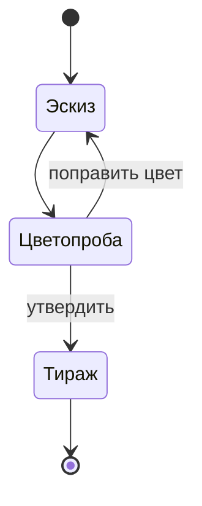
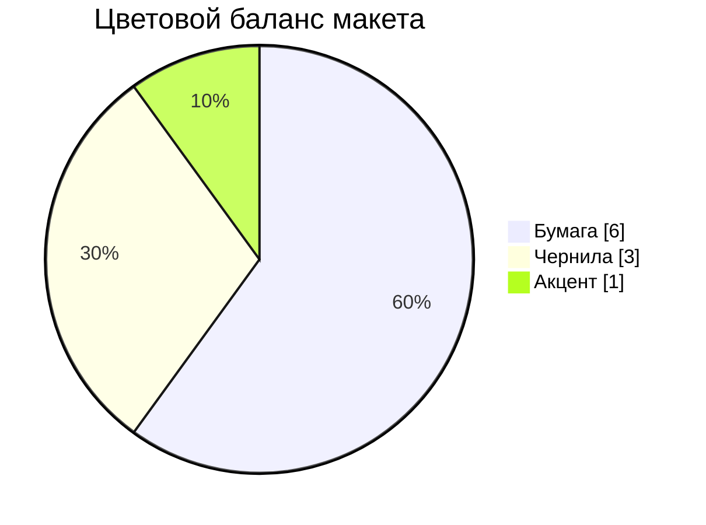
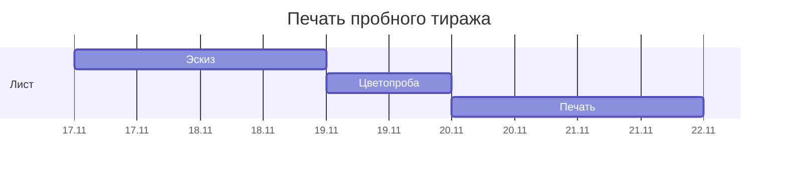

[← Полевой атлас](README.md) · [Картография и 3D](relief.md) · [Просмотрщики файлов](README.md#витрина-файлов)

# Что умеет сам README

Это страница с работающими образцами, а не скриншот Markdown-редактора. Нажми **Code** над файлом на GitHub, чтобы скопировать исходник любого блока. Для возврата к результату выбери **Preview**.

## Схема состояний

В цветопробе два исхода: отправить лист в печать или вернуть его к эскизу. Стрелка назад передаёт эту разницу лучше линейного списка.



[Скопировать чистый `.mmd`](samples/edition.mmd). Внутри Markdown добавь вокруг него ограждение `mermaid`; в самом `.mmd` обратные кавычки не нужны.

## Доли и длительности

**Круговая диаграмма** отвечает на вопрос «сколько от целого?». Здесь числа учебные: шесть частей бумаги, три части чернил и одна часть акцента.



**Диаграмма Ганта** отвечает на другой вопрос — «что после чего и сколько длится?». Вторая работа начинается после первой, а не в произвольную дату.



Другие примеры: [архитектурная схема и диалог сервисов](../README.md#5-интерактивные-векторные-схемы-mermaid), [граф коммитов](../README.md#граф-коммитов). Если свежий синтаксис из редактора не работает здесь, блок `mermaid` с единственной строкой `info` покажет версию движка GitHub. Документация [2](https://docs.github.com/en/get-started/writing-on-github/working-with-advanced-formatting/creating-diagrams).

## Формула вместо картинки

У нашего [кристалла](samples/crystal.stl) число граней $F=8$. Характеристику Эйлера удобно показать отдельной строкой:

```math
V-E+F = 6-12+8 = 2
```

<details>
<summary>Скопировать обе формы записи</summary>

````markdown
Число граней $F=8$.

```math
V-E+F = 6-12+8 = 2
```
````

</details>

В GitHub Markdown формулы набираются в синтаксисе LaTeX, их отображает MathJax. Для блочной записи также подходят `$$`. GitHub Docs [1](https://docs.github.com/en/get-started/writing-on-github/working-with-advanced-formatting/writing-mathematical-expressions).

## Редакторский стол

**Правка с первого взгляда.** Блок `diff` подсвечивает добавленные и удалённые строки. Это иллюстрация в документе, а не настоящий diff коммита:

```diff
- Название проекта и двенадцать бейджей.
+ Покрути модель. Затем скачай исходник и измени одну вершину.
```

**Лист приёмки.** В исходнике используй `- [x]` или `- [ ]`. Это состояние документа, не голосование: отметки меняют в самом Markdown.

- [x] У модели есть ссылка на файл.
- [x] Смысл схемы понятен без цвета.[^shape]
- [ ] Подставить данные собственного проекта перед публикацией.

<details>
<summary><b>Почему на полях нет цветных кружков рядом с HEX?</b></summary>

В README `#EF6747` в обратных кавычках — текст. Автоматические образцы HEX, RGB и HSL задокументированы для Issues, PR и Discussions, не для README. Для читателя покажи отдельную [цветопробу](../assets/relief-riso.svg), а значение оставь доступным для копирования. GitHub Docs [1](https://docs.github.com/en/get-started/writing-on-github/getting-started-with-writing-and-formatting-on-github/basic-writing-and-formatting-syntax).

</details>

> [!TIP]
> Спрячь длинный исходник под `<details>`, но не саму ссылку на результат. Проверь раскрытие с клавиатуры: <kbd>Tab</kbd> до заголовка, затем <kbd>Enter</kbd>.

**Ещё из набора:** [пять видов Alerts](../README.md#4-цветные-инфо-блоки-github-alerts), [таблицы, иконки и бейджи](../README.md#оглавление), [светлая и тёмная иллюстрации в `<picture>`](../README.md#кинолаборатория), [видео как вложение и обложки-ссылки](../README.md#6-продвинутая-вёрстка-портфолио-сплит-темы-picture-видео-kbd). Для внешнего видео достаточно картинки-ссылки; не рассчитывай на YouTube-iframe внутри README.

[^shape]: Это живая сноска. В исходнике у текста стоит `[^shape]`, а определение начинается с `[^shape]:`. На схеме полезно подписывать линии и узлы, а не различать их только оттенком.
