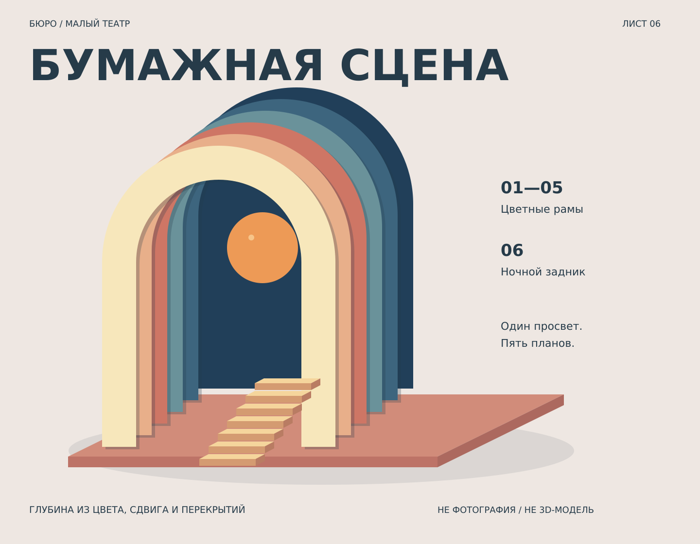
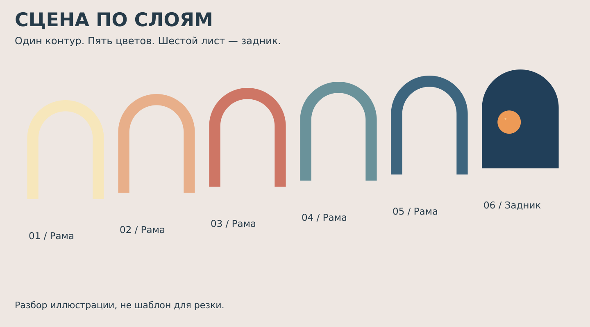

# Бумажная сцена

[← Галерея](../README.md)



## Малый театр вместо интерфейса

Пять арочных рам, сплошной задник с оранжевым диском и короткая лестница образуют собственную графическую декорацию. Светлая передняя рама постепенно сменяется терракотовыми, голубыми и тёмно-синими планами. Пастельный фон и крупная типографика связывают всё в редакционный плакат.

Это **плоская векторная иллюстрация с условной глубиной**, не фотография бумажного макета и не рендер настоящей 3D-сцены. Её задача — показать выразительность простых контуров, наложений и ограниченной палитры. Новая композиция добавлена без удаления прежних разделов README.

## Из чего сделана глубина

1. **Общий контур.** Все пять рам используют ровно один SVG path: внешний арочный силуэт и внутренний вырез. `fill-rule="evenodd"` оставляет просвет, а не закрашивает его цветом фона.
2. **Сдвиг планов.** Каждая следующая рама смещается на 32 экранные единицы вправо и 24 вверх. Это художественная раскладка, не калиброванная перспектива и не строгая изометрия.
3. **Перекрытия.** Рисуем задник, затем рамы от дальней к ближней, затем лестницу. Нет z-buffer, ray tracing, проверки столкновений или физического освещения.
4. **Цвет.** Передний план светлее заднего; пять заливок помогают читать глубину даже без текстуры.
5. **Условный срез.** Смещённая тёмная копия силуэта намекает на край листа. Тень под подиумом — полупрозрачный эллипс, не вычисленный световой перенос.

Лестница — набор плоских многоугольников с тремя оттенками. Оранжевый круг и маленькая светлая точка принадлежат заднику; их частичное перекрытие рамами намеренно. Художественные перекрытия не доказывают физическую собираемость такого макета.

## Сцена по слоям



**01–05 — одинаковые арочные рамы, 06 — сплошной задник.** В разборе использованы те же path и цвета, а не похожие заново нарисованные детали. Подиум, условные края и лестница не представлены отдельными листами: разбор объясняет только основные планы декорации.

Это **не выкройка**, не лазерный файл и не инструкция для безопасной резки. Нет единиц материала, масштаба, допусков, креплений и расчёта устойчивости. Не нужно воспринимать число листов как полную спецификацию реального изделия.

## Формат README и доступность

- Обложка 1440×1120; на телефоне — 720×1040 с заголовком над уменьшенной сценой и перенесённой подписью.
- Разбор 1440×800; мобильная версия 720×1680 — две колонки и три ряда вместо шести деталей в один ряд.
- Четыре самостоятельных SVG без скриптов, анимации, фильтров, внешних изображений и шрифтовых запросов. Палитра иллюстрации намеренно одинакова в обеих темах.
- `<picture>` выбирает мобильный вариант; при отсутствии поддержки source остаётся настольная картинка. В самом README нет CSS или JavaScript.
- Alt, внутренние title/desc, номера деталей и текстовый разбор дублируют визуальную информацию. Цвет — не единственный способ различить рамы.
- Обычные Markdown-ссылки открывают оригиналы и JSON; детали внутри картинки не интерактивны. Системный шрифт может немного различаться между устройствами.

## Что прочитано в других README

Начала **восьми корневых README**, до 2600 символов каждого. Точные SHA и постоянные ссылки: [sources.json](samples/paperstage/sources.json). Изображения, демо, сайты, связанные документы и исходники не открывались. Это ограниченный обзор способов публикации и описания графических инструментов, не аудит всего репозитория.

| Проект | Наблюдение → решение |
|---|---|
| jdan/isomer | README описывает isometric canvas, показывает API простых объёмных фигур; у нас готовые SVG и честное обозначение условной глубины, без заявления о строгой изометрии. Библиотека не используется. |
| metafizzy/zdog | В начале README прямо заявлен pseudo-3D и показан runtime с вращением; у нас плоская имитация глубины, заранее сохранённая без интерактивного движка. |
| svgdotjs/svg.js | Манипуляция и анимация SVG требуют JS; для неподвижного README достаточно записать готовые контуры генератором. |
| rough-stuff/rough | Перечень простых кривых, дуг, полигонов и SVG paths; иллюстрация построена из таких базовых средств, но без имитации почерка и без Rough.js. |
| rough-stuff/rough-notation | Аннотации добавляются JS как соседний SVG-элемент; вместо такого недоступного в README поведения подписи включены прямо в картинку и продублированы текстом. |
| facebook/yoga | README описывает layout engine и Chrome fixtures для ожидаемой раскладки; для наших двух композиций выбраны явные координаты и отдельная браузерная проверка, без установки Yoga. |
| excalidraw/excalidraw | В начале README hero подключён через picture и ведёт по настоящей ссылке; используем нативную оболочку picture/link вокруг своей работы, не копируя artwork или редактор. |
| tldraw/tldraw | В начале README разделены hero и ссылки на документацию; применён принцип «сначала работа, затем разбор», без встроенного infinite canvas. |

Ни один из этих проектов не заявляется источником наших арок, палитры или сцены. Чужие иллюстрации и код не включены.

## Повторить

```sh
python atlas/samples/paperstage/generate.py
python -m unittest discover -s tests -p test_paperstage.py -v
```

Стандартная библиотека Python; README генератор не редактирует. [Генератор](samples/paperstage/generate.py) · [Параметры](../assets/paperstage/scene.json) · [SHA-256](../assets/paperstage/manifest.json) · [Проверочная страница](../assets/paperstage/proof.html) · [Chromium checker](samples/paperstage/check-browser.cjs).

Unit-тесты проверяют пять рам, общий контур и цвета в обоих видах, порядок от заднего плана к переднему, размеры композиций, безопасный SVG, контрольные суммы и детерминированную перегенерацию. Браузерная проверка — две ширины × две темы, выбор source, загрузка четырёх композиций, клавиатурная ссылка, отсутствие переполнения, HTTP-запросов и JS-ошибок. Локальный proof не равен github.com; прохождение picture/source и ссылок через Markdown sanitizer проверяется отдельно GitHub API.
