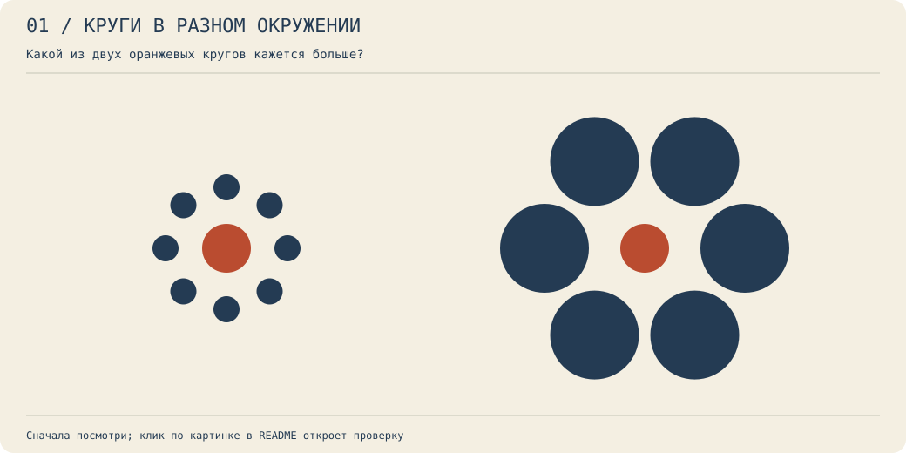

[← README](../README.md) · [Генератор](samples/perception/generate.py) · [Числовые факты JSON](../assets/perception/facts.json)

# Оптический зал: посмотри, кликни, проверь

18 ноября 2026. Ещё один способ оформить README — **дать читателю маленькую зрительную загадку**, а не просто прокрутку украшений. Шесть исходных рисунков ведут на шесть отдельных файлов с разметкой-проверкой. Это обычные картинки-ссылки: не JavaScript, не hover-эффект и не переключатель внутри SVG.

Сила иллюзии индивидуальна и зависит от размера экрана, масштаба и окружения. Здесь демонстрационные варианты классических эффектов, **не диагностический или психофизический тест**. Если никакой иллюзии не видно, это не ошибка читателя. Проверки доказывают свойства графики, а не предсказывают восприятие каждого человека.

## Какие GitHub исследованы

### optical-illusions: интересен сам приём reveal

Посмотрен [set1.js](https://github.com/cmpolis/optical-illusions/blob/604dd81524c5aacc910786c06622b61385290cdf/set1.js): D3 строит несколько классических иллюзий, а функция `_reveal` меняет атрибут для объясняющего состояния. Есть круги, стрелки, плиточная стена и направляющие.

Репозиторий не объявляет лицензию через GitHub API. Поэтому **его код, размеры, оформление и изображения не переносились**. Берём лишь идею подачи «сначала впечатление, затем проверка»; классические геометрические эффекты реализованы здесь самостоятельно с другими параметрами. В README вместо JS-переключателя — переход по ссылке на отдельный SVG-плакат.

### Pyllusion: отдельно физическая разница и контекст

В [README](https://github.com/RealityBending/Pyllusion/blob/8fff53efd783e666ea29262b8d0c671c088c0453/README.md) проект объясняет параметризацию иллюзий: реальное отличие целевых объектов отделено от силы контекста. Просмотрены также:

- [ebbinghaus_parameters.py](https://github.com/RealityBending/Pyllusion/blob/8fff53efd783e666ea29262b8d0c671c088c0453/pyllusion/Ebbinghaus/ebbinghaus_parameters.py): внутренние и внешние размеры, расстояния между центрами и краями описываются разными параметрами;
- [contrast_parameters.py](https://github.com/RealityBending/Pyllusion/blob/8fff53efd783e666ea29262b8d0c671c088c0453/pyllusion/Contrast/contrast_parameters.py): целевые яркости и яркости фона рассчитываются раздельно, затем переводятся в RGB.

Практический вывод: в собственной галерее нельзя незаметно менять размер или цвет объекта ради усиления эффекта. Наши целевые радиусы, длины и заливки действительно совпадают. Это проверяется в самих SVG, а не только в сопровождающем тексте. Pyllusion не подключается как зависимость; код и материалы проекта не копируются.

## Шесть экспонатов

| Эффект | На что смотреть | Что проверяется |
| --- | --- | --- |
| Эббингауз | Два оранжевых круга среди больших и маленьких соседей | Оба радиуса 28 SVG-единиц; направляющие касаются их верхней и нижней границ |
| Мюллер — Лайер | Два горизонтальных отрезка с разными наконечниками | Концы стержней имеют x=260 и x=780; длина каждого 520 |
| Стена кафе | Ряды чёрных и белых плиток со сдвигом | Горизонтальные швы имеют постоянную y-координату; шаг рядов 42, толщина раствора 3 |
| Геринг | Две прямые на фоне веерных линий | У каждого целевого отрезка x постоянен, никаких кривых Безье нет |
| Одновременный контраст | Серые прямоугольники на тёмном и светлом фоне | У обоих точный `fill="#888888"`; в проверке их связывает полоса того же цвета |
| Канизса | Светлая фигура между тремя дисками с вырезами | Центральная заливка совпадает с бумагой `#f4efe2`, видимого контура в исходнике нет |

### Что именно делает проверка

В большинстве proof-файлов контекст становится бледнее, а бирюзовые направляющие показывают равенство или прямолинейность. Проверка намеренно меняет **контекст**, не геометрию целевых объектов. У контраста появляется перемычка того же серого цвета. У Канизсы добавляется пунктир отсутствующей прежде границы.

В варианте Канизсы вырезы сделаны многоугольником цвета бумаги поверх дисков. Поэтому утверждение не «в SVG нет треугольника вообще», а **«у воспринимаемой фигуры не нарисован видимый контур и нет более светлой заливки»**. В исходнике `polygon` есть, но его цвет совпадает с окружающей бумагой. Разметка-проверка объясняет это явно.

Файлы с суффиксом `-proof.svg` — самостоятельные иллюстрации, а не состояние одной и той же картинки. Кнопка Back браузера возвращает исходник. Подпись и обычные ссылки доступны независимо от того, включён ли показ изображений.

## Почему это уместно в README

Так можно показать идею продукта через небольшое действие читателя: найти различие, проверить предположение, открыть объяснение. Для дизайн-системы особенно полезен одинаковый серый на разных фонах; для графического движка — равные длины и прямые; для учебного проекта — наглядная проверка исходника.

При переносе в собственный проект лучше выбрать **один** подходящий эффект, а не отвлекать пользователя десятком загадок. Не прячь важную информацию только в оптическом рисунке. Обычный alt и текстовое объяснение остаются обязательны: цвет, зрение и индивидуальное восприятие у читателей различаются.

В HTML-коде идея проста:

```html
<a href="../assets/perception/ebbinghaus-proof.svg">
  
</a>
```

Это рабочие пути относительно этой страницы в `atlas/`. При переносе блока в корневой README убери начальное `../`. Никаких обработчиков клика внутри изображения; GitHub открывает файл по обычной ссылке. Внутренние ссылки внешнего SVG не превращаются в независимые кнопки внутри ``.

## Повторить и проверить

```sh
python3 atlas/samples/perception/generate.py
python3 atlas/samples/perception/generate.py --output /tmp/perception
python3 -m unittest discover -s tests -v
```

Только стандартная библиотека Python. Все двенадцать SVG статичны и самодостаточны, без SMIL, CSS-анимации, `foreignObject`, скриптов, сетевых шрифтов и внешних изображений. Генератор не меняет README. JSON хранит параметры, а тесты дополнительно читают готовые SVG и проверяют фактические размеры и цвета. Математическая воспроизводимость не доказывает одинаковую силу иллюзии на всех экранах.
