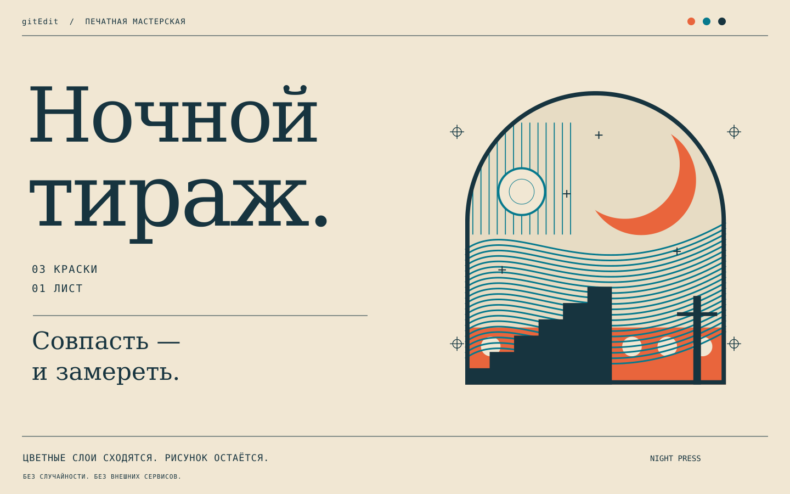

[← Галерея](../README.md) · [Бюро](foyer.md) · [Световой стол](lighttable.md) · [Плакат без движения PNG](../assets/pressroom/still.png) · [Плакат A4 PDF](../assets/pressroom/print-a4.pdf)

# Ночной тираж



Ещё одна **форма оформления**, не новая головоломка и не ещё один каталог. Собственный графический плакат: крупный кириллический набор с засечками и ночная сцена из трёх цветовых групп. Оранжевый месяц, синие линии и тёмная архитектура сначала чуть расходятся, затем медленно совмещаются и надолго замирают.

[Анимированный SVG](../assets/pressroom/motion.svg) · [Неподвижный SVG](../assets/pressroom/still.svg) · [Мобильный неподвижный PNG](../assets/pressroom/still-mobile.png) · [Локальная цветопроба](../assets/pressroom/proof.html).

## Что нового в оформлении

**Другой характер шрифта.** После рубленого «Бюро» и материальных рамок — крупный засечковый набор «Ночной тираж.». Заголовок и пояснения всегда стоят на месте; читателю не нужно догонять текст глазами.

**Один плакат, не набор виджетов.** Тёплая бумага, бирюзово-синий, киноварно-оранжевый и тёмный петрольный. Ночной пейзаж собран из месяца, поля линий, лестницы, арочного контура и мелких меток. Все геометрия, композиция и надписи собственные; фотографий, скачанного artwork и сгенерированных по чужому изображению слоёв нет.

**Движение по смыслу.** Смещаются только три цветовые группы. Не вращается страница, не мерцает фон, не печатается по букве заголовок. Малые совмещаемые мишени делают понятным сам жест приведения слоёв, но не являются измерительным прибором.

**Отдельная вертикальная композиция.** Десктопный SVG — **1440×900**, мобильный — **720×1000**: название над рисунком, а не слева. Собственный бумажный фон выбран намеренно и не переключается в тёмную «бумагу» по теме GitHub. Это репродукция плаката, а не продолжение фона интерфейса.

## Приводка — только графическая метафора

Реальная печать сложнее: прозрачность/толщина красок, порядок нанесения, материал, поглощение света, растискивание и профиль оборудования здесь не моделируются. Нет CMYK-преобразования, физических смесевых красок, калибровки регистра или метрики ошибки. `03 КРАСКИ / 01 ЛИСТ` — описание композиции из трёх групп, не техническое задание печатному производству.

Посмотреть отдельно:

- [Оранжевый слой](../assets/pressroom/plate-one.svg): месяц и нижняя полоса.
- [Синий слой](../assets/pressroom/plate-two.svg): линейное поле и окружности.
- [Тёмный слой](../assets/pressroom/plate-three.svg): архитектура и звёздные метки.

В этих файлах сохраняются бумажная подложка, неизменный заголовок и служебная графика для ориентации. Это **учебные виды групп**, не готовые цветоделённые формы для станка. Некоторые бумажные вырезы нарисованы цветом подложки, а не булевой операцией подготовки тиража.

## Как устроен цикл

[Тайминг JSON](../assets/pressroom/timing.json): период **16 секунд**.

| Часть периода | Состояние |
|---|---|
| 0–8 % | Небольшое исходное расхождение слоёв |
| 8–32 % | Плавное совмещение |
| 32–85 % | Полностью неподвижный совмещённый рисунок — **8,48 с** |
| 85–100 % | Медленное возвращение к начальным смещениям |

Первый/последний кадры одинаковы, поэтому петля не перескакивает. Начальные смещения в локальных координатах рисунка: **(−28,12)**, **(24,−18)** и **(9,19)**. Это небольшое перемещение относительно рисунка шириной 480 единиц; конечный масштаб зависит от композиции.

Анимируется только `transform: translate`. Нет мигания, исчезновения/появления текста, смены яркости или масштабирования. Это не обещание отсутствия дискомфорта для каждого зрителя: если движение мешает, [открой PNG](../assets/pressroom/still.png), [статичный SVG](../assets/pressroom/still.svg) или включи уменьшение движения в системе. Отдельной кнопки паузы внутри картинки README нет, и нарисованная кнопка за неё не выдаётся. Соответствие всем требованиям доступности этим макетом не заявляется.

## Что исполняется на странице

В README — обычная ссылка с `<picture>` и ``. На GitHub **нет** нашего JavaScript, canvas, iframe, внешнего API или запуска Python. CSS-анимация находится **внутри локального SVG-изображения**, а не в стилях страницы README. SVG не содержит скриптов, `foreignObject`, внешних картинок, сетевых шрифтов или внешних ссылок.

Для reduced-motion предусмотрены два независимых уровня:

1. `<picture>` выбирает отдельный неподвижный файл, с отдельным мобильным вариантом.
2. В самом анимированном SVG `@media(prefers-reduced-motion:reduce)` отключает все три анимации и убирает смещения. Это работает и при непосредственном открытии SVG или в просмотрщике, проигнорировавшем источники `<picture>`, но поддерживающем эту media query.

При отключённой/неподдерживаемой CSS-анимации базовая геометрия уже совмещена. `@media print` также отключает движение. Техническая поддержка зависит от просмотрщика: не обещаем анимацию во всех Markdown-клиентах/почтовых превью. GitHub Markdown API проверен на сохранение разметки источников, а поведение SVG — в браузере как у реального файла и изображения. Это не равнозначно контролю каждого GitHub-прокси/клиента.

## Типографика и печать

Для надписей переиспользован **наш собственный** наборщик контуров из оформления Бюро. Локальные DejaVu Serif и DejaVu Sans Mono превращаются в `<path>/<use>`, поэтому шрифт не нужно загружать читателю. Это контуры надписей, а не встроенная шрифтовая программа. Снаружи задан содержательный `alt`, внутри SVG — `title`; смысл и ссылки повторены обычным текстом. Надписи в контурах не выделяются для копирования.

A4 PDF — **одна портретная страница 210×297 мм**, неподвижная мобильная композиция с полями. Печатать как самостоятельный декоративный плакат. Размеры и метки **не** являются калибровочным тестом принтера; для реальной многокрасочной печати нужна отдельная подготовка. Здесь важен законченный оттиск, а не обещание производственного цветоделения.

## Воспроизведение и проверки

```sh
python3 -m venv .venv
.venv/bin/pip install -r atlas/samples/pressroom/requirements.txt
.venv/bin/python atlas/samples/pressroom/generate.py
.venv/bin/python -m unittest discover -s tests -p test_pressroom.py -v
```

Нужны fonttools **4.68.0**, PyMuPDF **2.1**, локальные DejaVu в `/usr/share/fonts/truetype/dejavu` и собственный модуль `atlas/samples/foyer/generate.py`. Из чужих репозиториев во время генерации ничего не загружается. README и предыдущие файлы не изменяются генератором. Выходы: семь SVG, два PNG, статичный PDF, тайминг и [хеши](../assets/pressroom/manifest.json). Даты PDF фиксированы, повторная генерация сравнивается побайтно в одном окружении шрифтов/библиотек.

Восемь тестов проверяют самодостаточность всех SVG и локальные ссылки на контуры; равенство анимированного/статичного исходника за исключением CSS; три отдельных группы; тайминг паузы; PNG/A4 PDF; хеши/восемь источников; порядок и варианты README; регенерацию без изменения README.

`check-browser.cjs` проверяет не наличие слова animation, а поведение:

- ровно **три** CSS-анимации и точные начальные матрицы смещения;
- совмещённую матрицу на 9-й и 13-й секундах;
- различие кадров до/после совмещения;
- **ноль анимаций** при reduced-motion и **пиксельное совпадение** с отдельным статичным SVG;
- ноль анимаций в print-media;
- четыре выбора `<picture>`: desktop/mobile × обычный/reduced-motion;
- клавиатурную ссылку, отсутствие горизонтального скролла, HTTP и JS-ошибок.

Зависимости npm указаны в начале скрипта; минимальному Linux нужны библиотеки Chromium. Тестовая автоматизация управляет временем через DevTools снаружи документа: скрипт **не** помещается в рисунок или README.

## Что исследовано в других README

[sources.json](samples/pressroom/sources.json) фиксирует **восемь README с SHA**. Часть уже встречалась в прошлых исследованиях — это целевой повторный просмотр для другого приёма, а не заявление о восьми впервые открытых проектах. У длинных README изучены начало и выбранные фрагменты. Чужие SVG/шаблоны/исходники/тесты не аудировались и не переносились, видео и сервисы не запускались, внешние ресурсы не скачивались.

| README | Что влияет на решение |
|---|---|
| danba340/svg-animation-readme-example | Сам приём «обычный SVG → animated SVG» внутри ``. В README явно атрибутируется чужая картинка; она не загружалась. Здесь геометрия собственная, не анимация чужого кота. |
| kyechan99/capsule-render | Внешний API для заголовков, параметры анимации и прямое предупреждение best-effort/лимитов. Отказываемся от сервиса: законченный локальный SVG не зависит от его доступности. |
| DenverCoder1/readme-typing-svg | Генерация печатающихся строк. Отказываемся от движения текста; заголовок всегда полностью виден. Сервис не вызывался. |
| Platane/snk | README показывает SVG/GIF и генерацию через workflow, темы через picture. Берём разделение «заранее сгенерированное изображение / показ в README», но не включаем Actions, не копируем граф вкладов и не выдаём композицию за живые данные. |
| andreasbm/readme | README генерируется из blueprint и содержит шаблонные блоки. Наш генератор создаёт только отдельный вставляемый блок, **не перезаписывает весь README** и не трогает старую галерею. Демо/генератор не запускались. |
| svgdotjs/svg.js | README JS-библиотеки создания/анимации SVG. Такой JS нельзя просто встроить в GitHub README, поэтому геометрию печатаем Python, а движение задаём CSS изображения. Библиотека не устанавливалась. |
| svg/svgo | README объясняет оптимизацию и параметры плагинов, включая идентификаторы. Не прогоняем анимированный SVG через неизвестные преобразования: имена групп/правила сохраняются и проверяются. Сам SVGO не запускался. |
| marcbruederlin/particles.js | README требует canvas, script и стили фона страницы. Это контрпример для README: красивый сайт-эффект не равен допустимому GitHub-оформлению. Ни код, ни фон с частицами не используются. |

Итог — собственный медленный печатный плакат, в котором видна мысль движения и заранее предусмотрен полноценный неподвижный результат. Все предыдущие экспонаты и оформление остаются на месте.
