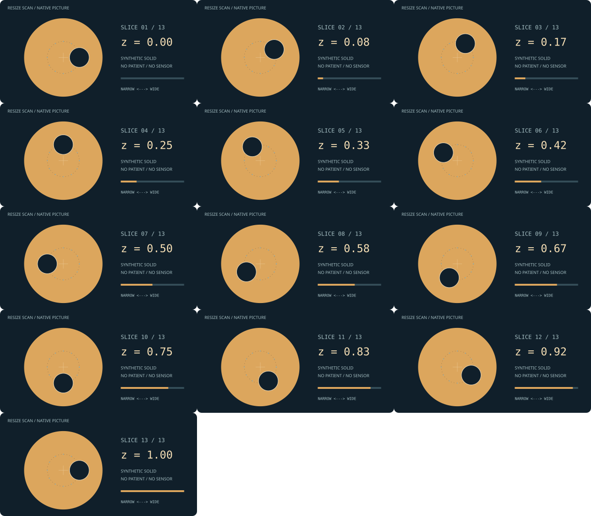

# Ширина окна как ручка покадрового просмотра

[← Попробовать в README](../README.md) · [Все 13 кадров одним SVG](../assets/resize-scan/all-slices.svg) · [Данные кадров](../assets/resize-scan/frames.json) · [Переносимый HTML TXT](../assets/resize-scan/picture.txt)

## Строго внутри README

Отдельного сайта, backend, iframe и нашего JavaScript нет. В корневом README стоит настоящий **`picture` с двенадцатью `source media` и одним `img`**. Браузер выбирает файл по ширине своего viewport и заново оценивает условия при изменении окна. Это не ссылка на внешний опыт и не видео, изображающее работающий интерфейс.

В галерее `picture` уже выбирает мобильную/тёмную обложку. **Новая находка здесь — способ управления, а не новый HTML-тег:** ширина окна используется как грубая ручка просмотра последовательности. Сужай и расширяй окно на компьютере, и отверстие будет переходить между положениями, показывая срезы синтетической детали по глубине.

Это **конечные 13 заранее вычисленных кадров**, а не вычисление объёма в браузере, не range input, не canvas и не непрерывная анимация. Между порогами картинка только масштабируется. Файлы — обычные статичные SVG без скриптов, animation и внешних ресурсов. Движение возникает только из смены выбранного кадра вслед за действием читателя.

## Как попробовать и что может мешать

- На компьютере медленно менять **ширину окна**, а не прокручивать документ.
- Условия относятся к viewport в **CSS-пикселях**, не к ширине изображения или колонки README. Даже когда колонка перестала расширяться, выбор источника может продолжать меняться.
- На телефоне, в приложении GitHub или на небольшом мониторе весь диапазон может быть недоступен. Поворот устройства может выбрать другой кадр, но не превращает телефон в полноценный ползунок.
- Масштаб страницы может менять доступную CSS-ширину и тем самым выбранный кадр. Не нужно менять удобный для чтения масштаб ради опыта: ниже доступны все состояния.
- При сетевой загрузке нового SVG возможна задержка. Не обещаем мгновенный отклик и загрузку только одного файла за всю сессию.
- При остановке изменения окна изображение неподвижно. `prefers-reduced-motion` не отключается и не подделывается; здесь вообще нет автодвижения или таймера.
- Один `img` имеет общее alt-описание; оно не становится динамическим озвучиваемым индикатором номера кадра. Для невизуального просмотра есть текстовая таблица и JSON.

## Все состояния без изменения окна

Номер среза и его z-координата подписаны прямо в SVG. Пороги ниже описаны для целочисленной ширины; точные `max-width` также сохранены в JSON и HTML. Для дробной CSS-ширины браузер, например, уже после 599 px выбирает следующий source, если 599 перестало подходить.

| Срез | z | Ширина viewport, CSS px | Файл |
|---|---|---|---|
| 1 | 0/12 | ≤599 | [SVG](../assets/resize-scan/slice-00.svg) |
| 2 | 1/12 | 600–679 | [SVG](../assets/resize-scan/slice-01.svg) |
| 3 | 2/12 | 680–759 | [SVG](../assets/resize-scan/slice-02.svg) |
| 4 | 3/12 | 760–839 | [SVG](../assets/resize-scan/slice-03.svg) |
| 5 | 4/12 | 840–919 | [SVG](../assets/resize-scan/slice-04.svg) |
| 6 | 5/12 | 920–999 | [SVG](../assets/resize-scan/slice-05.svg) |
| 7 | 6/12 | 1000–1079 | [SVG](../assets/resize-scan/slice-06.svg) |
| 8 | 7/12 | 1080–1159 | [SVG](../assets/resize-scan/slice-07.svg) |
| 9 | 8/12 | 1160–1239 | [SVG](../assets/resize-scan/slice-08.svg) |
| 10 | 9/12 | 1240–1319 | [SVG](../assets/resize-scan/slice-09.svg) |
| 11 | 10/12 | 1320–1399 | [SVG](../assets/resize-scan/slice-10.svg) |
| 12 | 11/12 | 1400–1479 | [SVG](../assets/resize-scan/slice-11.svg) |
| 13 | 12/12 | ≥1480 | [SVG](../assets/resize-scan/slice-12.svg) |



## Геометрия, не медицинские данные

Синтетическое твёрдое тело занимает высоты `0 ≤ z ≤ 1`. Внешнее сечение — диск радиуса `R = 2.2`. Из него вычтен круг радиуса `a = 0.55`, чей центр меняется по высоте:

```text
cx(z) = 0.9 cos(2πz)
cy(z) = 0.9 sin(2πz)
solid: x²+y² ≤ 2.2² AND (x-cx(z))²+(y-cy(z))² ≥ 0.55²
```

Каждый файл — точное схематическое сечение этого аналитически определённого множества при `z = i/12`. Это не восстановление из измерений, не настоящая томография, не пациент и не промышленная спецификация.

Канал здесь **определён горизонтальными круглыми сечениями**, не как трубка постоянного евклидова радиуса в нормальной плоскости винтовой оси. Эти конструкции не следует путать. Условие `0.9 + 0.55 < 2.2` удерживает отверстие внутри внешнего диска. Площадь материала во всех сечениях одна: `π(2.2²−0.55²)`.

Первый и последний срез имеют одинаковую геометрию отверстия после полного оборота, но разные подписи z и прогресс. Точки, пунктирная окружность и перекрестие — поясняющие метки, не дополнительные полости материала. Рисунки и модель свои; внешние изображения и шрифты не использовались.

## Проверка реального переключения

Взяли **HTML из GitHub Markdown API с `context: overbaffe1/gitEdit`**, а не только локальный исходник, и открыли в локальном Chromium 153.0.8010.0 через Playwright Core 1.65.1.

- GitHub сохранил один `picture`, все 12 media-условий и 13 путей файлов.
- Проверены обе стороны всех 12 порогов, узкое и широкое состояния, проход туда и обратно: **52 resize-проверки**.
- Тот же проход повторён при DPR 2: всего **104 проверки**. Это изменение плотности устройства, не имитация всех браузерных режимов zoom.
- Для каждого положения проверены настоящий `img.currentSrc` и успешный `img.decode()`.
- Все 13 кадров достижимы; при выборе нет перезагрузки документа, перехода по ссылке и обращения к внешнему сервису. Медиа читались из локального checkout.
- В тестовом документе нет нашего `script`, `input` и `iframe`. Код Playwright — автоматизация проверки, не часть README.

Граница: это **HTML GitHub API в локальном браузере**, не авторизованная production-страница github.com с её CSS/JS, не Safari/Firefox и не физический смартфон. Разные GitHub-клиенты могут ограничивать responsive HTML. Сам факт прохождения локального browser-теста не даёт вечной гарантии поведения платформы.

## Источники и граница новизны

[Пять закреплённых файлов](samples/resize_scan/sources.json):

- MDN `picture`: выбор первого подходящего source и пример с явным предложением менять ширину окна. Это существующее стандартное поведение, не наше изобретение.
- MDN `source`: семантика `media`, `srcset` и fallback.
- `scottjehl/picturefill`, README: исторический polyfill, ныне archived/deprecated. Он **не установлен**, приложение и JS из него не заимствованы; современная нативная поддержка не требует полифилла.
- WPT `update-media.html`: небольшой тест изменения media-условия и `currentSrc`. Он проверяет мутацию атрибута, **не именно наше управление viewport**; для последнего написан отдельный browser-тест.
- `github/markup`, README: преобразование Markdown — только этап pipeline, поэтому отдельно проверен ответ GitHub с repository context.

До этой идеи просмотрены репорты Mermaid #5696 и github/markup #1779, их комментарии и раздел Interaction документации Mermaid. Там есть исторические примеры ссылок и исправлений, но они не доказывают текущую конфигурацию всех GitHub-viewer. **Кликабельная Mermaid-панель в этой работе не объявлена готовой и не добавлена.**

## Перенести и воспроизвести

Для полного опыта скопируй [picture.txt](../assets/resize-scan/picture.txt) в **корневой README** и все 13 `slice-XX.svg` в `assets/resize-scan/` своего проекта. Можно выбрать свои кадры и пороги. В README подпапки нужно поправить пути. TXT не меняет файл и не копирует в clipboard автоматически.

Генератор и unit-тесты — стандартная библиотека Python:

```sh
python atlas/samples/resize_scan/generate.py
python -m unittest discover -s tests -p test_resize_scan.py -v
```

Генератор обновляет только свои SVG/JSON/TXT, manifest и фрагмент для галереи. **Корневой README, workflows и историю Git он не меняет.** [Контрольные суммы](../assets/resize-scan/manifest.json).

Opt-in browser-проверка, Node 22+ и настроенный `gh`:

```sh
npm install --prefix .local/resize-scan --no-audit --no-fund playwright-core@1.65.1 @sparticuz/chromium@153.0.0
node atlas/samples/resize_scan/check-browser.cjs
```

В минимальном Linux без NSS/NSPR можно использовать библиотеки из того же локального npm-пакета:

```sh
RESIZE_SCAN_BUNDLED_LIBS=1 node atlas/samples/resize_scan/check-browser.cjs
```

Это локальный Chromium, не AWS, не Codespaces, не запуск Actions и не отдельный сайт для читателя. Никакой хостинг не включён. Бинарники и node_modules исключены из Git.
