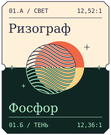
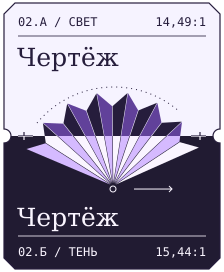
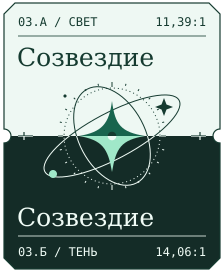

# Картотека красок

Три пары для светлой и тёмной бумаги. В каждой пробе три краски: **фон**, **текст**, **акцент**.

<p align="center">
  
  
  
</p>

**В README.** Возьми, например, [первую карточку](../../../assets/inkbook/press.svg), положи её в `assets/` своего проекта и вставь ``. Обе половины лежат в одном SVG; ему не нужны внешний шрифт, скрипт или сервис бейджей. Все HEX-коды можно скопировать из [таблицы красок](../palettes.csv).

**В обсуждении палитры.** Вставь строку ниже в описание PR: рядом с каждым HEX GitHub сам нарисует цветную точку. Это [приём для Issues, PR и Discussions](https://github.com/github/docs/blob/841308525efb1a0f005369d83c54183068bb65d2/content/get-started/writing-on-github/getting-started-with-writing-and-formatting-on-github/basic-writing-and-formatting-syntax.md#supported-color-models), а не замена карточке в README.

```markdown
Ризограф: фон `#FFF1D9` · текст `#292948` · акцент `#EF6747`
```

**В GIMP.** Скачай [inkbook.gpl](../../../assets/inkbook/inkbook.gpl?raw=true). В контекстном меню диалога «Палитры» выбери **Импортировать палитру → Файл палитры** и укажи этот файл. Получатся шесть рядов по три образца; в названии каждого есть палитра, тема и назначение. [Справка GIMP по импорту](https://github.com/GNOME/gimp-help/blob/ec88c38b18bc4cef69864c6605379fa0e0743ee9/src/dialogs/palettes-dialog.xml).

**На своём сайте.** Сохрани [inkbook.css](../../../assets/inkbook/inkbook.css) рядом с HTML. Выбери пару: `press`, `blueprint` или `orbit`. В тёмной теме значения меняются, а имена остаются. Это стили сайта, не способ перекрасить фон README.

```html
<link rel="stylesheet" href="inkbook.css">
<style>
  .proof { background: var(--ge-paper); color: var(--ge-ink); border-left: .5em solid var(--ge-accent); padding: 1em; }
  .proof a { color: var(--ge-link); text-decoration: underline; }
</style>
<p class="proof" data-inkbook="press">Цветопроба · <a href="https://github.com/overbaffe1/gitEdit">Мастерская</a></p>
```

**Почему у ссылки своя краска?** `--ge-accent` сохраняет цвет рисунка. Для `--ge-link` печатник берёт акцент, только если его контраст **на `--ge-paper`** не ниже [4,5:1 для обычного текста по WCAG](https://github.com/w3c/wcag/blob/2766fae25fc8286f60181d655115cba054b797e1/guidelines/sc/20/contrast-minimum.html); иначе берёт `--ge-ink`. Сравнение идёт до округления. Число на самой карточке относится к паре **текст / фон**, а не ко всему рисунку.

**Сменить краску.** Исправь HEX в [palettes.csv](../palettes.csv) и запусти из корня `python3 atlas/samples/inkbook/print.py` (Python 3.10+). Три SVG, GPL и CSS пересоберутся без сторонних пакетов. Подписи и вырубка заданы в [мастере карточки](card.svg.in), рисунки и [расчёт по относительной яркости sRGB](https://github.com/w3c/wcag/blob/2766fae25fc8286f60181d655115cba054b797e1/guidelines/terms/20/relative-luminance.html) — в [печатнике](print.py). Если меняешь исходные краски репозитория, обнови и текстовые коды в главном README.
