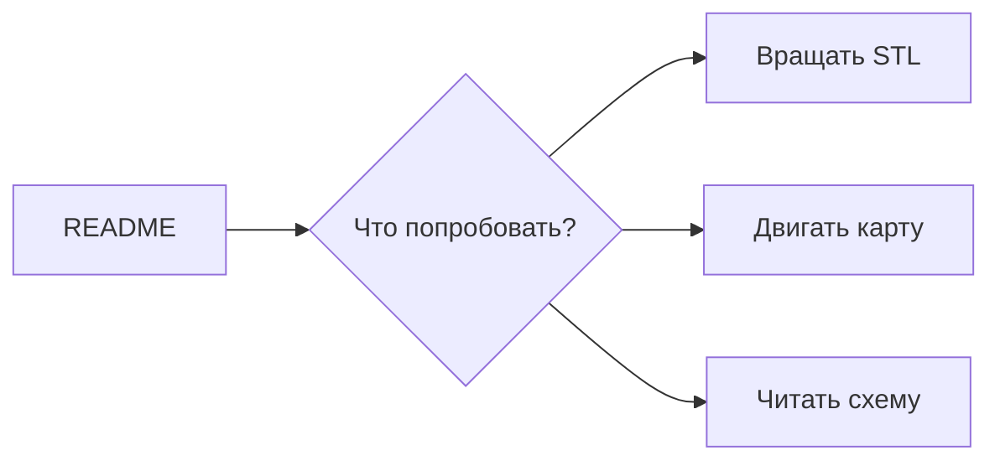
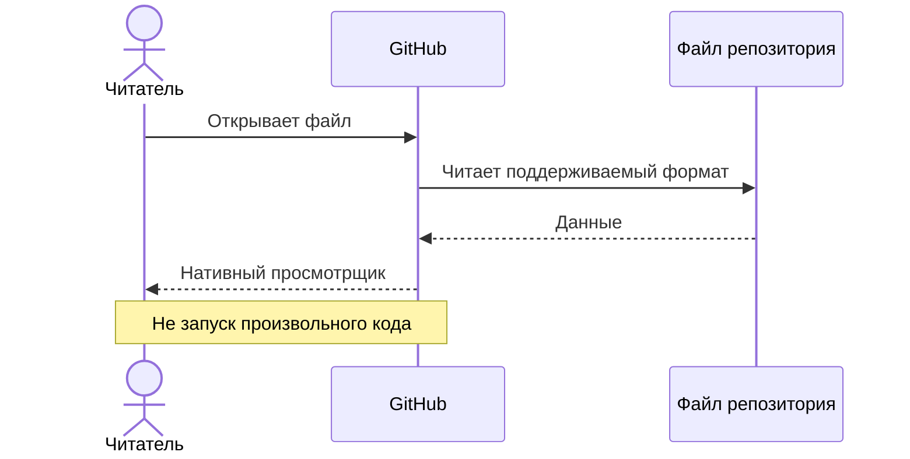
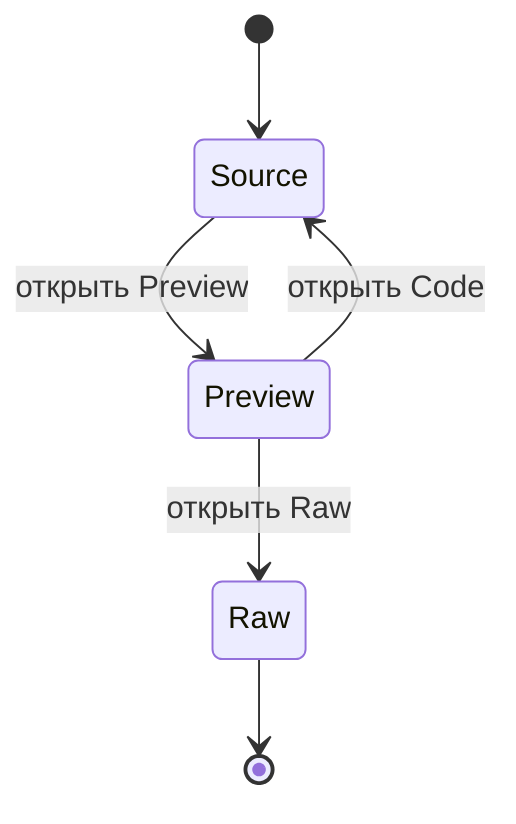
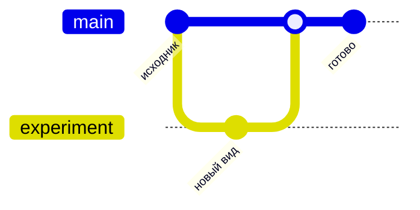
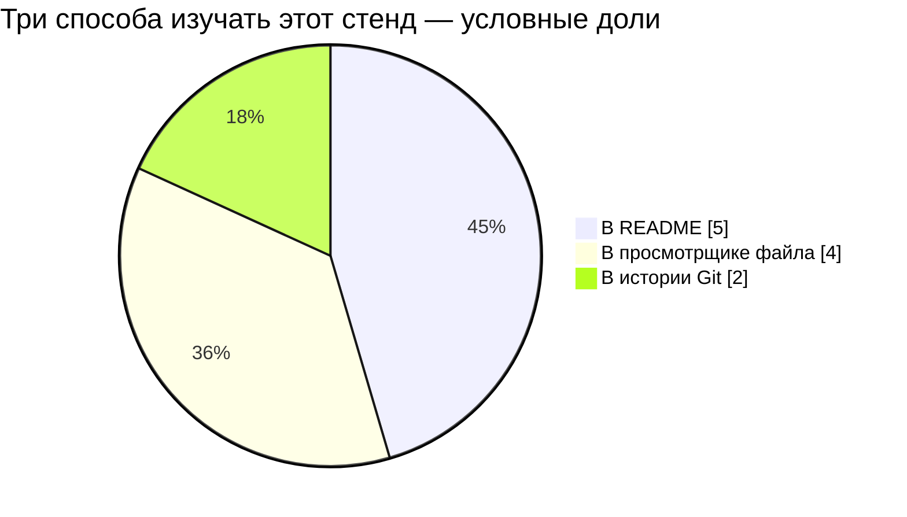

<!-- native-lab:start -->
## GitHub, который можно потрогать

**Здесь — возможности самого GitHub, а не нарисованные кнопки.** Первые блоки работают в README; дальше явно помечено, что откроется на отдельной странице. В стороннем Markdown-просмотрщике вместо них может быть только исходный код.

> [!TIP]
> Начни с модели и карт: тяни мышью, меняй масштаб. Это настоящие встроенные просмотрщики, не GIF. Если блок не загрузился, рядом есть ссылка на отдельный файл.

### 1. Поверни объект — настоящий STL

Перетаскивай модель, приближай колесом, попробуй режим **Wireframe** в панели просмотрщика. Кольцо и кристалл — две раздельные замкнутые компоненты: 78 вершин и 152 треугольника. Это демонстрационная геометрия, не готовое изделие для печати.

```stl
solid native_orbit
  facet normal 0.843610 0.226045 0.487058
    outer loop
      vertex 2.450000 0.000000 0.000000
      vertex 2.121762 1.225000 0.000000
      vertex 1.926907 1.112500 0.389711
    endloop
  endfacet
  facet normal 0.843610 0.226045 0.487058
    outer loop
      vertex 2.450000 0.000000 0.000000
      vertex 1.926907 1.112500 0.389711
      vertex 2.225000 0.000000 0.389711
    endloop
  endfacet
  facet normal 0.000000 0.000000 1.000000
    outer loop
      vertex 2.225000 0.000000 0.389711
      vertex 1.926907 1.112500 0.389711
      vertex 1.537195 0.887500 0.389711
    endloop
  endfacet
  facet normal 0.000000 0.000000 1.000000
    outer loop
      vertex 2.225000 0.000000 0.389711
      vertex 1.537195 0.887500 0.389711
      vertex 1.775000 0.000000 0.389711
    endloop
  endfacet
  facet normal -0.843610 -0.226045 0.487058
    outer loop
      vertex 1.775000 0.000000 0.389711
      vertex 1.537195 0.887500 0.389711
      vertex 1.342339 0.775000 0.000000
    endloop
  endfacet
  facet normal -0.843610 -0.226045 0.487058
    outer loop
      vertex 1.775000 0.000000 0.389711
      vertex 1.342339 0.775000 0.000000
      vertex 1.550000 0.000000 0.000000
    endloop
  endfacet
  facet normal -0.843610 -0.226045 -0.487058
    outer loop
      vertex 1.550000 0.000000 0.000000
      vertex 1.342339 0.775000 0.000000
      vertex 1.537195 0.887500 -0.389711
    endloop
  endfacet
  facet normal -0.843610 -0.226045 -0.487058
    outer loop
      vertex 1.550000 0.000000 0.000000
      vertex 1.537195 0.887500 -0.389711
      vertex 1.775000 0.000000 -0.389711
    endloop
  endfacet
  facet normal -0.000000 -0.000000 -1.000000
    outer loop
      vertex 1.775000 0.000000 -0.389711
      vertex 1.537195 0.887500 -0.389711
      vertex 1.926907 1.112500 -0.389711
    endloop
  endfacet
  facet normal -0.000000 -0.000000 -1.000000
    outer loop
      vertex 1.775000 0.000000 -0.389711
      vertex 1.926907 1.112500 -0.389711
      vertex 2.225000 0.000000 -0.389711
    endloop
  endfacet
  facet normal 0.843610 0.226045 -0.487058
    outer loop
      vertex 2.225000 0.000000 -0.389711
      vertex 1.926907 1.112500 -0.389711
      vertex 2.121762 1.225000 0.000000
    endloop
  endfacet
  facet normal 0.843610 0.226045 -0.487058
    outer loop
      vertex 2.225000 0.000000 -0.389711
      vertex 2.121762 1.225000 0.000000
      vertex 2.450000 0.000000 0.000000
    endloop
  endfacet
  facet normal 0.617565 0.617565 0.487058
    outer loop
      vertex 2.121762 1.225000 0.000000
      vertex 1.225000 2.121762 0.000000
      vertex 1.112500 1.926907 0.389711
    endloop
  endfacet
  facet normal 0.617565 0.617565 0.487058
    outer loop
      vertex 2.121762 1.225000 0.000000
      vertex 1.112500 1.926907 0.389711
      vertex 1.926907 1.112500 0.389711
    endloop
  endfacet
  facet normal 0.000000 0.000000 1.000000
    outer loop
      vertex 1.926907 1.112500 0.389711
      vertex 1.112500 1.926907 0.389711
      vertex 0.887500 1.537195 0.389711
    endloop
  endfacet
  facet normal 0.000000 0.000000 1.000000
    outer loop
      vertex 1.926907 1.112500 0.389711
      vertex 0.887500 1.537195 0.389711
      vertex 1.537195 0.887500 0.389711
    endloop
  endfacet
  facet normal -0.617565 -0.617565 0.487058
    outer loop
      vertex 1.537195 0.887500 0.389711
      vertex 0.887500 1.537195 0.389711
      vertex 0.775000 1.342339 0.000000
    endloop
  endfacet
  facet normal -0.617565 -0.617565 0.487058
    outer loop
      vertex 1.537195 0.887500 0.389711
      vertex 0.775000 1.342339 0.000000
      vertex 1.342339 0.775000 0.000000
    endloop
  endfacet
  facet normal -0.617565 -0.617565 -0.487058
    outer loop
      vertex 1.342339 0.775000 0.000000
      vertex 0.775000 1.342339 0.000000
      vertex 0.887500 1.537195 -0.389711
    endloop
  endfacet
  facet normal -0.617565 -0.617565 -0.487058
    outer loop
      vertex 1.342339 0.775000 0.000000
      vertex 0.887500 1.537195 -0.389711
      vertex 1.537195 0.887500 -0.389711
    endloop
  endfacet
  facet normal -0.000000 -0.000000 -1.000000
    outer loop
      vertex 1.537195 0.887500 -0.389711
      vertex 0.887500 1.537195 -0.389711
      vertex 1.112500 1.926907 -0.389711
    endloop
  endfacet
  facet normal -0.000000 -0.000000 -1.000000
    outer loop
      vertex 1.537195 0.887500 -0.389711
      vertex 1.112500 1.926907 -0.389711
      vertex 1.926907 1.112500 -0.389711
    endloop
  endfacet
  facet normal 0.617565 0.617565 -0.487058
    outer loop
      vertex 1.926907 1.112500 -0.389711
      vertex 1.112500 1.926907 -0.389711
      vertex 1.225000 2.121762 0.000000
    endloop
  endfacet
  facet normal 0.617565 0.617565 -0.487058
    outer loop
      vertex 1.926907 1.112500 -0.389711
      vertex 1.225000 2.121762 0.000000
      vertex 2.121762 1.225000 0.000000
    endloop
  endfacet
  facet normal 0.226045 0.843610 0.487058
    outer loop
      vertex 1.225000 2.121762 0.000000
      vertex 0.000000 2.450000 0.000000
      vertex 0.000000 2.225000 0.389711
    endloop
  endfacet
  facet normal 0.226045 0.843610 0.487058
    outer loop
      vertex 1.225000 2.121762 0.000000
      vertex 0.000000 2.225000 0.389711
      vertex 1.112500 1.926907 0.389711
    endloop
  endfacet
  facet normal 0.000000 0.000000 1.000000
    outer loop
      vertex 1.112500 1.926907 0.389711
      vertex 0.000000 2.225000 0.389711
      vertex 0.000000 1.775000 0.389711
    endloop
  endfacet
  facet normal 0.000000 0.000000 1.000000
    outer loop
      vertex 1.112500 1.926907 0.389711
      vertex 0.000000 1.775000 0.389711
      vertex 0.887500 1.537195 0.389711
    endloop
  endfacet
  facet normal -0.226045 -0.843610 0.487058
    outer loop
      vertex 0.887500 1.537195 0.389711
      vertex 0.000000 1.775000 0.389711
      vertex 0.000000 1.550000 0.000000
    endloop
  endfacet
  facet normal -0.226045 -0.843610 0.487058
    outer loop
      vertex 0.887500 1.537195 0.389711
      vertex 0.000000 1.550000 0.000000
      vertex 0.775000 1.342339 0.000000
    endloop
  endfacet
  facet normal -0.226045 -0.843610 -0.487058
    outer loop
      vertex 0.775000 1.342339 0.000000
      vertex 0.000000 1.550000 0.000000
      vertex 0.000000 1.775000 -0.389711
    endloop
  endfacet
  facet normal -0.226045 -0.843610 -0.487058
    outer loop
      vertex 0.775000 1.342339 0.000000
      vertex 0.000000 1.775000 -0.389711
      vertex 0.887500 1.537195 -0.389711
    endloop
  endfacet
  facet normal -0.000000 -0.000000 -1.000000
    outer loop
      vertex 0.887500 1.537195 -0.389711
      vertex 0.000000 1.775000 -0.389711
      vertex 0.000000 2.225000 -0.389711
    endloop
  endfacet
  facet normal -0.000000 -0.000000 -1.000000
    outer loop
      vertex 0.887500 1.537195 -0.389711
      vertex 0.000000 2.225000 -0.389711
      vertex 1.112500 1.926907 -0.389711
    endloop
  endfacet
  facet normal 0.226045 0.843610 -0.487058
    outer loop
      vertex 1.112500 1.926907 -0.389711
      vertex 0.000000 2.225000 -0.389711
      vertex 0.000000 2.450000 0.000000
    endloop
  endfacet
  facet normal 0.226045 0.843610 -0.487058
    outer loop
      vertex 1.112500 1.926907 -0.389711
      vertex 0.000000 2.450000 0.000000
      vertex 1.225000 2.121762 0.000000
    endloop
  endfacet
  facet normal -0.226045 0.843610 0.487058
    outer loop
      vertex 0.000000 2.450000 0.000000
      vertex -1.225000 2.121762 0.000000
      vertex -1.112500 1.926907 0.389711
    endloop
  endfacet
  facet normal -0.226045 0.843610 0.487058
    outer loop
      vertex 0.000000 2.450000 0.000000
      vertex -1.112500 1.926907 0.389711
      vertex 0.000000 2.225000 0.389711
    endloop
  endfacet
  facet normal -0.000000 0.000000 1.000000
    outer loop
      vertex 0.000000 2.225000 0.389711
      vertex -1.112500 1.926907 0.389711
      vertex -0.887500 1.537195 0.389711
    endloop
  endfacet
  facet normal -0.000000 0.000000 1.000000
    outer loop
      vertex 0.000000 2.225000 0.389711
      vertex -0.887500 1.537195 0.389711
      vertex 0.000000 1.775000 0.389711
    endloop
  endfacet
  facet normal 0.226045 -0.843610 0.487058
    outer loop
      vertex 0.000000 1.775000 0.389711
      vertex -0.887500 1.537195 0.389711
      vertex -0.775000 1.342339 0.000000
    endloop
  endfacet
  facet normal 0.226045 -0.843610 0.487058
    outer loop
      vertex 0.000000 1.775000 0.389711
      vertex -0.775000 1.342339 0.000000
      vertex 0.000000 1.550000 0.000000
    endloop
  endfacet
  facet normal 0.226045 -0.843610 -0.487058
    outer loop
      vertex 0.000000 1.550000 0.000000
      vertex -0.775000 1.342339 0.000000
      vertex -0.887500 1.537195 -0.389711
    endloop
  endfacet
  facet normal 0.226045 -0.843610 -0.487058
    outer loop
      vertex 0.000000 1.550000 0.000000
      vertex -0.887500 1.537195 -0.389711
      vertex 0.000000 1.775000 -0.389711
    endloop
  endfacet
  facet normal 0.000000 -0.000000 -1.000000
    outer loop
      vertex 0.000000 1.775000 -0.389711
      vertex -0.887500 1.537195 -0.389711
      vertex -1.112500 1.926907 -0.389711
    endloop
  endfacet
  facet normal 0.000000 -0.000000 -1.000000
    outer loop
      vertex 0.000000 1.775000 -0.389711
      vertex -1.112500 1.926907 -0.389711
      vertex 0.000000 2.225000 -0.389711
    endloop
  endfacet
  facet normal -0.226045 0.843610 -0.487058
    outer loop
      vertex 0.000000 2.225000 -0.389711
      vertex -1.112500 1.926907 -0.389711
      vertex -1.225000 2.121762 0.000000
    endloop
  endfacet
  facet normal -0.226045 0.843610 -0.487058
    outer loop
      vertex 0.000000 2.225000 -0.389711
      vertex -1.225000 2.121762 0.000000
      vertex 0.000000 2.450000 0.000000
    endloop
  endfacet
  facet normal -0.617565 0.617565 0.487058
    outer loop
      vertex -1.225000 2.121762 0.000000
      vertex -2.121762 1.225000 0.000000
      vertex -1.926907 1.112500 0.389711
    endloop
  endfacet
  facet normal -0.617565 0.617565 0.487058
    outer loop
      vertex -1.225000 2.121762 0.000000
      vertex -1.926907 1.112500 0.389711
      vertex -1.112500 1.926907 0.389711
    endloop
  endfacet
  facet normal -0.000000 0.000000 1.000000
    outer loop
      vertex -1.112500 1.926907 0.389711
      vertex -1.926907 1.112500 0.389711
      vertex -1.537195 0.887500 0.389711
    endloop
  endfacet
  facet normal -0.000000 0.000000 1.000000
    outer loop
      vertex -1.112500 1.926907 0.389711
      vertex -1.537195 0.887500 0.389711
      vertex -0.887500 1.537195 0.389711
    endloop
  endfacet
  facet normal 0.617565 -0.617565 0.487058
    outer loop
      vertex -0.887500 1.537195 0.389711
      vertex -1.537195 0.887500 0.389711
      vertex -1.342339 0.775000 0.000000
    endloop
  endfacet
  facet normal 0.617565 -0.617565 0.487058
    outer loop
      vertex -0.887500 1.537195 0.389711
      vertex -1.342339 0.775000 0.000000
      vertex -0.775000 1.342339 0.000000
    endloop
  endfacet
  facet normal 0.617565 -0.617565 -0.487058
    outer loop
      vertex -0.775000 1.342339 0.000000
      vertex -1.342339 0.775000 0.000000
      vertex -1.537195 0.887500 -0.389711
    endloop
  endfacet
  facet normal 0.617565 -0.617565 -0.487058
    outer loop
      vertex -0.775000 1.342339 0.000000
      vertex -1.537195 0.887500 -0.389711
      vertex -0.887500 1.537195 -0.389711
    endloop
  endfacet
  facet normal 0.000000 -0.000000 -1.000000
    outer loop
      vertex -0.887500 1.537195 -0.389711
      vertex -1.537195 0.887500 -0.389711
      vertex -1.926907 1.112500 -0.389711
    endloop
  endfacet
  facet normal 0.000000 -0.000000 -1.000000
    outer loop
      vertex -0.887500 1.537195 -0.389711
      vertex -1.926907 1.112500 -0.389711
      vertex -1.112500 1.926907 -0.389711
    endloop
  endfacet
  facet normal -0.617565 0.617565 -0.487058
    outer loop
      vertex -1.112500 1.926907 -0.389711
      vertex -1.926907 1.112500 -0.389711
      vertex -2.121762 1.225000 0.000000
    endloop
  endfacet
  facet normal -0.617565 0.617565 -0.487058
    outer loop
      vertex -1.112500 1.926907 -0.389711
      vertex -2.121762 1.225000 0.000000
      vertex -1.225000 2.121762 0.000000
    endloop
  endfacet
  facet normal -0.843610 0.226045 0.487058
    outer loop
      vertex -2.121762 1.225000 0.000000
      vertex -2.450000 0.000000 0.000000
      vertex -2.225000 0.000000 0.389711
    endloop
  endfacet
  facet normal -0.843610 0.226045 0.487058
    outer loop
      vertex -2.121762 1.225000 0.000000
      vertex -2.225000 0.000000 0.389711
      vertex -1.926907 1.112500 0.389711
    endloop
  endfacet
  facet normal -0.000000 0.000000 1.000000
    outer loop
      vertex -1.926907 1.112500 0.389711
      vertex -2.225000 0.000000 0.389711
      vertex -1.775000 0.000000 0.389711
    endloop
  endfacet
  facet normal -0.000000 0.000000 1.000000
    outer loop
      vertex -1.926907 1.112500 0.389711
      vertex -1.775000 0.000000 0.389711
      vertex -1.537195 0.887500 0.389711
    endloop
  endfacet
  facet normal 0.843610 -0.226045 0.487058
    outer loop
      vertex -1.537195 0.887500 0.389711
      vertex -1.775000 0.000000 0.389711
      vertex -1.550000 0.000000 0.000000
    endloop
  endfacet
  facet normal 0.843610 -0.226045 0.487058
    outer loop
      vertex -1.537195 0.887500 0.389711
      vertex -1.550000 0.000000 0.000000
      vertex -1.342339 0.775000 0.000000
    endloop
  endfacet
  facet normal 0.843610 -0.226045 -0.487058
    outer loop
      vertex -1.342339 0.775000 0.000000
      vertex -1.550000 0.000000 0.000000
      vertex -1.775000 0.000000 -0.389711
    endloop
  endfacet
  facet normal 0.843610 -0.226045 -0.487058
    outer loop
      vertex -1.342339 0.775000 0.000000
      vertex -1.775000 0.000000 -0.389711
      vertex -1.537195 0.887500 -0.389711
    endloop
  endfacet
  facet normal 0.000000 -0.000000 -1.000000
    outer loop
      vertex -1.537195 0.887500 -0.389711
      vertex -1.775000 0.000000 -0.389711
      vertex -2.225000 0.000000 -0.389711
    endloop
  endfacet
  facet normal 0.000000 -0.000000 -1.000000
    outer loop
      vertex -1.537195 0.887500 -0.389711
      vertex -2.225000 0.000000 -0.389711
      vertex -1.926907 1.112500 -0.389711
    endloop
  endfacet
  facet normal -0.843610 0.226045 -0.487058
    outer loop
      vertex -1.926907 1.112500 -0.389711
      vertex -2.225000 0.000000 -0.389711
      vertex -2.450000 0.000000 0.000000
    endloop
  endfacet
  facet normal -0.843610 0.226045 -0.487058
    outer loop
      vertex -1.926907 1.112500 -0.389711
      vertex -2.450000 0.000000 0.000000
      vertex -2.121762 1.225000 0.000000
    endloop
  endfacet
  facet normal -0.843610 -0.226045 0.487058
    outer loop
      vertex -2.450000 0.000000 0.000000
      vertex -2.121762 -1.225000 0.000000
      vertex -1.926907 -1.112500 0.389711
    endloop
  endfacet
  facet normal -0.843610 -0.226045 0.487058
    outer loop
      vertex -2.450000 0.000000 0.000000
      vertex -1.926907 -1.112500 0.389711
      vertex -2.225000 0.000000 0.389711
    endloop
  endfacet
  facet normal -0.000000 -0.000000 1.000000
    outer loop
      vertex -2.225000 0.000000 0.389711
      vertex -1.926907 -1.112500 0.389711
      vertex -1.537195 -0.887500 0.389711
    endloop
  endfacet
  facet normal -0.000000 -0.000000 1.000000
    outer loop
      vertex -2.225000 0.000000 0.389711
      vertex -1.537195 -0.887500 0.389711
      vertex -1.775000 0.000000 0.389711
    endloop
  endfacet
  facet normal 0.843610 0.226045 0.487058
    outer loop
      vertex -1.775000 0.000000 0.389711
      vertex -1.537195 -0.887500 0.389711
      vertex -1.342339 -0.775000 0.000000
    endloop
  endfacet
  facet normal 0.843610 0.226045 0.487058
    outer loop
      vertex -1.775000 0.000000 0.389711
      vertex -1.342339 -0.775000 0.000000
      vertex -1.550000 0.000000 0.000000
    endloop
  endfacet
  facet normal 0.843610 0.226045 -0.487058
    outer loop
      vertex -1.550000 0.000000 0.000000
      vertex -1.342339 -0.775000 0.000000
      vertex -1.537195 -0.887500 -0.389711
    endloop
  endfacet
  facet normal 0.843610 0.226045 -0.487058
    outer loop
      vertex -1.550000 0.000000 0.000000
      vertex -1.537195 -0.887500 -0.389711
      vertex -1.775000 0.000000 -0.389711
    endloop
  endfacet
  facet normal 0.000000 0.000000 -1.000000
    outer loop
      vertex -1.775000 0.000000 -0.389711
      vertex -1.537195 -0.887500 -0.389711
      vertex -1.926907 -1.112500 -0.389711
    endloop
  endfacet
  facet normal 0.000000 0.000000 -1.000000
    outer loop
      vertex -1.775000 0.000000 -0.389711
      vertex -1.926907 -1.112500 -0.389711
      vertex -2.225000 0.000000 -0.389711
    endloop
  endfacet
  facet normal -0.843610 -0.226045 -0.487058
    outer loop
      vertex -2.225000 0.000000 -0.389711
      vertex -1.926907 -1.112500 -0.389711
      vertex -2.121762 -1.225000 0.000000
    endloop
  endfacet
  facet normal -0.843610 -0.226045 -0.487058
    outer loop
      vertex -2.225000 0.000000 -0.389711
      vertex -2.121762 -1.225000 0.000000
      vertex -2.450000 0.000000 0.000000
    endloop
  endfacet
  facet normal -0.617565 -0.617565 0.487058
    outer loop
      vertex -2.121762 -1.225000 0.000000
      vertex -1.225000 -2.121762 0.000000
      vertex -1.112500 -1.926907 0.389711
    endloop
  endfacet
  facet normal -0.617565 -0.617565 0.487058
    outer loop
      vertex -2.121762 -1.225000 0.000000
      vertex -1.112500 -1.926907 0.389711
      vertex -1.926907 -1.112500 0.389711
    endloop
  endfacet
  facet normal -0.000000 -0.000000 1.000000
    outer loop
      vertex -1.926907 -1.112500 0.389711
      vertex -1.112500 -1.926907 0.389711
      vertex -0.887500 -1.537195 0.389711
    endloop
  endfacet
  facet normal -0.000000 -0.000000 1.000000
    outer loop
      vertex -1.926907 -1.112500 0.389711
      vertex -0.887500 -1.537195 0.389711
      vertex -1.537195 -0.887500 0.389711
    endloop
  endfacet
  facet normal 0.617565 0.617565 0.487058
    outer loop
      vertex -1.537195 -0.887500 0.389711
      vertex -0.887500 -1.537195 0.389711
      vertex -0.775000 -1.342339 0.000000
    endloop
  endfacet
  facet normal 0.617565 0.617565 0.487058
    outer loop
      vertex -1.537195 -0.887500 0.389711
      vertex -0.775000 -1.342339 0.000000
      vertex -1.342339 -0.775000 0.000000
    endloop
  endfacet
  facet normal 0.617565 0.617565 -0.487058
    outer loop
      vertex -1.342339 -0.775000 0.000000
      vertex -0.775000 -1.342339 0.000000
      vertex -0.887500 -1.537195 -0.389711
    endloop
  endfacet
  facet normal 0.617565 0.617565 -0.487058
    outer loop
      vertex -1.342339 -0.775000 0.000000
      vertex -0.887500 -1.537195 -0.389711
      vertex -1.537195 -0.887500 -0.389711
    endloop
  endfacet
  facet normal 0.000000 0.000000 -1.000000
    outer loop
      vertex -1.537195 -0.887500 -0.389711
      vertex -0.887500 -1.537195 -0.389711
      vertex -1.112500 -1.926907 -0.389711
    endloop
  endfacet
  facet normal 0.000000 0.000000 -1.000000
    outer loop
      vertex -1.537195 -0.887500 -0.389711
      vertex -1.112500 -1.926907 -0.389711
      vertex -1.926907 -1.112500 -0.389711
    endloop
  endfacet
  facet normal -0.617565 -0.617565 -0.487058
    outer loop
      vertex -1.926907 -1.112500 -0.389711
      vertex -1.112500 -1.926907 -0.389711
      vertex -1.225000 -2.121762 0.000000
    endloop
  endfacet
  facet normal -0.617565 -0.617565 -0.487058
    outer loop
      vertex -1.926907 -1.112500 -0.389711
      vertex -1.225000 -2.121762 0.000000
      vertex -2.121762 -1.225000 0.000000
    endloop
  endfacet
  facet normal -0.226045 -0.843610 0.487058
    outer loop
      vertex -1.225000 -2.121762 0.000000
      vertex -0.000000 -2.450000 0.000000
      vertex -0.000000 -2.225000 0.389711
    endloop
  endfacet
  facet normal -0.226045 -0.843610 0.487058
    outer loop
      vertex -1.225000 -2.121762 0.000000
      vertex -0.000000 -2.225000 0.389711
      vertex -1.112500 -1.926907 0.389711
    endloop
  endfacet
  facet normal -0.000000 -0.000000 1.000000
    outer loop
      vertex -1.112500 -1.926907 0.389711
      vertex -0.000000 -2.225000 0.389711
      vertex -0.000000 -1.775000 0.389711
    endloop
  endfacet
  facet normal -0.000000 -0.000000 1.000000
    outer loop
      vertex -1.112500 -1.926907 0.389711
      vertex -0.000000 -1.775000 0.389711
      vertex -0.887500 -1.537195 0.389711
    endloop
  endfacet
  facet normal 0.226045 0.843610 0.487058
    outer loop
      vertex -0.887500 -1.537195 0.389711
      vertex -0.000000 -1.775000 0.389711
      vertex -0.000000 -1.550000 0.000000
    endloop
  endfacet
  facet normal 0.226045 0.843610 0.487058
    outer loop
      vertex -0.887500 -1.537195 0.389711
      vertex -0.000000 -1.550000 0.000000
      vertex -0.775000 -1.342339 0.000000
    endloop
  endfacet
  facet normal 0.226045 0.843610 -0.487058
    outer loop
      vertex -0.775000 -1.342339 0.000000
      vertex -0.000000 -1.550000 0.000000
      vertex -0.000000 -1.775000 -0.389711
    endloop
  endfacet
  facet normal 0.226045 0.843610 -0.487058
    outer loop
      vertex -0.775000 -1.342339 0.000000
      vertex -0.000000 -1.775000 -0.389711
      vertex -0.887500 -1.537195 -0.389711
    endloop
  endfacet
  facet normal 0.000000 0.000000 -1.000000
    outer loop
      vertex -0.887500 -1.537195 -0.389711
      vertex -0.000000 -1.775000 -0.389711
      vertex -0.000000 -2.225000 -0.389711
    endloop
  endfacet
  facet normal 0.000000 0.000000 -1.000000
    outer loop
      vertex -0.887500 -1.537195 -0.389711
      vertex -0.000000 -2.225000 -0.389711
      vertex -1.112500 -1.926907 -0.389711
    endloop
  endfacet
  facet normal -0.226045 -0.843610 -0.487058
    outer loop
      vertex -1.112500 -1.926907 -0.389711
      vertex -0.000000 -2.225000 -0.389711
      vertex -0.000000 -2.450000 0.000000
    endloop
  endfacet
  facet normal -0.226045 -0.843610 -0.487058
    outer loop
      vertex -1.112500 -1.926907 -0.389711
      vertex -0.000000 -2.450000 0.000000
      vertex -1.225000 -2.121762 0.000000
    endloop
  endfacet
  facet normal 0.226045 -0.843610 0.487058
    outer loop
      vertex -0.000000 -2.450000 0.000000
      vertex 1.225000 -2.121762 0.000000
      vertex 1.112500 -1.926907 0.389711
    endloop
  endfacet
  facet normal 0.226045 -0.843610 0.487058
    outer loop
      vertex -0.000000 -2.450000 0.000000
      vertex 1.112500 -1.926907 0.389711
      vertex -0.000000 -2.225000 0.389711
    endloop
  endfacet
  facet normal 0.000000 -0.000000 1.000000
    outer loop
      vertex -0.000000 -2.225000 0.389711
      vertex 1.112500 -1.926907 0.389711
      vertex 0.887500 -1.537195 0.389711
    endloop
  endfacet
  facet normal 0.000000 -0.000000 1.000000
    outer loop
      vertex -0.000000 -2.225000 0.389711
      vertex 0.887500 -1.537195 0.389711
      vertex -0.000000 -1.775000 0.389711
    endloop
  endfacet
  facet normal -0.226045 0.843610 0.487058
    outer loop
      vertex -0.000000 -1.775000 0.389711
      vertex 0.887500 -1.537195 0.389711
      vertex 0.775000 -1.342339 0.000000
    endloop
  endfacet
  facet normal -0.226045 0.843610 0.487058
    outer loop
      vertex -0.000000 -1.775000 0.389711
      vertex 0.775000 -1.342339 0.000000
      vertex -0.000000 -1.550000 0.000000
    endloop
  endfacet
  facet normal -0.226045 0.843610 -0.487058
    outer loop
      vertex -0.000000 -1.550000 0.000000
      vertex 0.775000 -1.342339 0.000000
      vertex 0.887500 -1.537195 -0.389711
    endloop
  endfacet
  facet normal -0.226045 0.843610 -0.487058
    outer loop
      vertex -0.000000 -1.550000 0.000000
      vertex 0.887500 -1.537195 -0.389711
      vertex -0.000000 -1.775000 -0.389711
    endloop
  endfacet
  facet normal -0.000000 0.000000 -1.000000
    outer loop
      vertex -0.000000 -1.775000 -0.389711
      vertex 0.887500 -1.537195 -0.389711
      vertex 1.112500 -1.926907 -0.389711
    endloop
  endfacet
  facet normal -0.000000 0.000000 -1.000000
    outer loop
      vertex -0.000000 -1.775000 -0.389711
      vertex 1.112500 -1.926907 -0.389711
      vertex -0.000000 -2.225000 -0.389711
    endloop
  endfacet
  facet normal 0.226045 -0.843610 -0.487058
    outer loop
      vertex -0.000000 -2.225000 -0.389711
      vertex 1.112500 -1.926907 -0.389711
      vertex 1.225000 -2.121762 0.000000
    endloop
  endfacet
  facet normal 0.226045 -0.843610 -0.487058
    outer loop
      vertex -0.000000 -2.225000 -0.389711
      vertex 1.225000 -2.121762 0.000000
      vertex -0.000000 -2.450000 0.000000
    endloop
  endfacet
  facet normal 0.617565 -0.617565 0.487058
    outer loop
      vertex 1.225000 -2.121762 0.000000
      vertex 2.121762 -1.225000 0.000000
      vertex 1.926907 -1.112500 0.389711
    endloop
  endfacet
  facet normal 0.617565 -0.617565 0.487058
    outer loop
      vertex 1.225000 -2.121762 0.000000
      vertex 1.926907 -1.112500 0.389711
      vertex 1.112500 -1.926907 0.389711
    endloop
  endfacet
  facet normal 0.000000 -0.000000 1.000000
    outer loop
      vertex 1.112500 -1.926907 0.389711
      vertex 1.926907 -1.112500 0.389711
      vertex 1.537195 -0.887500 0.389711
    endloop
  endfacet
  facet normal 0.000000 -0.000000 1.000000
    outer loop
      vertex 1.112500 -1.926907 0.389711
      vertex 1.537195 -0.887500 0.389711
      vertex 0.887500 -1.537195 0.389711
    endloop
  endfacet
  facet normal -0.617565 0.617565 0.487058
    outer loop
      vertex 0.887500 -1.537195 0.389711
      vertex 1.537195 -0.887500 0.389711
      vertex 1.342339 -0.775000 0.000000
    endloop
  endfacet
  facet normal -0.617565 0.617565 0.487058
    outer loop
      vertex 0.887500 -1.537195 0.389711
      vertex 1.342339 -0.775000 0.000000
      vertex 0.775000 -1.342339 0.000000
    endloop
  endfacet
  facet normal -0.617565 0.617565 -0.487058
    outer loop
      vertex 0.775000 -1.342339 0.000000
      vertex 1.342339 -0.775000 0.000000
      vertex 1.537195 -0.887500 -0.389711
    endloop
  endfacet
  facet normal -0.617565 0.617565 -0.487058
    outer loop
      vertex 0.775000 -1.342339 0.000000
      vertex 1.537195 -0.887500 -0.389711
      vertex 0.887500 -1.537195 -0.389711
    endloop
  endfacet
  facet normal -0.000000 0.000000 -1.000000
    outer loop
      vertex 0.887500 -1.537195 -0.389711
      vertex 1.537195 -0.887500 -0.389711
      vertex 1.926907 -1.112500 -0.389711
    endloop
  endfacet
  facet normal -0.000000 0.000000 -1.000000
    outer loop
      vertex 0.887500 -1.537195 -0.389711
      vertex 1.926907 -1.112500 -0.389711
      vertex 1.112500 -1.926907 -0.389711
    endloop
  endfacet
  facet normal 0.617565 -0.617565 -0.487058
    outer loop
      vertex 1.112500 -1.926907 -0.389711
      vertex 1.926907 -1.112500 -0.389711
      vertex 2.121762 -1.225000 0.000000
    endloop
  endfacet
  facet normal 0.617565 -0.617565 -0.487058
    outer loop
      vertex 1.112500 -1.926907 -0.389711
      vertex 2.121762 -1.225000 0.000000
      vertex 1.225000 -2.121762 0.000000
    endloop
  endfacet
  facet normal 0.843610 -0.226045 0.487058
    outer loop
      vertex 2.121762 -1.225000 0.000000
      vertex 2.450000 0.000000 0.000000
      vertex 2.225000 0.000000 0.389711
    endloop
  endfacet
  facet normal 0.843610 -0.226045 0.487058
    outer loop
      vertex 2.121762 -1.225000 0.000000
      vertex 2.225000 0.000000 0.389711
      vertex 1.926907 -1.112500 0.389711
    endloop
  endfacet
  facet normal 0.000000 -0.000000 1.000000
    outer loop
      vertex 1.926907 -1.112500 0.389711
      vertex 2.225000 0.000000 0.389711
      vertex 1.775000 0.000000 0.389711
    endloop
  endfacet
  facet normal 0.000000 -0.000000 1.000000
    outer loop
      vertex 1.926907 -1.112500 0.389711
      vertex 1.775000 0.000000 0.389711
      vertex 1.537195 -0.887500 0.389711
    endloop
  endfacet
  facet normal -0.843610 0.226045 0.487058
    outer loop
      vertex 1.537195 -0.887500 0.389711
      vertex 1.775000 0.000000 0.389711
      vertex 1.550000 0.000000 0.000000
    endloop
  endfacet
  facet normal -0.843610 0.226045 0.487058
    outer loop
      vertex 1.537195 -0.887500 0.389711
      vertex 1.550000 0.000000 0.000000
      vertex 1.342339 -0.775000 0.000000
    endloop
  endfacet
  facet normal -0.843610 0.226045 -0.487058
    outer loop
      vertex 1.342339 -0.775000 0.000000
      vertex 1.550000 0.000000 0.000000
      vertex 1.775000 0.000000 -0.389711
    endloop
  endfacet
  facet normal -0.843610 0.226045 -0.487058
    outer loop
      vertex 1.342339 -0.775000 0.000000
      vertex 1.775000 0.000000 -0.389711
      vertex 1.537195 -0.887500 -0.389711
    endloop
  endfacet
  facet normal -0.000000 0.000000 -1.000000
    outer loop
      vertex 1.537195 -0.887500 -0.389711
      vertex 1.775000 0.000000 -0.389711
      vertex 2.225000 0.000000 -0.389711
    endloop
  endfacet
  facet normal -0.000000 0.000000 -1.000000
    outer loop
      vertex 1.537195 -0.887500 -0.389711
      vertex 2.225000 0.000000 -0.389711
      vertex 1.926907 -1.112500 -0.389711
    endloop
  endfacet
  facet normal 0.843610 -0.226045 -0.487058
    outer loop
      vertex 1.926907 -1.112500 -0.389711
      vertex 2.225000 0.000000 -0.389711
      vertex 2.450000 0.000000 0.000000
    endloop
  endfacet
  facet normal 0.843610 -0.226045 -0.487058
    outer loop
      vertex 1.926907 -1.112500 -0.389711
      vertex 2.450000 0.000000 0.000000
      vertex 2.121762 -1.225000 0.000000
    endloop
  endfacet
  facet normal 0.648381 0.648381 0.399004
    outer loop
      vertex 0.000000 0.000000 1.300000
      vertex 0.800000 0.000000 0.000000
      vertex 0.000000 0.800000 0.000000
    endloop
  endfacet
  facet normal 0.648381 0.648381 -0.399004
    outer loop
      vertex 0.000000 0.000000 -1.300000
      vertex 0.000000 0.800000 0.000000
      vertex 0.800000 0.000000 0.000000
    endloop
  endfacet
  facet normal -0.648381 0.648381 0.399004
    outer loop
      vertex 0.000000 0.000000 1.300000
      vertex 0.000000 0.800000 0.000000
      vertex -0.800000 0.000000 0.000000
    endloop
  endfacet
  facet normal -0.648381 0.648381 -0.399004
    outer loop
      vertex 0.000000 0.000000 -1.300000
      vertex -0.800000 0.000000 0.000000
      vertex 0.000000 0.800000 0.000000
    endloop
  endfacet
  facet normal -0.648381 -0.648381 0.399004
    outer loop
      vertex 0.000000 0.000000 1.300000
      vertex -0.800000 0.000000 0.000000
      vertex 0.000000 -0.800000 0.000000
    endloop
  endfacet
  facet normal -0.648381 -0.648381 -0.399004
    outer loop
      vertex 0.000000 0.000000 -1.300000
      vertex 0.000000 -0.800000 0.000000
      vertex -0.800000 0.000000 0.000000
    endloop
  endfacet
  facet normal 0.648381 -0.648381 0.399004
    outer loop
      vertex 0.000000 0.000000 1.300000
      vertex 0.000000 -0.800000 0.000000
      vertex 0.800000 0.000000 0.000000
    endloop
  endfacet
  facet normal 0.648381 -0.648381 -0.399004
    outer loop
      vertex 0.000000 0.000000 -1.300000
      vertex 0.800000 0.000000 0.000000
      vertex 0.000000 -0.800000 0.000000
    endloop
  endfacet
endsolid native_orbit
```

[Открыть ту же модель отдельным STL](assets/native-lab/orbit.stl) · [Как устроен стенд и его ограничения](atlas/native-lab.md). Для 3D нужен работающий WebGL в браузере.

### 2. Подвигай карту — GeoJSON прямо здесь

Попробуй масштабирование и перетаскивание. Точки и ломаная **условные**, это не проверенный туристический маршрут. Подложка загружается картографическим просмотрщиком GitHub, не нашим кодом.

```geojson
{
  "type": "FeatureCollection",
  "features": [
    {"type": "Feature", "properties": {"title": "Условная точка A"}, "geometry": {"type": "Point", "coordinates": [-19.10, 64.20]}},
    {"type": "Feature", "properties": {"title": "Условная точка B"}, "geometry": {"type": "Point", "coordinates": [-18.86, 64.28]}},
    {"type": "Feature", "properties": {"title": "Учебный профиль A–B", "stroke": "#7156a0"}, "geometry": {"type": "LineString", "coordinates": [[-19.10, 64.20], [-19.02, 64.26], [-18.94, 64.24], [-18.86, 64.28]]}}
  ]
}
```

[Та же карта отдельным файлом](assets/native-lab/survey.geojson). Окно с properties по нажатию на объект зависит от интерфейса просмотрщика.

### 3. Две области с общей границей — TopoJSON

Это другая запись геометрии: соседние учебные полигоны ссылаются на общую дугу. Перемещать карту и менять масштаб можно так же; редактировать вершины в этом окне нельзя.

```topojson
{
  "type": "Topology",
  "objects": {
    "sheets": {"type": "GeometryCollection", "geometries": [
      {"type": "Polygon", "properties": {"title": "Западный лист", "fill": "#9469bd"}, "arcs": [[0, 1]]},
      {"type": "Polygon", "properties": {"title": "Восточный лист", "fill": "#38806e"}, "arcs": [[-1, 2]]}
    ]}
  },
  "arcs": [
    [[-19.0, 64.18], [-19.0, 64.30]],
    [[-19.0, 64.30], [-19.14, 64.30], [-19.14, 64.18], [-19.0, 64.18]],
    [[-19.0, 64.18], [-18.82, 64.18], [-18.82, 64.30], [-19.0, 64.30]]
  ]
}
```

[Те же области отдельным TopoJSON](assets/native-lab/sheets.topojson).

### 4. Схемы строит GitHub, а не экспортёр PNG

Ниже пять **живых блоков Mermaid**: схема выбора, последовательность, состояния, Git-граф и круговая диаграмма. Это отрисовка текста, не симулятор процесса. Кнопки панорамирования/масштаба зависят от текущего интерфейса GitHub; произвольные JavaScript-обработчики сюда не добавлены.











[Исходная схема](assets/native-lab/flow.mmd) · [Последовательность](assets/native-lab/sequence.mmd) · [Состояния](assets/native-lab/states.mmd) · [Git-граф](assets/native-lab/git.mmd) · [Доли](assets/native-lab/pie.mmd). Числа в диаграмме долей учебные, не статистика посетителей.

### 5. Настоящее «до / после» со слайдером

**[Открыть сравнение двух версий PNG на GitHub](https://github.com/overbaffe1/gitEdit/commit/26c5431add793db98fa4207ae0be148d0166ecc0)** — выбери **Swipe**, затем **Onion Skin**, если эти режимы доступны в твоём интерфейсе. В первой версии круг оранжевый и полоски короче, во второй круг зелёный и полоски длиннее. Это один и тот же файл в двух коммитах, не картинка с нарисованным ползунком. **Откроется история изменений, не виджет внутри README.**

[Текущий PNG](assets/native-lab/revision.png) · [Код, создающий обе версии](atlas/samples/native_lab/diff_image.py). В мобильном интерфейсе набор средств сравнения может отличаться.

### 6. Ещё четыре просмотрщика — открой и попробуй

| Открыть на GitHub | Что делать | Где граница |
|---|---|---|
| [Каталог CSV](assets/native-lab/catalog.csv) · [тот же TSV](assets/native-lab/catalog.tsv) | Введи `map` или `3d` в поиск над таблицей, если он доступен; нажми номер строки для ссылки на неё | Поиск на странице файла, не в Markdown-таблице; набор элементов UI зависит от интерфейса GitHub |
| [Notebook с сохранённым результатом](assets/native-lab/mesh.ipynb) | Посмотри код и готовый текстовый вывод | GitHub не запускает Python, JS-виджеты и ячейки notebook |
| [PDF из существующей галереи](assets/pressroom/print-a4.pdf) | Открой документ в просмотрщике GitHub | PDF не встроен в README; ссылки внутри PDF GitHub может игнорировать |
| [Исходник Mermaid отдельным файлом](assets/native-lab/flow.mmd) | Сравни Preview и Code, если переключатель доступен | Это нативный рендер файла, не отдельное приложение |

### 7. Необычная разметка, которая действительно работает

Формулу ниже набирает GitHub, а не генератор картинки:

```math
V-E+F = 78-228+152 = 2
```

Это сумма характеристик двух компонент (тора и октаэдра), **не утверждение, что вся модель — одна сфера**.

<details open>
<summary>Нажми: это настоящий раскрывающийся блок, а не кнопка на картинке</summary>

Он открыт изначально, чтобы ничего не прятать. Сверни и разверни его мышью или клавиатурой. Выбор состояния не сохраняется в Git.

- [x] Отмеченный пункт списка.
- [ ] Неотмеченный пункт списка.

Эти галочки показывают состояние Markdown, а не форму для отправки ответов: в README не обещается изменение файла кликом.

Сноска делает переход к примечанию и обратно.[^native-lab-note]

</details>

[^native-lab-note]: Это обычная сноска GitHub Markdown. В длинном README примечание окажется внизу документа; GitHub добавляет обратную ссылку.

> [!IMPORTANT]
> Произвольный HTML/JS, iframe с сайтом, Three.js-сцена, запуск notebook и игра на canvas не становятся работающими виджетами от вставки в README. Не путай нативные просмотрщики со ссылками на Pages и анимациями-картинками.

[Полный реестр возможностей, пять типов alerts, адаптация по теме, видео и честные ограничения](atlas/native-lab.md) · [Постоянные ссылки на изученную документацию](atlas/samples/native_lab/sources.json). Все старые разделы ниже сохранены.

### 8. Автогруппировка точек и другие форматы документации

[Открыть карту с 800 учебными точками](assets/native-lab/clusters.geojson): отдаляй и приближай. GitHub документирует автоматическую кластеризацию больших наборов; появление групп зависит от масштаба и текущего просмотрщика. Точки созданы сеткой, не являются адресами людей или результатом наблюдений.

GitHub умеет показывать не только Markdown: [reStructuredText](assets/native-lab/notes.rst) · [AsciiDoc](assets/native-lab/notes.adoc) · [Org](assets/native-lab/notes.org). Это **другие разметки документа**, не три новых интерактивных движка. [Узнать версию Mermaid отдельным файлом](assets/native-lab/version.mmd).

<!-- native-lab:end -->

