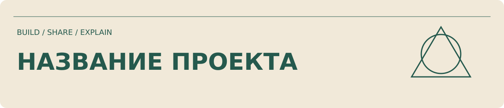

# Конструктор README без скрипта

[В галерею](../../../README.md) · [Как устроено](../../switchboard.md)

Ссылки ниже **открывают другую Markdown-страницу**. Меняется один параметр, остальные сохраняются в имени файла. Это не форма, не JS и не запись в Git.

**Форма:** **Лента ✓** · [Плакат](stack-forest-full.md)

**Цвет SVG:** [Чернила](wide-ink-full.md) · [Коралл](wide-coral-full.md) · **Лес ✓**

**Текст:** [Коротко](wide-forest-brief.md) · **Подробно ✓**

Состояние: `wide-forest-full`. Всего 12 готовых вариантов. [Сбросить](wide-ink-brief.md). Кнопка браузера «Назад» возвращает предыдущий вариант.

---

### Предпросмотр



## Название проекта

Одно предложение: что делает проект и кому помогает. Замени этот пример своим текстом.

### С чего начать

1. Объясни первый шаг.
2. Укажи, где искать примеры.
3. Опиши ожидаемый результат.

| Раздел | Что написать |
|---|---|
| Возможности | Главные задачи проекта |
| Ограничения | Чего проект не обещает |
| Участие | Как предложить улучшение |

---

### Забрать вариант в свой репозиторий

1. Сохрани [этот SVG](../../../assets/switchboard/wide-forest.svg) в своём проекте как `assets/readme-card.svg`. Для исходных байтов используй Raw/Download, а не HTML-страницу файла.
2. Скопируй Markdown ниже в свой корневой README и замени демонстрационный текст.

```markdown


## Название проекта

Одно предложение: что делает проект и кому помогает. Замени этот пример своим текстом.

### С чего начать

1. Объясни первый шаг.
2. Укажи, где искать примеры.
3. Опиши ожидаемый результат.

| Раздел | Что написать |
|---|---|
| Возможности | Главные задачи проекта |
| Ограничения | Чего проект не обещает |
| Участие | Как предложить улучшение |
```

[Тот же фрагмент отдельным TXT](../../../assets/switchboard/snippets/wide-forest-full.txt). Это текст для ручного копирования, не автоматическое изменение файла и не команда в буфер обмена.

Цвет выбран в самом SVG и не переключается автоматически с темой GitHub. Размеры — подсказки для рендера; узкий экран ограничивает картинку шириной контейнера. SVG не содержит скриптов и внешних ресурсов.
