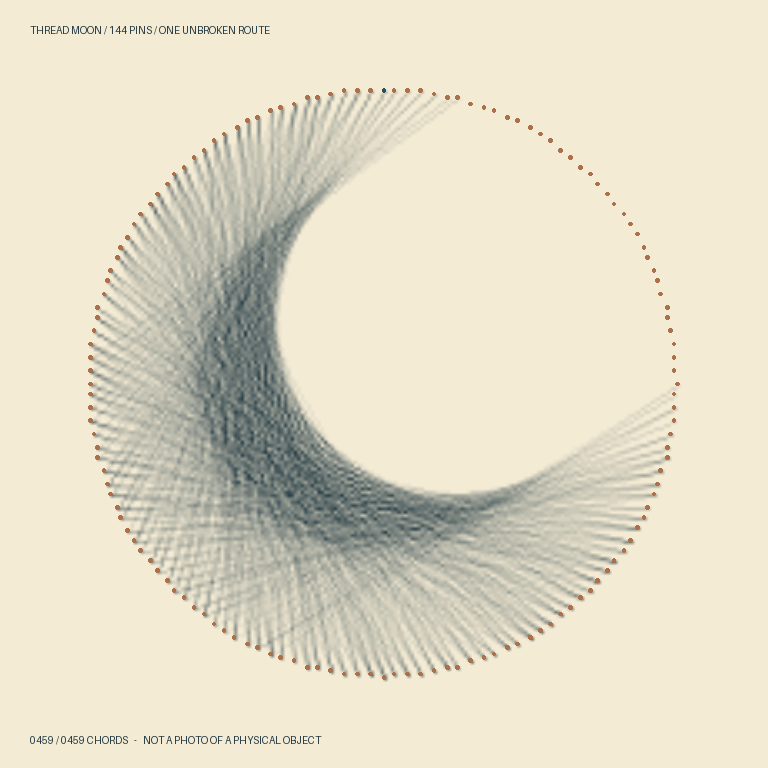

[← Галерея](../README.md) · [Полная луна PNG](../assets/threadmoon/moon.png) · [Цель PNG](../assets/threadmoon/target.png) · [Маршрут CSV](../assets/threadmoon/route.csv) · [Гвоздики A4 PDF](../assets/threadmoon/pins-a4.pdf) · [Локальный счётчик HTML](../assets/threadmoon/counter.html)

# Нитяная луна: изображение как инструкция по изготовлению

18 ноября 2026. После гипертекстового квеста — ещё один тип экспоната: **изображение, для которого можно забрать последовательность физических действий**. Не фотография чужой поделки и не стилизация фильтром: собственный аналитический полумесяц приближён 459 прямыми отрезками одной непрерывной нити между 144 гвоздиками.



## Что исследовано в других GitHub

Это новый тематический обзор **8 README**, а не повторный аудит прежних 102. Два исходных файла дополнительно прочитаны; остальные шесть — README-уровень. Адреса README закреплены на коммитах в [реестре JSON](samples/threadmoon/sources.json). Никакие чужие портреты, код и готовые маршруты сюда не перенесены.

| Репозиторий | Что фактически посмотрено | Вывод для экспоната |
| --- | --- | --- |
| [halfmonty/StringArtGenerator](https://github.com/halfmonty/StringArtGenerator) | README: веб-генератор и показ процесса | Процесс намотки объясняет результат лучше одной финальной картинки |
| [kaspar98/StringArt](https://github.com/kaspar98/StringArt) | README и `generate.py` на закреплённом коммите | В файле считается суммарное улучшение квадратов ошибок для возможных следующих хорд, сохраняется порядок обхода гвоздиков. Уменьшение ошибки стоит проверять численно |
| [birsakm/StringArt](https://github.com/birsakm/StringArt) | README репозитория к статье Eurographics 2018 | У метода есть серьёзный контекст computational fabrication, а не только декоративные фильтры. Статья и роботизированная установка здесь не воспроизводятся |
| [dronperminov/StringArtGenerator](https://github.com/dronperminov/StringArtGenerator) | README и `js/string_art_generator.js` | `GetNextNail` выбирает линию по средней остаточной яркости, `RemoveLine` осветляет остаток; экспорт включает координаты и последовательность. Критерий отличается от суммарного улучшения SSE |
| [grvlbit/stringart](https://github.com/grvlbit/stringart) | README | Авторы явно предупреждают про зависимость стоимости от числа гвоздей, итераций и разрешения. Небольшое фиксированное поле здесь намеренно |
| [virtuallypassedsmartsparrow/StringArt](https://github.com/virtuallypassedsmartsparrow/StringArt) | README: разные MATLAB-скрипты, ч/б маршрут и несколько CMYK-маршрутов | «Одна нить» не стоит обещать для четырёх раздельных цветовых списков. Здесь только один путь |
| [a-m-farahani/StringArt](https://github.com/a-m-farahani/StringArt) | README: круг/прямоугольник, координатный шум против муара | Муару и геометрии гвоздиков нужно уделять внимание; здесь позиции регулярные и явно зафиксированы |
| [neumann-mlucas/StringArt.jl](https://github.com/neumann-mlucas/StringArt.jl) | README, особенно описание dead-end/restart | Документирован переход к другому гвоздику при тупике. Это полезный приём оптимизации, но мы не используем его, чтобы не разорвать физический маршрут |

Глубокие выборки исходников, без зависимости от будущего HEAD:

- [kaspar98 / generate.py](https://github.com/kaspar98/StringArt/blob/99c25ae3e7a9549f4f2ffb8d5926c5f5b86226c2/generate.py) — точный адрес также хранится в JSON.
- [dronperminov / string_art_generator.js](https://github.com/dronperminov/StringArtGenerator/blob/843eae5c0770c2203da53e634bb53ff2a9915242/js/string_art_generator.js) — закреплённый GitHub URL записан в поле `source_url` реестра.

Это описание просмотренных механизмов, не аудит качества/безопасности восьми проектов и не утверждение, что их веб-сервисы сейчас доступны. Их приложения не запускались. Собственный генератор написан отдельно: другой рисунок, параметры, дискретизация, ограничение коротких хорд, остановка и комплект файлов.

## Как вычислен маршрут

1. На окружности находятся 144 гвоздика. `000` сверху; номера растут по часовой стрелке.
2. Цель — разность двух круговых масок на поле 192 × 192, плотность внутри полумесяца 0,78. Это собственная геометрия, не скачанный портрет.
3. Каждая хорда растрируется целочисленным алгоритмом Брезенхема. Её пиксели уникальны; обратное направление даёт тот же набор.
4. Нить прибавляет 0,065 к темноте затронутых пикселей, с насыщением в 1. Рассматриваются только хорды с циклическим расстоянием не менее семи гвоздиков.
5. Из текущего гвоздика выбирается хорда с максимальным **положительным уменьшением суммы квадратов ошибок** по всему полю. При равенстве остаётся меньший номер кандидата. Случайности нет.
6. Конец хорды становится началом следующей. Нет телепортации, разрыва нити или тайного соединительного отрезка.
7. Остановка — когда ни один допустимый ход из текущего гвоздика не уменьшает ошибку, либо достигнут бюджет. Для выпуска сработала первая причина: **459 хорд**.

SSE уменьшилась с **2754,835200 до 945,991025**, примерно на 65,66 %. Это ошибка учебной растровой модели, **не процент сходства человеческого восприятия и не доказательство глобального оптимума**. Полная последовательность SSE и маршрут — в [facts.json](../assets/threadmoon/facts.json).

Каждый кадр GIF заново восстанавливается из соответствующего префикса опубликованного маршрута. Финальный PNG — полный маршрут, без подмешивания целевого полумесяца. Окружность гвоздиков и подписи добавлены отдельно и в SSE не входят. Анимация показывает выборки по ходу процесса, не каждую из 459 хорд как отдельный кадр.

## Что можно сделать руками

1. Забери [шаблон A4](../assets/threadmoon/pins-a4.pdf). Печатай **100 %**, без «подогнать к странице». Измерь контрольный отрезок: он должен быть 50 мм.
2. Окружность гвоздиков — **Ø 160 мм**, шаг вдоль окружности около **3,49 мм**. Это плотная разметка: нужны достаточно тонкие подходящие гвоздики и надёжное основание, не ткань и не обещание пригодности любого обруча.
3. Перенеси центры на основание; обращайся с гвоздями и инструментами безопасно. Держи острые детали вне доступа детей. В настоящем материале намотка здесь не испытывалась.
4. Закрепи тёмную тонкую нить на `000`. В каждой строке [route.csv](../assets/threadmoon/route.csv) указан переход `from_pin → to_pin`; не обрезай между строками.
5. Сумма идеальных прямых хорд — **65,372 м**. Обхваты гвоздиков, высота слоёв, узлы, подход к закреплению и запас в это число **не входят**. Не покупай нить ровно по расчётному числу.
6. Для ручного счёта скачай [counter.html](../assets/threadmoon/counter.html) и открой локально в браузере. Есть «Назад», «Дальше» и ползунок. Сеть не используется; автоматически ничего не проигрывается. Номер шага перед закрытием запиши сам — автосохранения нет.

CSV на GitHub удобен как таблица, но поле с ведущими нулями сторонняя программа может показать числом. `7` и `007` — один гвоздик. Счётчик дополняет номера до трёх знаков.

### Где модель расходится с реальной вещью

Темнота в PNG складывается линейно на грубой сетке. Реальная нить имеет толщину, отражение, просветы и объём; её оптические свойства не откалиброваны. Скруглённые координаты растровой сетки используются для рисунка, точные угловые позиции — для физического PDF и длины идеальных хорд. Локальный HTML показывает схему полупрозрачных линий, **не пиксельную копию численной модели**. Поэтому не обещаем, что изготовленная вещь будет выглядеть в точности как PNG.

Четыре разные поверхности не смешаны:

- README — только PNG/GIF с reduced-motion-постером и ссылки.
- CSV — инструкция по переходам, не приложение.
- PDF — калибруемый шаблон центров, не схема готовых витков.
- Скачанный HTML — локальный счётчик, который **не запускается в Markdown GitHub**. На странице HTML-файла GitHub показывает исходник.

## Повторить

```sh
python3 -m venv .venv
.venv/bin/pip install -r atlas/samples/threadmoon/requirements.txt
.venv/bin/python atlas/samples/threadmoon/generate.py
.venv/bin/python -m unittest discover -s tests -v
```

[Генератор](samples/threadmoon/generate.py) не делает сетевых запросов, не читает фото, не требует токенов и не переписывает README. Параметр `--output /tmp/threadmoon` выпускает все файлы отдельно. Зависимости этого экспоната закреплены; для полного исторического набора тестов нужны и зависимости старых экспонатов.

Дальше этот подход можно применить к собственной эмблеме или иллюстрации алгоритма: посетитель получает не только красивую обложку, но и **исполняемый вручную маршрут изготовления**. Чужой портрет или логотип лучше не брать без проверки прав.

## Проверка выпуска

- **116 unittest-тестов прошли**, без пропусков: в том числе восемь новых проверок непрерывности CSV, каждого уменьшения SSE, честной локальной остановки, физических длин, финального PNG/GIF, A4-разметки, автономного счётчика и побайтной регенерации.
- PNG и отрендеренный PDF просмотрены визуально. Физическая намотка не выполнялась.
- [Дополнительный браузерный тест](samples/threadmoon/check-browser.cjs) выполнен в headless Chromium: «Дальше», «Назад», сброс, ползунок, управление ползунком клавиатурой, изменение canvas и границы маршрута. Ошибок JavaScript и HTTP-запросов не было. Проверялась локальная HTML-страница, не выполнение HTML внутри GitHub.
- Старое содержимое корневого README сохранено побайтно, добавлен только раздел.

Для дополнительного браузерного теста нужны Node, `playwright-core`, `@sparticuz/chromium` и системные библиотеки Chromium; это не зависимости генератора. В изолированном окружении использовались библиотеки из `bin/al2023.tar.br` npm-пакета с `LD_LIBRARY_PATH`, указывающим на распакованный `lib`. Helper отключает sandbox Chromium: запускай его только в изолированном тестовом окружении. Он не нужен для открытия готового счётчика в обычном браузере.
