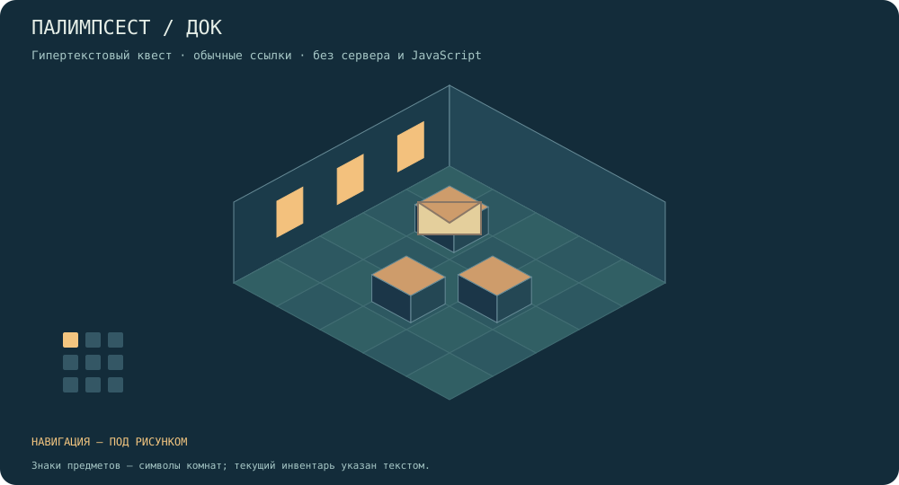

# Док

**Инвентарь: ключ / линза.** Код состояния: `r00-i3`.

Здесь прибывают письма, которых ещё никто не написал. На стене план станции.

| | | |
| :---: | :---: | :---: |
| | Стена | |
| Стена | **Ты здесь** | [Восток: Архив](r01-i3.md) |
| | [Юг: Оранжерея](r03-i3.md) | |

[Начать заново](r00-i0.md) · [Правила](README.md) · [Вернуться в галерею](../../README.md)

Это переходы между готовыми файлами, не серверная игра. Инвентарь хранится в URL страницы; Back откатывает ход. Можно делиться ссылкой на состояние. Секретов и защиты от прямого открытия страниц нет.
