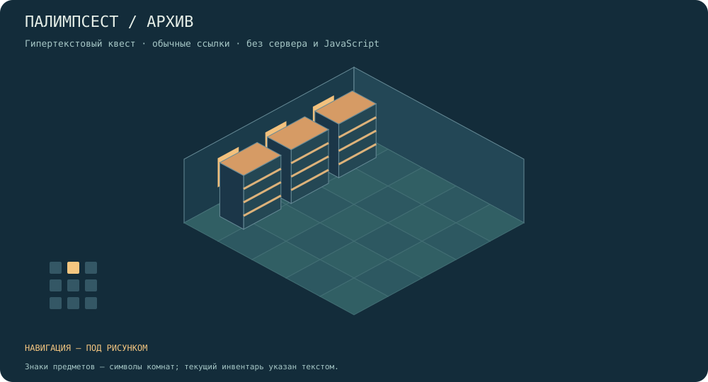

# Архив

**Инвентарь: — / линза.** Код состояния: `r01-i2`.

В ящиках лежат маршруты других путешественников. Южная дверь ведёт в атриум.

| | | |
| :---: | :---: | :---: |
| | Стена | |
| [Запад: Док](r00-i2.md) | **Ты здесь** | Стена |
| | [Юг: Атриум](r04-i2.md) | |

[Начать заново](r00-i0.md) · [Правила](README.md) · [Вернуться в галерею](../../README.md)

Это переходы между готовыми файлами, не серверная игра. Инвентарь хранится в URL страницы; Back откатывает ход. Можно делиться ссылкой на состояние. Секретов и защиты от прямого открытия страниц нет.
