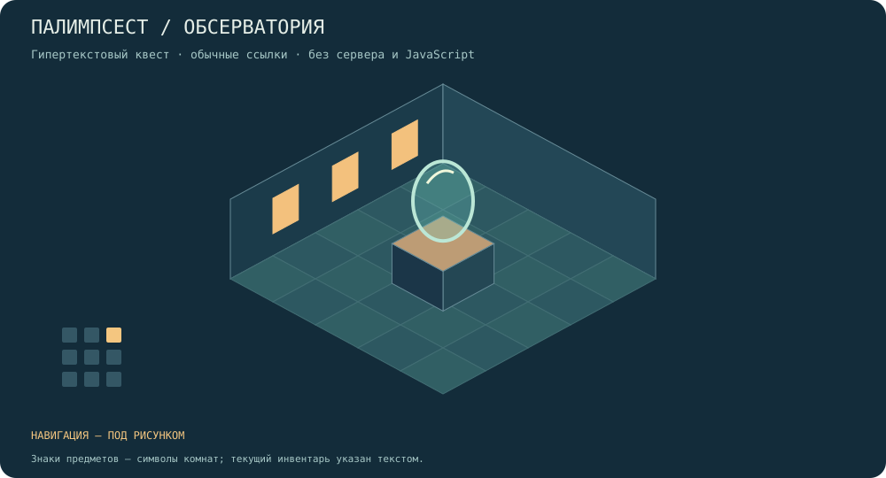

# Обсерватория

**Инвентарь: — / линза.** Код состояния: `r02-i2`.

На подставке сияет линза. Ты берёшь её: без неё луч маяка не собрать.

| | | |
| :---: | :---: | :---: |
| | Стена | |
| Стена | **Ты здесь** | Стена |
| | [Юг: Резонатор](r05-i2.md) | |

[Начать заново](r00-i0.md) · [Правила](README.md) · [Вернуться в галерею](../../README.md)

Это переходы между готовыми файлами, не серверная игра. Инвентарь хранится в URL страницы; Back откатывает ход. Можно делиться ссылкой на состояние. Секретов и защиты от прямого открытия страниц нет.
