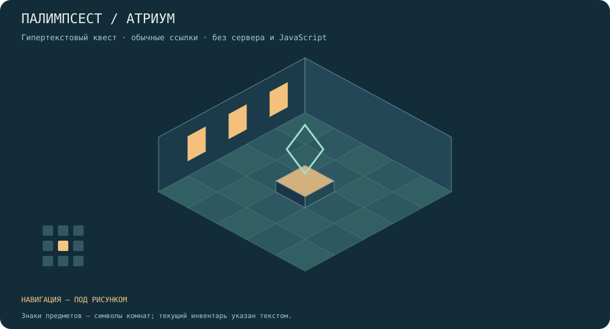

# Атриум

**Инвентарь: ключ / линза.** Код состояния: `r04-i3`.

На полу пересекаются световые дорожки. Отсюда удобно вернуться к архиву.

| | | |
| :---: | :---: | :---: |
| | [Север: Архив](r01-i3.md) | |
| Стена | **Ты здесь** | [Восток: Резонатор](r05-i3.md) |
| | Стена | |

[Начать заново](r00-i0.md) · [Правила](README.md) · [Вернуться в галерею](../../README.md)

Это переходы между готовыми файлами, не серверная игра. Инвентарь хранится в URL страницы; Back откатывает ход. Можно делиться ссылкой на состояние. Секретов и защиты от прямого открытия страниц нет.
