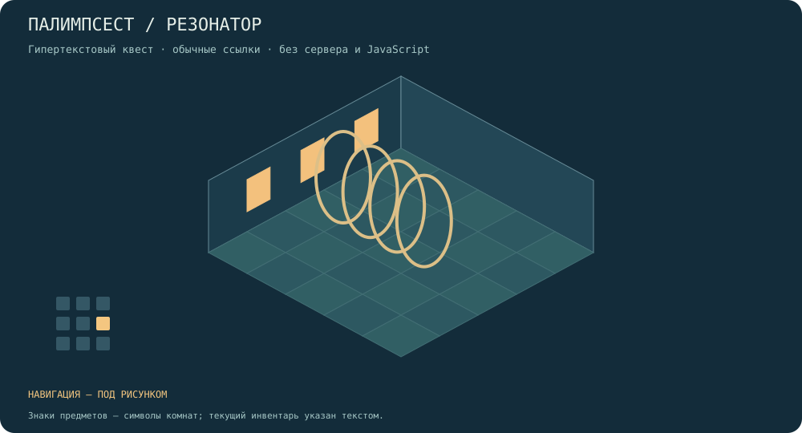

# Резонатор

**Инвентарь: ключ / —.** Код состояния: `r05-i1`.

Пустые кольца отвечают на каждый шаг. На севере обсерватория, на юге маяк.

| | | |
| :---: | :---: | :---: |
| | [Север: Обсерватория](r02-i3.md) | |
| [Запад: Атриум](r04-i1.md) | **Ты здесь** | Стена |
| | [Юг: Маяк](r08-i1.md) | |

[Начать заново](r00-i0.md) · [Правила](README.md) · [Вернуться в галерею](../../README.md)

Это переходы между готовыми файлами, не серверная игра. Инвентарь хранится в URL страницы; Back откатывает ход. Можно делиться ссылкой на состояние. Секретов и защиты от прямого открытия страниц нет.
