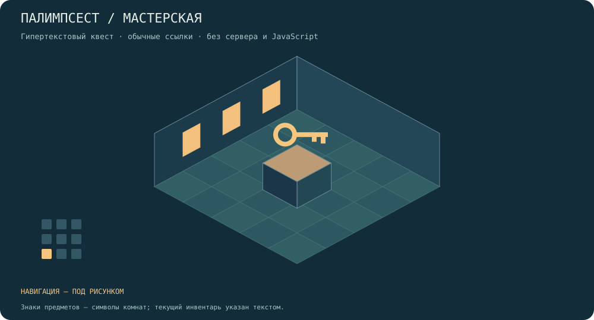

# Мастерская

**Инвентарь: ключ / линза.** Код состояния: `r06-i3`.

На верстаке ждёт латунный ключ. Ты берёшь его: он отпирает корпус маяка.

| | | |
| :---: | :---: | :---: |
| | [Север: Оранжерея](r03-i3.md) | |
| Стена | **Ты здесь** | [Восток: Галерея](r07-i3.md) |
| | Стена | |

[Начать заново](r00-i0.md) · [Правила](README.md) · [Вернуться в галерею](../../README.md)

Это переходы между готовыми файлами, не серверная игра. Инвентарь хранится в URL страницы; Back откатывает ход. Можно делиться ссылкой на состояние. Секретов и защиты от прямого открытия страниц нет.
