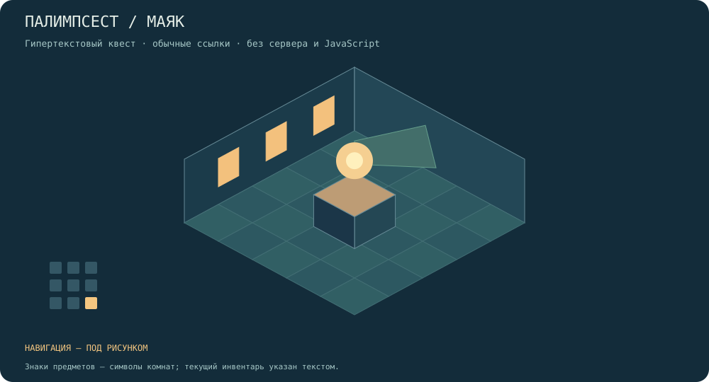

# Маяк

**Инвентарь: ключ / —.** Код состояния: `r08-i1`.

Для запуска нужны латунный ключ и линза. Можно вернуться за недостающим.

Маяк пока закрыт. Не хватает: **линза**.

| | | |
| :---: | :---: | :---: |
| | [Север: Резонатор](r05-i1.md) | |
| [Запад: Галерея](r07-i1.md) | **Ты здесь** | Стена |
| | Стена | |

[Начать заново](r00-i0.md) · [Правила](README.md) · [Вернуться в галерею](../../README.md)

Это переходы между готовыми файлами, не серверная игра. Инвентарь хранится в URL страницы; Back откатывает ход. Можно делиться ссылкой на состояние. Секретов и защиты от прямого открытия страниц нет.
