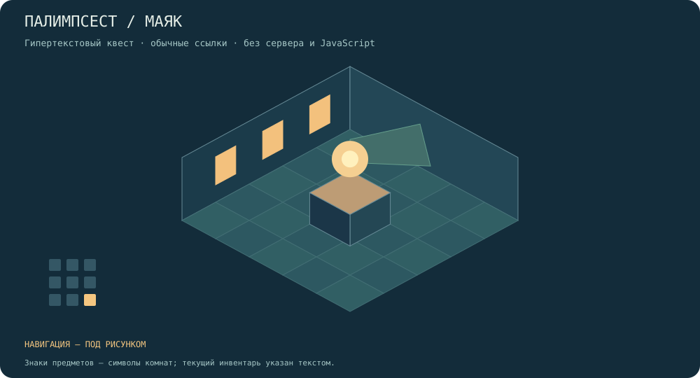

# Маяк зажжён

**Инвентарь: ключ / линза.** Код состояния: `r08-i3`.

Ты открыл корпус ключом, поставил линзу и направил луч к доку. Станция снова принимает письма. **Победа.**

[Начать заново](r00-i0.md) · [Правила](README.md) · [Вернуться в галерею](../../README.md)

Это переходы между готовыми файлами, не серверная игра. Инвентарь хранится в URL страницы; Back откатывает ход. Можно делиться ссылкой на состояние. Секретов и защиты от прямого открытия страниц нет.
