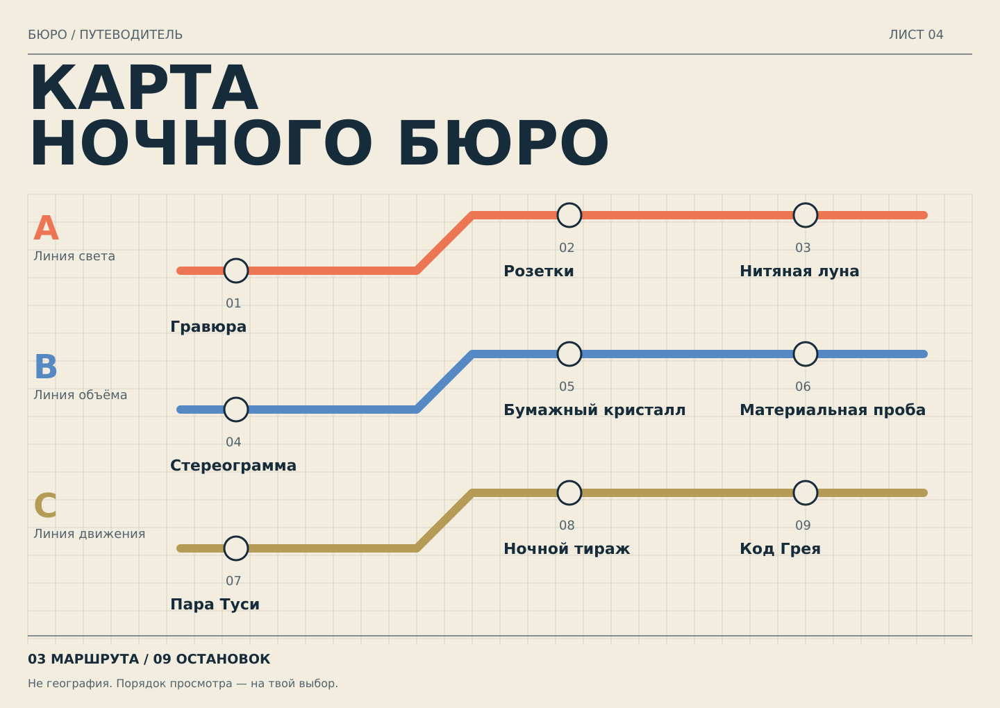

# Карта ночного бюро

[← Галерея](../README.md)



## Не ещё один экспонат, а другой способ смотреть

Плакат-путеводитель объединяет девять существующих работ в три редакторских маршрута. Он не заменяет каталог и не утверждает, что эти связи единственные или математически оптимальные. Все прежние разделы README сохранены.

Вместо карточек — непрерывные линии, станционные кольца, техническая сетка и крупный двухстрочный заголовок. Тёплая бумага и тёмно-синий текст в светлой версии; ночной синий и кремовые надписи в тёмной. Цветные линии намеренно приглушены: для чтения маршрута достаточно букв и номеров.

## Текстовый маршрут

- **A · Линия света:** [01 Гравюра](printroom.md) → [02 Розетки](afterlight.md) → [03 Нитяная луна](threadmoon.md). Разные способы строить рисунок линиями.
- **B · Линия объёма:** [04 Стереограмма](stereogram.md) → [05 Бумажный кристалл](relief.md) → [06 Материальная проба](materials.md). Скрытая глубина, физический сгиб, отрендеренная поверхность.
- **C · Линия движения:** [07 Пара Туси](rolling.md) → [08 Ночной тираж](pressroom.md) → [09 Код Грея](gray.md). Геометрическое движение, совмещение форм, дискретный переход.

Это не карта местности, не транспортная сеть и не оценка времени просмотра. Пересадок нет; любая станция может стать началом.

## Как работает в README

Четыре самостоятельных SVG: настольные 1440×1020 и мобильные 720×1700, каждая пара в светлой и тёмной палитрах. `<picture>` выбирает композицию и тему. На узком экране это не уменьшенная схема: три линии расположены вертикально, подписи остаются крупными. При отсутствии поддержки source остаётся светлая настольная картинка.

SVG подключён как изображение. **Кружки не кликабельны**: GitHub не превращает внутренние SVG-ссылки в надёжную навигацию через img. Настоящие ссылки — обычный Markdown под картой, доступны клавиатурой. Нажатие на всю карту открывает эту страницу. Есть alt, title/desc внутри SVG и полный текстовый маршрут. Текст в изображении может зависеть от установленных шрифтов; это не замена текстовым ссылкам.

Нет скриптов, анимации, внешних изображений, тайлов, шрифтовых загрузок, токенов и запросов к картографическим сервисам. Не используются WebGL, JS-библиотеки и оптимизаторы схем.

## Исследование README

Прочитаны корневые README восьми проектов. Точные commit SHA и постоянные ссылки сохранены в [sources.json](samples/wayfinding/sources.json). Это ограниченный обзор README, **не аудит репозиториев**. Изображения по ссылкам, демо и исходный код не исследовались и не копировались.

| README | Наблюдение и решение для нашей галереи |
|---|---|
| maplibre/maplibre-gl-js | В README есть picture с вариантами логотипа для темы; применён этот нативный механизм выбора, но без картографического runtime. |
| Leaflet/Leaflet | Крупный SVG-логотип и короткая формулировка назначения; карту сопровождает короткая инструкция, а не длинный технический пролог. Интерактивность библиотеки сюда не переносится. |
| d3/d3-geo | GeoJSON и сферические проекции — реальные географические данные; наша схема явно не география. |
| visgl/deck.gl | Данные, слои и views описаны отдельно; у нас отдельно заданы список станций, графическая композиция и адаптивные варианты. GPU-стек не подключён. |
| OpenRailwayMap/OpenRailwayMap | README описывает настоящую железнодорожную инфраструктуру на базе OSM; наши декоративные станции не выдают себя за реальные координаты. |
| juliuste/transit-map | Пары input/output и явные ограничения оптимизатора; у нас честно указана ручная редакторская компоновка, не решение MIP. Изображения примеров не скачивались. |
| gephi/gephi | Описание исследования сетей и интерактивного приложения; здесь только фиксированные маршруты, без заявлений об аналитике графа. |
| cytoscape/cytoscape.js | Различаются модель графа и необязательный renderer; у нас маршруты доступны также отдельно как JSON и обычные ссылки. |

Общая идея схемы метро не означает, что использован чужой дизайн. Линии, сетка, палитры и расположение подписей созданы в этом репозитории; логотипы и чужие карты не включены.

## Воспроизведение и проверка

```sh
python atlas/samples/wayfinding/generate.py
python -m unittest discover -s tests -p test_wayfinding.py -v
```

Генератор использует только стандартную библиотеку Python, README не редактирует. [Маршруты JSON](../assets/wayfinding/routes.json), [SHA-256](../assets/wayfinding/manifest.json), [локальная проверочная страница](../assets/wayfinding/proof.html), [браузерная проверка](samples/wayfinding/check-browser.cjs).

Тесты проверяют девять уникальных локальных назначений, безопасный SVG, тексты и размеры четырёх композиций, контрольные суммы и детерминированную перегенерацию. Браузерная проверка предназначена для Chromium: четыре сочетания ширины/темы, выбор source, загрузка изображения, отсутствие горизонтального переполнения, внешних запросов и JS-ошибок. Локальный proof — не доказательство полного совпадения с оформлением github.com; санитайзер Markdown проверяется отдельно через GitHub API.
