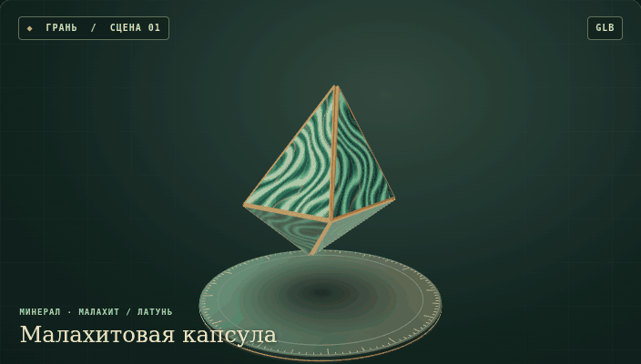

# Грань · кинетический кабинет

**[Открыть капсулу](https://rawcdn.githack.com/overbaffe1/gitEdit/ac0dd93aa7481a0961f366765dec9d1a766b10be/docs/index.html) · [сыграть парусник Кантильона](https://rawcdn.githack.com/overbaffe1/gitEdit/ac0dd93aa7481a0961f366765dec9d1a766b10be/docs/index.html?scene=ship)**

В [основном README](../README.md#покрути-кристалл) — одна кинопетля и стоп-кадр при уменьшении движения. Интерактивная часть — отдельная статическая страница с WebGL 2, не iframe в Markdown. Для работы без сайта скачай [ZIP с одним `crystal.html`](../assets/crystal-view.zip?raw=1). Капсула, проигрыватель и постер уже внутри. Модели пользователя никуда не отправляются.

| Что открыть | Что будет двигаться |
|---|---|
| **Малахитовая капсула** | Восемь створок расходятся по нормалям исходного [STL](../atlas/samples/crystal.stl) и смыкаются через 8 секунд. Внутри — янтарное зерно и две латунные орбиты. [Собранный GLB](../docs/malachite.glb) содержит UV, карты цвета и шероховатости/металличности, гравировку и ключи преобразований узлов. Это **новые** свойства GLB, не данные, вычитанные из STL. |
| **Парусник из MyWorkAiBrain** | Настоящий [ship.glb](https://github.com/overbaffe1/MyWorkAiBrain/blob/4131aaf20ce8aa92066aaab203ee7a465cad6d91/presentations/cantillon/models/glb/ship.glb): 13 материалов, 23 кости, 4-секундный клип. Не перекрашиваем модель и не заменяем скелет вращением камеры. На выбор сцены читаем закреплённый объект через GitHub API. Без сети/при лимите API открой заранее скачанный GLB кнопкой **«Открыть GLB или STL»**. Файл парусника не перепубликуется в этом репозитории. |
| **Свой GLB** | Встроенные материалы, текстуры и доступные клипы; клип выбирается в «Режиссуре». Нужен самостоятельный GLB 2.0 со встроенными буферами/изображениями. Внешние зависимости и модели, требующие декодеров Draco, KTX2 или Meshopt, не поддерживаются. |
| **Свой STL** | ASCII или двоичный STL, ось Z вверх. Обычный STL не хранит UV, текстуры и анимационные клипы. Студия добавляет поворотный стол; кнопка «Текстура для STL» накладывает локальный PNG/JPEG/WebP по плоской проекции каждой грани. Исходный файл не меняется. |

Потяни сцену мышью/пальцем, используй колесо/щипок для масштаба. На фокусированном холсте работают стрелки и `+`/`−`. Перемотка ставит движение на паузу, не сбрасывая камеру. При `prefers-reduced-motion: reduce` студия ждёт нажатия «Пуск». Если WebGL 2 недоступен, остаётся постер.

## Вставка в другой README

Например, для `MyWorkAiBrain` можно использовать этот блок **без копирования движка**. Кадр ведёт к изображённой капсуле, соседняя ссылка сразу запускает парусник. Для форка замени адреса своими.

```html
<p><a href="https://rawcdn.githack.com/overbaffe1/gitEdit/ac0dd93aa7481a0961f366765dec9d1a766b10be/docs/index.html"><picture>
  <source media="(prefers-reduced-motion: reduce)" srcset="https://github.com/overbaffe1/gitEdit/raw/refs/heads/main/docs/poster.jpg">
  
</picture></a></p>
<a href="https://rawcdn.githack.com/overbaffe1/gitEdit/ac0dd93aa7481a0961f366765dec9d1a766b10be/docs/index.html?scene=ship">Парусник Кантильона в 3D →</a>
```

## Пересобрать

`docs/` — весь статический сайт. Публичные ссылки в README используют [RawGitHack](https://github.com/neoascetic/rawgithack): его production-адрес с полным SHA фиксирует версию HTML, CSS, JS и GLB. При первом посещении сервис может показать страницу подтверждения. После обновления студии укажи в ссылках **новый коммит с готовой папкой `docs/`**, а не изменяемую ветку.

Для собственного адреса без CDN владелец может выбрать в [Settings → Pages](https://github.com/overbaffe1/gitEdit/settings/pages) **Deploy from a branch → main → /docs** и после успешной публикации заменить ссылки адресом из настроек. Включать Pages для чтения README или для ZIP не требуется. Для обычного просмотра ничего собирать не надо. Рендерер — [Three.js](https://github.com/mrdoob/three.js), [лицензия MIT](../docs/three-LICENSE.txt). Во время показа движок не загружается с CDN.

Из корня репозитория, с Python 3 + Pillow и Node.js 22+:

```sh
python3 studio/make_crystal.py       # STL → GLB с материалами и клипом
npm ci --prefix studio
npm run build --prefix studio        # JS-бандл и assets/crystal-view.zip
python3 -m http.server 8000 --directory docs
```

Чтобы переснять кинопетлю с той же сцены, в другом терминале укажи установленный Chromium. Скрипт двигает штатную шкалу времени на паузе, поэтому кадры не зависят от скорости видеокарты. Для отдельной CI-песочницы есть флаг `CI_CHROME=1` (software GL, без sandbox); на обычном компьютере он не нужен.

```sh
CHROME_BIN=/path/to/chromium node studio/capture.mjs http://localhost:8000 /tmp/facet-frames
python3 studio/film.py /tmp/facet-frames       # GIF: 100 × 80 мс + JPEG-стоп-кадр
python3 studio/pack.py                        # обновить стоп-кадр и в автономной копии
python3 -m unittest discover -s tests -v
```

Проверка в настоящем браузере: `CHROME_BIN=/path/to/chromium node studio/check.mjs http://localhost:8000`. Добавь `--ship`, чтобы дополнительно проверить скелетный клип из публичного GitHub API. Без этого флага проверка использует только локальные модели.
