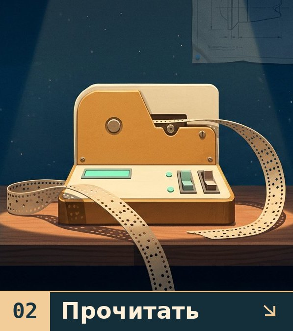
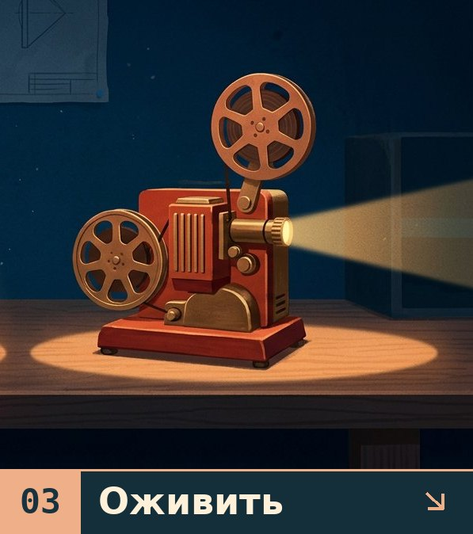
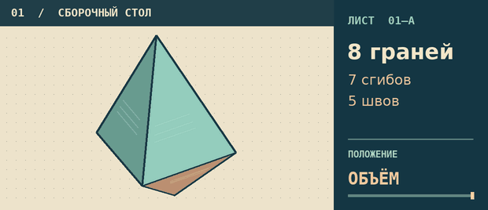
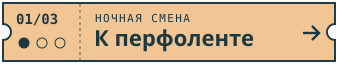
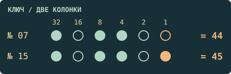
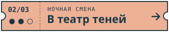
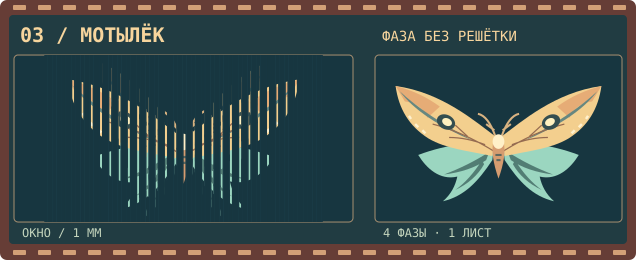
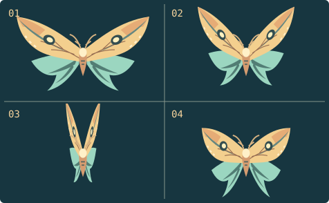
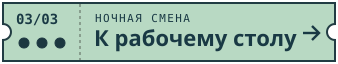

<!-- Шаблон работает и здесь, в templates/. Если переносишь в корень своего репозитория, скопируй assets/night-shift/ и замени ../assets/ на assets/. Для новой работы меняй заголовок и все ссылки на его якорь вместе. -->
# Ночная смена

Три работы одной мастерской: форма, данные и движение. Выбери предмет на столе.

[01 · Форма](#бумажный-кристалл) · [02 · Данные](#перфолента) · [03 · Движение](#театр-теней)

## Бумажный кристалл

<!-- Покажи предмет и одно конструктивное решение, а не перечень инструментов. -->
Восемь граней складываются из одного листа. Пять разрезов дают развернуть поверхность, не отделяя ни одной детали.

<picture>
  <source media="(prefers-reduced-motion: reduce)" srcset="../assets/night-shift/fold-still.png">
  
</picture>

Увидеть выкройку

## Перфолента

<!-- Дай читателю прочитать один результат из настоящего набора данных. -->
Один столбец — неделя работы LazyGit. Сложи веса пробитых отверстий. На сколько коммитов различаются две выделенные недели?

<picture>
  <source media="(max-width: 600px)" srcset="../assets/night-shift/weeks-tape-compact.svg">
  
</picture>

Свериться с ключом

## Театр теней

<!-- Движение не должно быть единственным способом понять работу. -->
Под решёткой один неподвижный лист. Каждая прорезь открывает свою фазу взмаха крыльев.

<picture>
  <source media="(max-width: 600px) and (prefers-reduced-motion: no-preference)" srcset="../assets/night-shift/moth-projector-compact.svg">
  <source media="(max-width: 600px)" srcset="../assets/night-shift/moth-still-compact.svg">
  <source media="(prefers-reduced-motion: no-preference)" srcset="../assets/night-shift/moth-projector.svg">
  
</picture>

Рассмотреть четыре фазы без движения

