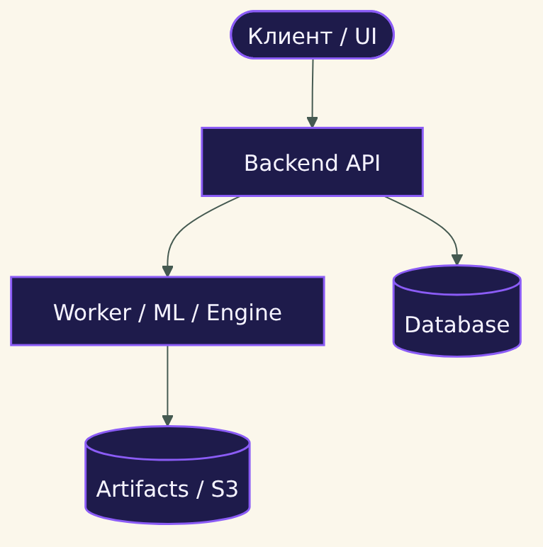

<!-- Для своего проекта замени ссылки Demo и Issues. Скопируй PNG схемы и её .mmd; поправь оба пути относительно своего README. -->
<div align="center">


[](https://example.com)
[](../assets/mermaid/project-architecture.png)
[](https://github.com/overbaffe1/gitEdit/issues)


<br>


</div>

---

## О проекте

<!-- Если есть гифка демо, раскомментируй строку ниже для красивого обтекания справа: -->
<!--  -->

**Project Name** — краткое и ёмкое объяснение (2–3 предложения), какую реальную задачу решает проект, чем он выделяется технически и почему его стоит пощупать.

### Ключевые фичи
* **Фича 1** — конкретная польза или инженерная деталь (метрики, скорость, точность).
* **Фича 2** — что работает под капотом (асинхронность, 3D-рендер, кэширование).
* **Фича 3** — удобство запуска одной командой без ручной рутины.

<!-- <br clear="right"/> -->

---

## Архитектура

<p><a href="../assets/mermaid/project-architecture.png"></a></p>

[Редактируемый исходник схемы](../atlas/samples/project-architecture.mmd)

---

## Быстрый старт

```bash
# 1. Клонировать репозиторий
git clone https://github.com/overbaffe1/REPO_NAME.git
cd REPO_NAME

# 2. Запустить окружение
docker compose up --build -d
```

> [!TIP]
> Для локальной разработки без Docker скопируй `.env.example` в `.env` и запусти `make dev` (остановка — <kbd>Ctrl</kbd> + <kbd>C</kbd>).

---

## Структура проекта

```text
REPO_NAME/
├── src/                # Основной исходный код и бизнес-логика
├── tests/              # Автотесты и фикстуры
├── docs/               # Скриншоты, схемы и дополнительная документация
└── docker-compose.yml  # Конфигурация контейнеров
```

<details>
<summary><b>Переменные окружения (<code>.env</code>)</b></summary>
<br>

| Переменная | По умолчанию | Описание |
|---|---|---|
| `APP_PORT` | `8000` | Порт HTTP-сервера |
| `DATABASE_URL` | `postgresql://...` | Строка подключения к БД |

</details>

---

## Лицензия

Распространяется под лицензией **MIT**.

<div align="center">
  
</div>
